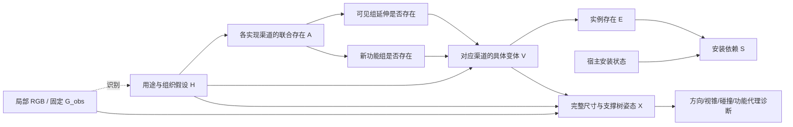

# v6 实证诊断与 v7：观测锚点延伸、新功能组及关系约束

2026-10-26 实证补充：真实 v7 已完成；最新分析和冻结/验证决策见 [V7_FREEZE_AND_VALIDATION_20261026.md](V7_FREEZE_AND_VALIDATION_20261026.md)。下文为 v7 实现前的 v6 诊断及设计依据，其中“v7 尚未运行”仅指当时状态。

2026-10-25。真实结果：`outputs/activation_completion_20261025_202940_1307023`；比较对象为 `modular_completion_20261025_162311_4103717`。两轮使用相同 RGB、固定 G_obs、seed=3407、K=4，API 为硅基流动 `deepseek-ai/DeepSeek-V4.1-Flash`。

**数量下降真实存在，主要发生在库存分布阶段，不能直接判为质量下降。v7 不把物体数调回二十多件；它修复可见区域延伸被粗粒度门控、识别/干预域混用，以及明确发现的空间求解缺陷。真实 v7 语义模型尚未运行。**

## 1. 先核对实际输出

| 分支 | 结构采样新增记录数 | 完成数值导出 | 诊断候选 | 期望新增记录 |
|---|---|---:|---:|---:|
| end_to_end / Qwen | 14、11、12、11 | 2/4 | 2 | 12.9913 |
| end_to_end / API | 14、9、15、12 | 4/4 | 0 | 12.7331 |
| layout_control / Qwen | 14、9、12、4 | 4/4 | 0 | 13.1950 |
| layout_control / API | 14、9、12、4 | 4/4 | 0 | 13.1950 |
| function_free / Qwen | 15、14、13、10 | 2/4 | 2 | 12.9913 |
| function_free / API | 14、14、12、12 | 3/4 | 0 | 12.7331 |

API 消融第 2 个布局因 `SSLEOFError` 失败，不能算语义或几何推理错误。没有自动重发该付费请求。本地 12 次布局都形成了有效数值回复，4 次后来被方向关系阻断；旧的 null 失败本轮未重现，但库存复杂度也变了，不能将差异完全归因于接口修复。

两个 layout_control 的结构样本相同。四件物体样本来自 `H=h7`、A=`10100`，即 background+social；对应 pooled 原始选择次数为 4，条件概率约 0.4479，并非编译器强行删减或只能由平滑产生。它还选中了较小的社交变体。

## 2. 为什么从约 21 件变成约 13 件

每个角色的期望贡献可精确拆成：

\[
E[N_r]=P(A_r=1)\,E[N_r\mid A_r=1].
\]

API 的角色贡献变化如下：

| 角色 | v5 存在率 | v6 存在率 | v5 期望记录 | v6 期望记录 |
|---|---:|---:|---:|---:|
| reading | 0.975 | 0.8925 | 5.250 | 5.672 |
| social | 0.950 | 0.8950 | 6.500 | 3.594 |
| storage | 0.960 | 0.3350 | 2.100 | 1.005 |
| work | 0.900 | 0.1350 | 7.200 | 0.617 |
| background | 无独立角色 | 0.8400 | 0 | 1.846 |

总期望为 21.05→12.7331。最大的减少是办公贡献 −6.583，其次社交 −2.906；阅读贡献反而略升。这解释了数量下降，也说明“这一版整体更保守”并不精确。

对共同角色用对称代数分解：

\[
\Delta E[N_r]=\underbrace{(p_1-p_0)(\bar n_0+\bar n_1)/2}_{存在率变化}
+\underbrace{(\bar n_1-\bar n_0)(p_0+p_1)/2}_{条件装配大小变化}.
\]

API 办公下降中，约 −4.808 来自存在率变化，−1.775 来自装配大小变化。这里比较的是两个不同候选域和机制的数值分解，不是识别出的因果效应。没有隐藏真值支持把办公区存在率强行恢复到 90%。计数单位也是对象记录，例如一摞书可能是一条，不能直接等同逐本标注数量。

本地仍主要使用 API 候选：v6 本地期望中约 12.774 条来自 API、0.2173 条来自本地；API 路径对应约 12.4858 和 0.2473。共同域适合比较机制/布局，但不能称作本地模型自主补全能力的证明。

## 3. 这轮真正需要修复的根因

### 3.1 “额外功能区”与“可见组的隐藏延伸”混在同一门控里

原 A_r 表示另外存在一个该角色装配；域中的候选却同时包括新办公区、阅读椅组合、给已有沙发服务的边桌与杯子。后者并不需要另一个独立功能区。一个二元角色门控承载了不同存在事件。

同一角色又只能选一套变体，因此“可见阅读区域的额外物品”与“另一个阅读角”被当成互斥替代。不能靠把 A_r 调大解决这一语义混淆。

v7 让每个功能有两个可共存的实现渠道：`observed_extension` 和 `new_group`。提案必须显式声明类型；前者必须声明真实观测 ID，并通过关系或安装连接到这些锚点。不会按物体名或 surrounding/belongings 请求名偷偷分类。

### 3.2 识别候选域混入了为干预额外加入的 H

v6 为匹配干预加入单功能及完整功能组合，随后把全部 16 个 H 都交给识别。原始提案的功能组合加不确定状态只有 5 个。

本地 4 次识别全部选择了额外加入的诊断 H（h4 三次、h14 一次）；API 有一次选择诊断 H（h3）。这些 H 并非被证明错误，但诊断设计改变了识别菜单和先验，不能当作新增图像证据。

v7 分开两个域：识别只在原始提案组合与不确定状态上估计 q(H)；匹配诊断 H 保留为结构方程支持的干预值，在观测分布中的概率质量为零。单独估计这些 H 下的机制用于模型内 `do(H)`，不冒充从观测识别的真实效应。

### 3.3 明确方向关系只有软惩罚

旧求解器把远近/左右顺序作为 0.25 权重软目标，同时惩罚偏离初始坐标。数值收敛仍可能违反明确顺序，最后才被检查阻断。v6 的四个本地诊断候选均为 camera-Z 顺序不满足，不是碰撞或 null。

v7 将明确 X/Z 顺序加入线性约束，和完整视锥外、支撑投影一起求解。原始 region 是模型的可修正数值猜测，不是已测墙界；允许比较其他隐藏方向，最终仍严格保持原视锥外。

### 3.4 功能归属不应该强制共用一个空间方向

例如 a11 的阅读椅和墙画属于同一功能装配，却分别关联落地灯和已见相框。旧编译器要求整个几何组共享同一视野外方向，可能把墙画强制留在相机后方，距目标相框数米。

v7 保留语义分组，数值求解按支撑树选择方向：桌子及其杯子一起运输，独立墙画可在另一侧。锚点关系只指导方向候选的初始化和优化，不是恢复了真实墙面。

### 3.5 近邻目标及搜索路径没有被充分执行

原 near 只弱吸引中心；初始坐标与消碰撞容易压过它。v7 优先最小化声明近邻的 AABB 表面间隔平方，再在该水平附近最小化位移；不编造统一的“near 必须小于 X 米”。碰撞与明确顺序仍优先。

另外，若原布局远但无碰撞，靠近锚点后的中间候选暂时有碰撞，旧搜索会丢掉这条路径。新版允许更近的候选继续消碰撞，避免卡在“远但不重叠”的初值。搜索仍有预算，不声称全局最优。

### 3.6 本地提案失败不应取消后续全部计划查询

本轮本地保存了 3 个有效程序、6 个对象记录，随后因 `category=lighting` 违反具体名词要求而提前停止。v7 在固定预算内继续其余已计划查询，每项仍只修复一次，完整记录失败。

提案 prompt 不再同时展示 coarse 类别表诱导填入 lighting；`category` 明确为 table lamp 等具体名词，数据集标签由后续程序赋予。最终仍使用原 37 类对象词表与表外着色。

## 4. 重新联网调研后采用的原则

| 工作与核对入口 | 本轮借鉴 | 边界 |
|---|---|---|
| [S-AOG](https://arxiv.org/html/1808.08473) | 结构产生、功能分组与支撑/组间关系应分开；Set 结构不能简化成每功能一套必然共存物体 | 原方法从数据学习分布；语法/MRF 边不能自动称真实因果边 |
| [HSG](https://siyuanhuang.com/files/eccv2018parsing.pdf)、[官方 inference.py](https://github.com/thusiyuan/holistic_scene_parsing/blob/master/inference.py) | 将几何关系真正用于联合求解与检验 | 其投影深度/法向/分割似然当前没有复现，图外无直接像素验证 |
| [SD-SCM](https://arxiv.org/html/2411.08019)、[官方 sdscm.py](https://github.com/lbynum/sequence-driven-scms/blob/main/sdscm.py) | 父变量受限机制、数值概率采样、替换机制的模型内干预 | 原文也说明非平凡依赖与措辞稳定性不自动保证；使用生成频率，不将最后位置 token 分数误认为完整序列似然 |
| [FactoredScenes](https://arxiv.org/html/2510.10292v1) | 保留场景程序/库存与条件几何分解 | 原方法学习程序库，本轮未声称已学得等价先验 |
| [Example-based Synthesis of 3D Object Arrangements](https://graphics.stanford.edu/projects/scenesynth/) | 围绕已有对象构造局部场景邻域，区分对象出现与支撑层级 | 数据驱动贝叶斯模型不等于单张图无监督识别真实原因 |
| [OpenFunGraph](https://arxiv.org/html/2503.19199)、[作者项目](https://openfungraph.github.io/) | 功能关系与普通空间关系不同，应显式表达关联对象及交互角色 | 输入为带位姿 RGB-D 序列，不能直接把其多视图结果当作单 RGB 的能力 |
| [ReSpace](https://respace.mnbucher.com/) | 显式结构状态与可执行位置修改；框级指标有局限 | 有训练、房间边界及网格指标；本轮仍是框级几何 |
| [FuncRoom-Agent](https://arxiv.org/html/2608.29519) | 明确区分功能 ownership、执行依赖、空间 reference 和真实 support，支持本次按支撑树求解 | 文本功能房间任务、专门训练；不能复制其明确功能需求为住户生活史 |
| [ScenePilot](https://arxiv.org/html/2608.30307) | 锚点中心的组先验及增量关系修复 | 本轮核对论文；项目页访问未成功，未声称已运行其未核验实现或学习其数据先验 |

这些工作支持显式可执行结构与学习/验证机制，并不支持靠对象更多或解释更长证明因果推理成功。

## 5. 修改后的条件 SCM

O、D 固定，H 为不含生活史/对象清单的空间组织与用途假设。渠道 s=(功能 r，实现类型 t)，其中 t 为可见组延伸或新组；两者不互斥。



O→q(H) 表示推断过程，不能解释为图像造成房间用途。当前是固定有限域 D 下的假设条件 SCM，不是从单图识别出的完整图像形成模型。

库存分解为：

\[
q(H\mid O,D)\,p(A_{channels}\mid H,D)
\prod_s p(V_s\mid H,A_s,D)
\prod_i\mathbf1[E_i=f_i(V)]\,
\mathbf1[S_i=E_i\land S_{host(i)}].
\]

根节点的安装依赖为 S_i=E_i。移除一件宿主仍不抹掉已拥有子物体；只令安装依赖失效。关闭新组渠道不会强制关闭可见组延伸渠道。

实例存在概率直接控制逆 CDF 采样：

\[
P(E_i=1)=\sum_hq(h)P(A_{s(i)}=1\mid h)P(V_{s(i)}=v(i)\mid h,A_{s(i)}=1).
\]

联合激活机制读取 H、固定观测身份、各渠道的规范含义、去重对象名集合与观测锚点 ID；不会仅看 reading/work 这种抽象标签，也不读取候选数量、照片、识别投票或之前回答。变体机制在渠道激活后选择完整变体。单一合法变体是确定性条件分布，不浪费模型调用，不伪造有效采样次数。

## 6. 紧凑联合分布没有偷偷提高存在概率

实现渠道增加后不展开指数大小的 mask 表，而使用与 v6 平滑**严格等价**的表示：

\[
p(a\mid h)=\frac{n_{h,a}}{K_h+\alpha}
+\frac{\alpha}{K_h+\alpha}\prod_s\operatorname{Bernoulli}(a_s;1/2).
\]

代码中的 J 只是“经验模式/产品先验”混合的数值分解，不解释为生活历史或真实隐藏物理原因。给定经验分量，各 A_s 是对应位；先验分量下各位独立取 1/2。这样可以精确计算对象、类别和数量概率，同时避免 2^渠道数 的表。

仍是总 α=1 的未校准预测分布。每渠道 1/2 的平滑先验是公开假设；扩展候选支持后，数量可能变化，不能归功于推理增益。新增 `expected_hidden_from_activation_smoothing` 与先验混合质量，帮助区分平滑贡献和原始机制选择。不会为了变多调 α、设最低数、丢弃空样本或重采直到成功。

function_free 消融保留联合激活分布与各装配/实例边缘概率，移除库存机制中的 H 边；几何仍条件于 H，因此不是“去掉全部功能”。`do(H)`、关闭渠道、移除宿主保持原噪声进行模型内干预，不能宣称现实效应已识别。

## 7. 几何修复已经如何验证

工作区 `research/audits/realization_v7_20261025/` 保存真实 v6 审计和原库存 CPU 重放，最终入口见该目录 `index.html`。每个对比都保持全部实例、完整 AABB 尺寸和 G_obs；没有调用模型/API，也没有重选库存。

重放与真实 v7 生成必须分别看：重放能验证几何算法修复是否有效，无法证明新的渠道机制能生成更正确的隐藏库存。没有像素外真值，也不能把零框重叠当成真实稳定性、人体可达性或墙面恢复。

最终固定库存重放（`result_004`）共 23 个有数值输入的世界：原框级契约通过 19/23，重放后 23/23；原 4 个顺序失败全部修复，残留非许可 AABB 重叠均为 0。每世界“最大声明 near 表面间隔”的中位数由 6.418m 降到 1.882m，最坏值由 8.371m 降到 3.081m。所有实例、尺寸和观测均保持；仍未证明每个 near 都符合实际功能，也未宣称搜索全局最优。

交付校验：158 项 CPU 回归通过（含 12 项 v7 新测试），510 个本地引用无缺失，3869 份原实验 JSON 哈希保持。真实输入完成 CPU 预检查及 prepare-only 验证；没有运行真实 v7 模型、提交 GPU 或调用付费 API。详见审计入口的 `VALIDATION.json` 和 `tests.log`。

若只挑成功导出的世界评价，分布还会受到布局成功率选择偏差影响；因此原始库存、数值失败和诊断候选全部计入分母，导出的 presence probability 是几何筛选前的生成概率。

## 8. 执行指令

只运行 CPU 测试：

```bash
cd /data-nfs/gpu1-2/u13529658780/DIT360
bash qwen_edit_pano/scripts/realization_completion.sh test
```

正式本地/API 对照，使用你终端已有的 `SILICONFLOW_API_KEY`；GPU3 替换为可用节点：

```bash
export CAUPANO_WORLDS=4
export CAUPANO_MECHANISM_DRAWS=4
export CAUPANO_BASELINE_ROOT=qwen_edit_pano/outputs/activation_completion_20261025_202940_1307023
bash qwen_edit_pano/scripts/realization_completion.sh compare GPU3 \
  qwen_edit_pano/outputs/activation_completion_20261025_202940_1307023/end_to_end 3407
```

固定 API：`deepseek-ai/DeepSeek-V4.1-Flash`；base=`https://api.siliconflow.cn/v1`。同公开采样参数、同观测板、同提示、K、修复政策；API 内部 seed 与视觉编码不能证明相同。两路共用候选域，仍不能称本地自主完整能力。

仅复用旧观测，提案/概率/布局全新生成。输出 `outputs/realization_completion_<时间>_<PID>/index.html`，自动包含 v7 本地/API、同库存布局对照、库存 H 边消融及旧 v6 端到端对比。`call_budget.json` 记录实际计划调用，单变体条件不会发请求。模板和字段增加可能仍有模型接口失败，原始回复和失败都保留。

需要单独重建可视化时：

```bash
CUDA_VISIBLE_DEVICES= OMP_NUM_THREADS=1 OPENBLAS_NUM_THREADS=1 MKL_NUM_THREADS=1 \
MPLCONFIGDIR=/tmp/caupano_review_mpl \
/data-nfs/gpu1-2/u13529658780/.conda/envs/qwen3vl/bin/python \
  -m qwen_edit_pano.world_pipeline.completion.assembly_activation_visual \
  --root qwen_edit_pano/outputs/realization_completion_实际目录 \
  --baseline-root qwen_edit_pano/outputs/activation_completion_20261025_202940_1307023
```

继续保留绑定官方映射的 MP 37 类对象词表：蓝色观测、橙色原始类别表内、紫色原始名表外但可映射、红色未解析。所有物体保留，表格同时列原始名和实际数据集标签。3D、XZ、ERP 为状态可视化，尚未连接 World Adapter 生成 RGB 全景。

## 9. 下一阶段应怎样证明研究目标

当前最明确的根因仍包括缺少跨场景学习与校准。有限域概率由 LM 生成频率决定，画出图不会让这些频率自动成为真实世界机制。若真实 v7 仍呈现扁平/极端存在概率，应优先检查域覆盖、语义定义、措辞偏差和数据校准，不继续凭这张图改权重。

按物理场景划分训练/验证/测试，训练阶段用完整全景或 3D 标注形成局部观测—隐藏库存对，区分已有组延伸和新增功能组，包含真实不存在及共存样例。测试阶段只使用局部 RGB。评估候选覆盖、类别存在 Brier/NLL、计数分布、尺寸位置、关系、框级约束和人工功能合理性；对 H 干预既检查模型内敏感性，也检查跨场景补全增益。

两个渠道也不是无限完整世界：当前每个渠道最多选一个变体，组内对象仍按声明共存。真实可重复功能组、更细粒度可选物品、可达性、真实支撑面、房间范围及渲染似然仍需数据与实现支持；不能为了填满镜头外任意添加。

主要代码：`assembly_realization.py`、`assembly_realization_experiment.py`、`assembly_realization_geometry.py`；保留 v6 入口供历史研究复核。更新只影响新建实验，旧输出不改写。
