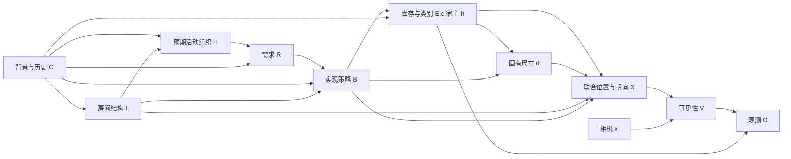

# 局部观测下的因果机制场景补全：独立审查、相关工作与执行方案

日期：2026-10-24，Asia/Shanghai。本文区分源码事实、文献结论和本项目的新假设。已阅读交接文档、当前活跃源码、两组最新原始输出和部分数据清单，并联网核对下列论文/官方材料。没有运行真实 GPU/API 补全、训练或 Adapter 实验。

## 1. 核心判断

你的方向值得研究，但应把命题改得更精确：**从局部证据反推可能的场景形成原因，再由这些假设机制预测未观测世界，并检验这种结构是否改善分布外补全与干预一致性。** 单张图本身不能证明家具为什么存在，也不能唯一决定镜头外的真值。

这里最需要避免的错误是把预测目标从 `P(隐藏世界 | 观测)` 偷换成 `P(隐藏对象 | do(已见对象))`。看到床以后应推断哪些房间/生活组织更可能；并不需要假设“把床搬进房间会立即产生衣柜”。共现也不是应当全部消除的坏信息：它可能正是共同场景用途的证据。

建议的研究主张是“**用途与实现机制约束的概率场景补全**”。在没有额外识别条件之前，称为带因果假设的生成模型。不要声称从单张 RGB 发现了真实因果图，也不要把结构化提示、拓扑排序、碰撞检查直接称为因果推理有效。

当前最值得检验的机制不是更多物体之间的箭头，而是：

1. 同一用途可以由不同对象组合实现，不存在“阅读就必须加书桌”的硬规则。
2. 已观测库存可能已经满足需求，无需再生成同类对象。
3. 同一实例可以服务多个需求，避免按每个功能区机械复制桌子、遥控器等。
4. 物品还来自储存、装饰、历史积累和闲置；不能把完整生活世界压缩成最小功能配置。
5. 物体存在、安装依赖、位置/朝向和实际活动可行性是不同变量。

## 2. 对当前项目的独立审查

### 2.1 已由源码和原始产物确认

入口为 `scripts/assembly_compare.sh → assembly_experiment.py → assembly_world.py`。默认分支仍是 `assembly_delta.py`，本次新增分支必须显式选择。`G_obs` 来自可见 2D 检测与 WildDet3D，当前固定它是隔离补全误差的合理实验选择，但不能把其度量值当成无误差的真实场景。

当前几何后端要求新增完整 AABB 位于原始输入视锥外；尚不处理“进入视锥、但被真实形状完全遮挡”的新实例。本文完整模型中的可见性机制是后续研究目标，不能说当前 pilot 已实现全部遮挡推断。

默认语义机制是 `Z → F → E_i → S_i ← S_host`：

- `F` 已经包含完整对象清单；`E_i` 基本是选中了哪个 F 的确定性指示变量。
- `S_i` 检查声明的宿主依赖，不检查真实表面、承重或落体动力学。
- Z/F 的均匀参考选择没有图像似然；它没有实现校准的照片后验。
- `assembly_pose.fit()` 在几何优化之后拟合参数，能回放不等于能解释场景形成，更不能证明其因果方向由数据识别。

任意有限候选集都能写成“先选候选，再展开对象”的图。因此**存在一个可执行 SCM 并不足以构成研究贡献**；关键是机制限制了什么、改变了什么分布，以及泛化/反事实结果是否符合独立证据。

### 2.2 最新两个实验确实存在的问题

| 输出目录末尾 | API 新增实例数 | Qwen |
|---|---:|---|
| `210523_172787` | 10 / 10 / 8 | `wall_hooks_001.affordances=["hang"]` 解析失败 |
| `211032_189937` | 13 / 10 / 9 | 同一原始及 repair 回复问题 |

本次给 affordances 添加精确别名 `hang → hanging`，在解析后记录 `interface_normalizations`；原始回复文件不改动。附件方式 `attachment.kind=hang` 继续保留其原语义。这个改动解决接口阻塞，不作为因果方法改进。

API 的零残留 AABB 交叠也不能说明功能可行。源码中 `layout_proxy_passed` 会把 wall/ceiling/seat/shelf/hang 等未验证安装记为 unresolved；例如无已知墙面时，墙挂电视即使不碰撞仍需审核。`near` 没有定义硬距离阈值，关系审核返回 `null`；这表示未完成度量判断，不能解释为“靠近已验证”。本次没有为了提高通过率取消这些标记。

交接文档称固定观测组三个 API 世界全是 `layout_needs_review`，但直接读取 `211032.../api/completion/world_02/numeric_review.json`，其 `layout_proxy_passed=true`，其余两个为 false。不同层级摘要需要分别读，不能仅复述交接文本。

### 2.3 数据量需要重新理解

实际读取三个 GT manifest 的记录统计如下，完整结果在 `../research/audits/causal_completion_research_2026-10-24/data_inventory.json`：

| 清单 | 记录数 | 不同 scene_id 数 | ready_for_training=true |
|---|---:|---:|---:|
| gt_world_pilot_v1 | 11 | 6 | 0 |
| gt_world_expanded_v1 | 31 | 1 | 0 |
| gt_world_supplement_v1 | 1483 | 20 | 0 |

这些统计只反映上述清单，不代表仓库全部数据。1483 个视角/记录不是 1483 个独立房间；上述 ready 标记也不等价于“所有几何都有错”。它说明不能未经审核便宣称已有足够的高质量训练标签。训练/验证应按建筑或房间划分，再生成局部视角，防止同一房间的另一个方向泄漏。

`1.py` 引用 Windows 的 `D:\proiects\CauPano` 和未附带的 `panogen_ft` 包，不是本服务器上可直接验证的当前实现，也不能凭模块名推断已经实现因果机制。

## 3. 文献调研：哪些能借鉴，哪些不能直接套用

下表为定向覆盖，不声称穷尽所有论文。较老的基础工作与截至当前日期可检索的新工作一起纳入。论文摘要/作者页面只能支持其明确写出的任务与方法；关键争议部分另外核对原文或代码。没有复现下表系统，不能把作者报告性能当成本项目的实测结果。

### 3.1 功能、活动与场景形成

| 工作及一手材料 | 可借鉴的部分 | 与本任务的差异 |
|---|---|---|
| [Human-Centric Indoor Scene Synthesis Using Stochastic Grammar，CVPR 2018](https://openaccess.thecvf.com/content_cvpr_2018/papers/Qi_Human-Centric_Indoor_Scene_CVPR_2018_paper.pdf)，[官方代码](https://github.com/SiyuanQi-zz/human-centric-scene-synthesis) | S-AOG 将功能组合、支持关系、对象属性与人类使用上下文结合；通过学习分布和 MCMC 采样 | 是功能性概率生成的强依据；MRF/语法边不自动等于可识别因果边 |
| [Holistic 3D Scene Parsing and Reconstruction from a Single RGB Image，ECCV 2018](https://openaccess.thecvf.com/content_ECCV_2018/html/Siyuan_Huang_Monocular_Scene_Parsing_ECCV_2018_paper.html) | 隐含人类上下文、几何/物理约束，analysis-by-synthesis 联合推断 | 主要评估单图场景解析/重建，不能直接替代整个背后世界分布的评估 |
| [Pose2Room，ECCV 2022](https://yinyunie.github.io/pose2room-page/)，[代码](https://github.com/yinyunie/Pose2Room) | 从活动轨迹推断类别与 OBB，并生成多个合理布局 | 其输入是真实人体轨迹；本项目从静态图像猜活动，证据明显更弱 |
| [PlanIT，SIGGRAPH 2019](https://kwang-ether.github.io/pdf/planit.pdf)，[代码](https://github.com/brownvc/planit) | 先生成/补全关系图，再用空间先验实例化 | 两阶段关系图生成不等于因果推理；仍应是强结构基线 |
| [BEHAVIOR-1K](https://arxiv.org/abs/2403.09227)，[BDDL 官方说明](https://github.com/StanfordVL/BEHAVIOR-1K/blob/main/bddl3/README.md) | 以对象、初始状态与目标谓词表达活动；可以借鉴需求及状态定义 | 任务给定时的活动执行与未知用途反推不同；不能将某个任务的对象表变成必加类别表 |
| [VirtualHome，2018](https://arxiv.org/abs/1806.07011) | 家庭活动程序提供操作序列与对象使用层面的建模思路 | 是活动模拟，不提供单图房间形成原因的识别保证 |

### 3.2 局部场景补全、离散语义与连续几何

| 工作及一手材料 | 借鉴点 | 局限/实验定位 |
|---|---|---|
| [ATISS，NeurIPS 2021](https://research.nvidia.com/labs/toronto-ai/ATISS/) | 对无序部分对象集建模，预测类别、尺寸、位置、朝向，支持 room completion | 作为学习式布局/补全基线；它并未显式建模历史用途因果机制 |
| [DiffuScene，CVPR 2024](https://openaccess.thecvf.com/content/CVPR2024/html/Tang_DiffuScene_Denoising_Diffusion_Models_for_Generative_Indoor_Scene_Synthesis_CVPR_2024_paper.html)，[补全实现](https://github.com/tangjiapeng/DiffuScene/blob/master/scene_synthesis/networks/diffusion_ddpm.py) | 无序集合联合生成多种实例属性；有保留 partial_boxes 的补全路径 | 已有数据训练出的生成先验；当前项目没有加载其权重，不能只借用名词声称复现 |
| [MiDiffusion](https://arxiv.org/abs/2405.21066) | 混合离散类别与连续几何扩散，支持预置对象和 masking/corruption 补全 | 需要其训练数据/空间条件；“无需任务特定训练”不等于整个模型无需训练 |
| [InstructScene，ICLR 2024](https://arxiv.org/abs/2402.04717)，[官方代码](https://github.com/chenguolin/InstructScene) | 语义图先验与布局解码器分工，可以对应本项目的语义机制和几何模块 | 图是统计语义表示；不能把显式图本身当成因果贡献 |
| [SceneNAT，2026 预印本](https://arxiv.org/abs/2601.07218) | 实例级/属性级 masking 和并行集合生成；可作后续效率与补全基线线索 | 官方 arXiv 当前标注 under review；不写成已确认顶会结论 |
| [SceneComplete](https://arxiv.org/abs/2410.23643)，[作者页面](https://scenecomplete.github.io/) | 对象完整几何和下游抓取验证 | 单张 RGB-D 的完整对象重建，尤其 clutter/manipulation；不同于局部 RGB 推断镜头外整个房间 |
| [InSpace，2026](https://arxiv.org/abs/2607.03990) | ERP-FRONT 及结构/资产分解，可能服务未来世界到全景/3D链路 | 输入已是 360° ERP，不能作为具有同样观测量的单局部图补全对照 |

### 3.3 VLM 空间生成与可执行验证

| 工作及一手材料 | 借鉴点 | 应避免的误读 |
|---|---|---|
| [Holodeck，CVPR 2024](https://arxiv.org/abs/2312.09067) | 语言知识提出对象与空间约束，数值方法负责布局 | 房间设计任务不同；不能复制其数量偏好或跳过失败物体的策略来美化补全结果 |
| [Holodeck 2.0，2025/2026 更新](https://arxiv.org/abs/2508.05899) | 视觉语言约束、对象资产生成与交互编辑 | 文本/图像引导的场景创作，不直接证明照片隐藏真值或因果识别 |
| [LayoutVLM，CVPR 2025](https://arxiv.org/html/2412.02193v3) | 数值初始化、可微关系约束、面对/对齐的朝向定义 | 原文有 finetuning 部分，不能统称免训练。`point_towards` 比相机 Z 排序更适合“电视朝向沙发” |
| [SceneReVis，2026](https://arxiv.org/abs/2602.09432) | 视觉诊断与修改循环、SceneChain-12k、SFT 后接强化学习 | 多步轨迹/自反思的收益应与因果机制收益分开；不是零训练的简单后处理 |
| [SceneTeract，2026](https://arxiv.org/abs/2603.29798)，[实现细节原文](https://arxiv.org/html/2603.29798v1) | 将活动拆为动作，检查可达、通行、净空、可见性等；很适合作为功能评估方向 | 需要场景几何和 agent 条件；仅凭当前 AABB 不能声称完成同等物理验证 |

### 3.4 名称带“因果”的工作，需要分别审核

**FairScene 至少对应两篇不同工作。** [Learning Unbiased Object Interactions for Indoor Scene Synthesis](https://harollluo.github.io/data/FairScene.pdf)研究室内对象交互中的类别长尾与上下文混杂，使用默认特征的预测差及上下文重加权。它可以启发分布偏置消融，但其目标、因果图和假设不等于本项目的用途反推。另一篇 [Learning Class-Disentangled 2D/3D Representations for Semantic Scene Completion，WACV 2026](https://openaccess.thecvf.com/content/WACV2026/papers/Jia_FairScene_Learning_Class-Disentangled_2D3D_Representations_for_Semantic_Scene_Completion_WACV_2026_paper.pdf) 是语义场景补全中的类别表征问题。后者全文本次抓取返回 403，仅依据检索到的论文摘要/摘录做名称与任务区分，不评价其未读的具体算法。

尤其不能直接把 FairScene 的后门调整搬来：卧室用途可能是床和衣柜的共同原因，对“看到床后预测衣柜”很有用；把它无条件调整掉可能恰好丢失需要的信息。先明确估计对象究竟是观察条件分布还是干预分布，再讨论去偏。

**[CausalStruct / Causal Reasoning Elicits Controllable 3D Scene Generation](https://arxiv.org/html/2509.15249v1)** 提供对象依赖、放置顺序、渲染评价和位置/尺寸反馈的思路。不过原文式 (6) 将多个干预条件下的概率直接对 r、s 求和；若对每个 r 的 s 分布各自归一化，总和会成为候选干预数，不能直接作为归一化概率。其所谓 intervention 部分还包含 MLLM 对候选渲染的判断。因此这里借鉴可执行依赖和空间反馈，不照搬该概率公式，也不把反复询问 LLM 当成现实因果效应的观测证据。这是本次对原文的独立分析。

**[CausalScene 作者页面](https://cstvlm.github.io/)** 描述 RGB-D 场景图、物理先验和反事实问答，与隐藏对象生成不是同一任务。该页本次提供的 Code 链接实际跳到 GitHub 首页，OpenReview PDF 又触发浏览器验证；没有完整核实其代码与数值。因此不引用其性能作为本项目方法依据，也不因网页把 co-occurrence 列为某种 causal edge 就接受“共现等于因果”。

**[Language Models as Causal Effect Generators / SD-SCM，EMNLP 2025](https://aclanthology.org/2025.emnlp-main.107/)，[官方代码](https://github.com/lbynum/sequence-driven-scms/blob/main/sdscm.py)** 的重要价值是“用户指定结构，LM 定义机制，外部执行采样/干预”。但图的真实有效性依赖假设；LM 不能替代场景因果识别。其候选得分与概率实现也不同于本项目的均匀参考选择。

反事实的语义基准采用 [Pearl：Structural Counterfactuals](https://onlinelibrary.wiley.com/doi/10.1111/cogs.12065)：先依据事实更新外生变量，再替换干预方程，最后预测。**仅固定随机种子然后改提示词，不自动完成事实条件下的 abduction。** [Multi-View Causal Representation Learning with Partial Observability，ICLR 2024](https://proceedings.iclr.cc/paper_files/paper/2024/hash/956e5427549a82a7472e02adc88360e9-Abstract-Conference.html) 提供附加多视图假设下的可识别性结果，不能据此宣称本项目的单图设置已经满足条件。

## 4. 推荐的完整研究模型

下面是本项目的设计建议，不是已有论文定理，也不是本次已经全部实现的系统。

### 4.1 生成方向与推断方向分开

令完整世界 `W={E_i,c_i,d_i,p_i,yaw_i,h_i}`；`h_i` 是宿主/安装地址。引入：

- C：建筑环境、资源、风格、生活习惯和历史积累的联合背景变量。
- L：房间包络、墙/门/窗等结构；未观测部分是随机假设。
- H：历史上预期支持的活动组织，不等于拍照时正在发生的活动。
- R：这些用途/储物/背景来源提出的资源需求。
- B：实现需求的对象组合与共享方式，允许互为替代。
- V：给定相机 κ 后，各对象的可见/被遮挡状态。
- O：检测器实际输出的观测摘要，包含类别、框和不确定度。



推断时信息方向反过来：`RGB/O → 对 C,L,H,R,B 的多个解释 → W_hidden`。这不是把 RGB 画成家具形成的物理原因。若额外建模像素，应加入 appearance、照明和 renderer；当前只有框的模型不应直接宣称定义了真实 RGB likelihood。

### 4.2 一组逻辑一致的结构方程

采用联合背景根变量吸收相关偏好/资源，不武断假设这些背景因素相互独立。给定该假设后可以写：

```text
(C,L,H) = f_context(U_context)           # 或继续展开已知的历史生成顺序
R       = f_need(C,L,H,U_R)
B       = f_realization(R,C,L,U_B)
(E,c,h) = f_inventory(B,C,U_E)
log d_i = f_size(c_i, role_i(B), C, U_di)
X       = f_layout(E,c,d,h,B,L,U_X)      # 联合布局变量，不强迫所有空间边组成 DAG
V       = f_visibility(W,κ)
O       = f_observer(W,V,U_O)
```

重要限制：`f_inventory` 允许背景物品，不是“需求→唯一必需家具”；尺寸在类别之外还依赖对象角色与资源背景。尺寸和位置也应有分布，不能把 VLM 提出的单个数值当成测量真值。

对于有已知宿主的对象，可以在几何机制内部使用：

```text
p_child = p_host + R_y(yaw_host) * δ_child
y_child = y_host + (sy_host + sy_child)/2      # 水平顶部支撑的近似
```

它们是明确的装配/支撑假设。层板、挂载、斜面需要各自的机制；AABB 本身并不提供实际表面。自由家具之间的碰撞、通路与朝向应由联合 `f_layout` 处理，不把优化梯度称为因果边。若沿用优化器，必须记录投影/优化如何改变了原来的采样分布。

已存在房间对用途有约束，家具又会影响今天能完成什么活动。因此实际活动可行性应另定义 `F_task=f_task(W,agent)` 作为世界的后果与验证目标。不要同时把同一个“活动”变量放在家具的原因与后果位置而形成未经解释的循环。

### 4.3 真正需要的逆向推断

如果只把 O 当成证据摘要，理想目标是：

```text
pθ,η(W_hidden,Z | O,κ) ∝ pθ(W_full,Z) · pη(O | W_full,κ)
Z = (C,L,H,R,B)
```

如果 O 由同一张 RGB 计算出来，不能把“RGB 似然”和“与 RGB 条件独立的 O 似然”直接相乘；会重复计算证据。要么定义完整观测链路，要么明确采用 O 的摘要近似。

观测机制至少需要回答：物体是否进入视野、是否被遮挡、可见时检测到的概率、类别与位置误差。**没检测到不等于不存在**；未进入画面的对象尤其不能按 absence evidence 处理。单目米制尺度还依赖学习先验/相机假设，应在结论中保留这一条件。

目前冻结 `G_obs` 可以作为工作条件 `W_observed≡G_obs`，只生成增量；这是实验约定，不是已估出真实后验。新分支依然使用这个约定。

VLM 可以作为候选提议器 `qφ(Z,W_hidden|RGB,G_obs)`。只有能计算目标密度与提议概率时，才有严格的重要性权重 `pθ·pη/qφ`。对黑盒 API 没有这些量时，不能把自评分、LLM 重复投票率或几何代价直接命名为 Bayes posterior。可以定义有限候选 energy ranking，但要公开其形式、独立校准，并承认它是指定的评分模型。

## 5. 本次已实现的可执行 pilot

### 5.1 它实际改变了生成机制

新增 `world_pipeline/completion/assembly_needs.py`，结构为：

```text
Z → R_k → B_k → E_i → S_i ← S_host
E_i = OR_k[选定的 B_k 实现策略使用同一精确实例 i]
```

每个场景假设有一个共享对象目录，需求各有 1..3 个互斥的联合实现策略。每个策略必须完整声明它依赖的新宿主；已见对象只能通过 ID 引用。一个对象可以同时出现在两个策略中，但只实例化一次。可以有 `object_keys=[]` 的实现，也可以有 background/storage/architecture 来源。没有对象下限和必加类别。

**当前 R 在给定 Z 下是确定性的开关，B 使用均匀参考采样。** 因此本次没有学习需求概率，也没有实现照片对需求的数值后验；它检验的是“显式、共享实例的组合机制”是否有用。不同需求在给定 Z 后按独立 B 采样；强耦合选择需要放进同一个联合策略。提示词提出跨组合一致性要求，程序检查身份和宿主闭合，但不会因此认证所有组合的生活语义都合理。

位置、尺寸与朝向仍由同一 `assembly_parametric` 后端给出；选中需求的描述也进入该后端上下文。它尚未成为学习式 `f_size/f_layout`。`pose_model.json` 继续是拟合后的回放机制，不能据此升级为已识别位置因果律。

需求分支使用 **IID ancestral sampling，保留重复世界**，避免去重后还声称输出是原分布样本。老 joint 分支依然采用独特库存候选策略，两者的 distinct-world 数与实际语义样本数都记录在对比页；比较时不能忽略这个差别。

### 5.2 可执行的因果查询及其范围

- `do(R_reading=0)`：重新执行形成/组织机制，移除只由该需求生成的实例；其他需求共享的桌子或储存物仍可保留。这是一个假设的组织生成干预，不是现实中“今天不阅读，家具立即消失”。
- `do(E_table=0)`：不删除已经拥有的灯/书，而将其宿主安装依赖标为未满足。它不模拟物体落地后的运动。
- `semantic_posterior(model,evidence)`：在有限机制内做严格的语义条件化；只枚举 Z/B，再派生确定性的 R/E/S，避免枚举全部确定性对象节点的指数状态空间。
- `abduct_semantics(model,evidence)`：从语义后验抽取事实状态，再采样各节点 CDF 区间中的噪声；能够精确回放，再做同噪声干预。该反事实耦合是本模型采用的 inverse-CDF 假设，不是从图像识别的真实个体噪声。

后两项中的 evidence 是 **对该有限模型变量的外部语义断言**，并非将观测家具与隐藏候选自动匹配后的视觉证据。它们不应被包装成已经实现 RGB abduction。正常补全主流程仍是 VLM 提议假设域后参考采样。

### 5.3 三个可比较分支

| 参数 | 内容 | 能回答什么 |
|---|---|---|
| `baseline` | 普通联合补全提示，输出兼容已有增量协议 | 直接提示式 pipeline 的表现 |
| `joint` | 现有 Z→完整 F 联合清单 | 中间场景描述/联合程序的表现 |
| `needs` | 需求→互斥实现→共享实例的可执行机制 | 新的组合结构是否改善补全 |

三组复用同一份每后端的 G_obs、同一 RGB、同一模型服务、随机种子、修复策略、最多 24 个候选新实例的容量和几何编译器。新 needs 目录容量是不同策略共享的总目录容量，与 joint 每个完整方案最多 24 件的限制并不完全同构；比较时应同时记录输出 token、调用次数、目录大小和采样实例数。

这首先是**整条 pipeline 对照**。提示词、内部表示、候选组合空间及去重策略仍有差异，不能仅凭 needs 优于 baseline 就断言已经隔离了因果机制的净收益。API 对 Qwen 的差异也不能代替同模型消融。

## 6. 用户可直接执行的命令

CPU 测试和两个环境的预检由本次执行并记录；不需要安装新依赖。下列命令从工作区运行。

```bash
cd /data-nfs/gpu1-2/u13529658780/DIT360
bash qwen_edit_pano/scripts/causal_completion_pilot.sh test
bash qwen_edit_pano/scripts/causal_completion_pilot.sh preflight
```

先在同一张已完成观测的图上做三方法小实验。`GPU3` 改为可用节点，Qwen 单后端不需要 API key：

```bash
bash qwen_edit_pano/scripts/causal_completion_pilot.sh compare GPU3 \
  /data-nfs/gpu1-2/u13529658780/DIT360/qwen_edit_pano/outputs/assembly_rgb_compare_20261024_211032_189937 \
  qwen 3407
```

若先测 API，把后端改为 api；节点参数此时不用于 GPU 提交：

```bash
if [[ -z "${SILICONFLOW_API_KEY:-}" ]]; then
  read -rsp 'SiliconFlow API Key: ' SILICONFLOW_API_KEY
fi
export SILICONFLOW_API_KEY

bash qwen_edit_pano/scripts/causal_completion_pilot.sh compare GPU3 \
  /data-nfs/gpu1-2/u13529658780/DIT360/qwen_edit_pano/outputs/assembly_rgb_compare_20261024_211032_189937 \
  api 3407
```

选择 `both` 会对两个后端分别执行三组真实推理。原实验不覆盖；脚本打印新 `causal_completion_pilot_.../index.html`。每个方法下面仍有各自的 `world_XX/world/scene_3d.html`、`layout_xz.png`、`erp_state_map.png`、`G_full.json` 和原始调用记录。失败与重复样本保留。这里生成的是世界状态与框可视化，不是 RGB ERP。

只有单张烟测通过后再扩展随机种子，例如：

```bash
for cc_seed in 3407 3408 3409; do
  bash qwen_edit_pano/scripts/causal_completion_pilot.sh compare GPU3 \
    /data-nfs/gpu1-2/u13529658780/DIT360/qwen_edit_pano/outputs/assembly_rgb_compare_20261024_211032_189937 \
    qwen "$cc_seed"
done
```

这只是同图随机性试验，不能替代多场景验证。已有不同输入图的观测实验可以分别作为 SOURCE_ROOT；不要把同一房间不同 crop 当成独立测试房间。

若只是复测原流程的 hang 接口修复：

```bash
bash qwen_edit_pano/scripts/assembly_compare.sh retry2 GPU3 \
  /data-nfs/gpu1-2/u13529658780/DIT360/qwen_edit_pano/outputs/assembly_rgb_compare_20261024_210523_172787 \
  /data-nfs/gpu1-2/u13529658780/DIT360/qwen_edit_pano/outputs/assembly_rgb_compare_20261024_211032_189937
```

默认仍运行 joint。也可通过 `CAUPANO_COMPLETION_MODEL=needs` 使用既有入口；模型选项写进新实验配置，后续世界生成不能临时换方法。

## 7. 接下来的优化顺序与可否证实验

### 第一阶段：验证是否值得继续该机制

先用固定观测做 6–12 张不同房间的小试，至少包含“同样有床但不同用途组织”“有书但不需要独立书桌”“可见家具已满足需求”“生活物品丰富”“视野内宿主不适合视野外新增”的例子。保留全部失败，不手工只挑最好候选。

对每个结果先盲审物体世界，而不是读解释文本判断因果推理是否精彩。记录：

- 观测身份/几何是否保持；新增是否重述可见实例。
- 物体选择、数量分布、周围区域的组织是否合理，是否机械复制小物品。
- 类别、位置、尺寸、宿主和朝向能否共同构成一个完整世界。
- 三种方法的错误率、语义样本多样性、调用数、token 与计算成本。
- 各候选的明确假设是什么；同一输入是否容纳多个合理解释。

覆盖后方不是强制往每个方向塞物体。没有房间边界时，合理覆盖也不意味着离相机越来越远便更好。数量增加或通过 AABB 代理检查不作为成功判据。

如果 needs 反复产生模板式需求、把一切归为阅读/储物，或冻结 8B 无法稳定输出共享实例机制，那么应简化/训练语义模型，不能继续靠新增检查器声称方法更强。

### 第二阶段：把因果假设与预测结构分开检验

需要同一候选目录下的消融，例如保持每个对象条件边缘存在率 `p(E_i|Z)` 不变，去掉需求实现引入的联合依赖：

```text
p_ind(E|Z) = ∏_i p_full(E_i|Z)
```

它保持期望对象数，但可能破坏宿主闭合和组合一致性。这些失败应计入分母，或在两边使用同样的宿主条件机制后重新计算边缘；不能只给一边自动补宿主或删掉子物体。空间约束与语义文本也必须固定，否则收益仍可能来自布局后端差异。该严格消融本次没有伪装成已经实现的代码。

还需要“给同样需求描述但不执行依赖方程”的对照，区分更多提示信息与可执行结构的作用。仅仅重新命名潜变量或多写一段因果解释而保持生成分布不变，理论上不应产生因果机制收益。

对假设机制测试同时看两类结果：

1. **内部执行正确性**：干预目标被固定，非后代不受影响，共享实例保持，宿主移除只使安装依赖失效。本次 CPU 测试覆盖了这些。
2. **外部机制有效性**：在有独立标注或模拟干预的场景里，变化是否与真实/指定的生成过程一致。单张静态照片不能完成这个验证。

建立成对的场景组织干预数据时，变的是“重新形成这个房间时的需求/资源配置”，不是同一张照片的真实历史。对于移动宿主后物体是否掉落，则另用物理仿真与形状进行验证。这两类问题不能混为一项反事实分数。

### 第三阶段：学习概率与连续机制

这是完整模型超出本次 pilot 的主要工作，建议优先于训练更复杂的 Adapter：

1. 审核已有完整世界标签，按建筑划分；从完整场景渲染/裁剪局部观测，保留检测错误、遮挡和可见性，不将随机删对象当成唯一局部观测分布。
2. 在训练房间中标注/审核用途、替代实现和共享角色。VLM 可给伪标签，但它们是先验标注而非因果真值；保留未知和多解。
3. 学习 `pθ(W,Z)` 的组合与度量机制；学习从局部证据得到多模态 Z 分布的推断网络。全景/完整世界可在训练提供监督，在测试禁止进入推断输入。
4. 用类与角色条件的 log-size 分布、宿主相对位置分布代替单次数值猜测。保留 joint continuous decoder 处理空间耦合，不能把每个对象 xyz 独立回归后当成世界一致性。
5. 在验证集上估计可见时的检测召回、类混淆和框误差，形成可审核的观测机制；否则先报告条件生成结果，不报告视觉后验概率。

训练时可以先在完整世界上用变分目标学习隐变量生成模型：

```text
log pθ(W) ≥ E_qψ(Z|W)[log pθ(W,Z) - log qψ(Z|W)]
```

这只是生成建模的标准目标，不带来因果可识别性保证。局部图像推断器还需要用模拟观测训练并保留多种可能解释；不能把完整房间教师给出的单一潜标签强制当成局部图像的唯一答案。相应的 set matching、尺寸、相对位姿、观测保持和干预配对损失应分别报告，不用单一 xyz MSE 掩盖类别/实例不确定性。

额外训练数据可考虑 [3D-FRONT](https://openaccess.thecvf.com/content/ICCV2021/html/Fu_3D-FRONT_3D_Furnished_Rooms_With_layOuts_and_semaNTics_ICCV_2021_paper.html) 的完整布局和功能角色，配合真实室内数据做分布检验。但专业设计场景与真实生活小物品存在域差异；不能假设它完整覆盖闲置物品、杂物和所有遮挡关系。

### 第四阶段：建立符合“合理世界”的评价

真实隐藏布局只有一个样本，合理候选并不需要与它逐实例完全相同。应同时报告：

- 与真实 hidden GT 的类别/count、匹配后的中心/尺寸、完整世界统计距离；固定 K，避免多抽样天然占优。
- 与观测的相容性、物体级功能与空间关系、人类盲评合理性。
- 多样性与校准：存在率 Brier/NLL 或 coverage 需要实际概率及独立验证，不能由三个候选的自评得出。
- 独立的功能测试，例如“能坐下阅读/打开储物柜/走到门边”；在当前只有 AABB 的阶段只能做明确注明近似的净空/通路代理。
- 机制扰动的局部性、替代实现与资源共享一致性，以及成对干预数据上的正确性。

单独的 best-of-K 匹配、CLIP 分数、零碰撞率或 VLM 自评都不足以覆盖这些目标。

等上述差异稳定出现，再把世界接入 Adapter，比较正确世界、同分布打乱世界、普通补全世界、无世界。这样才能区分世界推断收益、Adapter 是否使用世界以及全景图像模型的能力。

## 8. 实现与证据位置

- `world_pipeline/completion/assembly_needs.py`：共享实例、需求实现、有限语义条件化和噪声反推。
- `assembly_baseline.py`：普通联合补全提示基线。
- `assembly_pilot.py` 与 `scripts/causal_completion_pilot.sh`：固定观测三方法实验准备、执行与并排报告。
- `test_assembly_needs.py`：机制语义、真实失败回复、观测冻结及实际框导出测试。
- `../research/audits/causal_completion_research_2026-10-24/`：测试/预检日志、数据统计、合成演示及验证记录。

这次完成的是可审查的研究方案和能接现有流程的 pilot，而不是证明因果方法已经提升真实补全质量。真实生成与训练留给你执行；后续应以这些实验的失败模式决定是否继续该模型。
