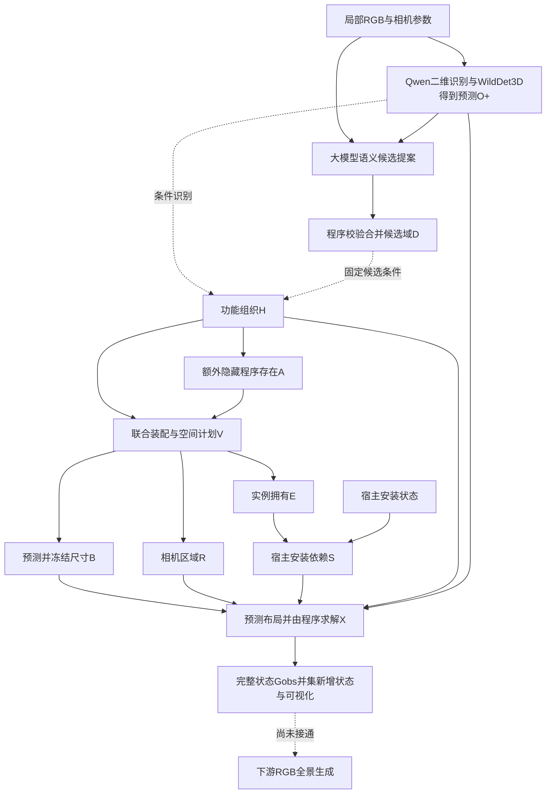

# 对上传流程图的核对

对象：`360°全景场景因果推理流程图-1.png`。原图保持不变。以下针对**当前实际代码**，不把图中示意概率当作真实实验。

总体上，图里的“观测与候选 → 功能组织H → 隐藏程序存在A → 装配与方位 → 实例、依赖、几何 → 状态”主线正确，可以作为研究概念图。若用于汇报已实现的方法，需要作如下修正。

## 1. 第一步需要把观测提取单独写清楚

图中直接输入“局部RGB和已观测物体”，省略了已观测物体怎样获得。当前是 `Qwen可见实例/2D框 → WildDet3D预测3D框 → 固定O+`。它们是模型预测，不是已知真值。

随后由两路大模型提出完整装配候选，**程序**校验、合并并形成该图共同域D。不要把全部校验也写成大模型完成。D是可选支持域，不是最终必须生成的对象清单。

## 2. H的方向和含义基本正确，但当前实现没有任意功能组合家族

H可表达不确定的世界功能组织，允许多种活动共存，不包含住户具体生活历史。图中“按概率采样，不一定取最高”也与实现一致。

但图中“实际由候选菜单确定，可以包含多种用途及其组合”比当前实现更宽。现有 `organization_profiles` 根据D中的角色构造“混合、不强调某功能”加“逐个角色得到强调”，不是枚举所有任意组合。本次厨房为6个H，不是固定四类，也不是所有活动组合。

最新主流程的H识别及存在/变体机制使用固定预测观测的**文字结构**和候选域条件，不在这些短机制请求中再次附原图。照片在观察与语义提案阶段使用。若图表达实际接口，应改为“由固定预测观测O+和候选域D推断H”；O+→H是推断方向，不是照片造成世界。

## 3. 存在A的示意基本合理，需要补上概率来源

A_r是“额外隐藏库存是否拥有这一功能角色的一套程序”，不是再次判断房间用途，更不是删除/增加可见观测。多个角色可共存，也允许全缺席。这部分图示正确。

当前概率不是LM直接报告的小数。每一父条件下K=4次别名/顺序编码的短选择，程序计数并平滑：

```text
p(A_r=1 | h,O+,D) = (n_present + 0.5) / (K_valid + 1)
```

图中的0.70可以由3/4存在票得到；其它如0.40、0.25、0.08是通用概念示例，不能标为当前默认K4行的实际估计（本轮K4全部有效时，只可能为0.1/0.3/0.5/0.7/0.9）。建议图注统一注明“概念概率示例，非实验估计”，或直接换成实际保存概率。

H和装配概率同样由响应计数平滑得到；小样本、编码与语言模型先验使这些分布未经真实世界校准。应画一个“LM选择 → 程序计票/平滑 → CPT → 程序采样”的小框。

## 4. 具体装配V与相机方位R不能被误读成两次独立抽样

当前代码联合选择“完整程序＋该程序各功能组的相机空间计划”。也就是代码中的M_r/V_r状态包含具体装配及区域，再确定性展开R_g。

因此示意图第4步建议改为：

```text
选择联合候选 (完整装配V_r, 空间计划R_r)
p(V_r,R_r | A_r=1,h,O+,D)
```

图里的装配概率条和方位概率条可以作为联合分布的展示，但不能暗示可以各自独立抽样后任意拼接。某些装配/空间关系在后方可能不合法，候选合法性有联合约束。

明确的数值问题：储物区域方位 `0.20 + 0.35 + 0.50 + 0.05 = 1.10`，不是合法分类概率分布。不能在汇报图上保留。若仅为示意，可另设一组和为1的数值并标明示意；若想展示实验，必须由实际CPT导出，不能为了美观手改实测表。

阅读方案仅显示0.60和0.30时，若还有省略候选，需要注明“其余方案合计0.10”；否则读者无法核对完整归一化。H示例概率合计1，阅读方位示例也合计1，这两处无需改。

## 5. S不是泛指所有物体关系，几何X也不是纯粹自由生成

这是当前图中最重要的符号问题。现有代码中：

```text
E_i：拥有/存在
S_i = E_i AND S_host：声明宿主安装依赖是否满足
```

图中把 `serves / supported_by / part_of / adjacent_to` 全放在“物体关系S”下，会与实现混淆。可以另用 `L_rel` 表示功能/空间关系，把S保留给安装有效状态。`part_of`与接近关系不自动构成SCM因果边；示例关系也不等于代码支持了所有同名字段。

几何过程应拆成“LM预测固有尺寸 → 冻结尺寸 → LM预测朝向/组距离/宿主相对坐标 → 程序变换与支撑高度计算 → MILP/有限碰撞搜索”。图中直接写“生成位置、尺寸、朝向”可作概念简写，不能解释成一次LM调用包办所有内容。

最终 `G_full = G_obs ∪ ΔG`，可见预测状态保持不变；数值失败保留候选，不通过删物体或缩尺寸掩盖问题。

## 6. 最后一幅RGB全景图目前应标“未来下游”，不是已有结果

当前因果补全阶段导出对象状态、框级平面/投影/3D及2:1 ERP方向图，尚未接通状态到RGB全景生成的下游。图里有纹理、家具资产和完整地面的俯视渲染图，也不是当前AABB可视化的实际产物。

建议第6步当前输出改为“结构化G_full与状态可视化”。另加虚线框：“后续：世界状态条件 → Adapter/全景生成模型 → 2:1 RGB全景”。若保留现有漂亮渲染图，统一标“概念示意，非当前实验输出”。

用户现在选择不继续直接RGB到结构化世界的对照；未来若做无因果RGB全景基线，应在同原图、相机、目标ERP规格、生成器及预算下制定图像级对照，不能把图中概念全景当作已经实现这项实验。

## 与实现对应的简化图



O+和D也是A/V的固定条件，简图未重复画出所有条件边。H/A/V离散概率来自计票平滑；拓扑图和结构方程由程序构造与执行。这是明确设定的条件生成机制，尚未识别现实场景形成的真实因果结构，也未证明因果增益。

可直接配合此前导出的 `outputs/meeting_comparison_20261028_001/generation_pipeline.svg`、`conditional_scm.svg` 和真实概率图使用；它们不包含已生成RGB全景的承诺。
