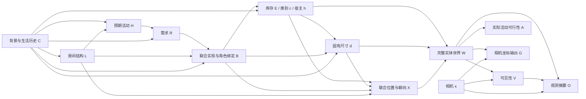

# 因果推理场景补全：本轮实测复核、因果图与模型优化

日期：2026-10-24，Asia/Shanghai。本轮以用户实际运行的 `outputs/causal_completion_pilot_20261024_220629_380006_3407` 为证据，重新定向检索并核验相关论文。本文是上一份 [完整调研报告](CAUSAL_COMPLETION_RESEARCH_20261024.md) 的更新，不把新设计描述成已经验证有效的模型。

## 1. 先看本次实际结果

已经复用项目的 `assembly_review.world_card`、`batch_world_review.interactive_boxes` 和 `semantic_layout_visual.erp_map`，生成：

- [三列实际世界对比页](outputs/causal_completion_pilot_20261024_220629_380006_3407/visual_compare_001/index.html)。
- [统一坐标、同步旋转的三维对比](outputs/causal_completion_pilot_20261024_220629_380006_3407/visual_compare_001/synchronized_3d.html)。
- [对象清单、原始状态哈希与支撑投影诊断](outputs/causal_completion_pilot_20261024_220629_380006_3407/visual_compare_001/review.json)。

每个候选使用相同的坐标显示范围；俯视图中的 N01 等短编号与下方物体表对应。没有给 needs 分支补造坐标或框，没有修改原来的 G_obs/G_full。不同方法的候选序号不是同一个真实世界的配对。

| Qwen 分支 | 实际导出 | 新增实例数 | 本次能说明什么 |
|---|---:|---|---|
| baseline | 2 个 | 2 / 6 | 普通补全的实际物体世界；独特库存采样未产生第三个不同库存 |
| joint | 3 个 | 7 / 4 / 4 | 有联合库存与部分宿主关系，仍需语义和安装审核 |
| needs | 0 个 | 未进入采样 | 首次及 repair 均返回旧格式，语义阶段停止 |

API 在本轮没有完成的补全摘要，不作为本次方法对照。

### 1.1 needs 失败是上一版提示词的设计问题

上一版 `assembly_needs.furniture_prompt()` 先要求共享目录加 requirements，随后又附上完整旧提示，旧提示明确要求 `alternatives`。真实首次与纠错回复都复制了旧格式，甚至保留了 `fill with the concrete activity or storage area` 等模板文字。

因此不能把失败归因于“需求机制的科学思想无效”，也不能把旧回复套上新名字当作新模型输出。本次已经移除冲突提示，只保留一个完整响应 schema，并用真实失败回复作为回归依据。原始回复保持原样。这是接口修复，没有被计为因果模型收益。

### 1.2 几何结果揭示的问题更具体

baseline/world_02：

- 杯子在其宿主桌子 AABB 上的 XZ 投影覆盖比例约 `0.0001`，即 **0.01%**。
- 书的对应比例约 `0.000044`，即 **0.0044%**。

当前接触检查只要求正的横向相交，因此这种近乎擦边的候选也可能通过。这个数是 AABB 投影代理，不能等同于真实表面接触，更不能证明物理稳定；但足以说明“零交叠”和“有一点接触”不是完整的支撑机制。

joint/world_03 中，variant 是 `freestanding wooden bookcase`，attachment 却声明 `wall`；另有台灯和书使用 `seat` 作为安装方式。joint/world_02 的低矮柜子同样被声明为壁挂。这些组合需要基于具体类型、支撑地址和几何一起解释，不能只看物体名字或数量。

原始度量回复还出现 null 尺寸后依赖 repair，以及多组 `range_m=3.0`、小物品通用尺寸重复。这提示数值生成受初始化模板和冻结 8B 能力影响。因果图应当给尺寸和位置提供可学习的条件机制；多写一段活动解释不会自动解决数值问题。

## 2. 新一轮调研改变了哪些判断

上一份已覆盖 S-AOG、ATISS、DiffuScene、InstructScene、Holodeck、LayoutVLM、FairScene、CausalStruct、SD-SCM 等。本轮增加了更直接对应“组织机制、功能关系和逆向推断”的工作，重点读了 FactoredScenes、FunFact、Function2Scene 的方法原文。

| 一手资料 | 已核验的内容 | 对本项目的借鉴与边界 |
|---|---|---|
| [FactoredScenes / From Programs to Poses，NeurIPS 2025](https://arxiv.org/html/2510.10292v1)，[会议记录](https://proceedings.nips.cc/paper_files/paper/2025/hash/a99b85989b2366790314046844c4f7d9-Abstract-Conference.html) | 从 3D-FRONT 学习程序库；LLM 在库约束下提出程序，再用程序条件模型预测真实场景姿态 | 最值得借鉴“可复用组合机制 + 学习的位姿”，不是无限增加一次性自然语言描述。它研究生成，不提供本项目单局部图的完整因果识别 |
| [FunFact，CVPR 2026](https://arxiv.org/html/2604.03696v1)，[官方代码](https://github.com/leggedrobotics/funfact-scenegraph) | 将候选功能关系作为变量，使用基数及几何因素联合推断；作者用 belief propagation 计算关系分布 | 有助于处理一对一/多对多依赖与竞争解释。输入是 posed RGB-D 与重建实体；需扩展才能生成从未观测的对象。因子图边不自动等于因果边 |
| [Function2Scene，2026](https://arxiv.org/html/2605.30819v1) | 从用户功能说明得到活动、人体工学、空间和环境约束，再评价与修改布局 | 借鉴角色、净空、朝向与使用条件。其用途是用户给定的，房间结构含验证环节；本项目用途与未见结构都要推断，不能直接照抄其硬约束或默认人群 |
| [FuncScene，2024](https://wutomwu.github.io/publications/2024-FuncScene/paper.pdf)，[代码](https://github.com/mwj2021/FuncScene) | 功能组作为全局房间与局部对象之间的中间层，用 VAE 生成后实例化 | 支持使用功能组作为建模单元；不能把“功能层次”本身称为已识别因果模型 |
| [OpenFunGraph，CVPR 2025](https://openfungraph.github.io/)；[FunGraph](https://arxiv.org/abs/2503.07909) | 从 RGB-D 序列提取对象、交互部件和功能关系 | 借鉴 typed relation 的语义。遥控器控制电视与台灯放在桌上需要不同变量，不能都变成普通 near 边 |
| [3DP3，NeurIPS 2021](https://proceedings.neurips.cc/paper/2021/hash/4fc66104f8ada6257fa55f29a2a567c7-Abstract.html) | 结构化生成场景、接触关系、深度似然与逆向推断，使用底层提议和结构更新 | 支持“先定义生成模型，再用观测反推”。它使用 RGB-D/形状与深度似然；本项目只有 RGB 和粗框，不能声称具备同等观测机制 |
| [S-AOG，CVPR 2018](https://openaccess.thecvf.com/content_cvpr_2018/papers/Qi_Human-Centric_Indoor_Scene_CVPR_2018_paper.pdf)；[HSG，ECCV 2018](https://openaccess.thecvf.com/content_ECCV_2018/html/Siyuan_Huang_Monocular_Scene_Parsing_ECCV_2018_paper.html) | 功能组、人类上下文、支持地址与 analysis-by-synthesis | 与本项目的用途/需求反推非常相关；原方法含学习/概率推断，不等价于只让 LLM 给一段解释 |
| [SD-SCM，EMNLP 2025](https://aclanthology.org/2025.emnlp-main.107/) | 用户指定结构、LM 提供条件机制，可在所指定模型内采样和干预 | 图和机制应可执行，但结构真实有效性仍依赖假设与外部证据；不能由文本输出自动识别 |
| [CausalVerse，NeurIPS 2025](https://arxiv.org/abs/2510.14049) | 可配置、已知生成过程的高保真模拟视觉数据 | 更适合验证机制和干预行为；仅在自然场景静态照片上变提示词不足以建立真实反事实标签 |
| [CausalSpatial，2026](https://arxiv.org/abs/2601.13304) | 物体运动后的碰撞、兼容、遮挡和轨迹推理，提出视频形式的外显模拟 | 可作为未来物理后果评估线索。它不直接解决本项目的场景形成与未知库存推断 |
| [Causal Parrots，TMLR 2023](https://arxiv.org/abs/2308.13067) | 分析语言中的因果陈述与实际因果能力之间的区别 | 提醒应把常识提议、机制执行和外部验证分开，不作为否定所有 LM 辅助建模的普遍定理 |

FairScene 的室内生成论文重点仍是类别长尾和上下文混杂，不能不区分目标就把 `P(Y|X)` 换成 `P(Y|do(X))`。对于“看到沙发后推断镜头外世界”，共同用途本来就是重要证据。CausalStruct 可参考对象依赖和反馈，但不直接采用其未归一化的概率写法。CausalScene 的 OpenReview PDF 本次仍触发验证，未核实的代码与性能没有作为证据。

## 3. 应该构建因果图，但要定义图在表达什么

我推荐的是**角色与实现机制介导的、基于观测反推的场景补全模型**。这是本项目的设计建议，不冒充某篇论文的完整复现。

需要区分三种图：

1. **场景形成的因果生成图**：为什么有这些物体，其尺寸、宿主和布局怎样形成。
2. **完整世界的对象关系图**：哪些对象放在谁上面、面对谁、服务哪个活动角色。
3. **观测条件下的推断因子图**：多个用途、对象身份和空间解释怎样通过共享证据相互竞争、共同更新。

`near` 是空间关系，`supports` 是支持关系，`controls` 涉及操作与状态变化，它们不能未经变量定义就全部作为相同类型的“因果箭头”。“电视与沙发共现”也不说明谁导致谁存在。

### 3.1 生成因果图

已生成可交互的 [因果图与变量说明](../research/audits/causal_graph_followup_2026-10-24/causal_graph/index.html)，以及可单独导出的 [SVG](../research/audits/causal_graph_followup_2026-10-24/causal_graph/generation_scm.svg)、[Mermaid](../research/audits/causal_graph_followup_2026-10-24/causal_graph/generation_scm.mmd) 和 [JSON 定义](../research/audits/causal_graph_followup_2026-10-24/causal_graph/graph_spec.json)。每个节点记录父变量、方程、含义与当前代码实现范围。



H 是形成房间时的预期使用，不是“现在正在阅读”。A 是生成的世界对指定 agent 是否实际能支持某活动，不能又拿同一个变量 A 回指库存而制造循环。

### 3.2 结构方程与模型假设

```text
C       = f_C(U_C)
L       = f_L(C,U_L)
H       = f_H(C,L,U_H)
R       = f_R(H,C,U_R)
B       = f_B(R,L,C,U_B)
J       = (E,c,h) = f_J(B,C,U_J)
log d_i = f_D(c_i, role_i(B), C, U_Di)
X       = f_X(J,d,B,L,U_X)
W       = assemble(J,d,X)
V       = visibility(W,κ)
O       = observer(W,V,κ,U_O)
A       = feasibility(W,agent)
G       = T_κ(W)
```

这些方程定义了一个可研究的假设模型，并不保证变量已识别。背景 C 采用联合变量容纳相关偏好/资源/历史，不能武断认为生活因素彼此独立；剩余独立噪声是模型的额外假设，需要通过数据和敏感性分析检验。

完整模型中的 R 应当有不确定性，B 应当允许替代与跨需求耦合。当前 pilot 的 R 在给定 Z 后确定，B 又独立均匀选择，这些是应升级的实质部分。

J 生成的是**完整库存**，包含已见与未见部分。它必须能解释为什么看到了沙发和落地灯。当前仅对隐藏目录定义的 E 节点，无法凭自身说明已见证据为何更支持某个用途，这正是现实现缺失的连接。

空间机制不必把所有对象之间的关系画成 DAG：将 X 作为联合位姿变量，内部使用宿主坐标机制和约束。例如水平桌面上的子物体可以使用：

```text
p_child = p_host + R_y(yaw_host) δ_child
y_child = y_host + (sy_host + sy_child)/2
```

实际支撑还需要表面、支撑区域/重心和间隙，不能仅要求一点 AABB 相交。面对、可达和通路应共同约束 X。空间求解器梯度不是因果边。

### 3.3 从观测反推，而不是反转箭头

目标是：

```text
p(W_hidden,Z | O,κ) ∝ pθ(W_full,Z) · pη(O | W_full,κ)
Z=(C,L,H,R,B)
```

用因子表达相容性时可以定义一个归一化的场景先验：

```text
pθ(W,Z) = (1/Zθ) p0θ(W,Z) φgeom(W,L) φfunc(W,R,B)
```

之后再乘观测似然。φgeom/φfunc 是生成先验的因素，不应在后验里重复乘两遍。它们需要具体定义与参数，不能只写公式再把 LLM 自评当成概率。

若只使用检测摘要 O，可以折叠渲染和感知过程，但应明确 pη 只针对这个摘要。若直接用 RGB，则需要外观、照明与成像模型。O 又是同一张 RGB 的函数，不能把两者作为独立证据重复计入。

仅在可见且应被可靠检测的区域，“未检测到”才可能提供不存在的证据。视野外或被遮挡的对象未检测到不构成同样的反证。冻结 G_obs 是当前实验的工作约定，不表示 WildDet3D 已无误差。

镜头改变时，物理房间 W 可以不变，但相机坐标输出 G 会通过 Tκ 改变。因此“相机干预不改变物体”应在固定房间坐标中理解，不能要求所有 camera xyz 数组原样不动。

## 4. 对这张客厅图，模型应该怎样推理

实际观测锚点包含 `obs_000/001=sofa`、`obs_003=floor lamp`、`obs_002=ottoman` 与托盘/抱枕/相框等。

合理的逆向推断可以同时保留：

- 会客休闲为主，未见部分还有储存与普通生活物品。
- 阅读兼会客，已见沙发和灯已经满足部分座位/照明角色，未必需要再增加桌椅。
- 兼影音活动，可能存在显示设备与对应安装、观看区域，但电视不是从两张沙发必然推出的事实。

对于影音解释，电视、安装/承载方式、观看方向和使用位置共同构成一个实现；遥控器应关联具体设备和使用场景。对于阅读解释，书、储存和照明既可以服务共同区域，也可以由已见对象承担。B 应表达这些替代和共享；不能每个需求各复制一套家具。

尺寸不应只由“这是书柜”决定，还应依赖其角色：独立储存、开放书架和壁挂层板是不同对象变体。台灯也不应通过任意 seat/shelf 标签就获得合理安装方式。保留坐标系、支撑表面和具体变体，才能让因果先验落实到 d、h 和 X。

“有托盘所以刚有人使用”“有相框所以有某种情感投入”都是额外推测，不能当成已观测事实写进后续硬条件。显式区分 evidence_refs、角色解释与未知假设，比增加叙述长度更重要。

## 5. 该优化什么：按机制优先级实施

### 第一优先：让观测真正更新用途/需求信念

固定一个可审核的有限功能/程序库，使用训练完整世界及其局部观测学习或校准 `pθ` 与 `pη`。VLM 提供候选和编码提议，外部推断计算联合权重。与当前“读完图后提出候选，再均匀抽取”相比，这才会改变有明确定义的证据更新过程。

程序库可以从完整场景中提取角色与组合模式，而不是靠每个请求重新发明全部物体关系。FactoredScenes 的“库与位姿分解”、S-AOG 的功能组合和 FunFact 的联合关系消歧分别支持不同部分。它们都不自动替我们识别真实因果图。

### 第二优先：共享角色与联合实现

将座位、照明、放置面、显示、储存等作为需求角色，不直接等同于某个必加类别。允许同一物体承担多个角色，允许已见库存参与，允许无新增实现，允许需要未满足的生活状态。强耦合需求的 B 要联合建模，不能给每个需求独立抛硬币后期待世界自动一致。

这一步应学习类别与数量的联合分布，保留背景物品来源。对象数过少不应简单用数量下限修补，重复小物品也不应当作覆盖完整世界。

### 第三优先：学习角色条件尺寸与宿主相对布局

将 d 与 X 从“单次 VLM 数字提议”升级成可学习的条件分布，例如正尺寸用 log-space 分布，独立家具和宿主子物体使用不同的几何解码头。保留多种布局假设；不以单一 MSE 平均多个不同合理房间。

需要增加 facing/视线、净空/通行、宿主可用表面等功能约束；其参数应来自经过审核的数据或具体 agent 条件，不能直接把 Function2Scene 中设计任务的尺寸阈值当成所有真实家庭的物理定律。

### 第四优先：区分两类干预

1. 组织机制干预：改变某项需求后重新形成房间。只有由该需求独占的实例应变化；共享实例可保留。它不是说今天不阅读，已有家具立即消失。
2. 现有世界的物理干预：移动桌子、移除支撑、操作控制器，追踪对象状态的后果。它需要形状、状态/时间和动力学，不是库存布尔开关就足够。

在事实条件下做个体反事实还需要更新外生噪声并声明跨世界耦合；仅固定种子不自动完成这一步。CausalVerse 等已知生成机制的模拟场景可以用于单独验证，但需检查其场景和变量是否覆盖本任务。

## 6. 实验怎样支持“因果推理的场景补全”

最终应同时提供：

- 多场景的补全合理性、类别/count、尺寸与空间组织结果，保留多解与失败分母。
- 同一目录/边缘存在率下去掉联合实现依赖的对照，区分更多提示信息与结构机制。
- 同库存和同几何后端下关闭观测更新的对照，检验后验更新是否真的利用证据。
- 成对机制干预的正确性：目标变化、共享/非后代保留、替代实现、实际功能后果。
- 交换场景风格/数据来源后结构机制的泛化；按房间/建筑切分，避免视角泄漏。

当前一张图的两个成功分支和一个失败分支，只能用于发现问题和完善实验接口，不能估计因果增益。

## 7. 本次实现边界与执行

本次已经完成实际世界可视化、等尺度/同步三维展示、支撑代理诊断、需求提示词冲突修复，以及完整研究图的 SVG/JSON/Mermaid 输出。当前图包含明确的生成变量和观测链路，但**完整观测似然、学习式尺寸/位姿机制与联合后验尚未实现/拟合**。不能把图文件的存在当成完整模型已跑通。

重新生成现有结果的可视化（不调用模型）：

```bash
cd /data-nfs/gpu1-2/u13529658780/DIT360
CUDA_VISIBLE_DEVICES= MPLCONFIGDIR=/tmp/caupano_review_mpl \
  /data-nfs/gpu1-2/u13529658780/.conda/envs/qwen3vl/bin/python \
  -m qwen_edit_pano.world_pipeline.completion.assembly_pilot_visual \
  --root qwen_edit_pano/outputs/causal_completion_pilot_20261024_220629_380006_3407
```

若要验证单一 schema 的接口修复，可以只重跑 needs，不必再跑 baseline/joint：

```bash
bash qwen_edit_pano/scripts/causal_completion_pilot.sh retry-needs GPU3 \
  /data-nfs/gpu1-2/u13529658780/DIT360/qwen_edit_pano/outputs/causal_completion_pilot_20261024_220629_380006_3407 \
  qwen
```

它继承原观测、种子与候选容量，新建 needs 实验并生成新的并排可视化；原结果不覆盖。这条命令验证接口和现有有限机制，不是执行上述完整新研究模型。

本轮 CPU 测试、源文件与原始状态哈希核对等见 [审计目录](../research/audits/causal_graph_followup_2026-10-24/)。本轮没有代你提交 GPU/API 推理或训练。
