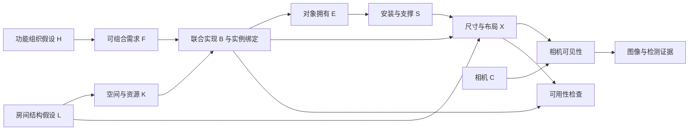

# CauPano：当前因果模型核查、相关工作与改进方案

调研日期：2026-11-02。本文依据当前源码、保存的原始模型回复、概率表、局部图像及联网获取的一手论文/项目资料整理。文献调研不等于复现实验；下面明确区分代码事实、论文结果与本项目的设计建议。没有运行新的 GPU/API 推断，没有改动模型实现或历史结果，也没有恢复已停止的直接 RGB→结构化世界基线。

目标保持为：从单张局部室内 RGB 与相机 HFOV，生成与观测相容的周围 360° 世界假设，`G_full = G_obs ∪ ΔG`。隐藏状态可以多解；对象数量、必出类别、后方覆盖率都不是优化目标。当前优先保持免训练。

## 1. 结论与建议顺序

当前 v13 是一套可执行的、人工规定结构的条件生成 SCM：冻结大模型提供经验机制，程序负责概率编译、随机采样、依赖展开和几何求解。它已超出“输出一段因果解释”，但尚未识别现实因果关系，也没有建立经过校准的照片条件世界后验。

值得保留的是：观测实例身份保护、完整功能程序联合展开、程序与相机空间计划联合选择、显式外生随机数、可审计的条件表，以及尺寸冻结后求布局。

建议按以下顺序推进，每一步单独验收：

1. **观测入口与评价先可靠**：解决“文字看见物体、对象列表为空”的矛盾，检查漏检、重投影、镜面和玻璃后的实例。
2. **建立可见性与房间结构的假设**：区分视野外、被遮挡、漏检和可见空域，让新增世界能解释原图。
3. **升级功能机制**：从抽象的“强调阅读”等 H，逐步过渡到可组合的功能需求、已有可供性、共享对象与可执行使用条件；增加跨角色联合约束。
4. **再改善概率与采样**：分离提示敏感性和模型随机性；增加多世界输出，记录筛选如何改变分布。
5. **最后接通状态→RGB 全景**：证明状态被下游遵循，再开展图像级因果/无因果比较。

## 2. 当前模型实际是什么

### 2.1 源码与执行流程

主要依据：

- [assembly_multiscene.py](world_pipeline/completion/assembly_multiscene.py)：观测、提案、合并候选、机制估计与多图调度。
- [assembly_organized.py](world_pipeline/completion/assembly_organized.py)：v13 的 H 家族、识别/存在/变体提示。
- [assembly_compositional.py](world_pipeline/completion/assembly_compositional.py)：条件表编译、边际、前向采样和模型内干预。
- [world_scm.py](world_pipeline/completion/world_scm.py)：有限离散 SCM、逆 CDF、干预和噪声溯因。
- [assembly_organized_geometry.py](world_pipeline/completion/assembly_organized_geometry.py)、[assembly_coordinate_transport.py](world_pipeline/completion/assembly_coordinate_transport.py)：冻结尺寸、相对坐标、同宿主摆放与数值接口。
- [assembly_io_recovery.py](world_pipeline/completion/assembly_io_recovery.py)：分块观察器与空列表处理。

```text
局部 RGB + HFOV
  → Qwen 可见实例与二维框
  → WildDet3D 实例三维框 → 冻结预测观测 O+
  → 两个后端提案并合并：共同有限候选程序域 D
  → 估计 H / A_r / V_r 的条件表
  → 采样完整功能程序、其内部对象与相机空间计划
  → 展开拥有 E、安装依赖 S
  → 冻结尺寸 → 预测布局参数 → 支撑/碰撞/方位约束求解
  → G_full、平面图、重投影、3D 和 ERP 状态可视化
```

ERP 是状态投影。当前完整补全主链尚未输出按这些状态生成的隐藏 RGB 全景。

### 2.2 变量与概率含义

| 变量 | 当前含义 | 应注意的边界 |
|---|---|---|
| O+ | 预测到的可见实例及其固定三维框 | 有漏检和单目几何误差，不是真值 |
| D | 当前图像得到的有限程序候选域 | 域外对象无法由后续调概率生成 |
| H | 混合用途，或逐个功能角色的强调假设 | 不是实际住户意图；不是任意功能组合 |
| A_r | 是否拥有该角色的一份额外隐藏程序 | 角色之间给定 H 条件独立 |
| V_r | 完整程序及其联合相机空间计划 | 同一程序内部对象不是独立抽样 |
| E_i | 某个候选实例是否被该程序展开为拥有 | 不是所有关系的因果变量 |
| S_i | 声明的宿主安装依赖是否满足 | 移除宿主不意味着拥有的物品消失 |
| X_i、尺寸、朝向 | 后续预测与约束求解得到的几何 | 主要使用框代理，不能认证实际可用性 |

核心离散分解为：

\[
q(H\mid O^+,D)\prod_r p(A_r\mid H,O^+,D)
p(V_r\mid A_r,H,O^+,D).
\]

`V_r` 已包含合法空间计划；不要额外再独立乘一遍方位概率。代码中的 J 是混合上下文的计算装置，完整方法令 J=H；它没有独立的物理含义。O+ 和 D 在每次编译内是固定上下文，并非实际场景生成过程中的原因。

默认每个条件行进行 K=4 次短选择，二元存在率用 `(n_present+0.5)/(K_valid+1)` 平滑。因此 0、1、2、3、4 票分别是 0.1、0.3、0.5、0.7、0.9。多项变体先验先均分程序，再均分各程序合法空间计划。程序使用外生均匀噪声和逆 CDF 进行实际采样。

这些数值准确描述当前选择协议诱导的模型分布，但不是现实世界频率。交换别名/顺序是在改变提示条件；四个选择也不能直接视作从同一已知现实分布获得的四个独立样本。K=4 次机制查询和输出四个完整世界是两件事。

## 3. 对现有产物的独立核查

本次统计与文件哈希保存在 [causal_model_audit_20261102.json](reports/causal_model_audit_20261102.json)。五图来源按 `meeting_comparison_20261028_001/provenance.json` 的 `scene_sources` 选取，即使用明确指定的厨房替换结果，没有按效果挑选样本。

### 3.1 空观测发生在二维入口

新增五图的 2D/3D 实例数核查为：**8、12、0、0、8**。两个零实例来自首个 Qwen 原始回复：对象列表为 `[]`，同时 `done=true`。

健身区回复的文字明确提到楼梯、扶手、玻璃后的健身器材；桑拿房回复明确提到坐凳。查看原图也能看到这些结构或对象。因此至少存在“文字证据与实例列表不一致”，不能解释为房间确实没有可见物体。现有空表合法结束的接口允许这种结果通过；它不同于曾经修复的“非空重复回复之后变成空表”。

出处位于 `outputs/local_observation_20261028_191556_2792703/scenes/<scene_id>/observation/qwen/observer2d/chunk_00_0.txt`；相关两个 scene ID：

- `8194nk5LbLH_9bdde31adaa1443bb206b09bfa3c474c`
- `x8F5xyUWy9e_39d82699c9a44bb9b5349d52faf1464d`

厨房原图/二维框图则显示大型中岛、橱柜、抽油烟机等可见内容没有进入三个吧凳的 G_obs。这会直接影响后续功能、支撑和空间假设。不能靠增加隐藏对象抵消可见对象漏检，更不能把漏检对象重新生成为视野外对象。

### 3.2 H→A 的实际响应经常很弱

对上述五图、两个后端，使用当前编译器重新编译保存的条件表，逐个场景内角色检查其所有 H 条件下的存在率：

| 后端 | 场景内角色总数 | 存在率完全不随 H 变化 | 其中恒为 0.9 |
|---|---:|---:|---:|
| Qwen | 27 | 20 | 18 |
| API | 27 | 11 | 11 |

这里的“27”是五个场景内角色数之和，不是 27 种独立语义类别。该统计只针对 A 的存在机制；不能据此断言 V、位置或全部模型完全不受 H 影响。K=4 也限制了对细微效应的分辨率。

这说明继续增加 H 的标签或强调措辞，未必会增加有意义的机制变化。若已有观测和候选菜单足以决定回答，H 冗余也可能是合理的；不要为制造非零效应而强行规定单调概率。

### 3.3 function_free 保留了整个离散库存混合分布

这是比“边际相同”更强的结构事实。令 W 为所有角色的完整离散程序/空间计划向量，并把 O+、D 省略：

\[
p_{\mathrm{full}}(W)=\sum_h q(h)\prod_r p(W_r\mid h).
\]

现有 `function_free` 删除 H→J，改成独立根节点 `J~q`，仍让所有角色共同依赖 J：

\[
p_{\mathrm{cut}}(W)=\sum_j q(j)\prod_r p(W_r\mid j)
=p_{\mathrm{full}}(W).
\]

因此它没有删除角色之间由混合变量引起的相关性；只切断了**被命名为 H 的变量与库存混合上下文之间的耦合**。

数值复核：10 份保存机制表中，实例存在、类别存在、期望类别数量、隐藏数量分布、程序概率和方位事件概率的最大差均为 0；进一步核查的 **13,120 个两角色联合概率值**差也为 0。全部离散联合分布相同的结论来自上述代数等式，不能仅由两角色数值检查推得。

同时，现有 CPU 用例 `test_actual_probabilities_change_with_H_and_Hcut_preserves_marginals` 通过，源码本来就包含保持边际的设计。这不是采样实现出错，而是实验比较的解释范围需要收窄。

**限制**：几何提示仍使用 H。完整方法中的 H 与库存相关，切断后可能不相关，因此 `(H,W,X)` 联合分布及最终图像可以变化；同随机种子也不保证两分支选到同一库存。不能把离散分布等价扩展为整个系统输出逐样本等价。此消融适合检查上下文耦合或 `do(H)` 响应，不足以单独证明正常补全时功能机制优于共现模型。

### 3.4 概率、域和数值求解不能混为一个指标

候选未被提案、候选被验证拒绝、程序没被采样、布局接口失败、物理代理不通过，是不同问题。当前保留空样本和失败是正确的审计习惯，应继续保留。

几何求解不是中性的可视化步骤：固定尺寸与采样方位可能使某些库存难以布局；只统计成功世界会改变发布分布。因此概率报告需注明是**布局前分布**还是**经过成功条件筛选后的分布**。

## 4. 一手相关工作核对：哪些真正值得借鉴

下表是有针对性的广泛调研，不声称穷尽相关文献。会议和时间按论文页核对；2026 年新工作若仅有预印本，保留预印本身份。没有把不同输入条件的结果当成与本项目同任务的直接性能证据。

### 4.1 因果机制、概率与反事实

| 工作 | 核对到的方法/结论 | 对本项目的作用与边界 |
|---|---|---|
| [Language Models as Causal Effect Generators / SD-SCM，EMNLP 2025](https://aclanthology.org/2025.emnlp-main.107/) | 用户规定 DAG，LM 给定机制，支持模型内观测、干预、反事实采样 | 支持当前总体范式；不意味着照片中的真实 DAG/效应被识别 |
| [SD-SCM 正文与附录](https://arxiv.org/html/2411.08019v2) | 仅拼接父变量；限制采样域。作者指出措辞敏感和有边无实际效应的问题 | 每个机制采用白名单上下文；本项目投票经验表是改编，不是原论文 token 概率归一化算法的完整复现 |
| [Gumbel-Max SCM，ICML 2019](https://proceedings.mlr.press/v97/oberst19a.html) | 给分类变量规定噪声机制与反事实耦合，并讨论反事实稳定性 | 若需要稳定的名义分类反事实，可借鉴按语义 ID 固定噪声的 Gumbel-Max；该耦合仍是额外假设 |
| [Language Model Probabilities are Not Calibrated in Numeric Contexts，ACL 2025](https://aclanthology.org/2025.acl-long.1417/) | 数字概率语境中仍有词、顺序和频率偏差 | 支持审计别名/顺序和校准，不能用该论文直接量化当前 Qwen/API 的误差 |

不要把“能执行 do”作为现实因果性验证。一个有条件表和逆 CDF 的模型能定义内部干预，但这些表是否代表室内世界的生成机制，仍需独立证据。

### 4.2 功能组织、逆向图形学和物理机制

| 工作 | 实际输入与方法 | 可以迁移什么 |
|---|---|---|
| [Human-centric Indoor Scene Synthesis Using Stochastic Grammar，CVPR 2018](https://arxiv.org/abs/1808.08473) | 学习 S-AOG 场景语法，以人类使用上下文约束对象，MCMC 合成 | And/Or 功能实现与可供性因子；不能把学习到的分布直接称为免训练先验 |
| [Holistic 3D Scene Parsing and Reconstruction，ECCV 2018](https://arxiv.org/abs/1808.02201) | 单 RGB；联合功能、几何和物理，以深度/法线/分割的渲染差异做逆向推断 | 最相关的思想是“生成世界后，回到原视角解释观测”，而非只扩展图节点 |
| [3DP3，NeurIPS 2021](https://arxiv.org/abs/2111.00312) | RGB-D、对象形状、接触图和深度似然；神经提案结合概率程序/MCMC | 神经模型提出、程序检查、观测似然纠错。它不是单 RGB 的未知全房间补全器 |
| [MIME，CVPR 2023](https://mime.is.tue.mpg.de/) | 以人体运动为条件生成场景，运动指示自由空间和接触 | 借用可坐、可走、可操作的检验；本项目没有观察到人体运动，不能将虚拟活动当证据 |
| [PhyScene，CVPR 2024](https://physcene.github.io/) | 条件扩散，并引入碰撞、房间边界、可达性引导 | 将“无碰撞”与“可交互/可到达”分开评估；模型本身需要训练 |
| [Infinigen Indoors，CVPR 2024](https://arxiv.org/abs/2406.11824) | 程序资产、约束语言及布局求解 | 借鉴明确的硬约束/软评分及使用空间约束；程序规则不是从本图识别出的现实因果关系 |
| [REST3D，2026，论文页标注 SIGGRAPH Asia 2026](https://arxiv.org/abs/2605.30338) | 单 RGB；重力支撑场景树、资产初始化、物理约束优化 | 支撑结构与原图一致性共同优化；解决物理稳定不等于推断所有视野外对象 |
| [RoomWright，2026-08 预印本](https://arxiv.org/abs/2608.18840) | 文本到代码场景；锚点→任务→对象/可供性，编译触发-条件-效果规则 | 新近最贴近“功能机制”的参考。它的 necessity-gated top-k 扩展不应照搬：本项目不设必出对象，也要允许普通非必要物品 |

RoomWright 值得学习的是结构化、可执行的功能条件，而不是把任务说明换成长篇解释。它输入是房间描述，并未证明能从单张局部照片推断真实隐藏库存。

### 4.3 结构化布局、对象集合与闭环优化

| 工作 | 核对到的能力 | 适用边界 |
|---|---|---|
| [ATISS，NeurIPS 2021](https://nv-tlabs.github.io/ATISS/) | 以对象集合建模；给部分对象可继续补全 | 通常给房型/地面轮廓且需要训练；借用集合表示和保留已知对象 |
| [DiffuScene，CVPR 2024](https://tangjiapeng.github.io/projects/DiffuScene/) | 联合对象属性的集合扩散，可做补全与重排 | 是学习式几何/语义先验，不是因果机制识别 |
| [InstructScene，ICLR 2024](https://chenguolin.github.io/projects/InstructScene/) | 语义图先验与布局解码分离，可处理部分属性条件 | 支持语义/连续几何分层；“零样本下游任务”不表示整个方法没有训练 |
| [Graph-to-3D，2021](https://he-dhamo.github.io/Graphto3D/) | 从给定场景图生成/编辑布局与形状 | 适合图到几何，不负责从局部 RGB 发现全部隐藏节点 |
| [LayoutGPT，NeurIPS 2023](https://layoutgpt.github.io/) | 通过上下文示例、CSS 类结构进行布局规划 | 可借鉴免训练的结构化接口；不能将提示例子中物体数量作为补全目标 |
| [Holodeck，CVPR 2024](https://openaccess.thecvf.com/content/CVPR2024/html/Yang_Holodeck_Language_Guided_Generation_of_3D_Embodied_AI_Environments_CVPR_2024_paper.html) | 文本→对象及关系约束→优化布局 | 适合把空间常识编译为约束；不是单图观测后验 |
| [AnyHome，ECCV 2024](https://arxiv.org/abs/2312.06644) | 文本→非模态结构→网格→纹理 | 借鉴结构与外观分离及分层编辑；不直接解决照片条件隐藏不确定性 |
| [LayoutVLM，CVPR 2025](https://arxiv.org/abs/2412.02193) | 视觉标记表示、VLM 规划、可微布局优化 | 适合用平面/多视角反馈优化相对关系；物理约束仍需数值检查 |
| [SceneReVis，2026-10 修订，论文页标注 ACM MM 2026](https://arxiv.org/abs/2602.09432) | 视觉诊断-行动闭环，SFT 后 Agentic RL | 借鉴闭环接口，当前免训练阶段不直接移植其训练配方；“causal construction trajectories”不是现实因果识别的保证 |

### 4.4 感知、360°生成与评价数据

| 工作 | 核对到的输入/能力 | 与本项目的关系 |
|---|---|---|
| [WildDet3D，2026](https://arxiv.org/abs/2604.08626) | 单 RGB，文字/点/二维框提示，可选深度辅助 | 当前感知组件；未进入提示列表的实例不会被它自动补成完整库存 |
| [Seeing Is Not Measuring，2026-09 预印本](https://arxiv.org/abs/2609.29073) | VLM 配合检测/深度工具及确定性度量求解 | 支持将坐标变换、距离和方位计算交给工具；不证明隐藏世界正确 |
| [SceneComplete，项目页标注 RA-L 2025](https://scenecomplete.github.io/) | 单 RGB-D→分实例对象网格，补全对象形状 | RGB-D 和已观测场景的物体形状补全，与未知房间背面的对象存在推断不同 |
| [PanoDreamer，2024 首稿、2026-01 修订](https://arxiv.org/abs/2412.04827) | 单图→全景/深度优化→360°三维场景 | 输入/输出范围很接近，可作未来图像级对照候选；没有显式功能 SCM |
| [AnchoredDream，2026-01 预印本](https://arxiv.org/abs/2601.16532) | 单图零样本 360°场景，以几何锚定外观生成 | 借鉴可见区域保护与几何引导；本文未验证其代码在本项目可运行 |
| [Ctrl-Room，2023 预印本](https://arxiv.org/abs/2310.03602) | 文本→布局→受布局引导的 RGB 全景→网格 | 下游状态到图像的具体参考，但布局/ControlNet 训练不能省略不提 |
| [InSpace，2026-07 预印本](https://arxiv.org/abs/2607.03990) | **输入完整 360° ERP**，结构化房间与分离资产生成 | 可借鉴房间结构和资产分层；输入覆盖率远强于本项目，不能直接充当同条件基线 |
| [Structured3D，ECCV 2020](https://structured3d-dataset.org/) | 结构标注、全景/透视渲染、实例三维框 | 适合局部视野裁剪与结构评价；使用官方标注语义时核对其定义 |
| [3D-FRONT，ICCV 2021](https://arxiv.org/abs/2011.09127) | 专业设计的室内布局与三维资产 | 可控渲染与干预测试；不是所有真实居住分布或小物品库存的代表 |

本次没有找到经核对后一项方法就同时满足“单局部 RGB、保留全部可见实例、开放类别的 360° 对象级世界、多解采样、免训练、可验证功能 SCM”的现成完整方案。这是本次检索结果，不能当成不存在相关工作或项目首创的证明。

## 5. 建议改成什么样的模型

下面是本项目设计建议，不是上述任何一篇论文的现成复现，也尚未经新实验验证。

### 5.1 先明确两个方向：世界生成与照片推断

世界生成方向应是：房间结构/功能组织/资源及可供性 → 对象和布局 → 相机下的可见性 → 图像/检测。推断时从照片逆向推这些隐变量。不要把 O→H 的识别箭头同时解释为现实场景形成的因果方向。

第一阶段可以保留现有条件 SCM，不必马上声称完整贝叶斯逆图形学。第二阶段才建立显式的生成先验与观测模型。两条路线的概率含义必须分开：

- **可立即实现的条件生成路线**：`q0(G|I,O+,D)` 加明确的兼容性评分，记录重排/拒绝后的经验分布。它是近似条件生成或能量重加权，不自动成为校准后验。
- **较完整的生成模型路线**：给定相机 C，定义 `p0(G,H,L,F,K)` 与观测似然 `p(I,O|G,C)`，再推断后验。若利用条件提案 q 抽样，严格重要性采样还需要可计算的提案密度和相应修正。

不能先用同一照片得到 `q(H|O)`，再未经推导重复乘一次 `p(O|H)` 并称为贝叶斯更新；也不能给黑盒 LLM 提案附一个任意分数就称为精确 MCMC。

### 5.2 保留观测身份，引入不确定性层

生产输出继续精确保留通过验收的 G_obs 及其来源文件。另设 uncertainty/diagnostic sidecar，记录类别候选、中心/尺寸/朝向的区间或多个预测假设、检测遗漏风险、镜面/玻璃/遮挡状态。未经校准的模型自报数值不能标成测量方差。

需要联合修正观测几何时，输出明确的新观测版本及匹配证据，不静默改写旧 G_obs。几何失配应通过可解释的诊断暴露，不能依靠移动观测或缩小隐藏物体来掩盖。

观察器增加有预算上限的检查：文字证据提到可枚举物体而对象表为空，或低覆盖率时，进行一次独立 grounding/reconciliation；仍无法确认时标记 `needs_review`。真正空房间仍合法，不设置至少一个对象的规则。镜面中的反射实例应关联原对象或标记不确定，玻璃后物体应保留可见性与空间归属区别。

### 5.3 建立可见性模型，使用负证据但不把漏检当缺席

至少区分：

1. 直接观测的实例；
2. 视锥内被遮挡的假设；
3. 视野外假设；
4. 图像中有线索但检测漏掉的待复核对象；
5. 镜像/玻璃后可见实例。

对候选世界投影回原视角，估计实例可见程度，并结合检测可靠性评价“如果它在这里，原图是否应该出现它”。一个候选柜子遮掉可见窗户，与柜子在相机后方，证据含义不同。未检测到对象不等于已证明对象不存在。

初期可使用框/粗几何、遮挡排序、分割与深度代理；框重投影和单目深度都是近似证据。尤其不能让不透明 AABB 误封桌椅空隙，或把玻璃当完全遮挡面。尚未接 RGB 渲染时不必要求纹理像素一致。

另引入房间壳体 L 的多个假设：地面、重力、可见墙面、门窗/连通空间、可用地面范围。被测量支持的部分标记为 observed，其余为 hypothesized；不强行指定后墙距离。否则求解器可以无限远离相机来消解拥挤，却不能称为合理室内世界。

### 5.4 从 H 标签转向功能实现、共享对象与使用条件

保留 H 作为高层不确定组织；逐步增加真正影响程序选择的变量：

- **F：功能需求组合**。阅读/交谈/工作可以共存，存在与强度都不确定；不推断个人职业或生活史。
- **K：资源与容量**。假设中的可用面积、通行空间、已有支撑表面、共享座位等。
- **T：实现/替代方式**。例如阅读可在已有沙发、床、独立座椅上发生；照明可来自自然光、顶灯或阅读灯。不规定阅读必出书架。
- **B：联合装配集合**。支持共享宿主和同一实例承担多个功能，不为每个角色复制桌子或座椅。
- **U：可执行使用条件**。坐下需要接近空间、座面方向；柜门需开启净空；工作表面需足够可用面积；光照是可用性假设，不能由一个 lamp 名词自动认证。

推荐分层表示：



图中的“检查”可以是约束因子或诊断，不应随意画回箭头形成不明的循环因果图。已有观测为整图推断提供条件，最终合并时锁定观测实例。

例如：照片已看到沙发、茶几、顶灯。提出一个隐藏的阅读功能实现，可以复用沙发和顶灯，可以选择靠墙书架，也可以没有额外阅读设备。若没有可达空间或可用台面，候选实现及其概率应改变；不只是修改 explanation。普通装饰、收藏和储物等不必对某项任务“必要”，仍应有可选先验。

这种变化带来的是可检查的生成假设，不是从照片证明主人实际想阅读。空间约束可排除明显不可能，但不能凭空判定未知区域的唯一家具类型。

### 5.5 修正跨角色独立与候选域边界

当前给定 H 各角色独立，不能充分处理共享中岛、共用工作/用餐桌、互斥的大体积布局、供电/用水关系等。优先保留程序内部联合展开，在程序集合间增加稀疏的 compatibility/resource 因子。使用显式共享实例绑定，不能用类别名相同就合并所有桌子。

可采用：按相关角色局部联合提案，或在现有乘积分布上加联合兼容性因子，再以有界搜索/粒子重加权生成。互斥因子属于约束，不必强行命名为因果边；仅当定义了机制及干预语义时才作为 SCM 结构。

D 需单独审计：提案后、去重后、角色拆分后、空间计划验证后的候选各剩多少；哪些失败来自接口。允许跨角色依赖留在同一候选或共享引用中，不以解析器拒绝替代建模。对语义相同候选去重，并检查重命名、复制候选是否改变先验质量。

仅增加候选数量会摊薄 K=4 的多项选择估计。应先保证不同功能实现和空间假设的有效覆盖，再增加预算；“域外/其他”只作覆盖风险或扩域入口，不能直接采样为未定义的合法世界。

### 5.6 几何与离散生成形成有界反馈

继续保持固有尺寸先于布局冻结。增加房间边界、朝向、可达性与使用净空约束；保留“接近”“面向”“支撑”“服务”“因果依赖”不同的关系类型。

一组固定库存布局失败时，先区分接口缺字段、求解预算不足和确实不相容。若预算内仍不可布局，返回结构化失败原因，交给离散假设更新。不能偷偷删对象、改类别、缩尺寸，再当成原样本成功。

采样后接受概率为 a(w) 时，发布分布一般为：

\[
p_{\mathrm{publish}}(w)=
\frac{p_{\mathrm{draw}}(w)a(w)}{\sum_{w'}p_{\mathrm{draw}}(w')a(w')}.
\]

因此要同时保留原始采样分布、失败率、筛选/修复策略和最终分布估计。固定预算生成 N 个世界，可以包含重复、空世界和失败；用于展示的排序世界须注明经过选择。不能挑最高分样本后仍称无条件 IID 输出。

### 5.7 概率估计与调用效率

优先把同义改写、顺序/别名设计、随机重复分开记录。每个条件允许重复完整的平衡编码块，先判断 H 改变的幅度是否大于提示设计与随机波动。默认 K=4 时，不宜给 0.7 这类数过强解释。

能读取本地 logits 时，可比较受限标签概率与经验计数；闭源 API 继续用可审计短选择。二者估计对象不同，且 token 概率也不自动是现实概率。Dirichlet/Beta 平滑只稳定估计，不能消除模型偏差。条件行内无效输出若与某个答案相关，丢弃无效样本也可能引入选择偏差，应单独报告。

当前 H 家族大小为 R+1，机制调用预算是 `K[1+2R(R+1)]`；R=6、K=4 时初始查询为 340 次/图/后端，还未计布局。与其全面增加 H 和 K，更有价值的是：缓存相同上下文、对有变化的机制有选择地加预算、用稀疏功能接口减少相关变量数量，同时避免因自适应停止而作未经验证的置信声明。

若有留出数据，可评价 Brier/对数损失、可靠性和区间覆盖；但每个观测仅对应一个真实隐藏房间，不足以确证完整条件多模态后验已校准。重复条件的可控模拟场景、人工兼容性评价与自然数据诊断应互相补充。

### 5.8 干预与反事实要定义具体操作

区分以下操作：

- 改变设计目标/功能偏好：是重新生成一个设计世界，不是证明实际屋主需求变了。
- 删除某个隐藏宿主：其物品“拥有 E”可以保留，安装/可用性变化；需要重新求几何，不能只统计删除节点。
- 改变相机：应改变可见性，不应改变已有世界的物体拥有。
- 改变可用空间或关闭某条通路：应通过资源/可达性机制影响布局与功能实现。

删除原图中可见对象属于反事实照片/编辑任务，不能同时要求新世界逐像素解释未改变的原图。保持观测的补全任务中优先对隐藏部分或假设变量作诊断。

现有逆 CDF 对名义分类的反事实耦合依赖状态排序。可考虑按稳定语义 ID 保留每个候选的 Gumbel 噪声，测试类别重排不变性；增加/删减候选域后不能悄悄复用不同意义的噪声。它改善模型内反事实定义，仍不能使真实反事实可识别。当前代码的逐照片噪声溯因也只在所规定的有限模型内成立。

## 6. 怎样证明改进有效

### 6.1 先固定评价对象

“合理完整”应操作化为：观测可解释、对象/尺寸/位置不自相矛盾、空间可容纳、支撑与使用条件成立、对未知区域表达多个合法假设。不要把恢复所有唯一真值隐藏对象作为唯一目标，也不要把任何 GT 差异都免于评价。

保留 GT 作为总体分布和几何诊断的一种参照；可观察区域保持严格评价，对不可观察部分同时评价多解质量与多样性。把大件、安装物、小件分别报告，避免大量小件掩盖房间结构问题。后方分布用于发现偏置，不能设为硬配额。

### 6.2 建议的实验顺序

| 阶段 | 固定项与比较 | 应回答的问题 |
|---|---|---|
| A：感知验收 | 原图、二维框、原始回复、三维重投影；不生成隐藏世界 | 漏检、重复、反射身份和三维误差来自哪里？ |
| B：观测/可见性 | 相同 O+、D、预先规定的预算；有无投影/遮挡检查 | 新增对象是否与原图冲突？合法解是否被错误拒绝？ |
| C：功能实现 | 相同语义候选域，抽象 H 与显式共享/替代实现逐项比较 | 改善是否来自可执行功能机制？ |
| D：联合约束 | 保持各角色模块边际，打散跨角色耦合；单列该诊断 | 收益是否来自联合一致性而非更多对象？ |
| E：鲁棒性 | 同义提示、别名、候选重排、相机旋转、观测扰动 | 改进是否稳定，还是提示/坐标偶然性？ |
| F：RGB 全景 | 接通状态下游后，在相同图像生成器与预算下比较 | 功能机制最终能否改变且改善生成图像？ |

B–E 是建议未来开展的方法诊断，不在本次自动启动；不恢复已停止的直接 RGB→结构化完整世界实验。

如果需要真正删除角色间共同功能上下文，可让各角色使用独立 `J_r~q`，或直接使用各角色的混合边际。这保持单角色模块边际，但改变联合分布。它检验联合依赖的作用，不检验现实因果图是否正确。若要检验上游功能机制整体，应另有匹配候选/调用预算的相关性机制参照；用户偏好的主要无因果效果对照放在 RGB 全景层实施。

### 6.3 评价指标

- **观测保持**：可见实例 ID 与属性保持、二维覆盖/召回诊断、重投影、原视角新增遮挡冲突。
- **空间/物理**：穿透、越界、悬浮、支撑面重合、可行布局率；框代理与网格/模拟检查分开报告。
- **功能**：可坐/可达/可操作比例、门柜开启净空、共享对象是否重复、功能实现是否有合法替代。
- **多解质量**：每张图固定预算下的有效世界率、全部失败率、去除排列影响后的程序/布局多样性。展示最优解与原始分布分开。
- **机制**：H→A 与 H→V 分别测；报告变化大小、提示扰动背景与零效应。程序规定“应改变”的测试只在显式模拟机制下检验。
- **图像层**：状态指定物体/方位/尺寸被遵循的程度、原图保真、360°接缝、独立盲评。五图不适合用 FID 等总体指标宣称显著优势。
- **成本**：每图查询数、token/时间、接口修复数、布局预算与失败原因；不能只报告成功例成本。

数据划分按房屋/场景进行，避免同一房间不同裁剪泄漏。先使用项目已有留出图和全景；需要可控干预时再考虑 Structured3D/3D-FRONT 或程序生成场景。使用合成干预作验证时，结论限于规定的模拟机制，不能自动外推到真实居住因果效应。

## 7. 推荐最先实施的具体改动

第一批只做可审计、低耦合的改动：

1. 给局部观察器增加“证据描述与空对象表矛盾”的状态及有界复核入口，完善漏检可视化与审核；不制造非空结果。
2. 新增独立的 proposal/geometry audit：按阶段统计候选域支持、失败原因、功能存在响应、变体响应；给 `function_free` 结果加精确的解释范围。
3. 在保持 O+ 不变的条件下，为所有新增实例记录 `outside_fov / occluded / uncertain` 可见性假设，加入原视角冲突检查。
4. 选一类明确的共享/替代实现做小型验证，例如已有沙发服务阅读，已有中岛服务用餐；不同时重写全部 H/A/V 和几何。
5. 统一多世界导出和失败记录；状态到 RGB 的遵循性验证准备好后再做图像级因果收益实验。

验收标准是以上指标改善且没有隐藏失败/选择偏差；不按新增对象更多、后方更满或解释更长验收。

本次完成了源码与保存结果核查、概率重新编译、一项现有 CPU 用例、相关一手资料检索与上述方案整理。所有拟议结构与性能收益仍需新的受控实验验证。
