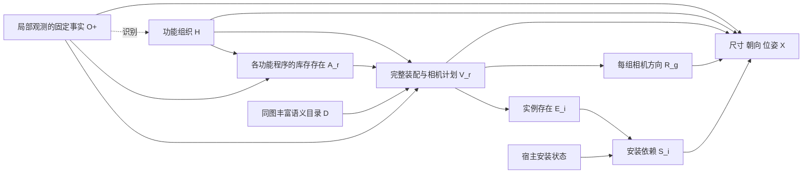

# v12：恢复完整功能程序的组合生成

2026-10-27，Asia/Shanghai。不训练。本轮交付实际补全代码，不再只给诊断建议。真实 GPU/API 由用户执行；CPU 合成验证不等于新版本真实效果。

## 1. 回看真正丰富的早期案例

核对原始程序、概率表和每个实际世界，而不是只看交接文字：

| 版本 | Qwen 四次新增 | API 四次新增 | 原数值接口导出 |
|---|---|---|---|
| v5 | 24,23,23,14 | 23,23,23,22 | Qwen 1/4，API 4/4 |
| v7 | 11,7,12,12 | 10,11,12,11 | 两路均 4/4 |
| v8 | 13,9,15,13 | 12,16,16,12 | 两路均 4/4 |
| v11 | 1,1,2,2 | 服务中断，未完成 | Qwen 4/4 |

[25 个真实世界的统一坐标对比与完整模块清单](../research/audits/compositional_v12_20261027/actual_history_001/index.html)。v5 的三次 Qwen 失败全部保留，不能把 24 条计划物体当成已通过的完整世界。原来的数值检查也不是语义/物理认证。

早期内容丰富的主要结构是：

- 阅读程序：书柜、边桌、书籍、杯子、台灯等共同出现。
- 社交程序：媒体柜、电视、茶几、边桌、遥控器和杂志构成整体。
- 工作程序：书桌、椅子、储物柜、电脑、台灯、笔记本、收纳盒等八件装配。
- 储物程序：家具和其内部/上方的箱子、篮子、书或花瓶共同出现。

v5 共享域有 15 个非空程序、70 条候选实例记录；70 跨互斥替代方案累加，绝不是一个世界应该有 70 件物体。v8 有 16 单位/57 实例；v11 只剩 6 单位/11 实例。

这些版本的区别同时包含**候选内容变薄**和**生成粒度改变**。v5 在多个功能程序上分别作选择，能够同时展开几套完整装配；v11 把库存和方向放入一次全局可变长列表，而实际 Qwen 几乎把它当成单选。只改列表措辞，不能恢复已经消失的书柜内容、工作装配和生活物品支持。

## 2. 本轮选择的修复范围

恢复“可共存的完整功能程序→家具及其生活物品”的组合方式，并保留后来有效的实例依赖、固定观测、相机方位保护和几何检查。

实现提供两种候选来源，使用同一套后续因果生成机制。为了先检验本图被丢失的内容支持，建议首轮采用**同图丰富语义目录**：直接读取并重新验证 v5 的全部候选程序，重新估计 H、存在概率、具体装配和相机方位，再生成全新的尺寸与布局。**不复用旧 CPT、选择结果、中心、尺寸或成功布局；不挑选某个旧成功世界照搬。**

这是明确的固定观测/固定语义目录方法实验，不冒充新的自主提案能力或跨场景效果。两后端使用同一个目录，源目录的 RGB/G_obs 必须与当前输入逐哈希相同。换图时不能使用这张图的目录，代码会拒绝。

选择这一范围是为了恢复已出现过的合理候选，并让生成机制的变化可核对，避免再次一边改机制、一边把候选库重新缩小。旧程序仍可能有语义问题，实际新世界必须继续复核；数量多本身不判胜。

**重新提案模式也已实现**：不设置或清空 `CAUPANO_PROGRAM_CATALOG`，Qwen 与 API 从当前固定局部观测各自提出完整功能程序，再合并候选并进入同一 H/A/V/R/X 机制。提案明确要求一个替代方案中的同功能多组共同存在，允许普通生活物品及其宿主，不限制成孤立家具名词。这一模式不读取旧语义目录；提案和后续机制的实际能力仍需真实执行验证。两模式都固定已有观察器结果，并不重新估计 G_obs。

## 3. 修改后的因果生成模型

O+：由局部图像得到的固定正面对象身份、相机参数和预测三维框。G_obs 始终保留；没有把单图推断为住户历史或测量出的房间边界。

H：不确定的功能组织标签组合，包含未确定用途的空标签值。没有标签不构成该用途/物品不存在的证据。

A_r：该世界是否拥有角色 r 的额外隐藏功能程序。它是库存存在变量，**不是“必须再有一个独立活动区”或“尚未满足的需求”门槛**。服务已有沙发的物品也可以在 A_r=1 的程序中。

V_r：A_r=1 时选择的完整功能程序及相机空间计划。程序内部的所有家具、物品、宿主和依赖共同展开；程序可以包含多个同功能组和多个同类别实例。例如两个沙发旁的阅读组可以在同一阅读程序内共存。有限目录中缺少这种组合时，不能声称模型已覆盖全部世界。

R_g：从 V_r 中提取的每组相机方向。没有固定宿主、方向未知的组具有 left/right/rear 的合法计划；同一程序内多组可以取不同方向。明确相机深度关系继续排除矛盾计划，不为了后方效果删除原关系。固定观测宿主不移动。

E_i：选择程序后实例存在。S_i：声明的宿主安装依赖，不是实际物理稳定性。X：新的固有尺寸、朝向和相对位姿，经过受保护方向、视锥、支撑代理与碰撞检查。



\[
q(H\mid O^+,D)\prod_r
p(A_r\mid H,O^+,D)\,
p(V_r\mid A_r,H,O^+,D).
\]

\[
E_i=\mathbf1[V_{r(i)}\text{选择了包含实例 }i\text{的程序}],\qquad
S_i=E_i\land S_{host(i)}.
\]

无宿主或宿主为固定观测时，相应宿主安装依赖基值为 1。移除新宿主使孩子的安装失效，仍保留孩子的拥有状态。相机方向是抽样程序的一部分，几何优化不能为了靠近已见家具把 rear 改回 left。

**条件独立假设公开：给定 H 后，不同功能角色的程序选择独立；同一程序内部的家具、内容及多组相机方向联合选择。** H 提供跨角色的共同变化，但该模型不能表示全部跨角色依赖。它是可执行、可检验的假设型 SCM，不是从单图识别了真实物理因果图。

left/right/rear 沿用几何方向域，不是严格互斥的角扇区。概率表统计“声明 rear 的程序事件”；可视化另按最终 Z<0 统计真实后半空间。没有要求每个角度都有物体。

## 4. 为什么不直接恢复旧版高存在率

v5 的 none 与多个非空候选一起作分类，备选数会影响平滑的存在质量。v12 明确分开：

1. 每个角色单独返回一个 JSON boolean，估计“这个可选完整程序是否存在”。没有全局可变长列表、菜单首项或预填 true 示例。
2. 已知该程序存在，再用一个 choice 选择完整装配和空间计划，不能在这一步重新删物品或决定不存在。

存在预测分布为：

\[
\widehat p(A_r=1\mid h)=
\frac{n_{h,r,1}+\alpha/2}{K_{h,r}+\alpha}.
\]

默认 alpha=1。增加候选数量不会把存在先验从 1/2 自动提高。具体非空程序的先验先均分到语义程序，再在该程序的合法空间计划间均分，不因多几个方向备选自动获得更多先验质量。

\[
\widehat p(V_r=v\mid A_r=1,h)
=\frac{n_{h,r,v}+\eta\pi_r(v)}{K_{h,r}^{V}+\eta},\quad
\pi_r(v)=\frac{1}{N_{programs,r}\,N_{plans,module(v)}}.
\]

默认 eta=1，不通过调平滑强度恢复数量。所有概率实际进入逆 CDF 抽样；对象概率、数量分布、类别存在率和相机计划事件可精确求和。H 的概率变化会传到真实对象存在及方位；如果本次后端学到的是平坦机制，就如实报告，不人工补出功能增益。

候选选项用每次重新绑定的中性别名，减少固定 a0 等标签偏好；同一角色、同一 draw 的候选次序和本地 seed 在不同 H 间保持一致，避免把菜单随机变化误算成 H 的作用。API 不发送未获支持的 seed。

## 5. 运行配置与对比范围

三个分支×两个后端，默认每分支四次，共 24 次布局：

- `end_to_end`：在当前候选域上，各自估计功能机制并生成新几何。目录模式固定旧语义候选；重新提案模式生成新的候选；都不重新运行观察器。
- `layout_control`：合并原始计数后只平滑一次，两后端使用相同 H、库存、空间计划和结构噪声，比较几何能力。
- `function_free`：切断 H→离散功能程序路径，保留完整库存/方向边缘分布，检验 H 条件响应，不期待平均数量变多。

实现中的 J 是 H 的确定性上下文副本；切边时变为按 q(H) 抽样的独立上下文索引。它是计算耦合工具，不是新物理原因或生活历史。几何仍保留相同 H 上下文，消融只对应离散程序路径。

Qwen/API 使用同一 G_obs、目录、提示模板、状态域、温度 .4、top_p .9、top_k 50、token 上限与解析/一次修复政策。API 固定硅基流动 `deepseek-ai/DeepSeek-V4.1-Flash`，端点 `https://api.siliconflow.cn/v1`，沿用 `SILICONFLOW_API_KEY`。

默认两后端都使用**相同的正面观测文字/预测几何**进行机制和数值布局，避免把上一轮 API 带图识别的服务失败再次混进机制比较；重新提案模式的候选生成仍向两后端提供相同的局部图像与观测板，若服务失败会如实记录。目录模式的原 RGB 已用于生成固定观测和目录。设置 `CAUPANO_LAYOUT_RGB=1` 可让两路数值布局都附带相同 RGB，但不能只改变一路。默认结果应描述为固定局部观测后的世界状态补全，不是从原 RGB 开始的新端到端实验。

保留当前支撑代理、相机视锥、方向关系和固定观测检查，没有新增房间容量、最少物体数或后方比例。刚性框中心支撑仍是有限假设，真实网格、重心、墙面、通行与可供性未认证。所有采样对象、空集、重复和失败都保留，不能删物体来完成布局。

## 6. 执行代码

核心：`world_pipeline/completion/assembly_compositional.py`；调度：`assembly_compositional_experiment.py`；入口：`scripts/compositional_completion.sh`。

数值几何为 `assembly_compositional_geometry.py`：保留原方向与支撑求解，明确提供冻结观测的预测中心/全尺寸。文字模式没有“已附图像”的矛盾说明，原始相机坐标只作条件，不复制为新对象的相对 offset。

先做本版 CPU 检查：

```bash
cd /data-nfs/gpu1-2/u13529658780/DIT360
bash qwen_edit_pano/scripts/compositional_completion.sh test
```

真实补全及自动可视化（用户执行）：

```bash
cd /data-nfs/gpu1-2/u13529658780/DIT360
CAUPANO_PROGRAM_CATALOG=qwen_edit_pano/outputs/modular_completion_20261025_162311_4103717 \
CAUPANO_BASELINE_ROOT=qwen_edit_pano/outputs/modular_completion_20261025_162311_4103717 \
CAUPANO_WORLDS=4 CAUPANO_MECHANISM_DRAWS=4 \
CAUPANO_CONCENTRATION=1 CAUPANO_REFERENCE_CONCENTRATION=1 \
bash qwen_edit_pano/scripts/compositional_completion.sh compare GPU3 \
  qwen_edit_pano/outputs/holistic_completion_20261026_235517_1710340/end_to_end 3407
```

这里沿用通用入口的 `CAUPANO_REFERENCE_CONCENTRATION` 参数名，但在 v12 中记录为**非空具体程序的 eta**，不是旧版 D-only 参考票；二者不要混淆。默认值均为 1。

需要验证完整的新提案流程时，执行以下另一组独立实验。它仍参考同图 v5 做可视化对比，但**不使用其语义候选**：

```bash
cd /data-nfs/gpu1-2/u13529658780/DIT360
CAUPANO_PROGRAM_CATALOG= \
CAUPANO_BASELINE_ROOT=qwen_edit_pano/outputs/modular_completion_20261025_162311_4103717 \
CAUPANO_WORLDS=4 CAUPANO_MECHANISM_DRAWS=4 \
CAUPANO_CONCENTRATION=1 CAUPANO_REFERENCE_CONCENTRATION=1 \
bash qwen_edit_pano/scripts/compositional_completion.sh compare GPU3 \
  qwen_edit_pano/outputs/holistic_completion_20261026_235517_1710340/end_to_end 3407
```

API 继续读取已有环境变量 `SILICONFLOW_API_KEY`；脚本不会自动获得 Key，也不会把本地 Qwen 当作 API 的替代。未设置 Key 时 compare 会明确退出。两种模式的提案成本不同，具体调用预算写入 `call_budget.json`。

输出为 `qwen_edit_pano/outputs/compositional_completion_时间_PID/index.html`。自动比较原丰富 v5 与新功能程序补全，含全部计划样本、失败、同范围 XZ、可旋转 3D、ERP 方向图、库存概率和支撑记录。蓝观测、橙表内原名、紫表外已映射、红未映射；表外对象不丢弃。仍是状态框，不生成 RGB ERP。

只准备，不调用模型：

```bash
cd /data-nfs/gpu1-2/u13529658780/DIT360
CAUPANO_PROGRAM_CATALOG=qwen_edit_pano/outputs/modular_completion_20261025_162311_4103717 \
bash qwen_edit_pano/scripts/compositional_completion.sh prepare GPU3 \
  qwen_edit_pano/outputs/holistic_completion_20261026_235517_1710340/end_to_end 3407
```

也可以把目录变量改为同图的 v8 `mechanism_completion_20261026_120551_1879296`，会重新核验它的全部语义程序并重新估计机制；不同目录的结果不能直接当成孤立因果效应。

机制阶段保存已验证请求的提示/seed/原始回复哈希缓存。服务错误不会自动重试，不会变成空库存；已成功数据不覆盖。当前一次 compare 创建全新目录，原失败记录保留。

## 7. 论文借鉴与评价

[S-AOG](https://arxiv.org/html/1808.08473) 提供功能组、承载、组合与替代的场景语法启发；[Holistic Scene Parsing](https://siyuanhuang.com/holistic_parsing/main.html) 支持把功能、几何和物理一起考察；[SD-SCM](https://aclanthology.org/2025.emnlp-main.107/) 支持指定结构、冻结 LM 条件机制与实际干预采样。它们没有证明本模型已识别真实因果结构；没有复用其训练参数或宣称复现其效果。

下一次结果需要同时检查内容是否恢复、重复和宿主是否合理、完整组内布局、相机后方、尺寸与功能距离、失败是否保留，以及 H 是否有可解释的概率影响。不能仅凭物体变多、概率非零或代码测试通过宣布成功。新版本真实质量仍待用户运行。

本轮最终验证：**225/225 项 CPU 回归通过**；目录模式与重新提案模式的真实输入 prepare-only 和 97 项源代码哈希核对通过；旧目录 15 个程序/70 条候选实例全部重新验证，得到 43 个满足必要中心/方向条件的空间计划。这个数不是对真实房间布局的认证。三分支两后端的合成执行和可视化链路已检查；合成场景明确标为非真实效果。原始 6,083 份来源 JSON 未变。[完整验证记录](../research/audits/compositional_v12_20261027/release_validation.json)。没有运行新 GPU/API 或训练。
