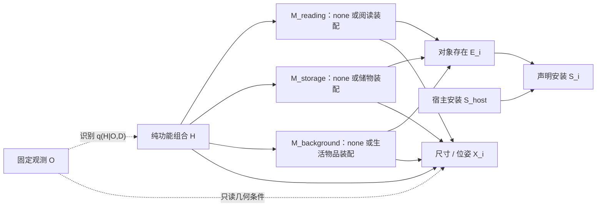

# 从实际 v4 结果到功能装配因果生成模型 v5

日期：2026-10-25。源码、保存回复、概率表、三维框和 CPU 重放共同核对。实际结果及诊断入口：工作区 `research/audits/modular_model_v5_20261025/index.html`。

本轮建议采用**功能装配语法下的条件结构生成模型**：功能变量只表达用途；按功能角色采样可选的完整装配，再产生对象存在与宿主安装状态。当前代码已经实现，但没有运行真实 v5 GPU/API 推断。数学结构与代码可核对，不把尚未发生的效果当作结论。

## 1. 这次实际运行发生了什么

有效分析目录是 `outputs/sdscene_compare_20261025_151733_3744172`，其中 API 模型确为硅基流动 `deepseek-ai/DeepSeek-V4.1-Flash`。更早的 `151157_3715222` 误用 Qwen API 并返回 HTTP 403，没有有效 API 生成结果，不拿它评价模型能力。

| 实际分支 | 四次新增物体数 | 配置分布的空世界概率 |
|---|---|---|
| end_to_end / qwen | 0、0、0、0 | 0.756731 |
| end_to_end / api | 9、9、10、9 | 0.019231 |
| layout_control / qwen | 10、9、0、9 | 0.435479 |
| layout_control / api | 10、9、0、9 | 0.435479 |

### 可以确认的事实

1. **本地有能力提出非空候选。** 本地成功提出 4 个完整候选，共 20 条候选实例记录；API 提出 8 个候选、77 条候选实例记录。这些总数跨替代世界累加，不能当成一个完整世界的物体数。
2. **本地主要在后续选择阶段偏向空世界。** 本地 15 次库存选择中有 14 次是 f_null；API 为 0/15。按已编译分布，本地期望新增数仍为 1.977885，API 为 9.115385。前者连续四次采空的模型内概率约为 0.328，出现四个空结果不说明采样器坏了。
3. **共同库存对照成立。** 两份 layout_control 的 `structural_samples.json` 字节相同，新增数也相同。两路都能为这批非空库存导出布局，说明“本地四次空世界”不能主要归因于几何阶段删除物体。
4. **功能变量混入了不属于变量定义的信息。** H 的实际值包含完整图像描述、观测物体清单、“minimalist”等描述，以及具体隐藏物品假设。这样比较两个 H 时，改变的远不止用途；“只传父变量”并没有自动保证父变量本身语义干净。
5. **全世界选一项的粒度过粗。** 当候选是“空世界”或一整套 8～11 件物体时，选择器无法只保留其中一个合理功能区域。一个不认同的子区域可能连带排除其他合理物品。
6. **存在明确的物理语义错误。** f1 中普通 side table 声明放在观测沙发的 seat 上；group.function 中还有原模板占位文本。原程序只检查宿主引用是否合法，尚不足以排除这类语义矛盾。
7. **固定库存后仍有空间生成差异。** 本地 world_01 将 console 放在电视上方，违反声明的 below；API 对这条关系满足。旧优化器主要调整 X/Z，无法修正挂墙根节点的错误 Y。两路仍有挂墙/座面/架内安装未核验；零碰撞不代表这些物理表面已经恢复。

H 的信息混杂和候选粒度是确认存在的结构问题；它们对空世界偏好的具体贡献，需要进一步消融。不能据一次运行断言“全部因为 H 描述太长”，也不能仅凭 API 物体更多就判断 API 更正确。相同库存下，API 的若干 near 关系距离也仍偏大，真实隐藏世界没有被验证。

## 2. 新一轮论文与实现核查

| 一手来源 | 与本项目相关的启发 | 不能直接照搬的部分 |
|---|---|---|
| [S-AOG / Human-centric Indoor Scene Synthesis](https://arxiv.org/html/1808.08473)，[作者仓库](https://github.com/SiyuanQi-zz/human-centric-scene-synthesis) | And、Or、Set 节点分别表达组合、替代与可选分支；功能与人类交互约束参与生成 | 原文的 MRF 势和场景语法边不全是因果边；其数据学习的分布不能由几条人工权重替代后仍称已学习 |
| [Holistic 3D Scene Parsing](https://siyuanhuang.com/files/eccv2018parsing.pdf)，[官方实现](https://github.com/thusiyuan/holistic_scene_parsing) | 潜在功能组、宿主几何、物理约束及观测一致性需共同考虑 | 已观测深度/法线的渲染一致性不能验证完全视野外的库存。本项目不固定未知墙面 |
| [FuncScene](https://wutomwu.github.io/publications/2024-FuncScene/paper.pdf)，[作者仓库](https://github.com/mwj2021/FuncScene) | 以功能组连接整体结构与局部对象，再实例化组内物体 | 本次看到的仓库 main 树只有 README 与 img，虽然 README 提到 main.py，但没有可核验的该文件。这里借鉴论文结构，没有声称复现其模型或训练结果 |
| [SD-SCM](https://aclanthology.org/2025.emnlp-main.107/)，[正文](https://arxiv.org/html/2411.08019)，[实现](https://github.com/lbynum/sequence-driven-scms) | 父变量约束、有限值域、拓扑采样和机制替换 | 指定的 DAG 与 LM 机制不等于从照片发现真实因果图。v5 仍采用 API 可用的经验分类频率，不冒充论文的 token 限域概率 |
| [FactoredScenes](https://arxiv.org/html/2510.10292v1) | 用结构程序处理组合，再处理真实场景中的姿态变化 | 支持分开诊断库存与几何，但当前未学习其程序库、朝向或姿态分布 |
| [CausalStruct](https://arxiv.org/html/2509.15249)，[作者仓库](https://github.com/gokucs/causalstruct) | 明确依赖顺序，再用可计算空间反馈修正数值布局 | 附录对 causal reasoning 的定义包含空间/功能关系建模，范围比真实 SCM 的因果识别更宽。本项目不将 near/above 全部视为因果边，也不把 PID 修正当作因果效应验证 |
| [MiDiffusion](https://arxiv.org/html/2405.21066)，[实现](https://github.com/MIT-SPARK/MiDiffusion) | 类别与几何共同建模，已有对象固定的补全协议 | 依赖已知 floor plan 及训练分布。本项目没有恢复完整房间边界，不能照搬其边界指标 |
| [Function2Scene](https://arxiv.org/html/2605.30819) | 将功能目标转换为可以检查的几何/活动约束，并迭代评估 | 输入是明确的设计要求、persona 和活动，不是从单图可靠恢复住户信息。本项目保留用途不确定性，不使用其设计目标强行补齐家具 |
| [CasLayout，作者机构介绍](https://www.microsoft.com/en-us/research/publication/caslayout-cascaded-3d-layout-diffusion-for-indoor-scene-synthesis-with-implicit-relation-modeling/?lang=ko-kr) | 区分类别数量、尺寸、稀疏关系和 OBB 阶段，避免全连接关系冗余 | 各条件阶段依赖训练和建筑约束；多阶段结构本身不构成因果证明 |

由这些工作得到的判断是：**生成单元应具有内部依赖结构；功能变量应有清楚的取值含义；几何约束应落实到数值；研究结论必须区分生成机制、空间约束和真实因果识别。**

## 3. v5 实际实现的变量与图

O：固定局部图像、相机、G_obs、观测宿主范围与预测三维框。

D：本地/API 新提案的共享有限装配库。不是全世界的完整物体支持集。

H：可共存的功能标签集合，如 social、reading、storage；有未确定用途的空标签集合。H 的传输值由函数重新构造，只保留标签和固定定义，不保留照片描述、物品猜测、风格、住户或生活历史。

M_r：角色 r 下的装配替代项，包括 none。装配可以同时包含家具与普通生活物品；例如“书柜+书籍+收纳篮”。选择一个装配是一个联合事件，组内不是逐物体独立猜测。多个功能共享同一件实物时，应放在同一装配中，不能分别复制一件。

E_i：候选实例存在；S_i：声明的宿主依赖满足。S_i 不代表真实安装表面已验证。

X_i：尺寸、相对位姿和编译后相机坐标框。结构采样失败与几何失败分开记录。



图中角色是示例；只为实际提案包含的角色建节点，没有强制生成阅读区、储物区或其他类别。D 在一次实验中固定，作为识别和机制的共同上下文。观测识别的反向箭头不表示“图片造成了房间用途”。

实际离散采样律：

\[
Q_m(H,\{M_r\}\mid O,D)
=q_m(H\mid O,D)\prod_{r\in\mathcal R(D)}p_m(M_r\mid H,D).
\]

这是明确的**给定 H,D 后角色装配条件独立假设**。H 对不同角色提供共同影响，组内对象保持联合依赖，但当前不能表示所有跨角色相关性。它是待检验的建模选择，没有被单图或当前数据识别。

每个角色当前选择至多一个候选装配。一个装配可包含多件同类物体；这不是“每类只能一件”的配额。确实必须共同出现的子区域需要在提案中构造成同一装配。跨装配的新宿主引用或对象依赖会被拒绝，反馈完整修复，不在合并阶段偷偷删除依赖。

### 3.1 对象与安装的结构方程

装配内部按 And 组合展开：

\[
E_i=\mathbf1[M_{r(i)}=a(i)],\qquad
S_i=E_i\land S_{\mathrm{host}(i)}.
\]

无宿主根节点按其自身存在确定声明安装；固定观测宿主作为既有条件。对宿主做 do(E_host=0)，孩子仍可存在，但安装不再满足。这个定义避免“移除书架就把仍拥有的书也消灭”的错误。

从 LM 得到的机制仍基于其训练中的统计知识。显式机制与干预接口使这些知识可审查、可替换；它们不会自动变成真实世界因果规律。当前定位是具有假设结构与模型内干预的条件生成原型，尚不估计真实住户的因果效应。

### 3.2 概率实际进入生成

识别阶段看共同图板和 O。每个装配机制阶段只看纯 H、固定角色、该角色替代项及每个世界共有的观测名称，不看图、不看其他角色的选择、不看之前投票。

每行默认 K=4 次分类生成；候选顺序按两路共同的阶段种子置换。本地/API 均返回一个 choice，经过相同解析和最多一次修复。使用总浓度 α=1 的对称平滑：

\[
\widehat p(s)=\frac{n_s+\alpha/|\Omega_r|}{K_{\rm valid}+\alpha}.
\]

保存有效/无效次数与多项式假设下的不确定性诊断；整行没有有效结果则失败，不回退为均匀成功。频率反映指定提示、顺序、解码及修复协议，不是 token 概率或校准场景置信度。

编译后的有限 SCM 用保存的外生 Uniform 噪声和逆 CDF 真正采样 M_r。实例存在概率：

\[
P(E_i=1\mid O,D)=\sum_h q(h\mid O,D)p(M_{r(i)}=a(i)\mid h,D).
\]

该值写入新增对象的 `generative_presence_probability`。不再只有一个全世界 F 的单选，而能组合多个合理装配；也保留全空和部分装配世界，不重采直到非空。

完整数量分布按 H 下各角色数量分布卷积，再对 H 混合；精确类别存在概率与期望数量分别计算。例如有两个可共存装配都含书时，不能把两本书的期望数量误称为“有书的概率”。

空世界概率是：

\[
P(\Delta G=\varnothing\mid O,D)
=\sum_hq(h\mid O,D)\prod_r p(M_r=\mathrm{none}\mid h,D).
\]

**分组本身会改变概率空间，可能机械地降低全空概率、增加物品数量。** 不能据此声称功能理解提高。none、平滑质量和装配间独立假设都必须结合原始选择次数与消融解释。没有最低新增数；当各装配机制确为 none 概率 1 时，所有世界会为空，测试已验证。

## 4. 空间机制的实际修改

1. v5 对 group.function 要求一个准确的功能标签，禁止模板句子；对普通桌椅/沙发/落地灯等放在 seat/top/shelf/hang 上的矛盾进行验证。独立式与挂墙矛盾仍拒绝。自动验证只覆盖明确约束，不代表所有类别语义已经解决。
2. 布局阶段增加所有观测对象的只读相机中心和完整 AABB 尺寸。原先只给名称/少量宿主尺寸，不足以让后端可靠判断 near；新的提示说明这些是预测值，不是 GT，且不能复制为相对 offset。它改善信息供应，不保证 near 已正确。
3. 给挂墙、吊顶、free 根节点增加最小 Y 位移投影；其孩子按宿主链一起移动。保持尺寸、固定观测与落地根节点 Y。v5 对 above/below 声明采用完整垂向 AABB 区间有序的约束，区别于旧版本只检查中心序。
4. 重新进行视野外、接触和碰撞审查；不可满足的显式方向关系会使该布局进入 `G_full_candidates.json` 诊断路径。库存与失败样本保留，不能通过删物体“修好”关系。
5. 装配组合可能超过四个几何组，所以方向搜索最多预览 81 个确定性候选，并精化其中 4 个，避免无界枚举 3^组数。预算和搜索范围写入报告；这不是概率重加权或完备求解。

上述空间关系是约束，不全部叫因果边。宿主姿态传到孩子姿态是明确的依赖机制；near/above 等通常是同一配置的关系，不能仅凭名称赋予干预含义。

对本次保存的本地 layout_control/world_01，已做纯 CPU 几何重放：同库存、同尺寸、同初始布局参数，把电视根节点 Y 上调约 **0.870045 m** 后，below 违反消失；观测和落地根节点未移动。记录为 `geometry_replay.json`。这是对明确数值缺陷的修正验证，不是 v5 新生成质量实验。电视真实挂墙面仍未核验。

## 5. 三组对照与可视化

固定观测：两路均复用来源实验的 qwen G_obs，图板和发送前 JPEG 哈希一致，不重新运行 Observer。

固定后端：本地 Qwen3-VL-8B；API 为硅基流动 `deepseek-ai/DeepSeek-V4.1-Flash`，端点 `https://api.siliconflow.cn/v1`。脚本与 prepare 显式指定 API 模型，不采纳旧的错误模型环境变量。

相同请求配置：temperature=.4、top_p=.9、top_k=50，API 请求关闭 Thinking；提案/布局 8192 token，分类 256 token，相同外部解析器与修复预算。本地阶段种子受控；API 不发送未获保证的 seed。两路内部视觉编码、分词器、算力和服务端行为不同，不能说完全等价。

| 实验 | 实际改变 | 用于回答 |
|---|---|---|
| end_to_end | 各自识别 H、估计装配机制和生成布局；O,D 共同 | 后端整体行为差异来自哪里 |
| layout_control | 合并两路分类计数，只平滑一次；结构噪声相同；布局后端不同 | 相同库存和 H 下的尺寸/布局能力 |
| function_free | 对每个后端将装配行替换为所有 H 行的均匀平均；M_r 节点移除 H 父边 | H→装配的条件依赖是否真正贡献了结果 |

消融定义：

\[
p_{\rm cut}(M_r\mid D)=\frac1{|\mathcal H|}\sum_h p_m(M_r\mid h,D).
\]

这是公开的参考分布及边替换，不是“真实无功能世界”。不调用新模型，不改 D、对象、宿主、q(H) 或几何后端；H→几何仍保留，所以测量的是 H→库存装配这一条路径。切边后，改变 H 不会再改变离散库存概率。代码检查的是实际父节点与采样行为。

索引提供本地/API 两路对照，也分别提供每个后端“功能条件 / 切断功能边”的三维比较。相同库存对照检查完整结构样本哈希。不可行库存和数值候选在画廊中保留并明确标注。

## 6. 执行命令

```bash
cd /data-nfs/gpu1-2/u13529658780/DIT360

# 只运行 CPU 测试
bash qwen_edit_pano/scripts/modular_completion.sh test

# 复用你终端已有的 SILICONFLOW_API_KEY
CAUPANO_WORLDS=4 CAUPANO_MECHANISM_DRAWS=4 \
bash qwen_edit_pano/scripts/modular_completion.sh compare GPU3 \
  qwen_edit_pano/outputs/sdscene_compare_20261025_151733_3744172/context \
  3407
```

`GPU3` 替换为要用的节点。源是带 `experiment.json` 的 context 层。新脚本只复用局部图像与固定观测，重新提案、构建共享装配库、估计机制、执行三组对照。不沿用旧 CPT 或布局，不覆盖旧结果。

若当前终端没有 Key，先在终端用 `read -r -s -p 'SiliconFlow API Key: ' SILICONFLOW_API_KEY` 读取，再 `export SILICONFLOW_API_KEY`。不要放进聊天或日志。脚本缺 Key 会在提交任务前停止。

K=4 是诊断预算。装配机制数随角色与 H 增加，每后端分类请求数约为：

\[
K(1+|\mathcal H|\,|\mathcal R|),
\]

每个请求至多一次验证修复；另外有提案和三组布局请求。例如 H=5、角色=4、K=4 时是 84 个分类请求/后端。需要检查概率稳定性时再在新目录提高 K（最多 20）并换 seed 重复，不根据是否非空决定追加预算。

输出默认为 `outputs/modular_completion_时间_PID/index.html`；也可通过 `CAUPANO_MODULAR_OUTPUT` 指定一个尚不存在的新目录。

```text
新输出目录/
  index.html
  shared/domain.json
  shared/mechanisms/{qwen,api,pooled}.json
  mechanism_diagnostics.json
  functional_edge_ablation.json
  comparison.json
  proposals/{qwen,api}/summary.json
  {end_to_end,layout_control,function_free}/{qwen,api}/completion/
    causal_model.json
    mechanism_graph.json/svg
    probability_audit.html
    probability_audit.json
    functional_probability_interventions.json
    structural_samples.json
    world_*/G_full.json 或 G_full_candidates.json
    world_*/numeric_review.json
  visual_*/visual_compare_001/index.html
```

只重建画廊，不调用 API/GPU，且保留旧画廊：

```bash
CUDA_VISIBLE_DEVICES= \
/data-nfs/gpu1-2/u13529658780/.conda/envs/qwen3vl/bin/python \
  -m qwen_edit_pano.world_pipeline.completion.assembly_modular_experiment report \
  --root qwen_edit_pano/outputs/你的_modular_completion_目录
```

## 7. 已完成的验证和仍需验证的内容

完整 CPU 回归 **133 项通过**。新增 11 项包含：纯 H、共同观测、概率归一化、类别存在与期望数量分离、实际采样频率、组合中间世界、空世界保留、宿主删除、真实 H 父边消融、六分支导出、固定库存哈希、垂向修正、不可行关系阻断和方向搜索预算。

真实来源图像和观测已通过 CPU preflight 和 v5 prepare。合成 CPU 全流程画廊、实际 v4 审计、原布局重放分别保存并明确区分；没有提交真实 v5 GPU 作业，也没有调用真实 API。

下一次结果应同时检查：原始 none 选择比例、每角色机制差异及其稳定性、P(全空)、数量分布、重复物品、方向/宿主可行性、未映射对象及消融后的类别存在概率。若功能行差异仍接近零或本地仍保守选 none，要如实保留这一结果，不能人为提高存在概率证明成功。

只有单图且没有完整隐藏真值时，无法证明唯一正确的补全。后续应按场景划分训练/验证/测试，用完整场景构造局部观测，学习功能装配的联合分布与宿主相对姿态，并评价候选域召回、语义合理性、多样性和空间可行性。需要共享全局空间资源、跨角色依赖或多个同类功能区域时，再升级装配关系模型；当前条件独立与每角色一个装配的限制应先用数据检验。

v4 到 v5 同时改变了表征、候选粒度和几何信息供应，直接比较两轮结果不能把全部变化归因于“因果推理”。这里新增的同域切边对照，是把这个问题变成可以进一步测量的研究任务。
