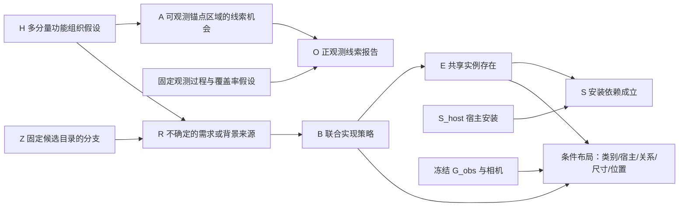

# 功能组织因果生成模型 v2：观测必须改变物体采样概率

本轮核验两篇指定论文及相关原始论文、作者项目与实现，检查本地实际采样路径，并实现 `completion_model=functional`。原 `baseline/joint/needs` 保留，已有实验不改写。

## 1. 结论与研究边界

你对生活历史 C 的质疑成立。具体住户的职业、习惯、消费经历、家庭历史可以是房间形成的上游因素，但单张局部图像通常不能识别它们。把这些叙述写进提示词，再当成确定原因生成物体，会把未经验证的猜测放大。

本版不推断个人生活史，也不是把 C 换个名字。H 定义为**场景生成程序中的潜在功能组织状态**：会客/休憩、阅读组织、工作组织、用餐组织、储物组织、其他背景组织。多个分量可以同时激活。它不是已发生的活动，也不是由当前家具计算出的可供性标签本身。H → 物体是我们明确假设并执行的生成方向；外部真实场景是否遵循这一机制，需要数据和实验验证。

若未来保留历史变量，应对未识别的历史边缘化，而不是输出住户故事。当前实现直接采用较弱的功能组织先验，并保留多种 H 的后验质量。

**已经实现：**明确 CPT、正观测线索似然、精确功能后验、后验驱动需求激活与联合物体采样、共享实例、安装依赖、数值干预、相同候选目录的先验/后验场景对照。

**尚未实现：**从真实完整场景学出的全部机制、校准后的隐藏物体概率、像素/深度渲染似然、人体可达性与真实表面支撑、完整连续几何后验。当前几何仍使用原项目参数化布局后端。不能把本版称为已识别的真实世界因果模型，也不能仅凭测试通过宣称补全质量提高。

## 2. 两篇指定论文的具体启发

| 工作 | 核验到的方法 | 对本项目采用什么 | 不能直接推出什么 |
|---|---|---|---|
| [Human-Centric Indoor Scene Synthesis Using Stochastic Grammar，CVPR 2018](https://arxiv.org/html/1808.08473) | S-AOG 的 And/Or/Set 分解、地址指针、物体属性与终端 MRF；学习功能/支撑关系与可供性分布，采样结构和尺寸，再用 MCMC 调整外部属性 | 用联合实现表达“桌—椅—灯”组合，支撑使用明确实例引用，允许不同配置和数量；结构与几何分层 | 层级语法、功能分组或 MRF 本身不等于可识别的因果 DAG，也不是从局部 RGB 推断任意视野外物体的现成后验 |
| [Holistic 3D Scene Parsing and Reconstruction from a Single RGB Image，ECCV 2018](https://siyuanhuang.com/files/eccv2018parsing.pdf) | HSG 连接功能与几何空间；隐含人体姿态辅助分组；比较预测与渲染的深度、法线、分割图；联合优化布局、物体与人体上下文 | 观测要成为数值约束；功能合理性需要几何可用性支持；后续以可供性/交互姿态因子约束布局 | 想象人体不代表实际存在的人，更不代表可恢复住户经历；重建观测场景的结果也不能自动验证镜头外补全 |

对应作者代码：[S-AOG](https://github.com/SiyuanQi-zz/human-centric-scene-synthesis)、[HSG](https://github.com/thusiyuan/holistic_scene_parsing)。本轮没有声称复现其训练、MCMC 或人体模块。

## 3. 补充相关工作与取舍

| 工作 | 借鉴点 | 和本项目的区别 |
|---|---|---|
| [FactoredScenes，NeurIPS 2025](https://arxiv.org/html/2510.10292v1) | 从数据学习可复用布局程序库，区分结构布局与真实生活场景中的姿态变化 | 不能用语言模型临时写的程序冒充已经学习的机制；论文的姿态建模重点包含朝向变化 |
| [FunFact，CVPR 2026](https://arxiv.org/html/2604.03696v1) | 将候选功能关系变成随机变量，联合推断边缘概率并评价置信度 | 输入为有位姿 RGB-D，主要推断功能关系；不是本项目的单图隐藏实例生成器，因子边也不自动具有因果含义 |
| [3DP3，NeurIPS 2021](https://proceedings.neurips.cc/paper/2021/hash/4fc66104f8ada6257fa55f29a2a567c7-Abstract.html) 与 [Bayes3D](https://arxiv.org/abs/2312.08715) | 显式场景生成、接触/形状与观测模型，推断场景结构和不确定性 | 深度/多视图和模型资源条件不同；不能把 VLM 的自评分当成其图像似然 |
| [MIME，CVPR 2023](https://mime.is.tue.mpg.de/) | 人体运动提供自由空间和接触证据，约束家具布局 | 它具有真实运动输入；本项目没有时，潜在交互姿态只能作为不确定的功能先验 |
| [ATISS，NeurIPS 2021](https://research.nvidia.com/labs/toronto-ai/ATISS/) | 无序物体集合条件生成、部分场景补全，是必须比较的强非因果基线 | 不是只要优于简单共现提示就能证明因果收益 |
| [MiDiffusion](https://arxiv.org/abs/2405.21066) | 联合处理离散类别与连续几何，使用掩码保留部分对象约束 | 可作为后续几何条件模型；当前没有集成它的权重或推断 |
| [Language Models as Causal Effect Generators，EMNLP 2025](https://aclanthology.org/2025.emnlp-main.107/) | 预先规定结构、明确机制采样、区分观测/干预/反事实 | 自定义的 SCM 可以执行干预，不等于从照片识别了真实因果结构 |

因此研究贡献应放在“功能生成机制如何改变隐藏世界分布，以及改变是否有益”，而不是“解释中出现了更多因果词”。

## 4. 与实际代码一致的模型结构



箭头表示假设的生成方向；实际推断从 O 反向更新 H，再更新 R/B/E 的分布。推断方向不是另一组因果箭头。

H 为六个二值分量，精确枚举 64 个联合状态。先验独立是本版简化；共享的 noisy-OR 观测会使后验分量相关。推断保留完整联合后验，不把各分量边缘概率重新当独立概率相乘。

A 是**观测锚点区域**的粗粒度线索机会，不是全世界某类物体的严格存在指示。否则 A_books=0 与隐藏书籍 E_book=1 会产生语义矛盾。隐藏实例 E 属于另一个候选部分；二者在给定 H 后以当前简化机制关联。这个粗观测模型不能替代完整世界到 RGB 的渲染模型。

Z 是图像辅助提出的有限候选目录分支，本版保持参考混合权重，不声称估计了真实房间类型频率。每个分支有一个共享实例目录与最多四个需求，每个需求最多三种联合实现。

R 可以为 0。功能组织存在不要求每种新家具都出现；B 可以只引用观测物体、没有新增对象。背景物品也有生成来源，不要求每件物品都满足一个当前活动。

一个桌子实例可以同时被阅读和储物策略引用：

\[
E_i=\bigvee_k \mathbf 1[B_k\text{ 使用实例 }i],\qquad
S_i=E_i\land S_{host(i)}.
\]

没有新增宿主依赖时，S_i=E_i。这里 S 只验证声明的安装依赖；不证明宿主有真实表面或安装承重能力。关闭某个需求后，物体仍可因另一个需求而存在。

## 5. 观测怎样实际改变隐藏生成概率

每个线索家族 f 的先验机会采用 noisy-OR：

\[
p(A_f=1\mid H)=1-(1-\ell)\prod_{r\in pa(f)}(1-s_{fr})^{H_r}.
\]

正观测概率是：

\[
p(O_f=1\mid H)=\alpha+(1-\alpha)\rho\eta\,p(A_f=1\mid H),
\]

其中 α 是假阳性率，ρ 是覆盖率，η 是检出率。实际 CPT 中有 A→O，并在推断时解析边缘化 A。ρ 当前是明确给定的固定近似，尚不是根据每件物体、实际相机和遮挡算出的可见性。

证据只包括已报告的正线索。缺失家族保持未知；没有看到书架，不会输入 O_storage=0。相同家族重复实例只产生一个二值因子；同一个检测最多分配给一个家族，避免把同一书柜当“书籍”和“储物”两份独立证据。所有来源 ID 写入 `cue_evidence.json`，未识别的名称保留为 unmatched，不强行分类。

\[
p(H\mid O^+,D)\propto p(H\mid D)\prod_{f\in O^+}p(O_f=1\mid H,D).
\]

D 是当前固定目录与接口。需求概率通过 CPT 计算：

\[
p(R_k=1\mid H,Z)=
\begin{cases}
\theta_1,&Z=z_k,H_{role(k)}=1\\
\theta_0,&Z=z_k,H_{role(k)}=0\\
0,&Z\ne z_k.
\end{cases}
\]

默认 θ₀=0.12，θ₁=0.78；角色先验、noisy-OR 强度与观测参数全部在 `functional_parameters.json`。**这些默认数值是可替换的工程假设，不是从指定论文获得的测量值，也不是语言模型输出的置信度。**

R=0 时 B=off；R=1 时按显式策略权重采样。默认策略间等权，允许用配置设置非均匀权重；这不妨碍 R 和最终 E 随证据发生数值变化。

对共享实例，精确存在概率为：

\[
p(E_i=1\mid O^+,D)=\sum_{H,Z}p(H\mid O^+,D)p(Z\mid D)
\left[1-\prod_k\left(1-p(R_k=1\mid H,Z)
\sum_{b:i\in b}p(B_k=b\mid R_k=1,D)\right)\right].
\]

乘积按不同需求计算，同一需求内互斥策略先求和。类别数量的期望为该类不同实例概率之和；它不是互斥类别 softmax，不能要求所有物体概率加起来等于 1。

实际执行顺序为：

```text
提案并验证共享目录 D（不向 VLM 索取概率）
→ 从冻结 G_obs 提取正观测家族及精确来源
→ 精确求 p(H|O+,D)
→ 抽 H 后，按数值 CPT 抽 R 与 B
→ OR 合并共享实例，得到 E 与安装状态 S
→ 选中实例交给原布局后端，预测尺寸、位置与朝向
→ 原样保留 G_obs，导出可行候选及失败记录
```

`structural_samples.json` 保存所有实际结构样本、状态与噪声。`G_full.json` 中每个新增实例附带 `generative_presence_probability`，明确它是**几何筛选之前**的存在概率。保留重复样本，不做“去重后还是 IID 后验样本”的错误声明。

布局失败不重新抽物体来凑成功数量。成功导出集合受到几何成功率选择，其经验频率不能直接冒充原结构后验。失败与阻塞世界必须一起评价。

**概率范围限制：**D 由看过同一图片的 VLM 提出，程序没有可计算的提案密度 q(D|I)。本版是“给定 D 的明确有限条件模型”，不是对所有真实完整世界的无偏视觉后验；没有用未知 q 伪造重要性校正。图像帮助提案，数值层只对粗线索建一次似然；不再乘一份 VLM 自评或解释长度分数。

## 6. 可检查的概率影响与干预

受控手写目录的验证例：观测书籍线索，阅读/储物是不同需求，台灯只在阅读角策略中出现，桌子和书可被两个需求共用。

| 事件 | 不使用线索似然的先验 | 使用线索的后验 |
|---|---:|---:|
| 隐藏台灯存在 | 0.1590 | 0.2447 |
| 同一个共享书籍实例存在 | 0.5652 | 0.6916 |
| 无关背景植物存在 | 0.2250 | 0.2250 |

2400 次实际结构抽样中，台灯频率约为先验 0.1583、后验 0.2388。与解析概率相符的程度在抽样误差范围内。**这只是机制和采样接线验证，不是实际房间效果、真实概率或因果增益评测。**完整数值与可视化：工作区 `research/audits/functional_probability_2026-10-24/controlled_numeric_demo/`。

`probability_audit.json` 同时导出同目录 prior/posterior 及每个 `do(R_k=0)` 的精确物体概率。关闭阅读需求会令这一路台灯概率归零，共享书籍仍可由储物需求保留。`host_interventions.json` 在同一已溯源噪声下重放干预；宿主消失使安装无效，不自动把子物品从库存中删除。这些都是模型内的生成机制查询，不是已验证的现实物理反事实。

## 7. 完整执行命令

文件已经放进工作树。先运行 CPU 验证，再由你运行模型实验：

```bash
cd /data-nfs/gpu1-2/u13529658780/DIT360
bash qwen_edit_pano/scripts/functional_completion.sh test

# GPU3 替换为你可用的节点；来源是已有的双分支冻结观测实验。
CAUPANO_WORLDS=6 bash qwen_edit_pano/scripts/functional_completion.sh compare \
  GPU3 \
  qwen_edit_pano/outputs/causal_completion_pilot_20261024_220629_380006_3407/joint \
  qwen 3407
```

这是新的目录和实验，不续写旧 needs 失败分支。Qwen 方案不需要 API key。`api`/`both` 需要已有 `SILICONFLOW_API_KEY`。

脚本先运行 posterior，生成新的共享目录；prior 分支严格复用同一目录、同一数值参数、同一 G_obs 和相机。prior 只关闭线索似然，重新抽样并运行布局，不重新向 VLM 提案。比较页检查这些条件，使用原项目的真实 AABB、统一坐标范围与同步旋转三维显示。无需重新执行 Observer2D/3D。

结果位于新的 `qwen_edit_pano/outputs/functional_completion_时间_PID/`：

```text
posterior/qwen/completion/probability_audit.html    先验/后验/干预数值
posterior/qwen/completion/cue_evidence.json        每条证据来源
posterior/qwen/completion/functional_parameters.json
posterior/qwen/completion/causal_model.json        实际全部 CPT
posterior/qwen/completion/structural_samples.json  真正送去布局的样本
posterior/qwen/completion/world_*/G_full.json      实际物体、尺寸、位置及存在概率
prior/qwen/completion/candidate_reuse.json        同目录对照的哈希证明
visual_compare_001/index.html                    两列实际结果
visual_compare_001/synchronized_3d.html           同步三维
```

脚本会输出实际比较页路径。重新生成可视化会产生新编号。ERP 图是状态方向图，没有生成 RGB 全景。

如需替换显式参数，复制 `research/audits/functional_probability_2026-10-24/default_functional_parameters.json` 后编辑，再设置：

```bash
CAUPANO_FUNCTIONAL_PARAMETERS=/你的路径/functional_parameters.json \
CAUPANO_WORLDS=6 bash qwen_edit_pano/scripts/functional_completion.sh compare \
  GPU3 qwen_edit_pano/outputs/causal_completion_pilot_20261024_220629_380006_3407/joint qwen 3407
```

参数被完整复制进新实验配置，后续读取原配置，不依赖外部文件继续存在。策略权重键为实际 `B_z0_需求key`，必须覆盖其所有策略，未知键或非正权重会报错。

## 8. 如何让参数来自数据

新增 `assembly_functional_fit.py`，读取人工核验的独立场景 JSONL。每个 `scene_id` 仅一个记录；禁止把同一房间的不同裁剪放进训练和验证。字段为：

```json
{"scene_id":"independent_room_001","split":"train","roles":{"social":1,"reading":1,"work":0,"dining":0,"storage":1,"background":1},"cue_reports":{"seating":1,"books":1,"work_tools":null},"needs":[{"role":"reading","active":1}]}
```

这是格式示例，不能当训练样本。roles 是审核的功能组织标注/代理，不能把它说成观察到了住户意图；needs 的含义要在标注规范中固定。`null` 表示未知；0 必须是在与配置匹配的观测过程下审核过的报告结果，不能从没检测到自动填入。

拟合器只使用 train：估计角色先验、带正则的 noisy-OR 强度，以及有标注时的需求激活频率。覆盖率、检出率、假阳性率和 leak 固定，因为二值报告通常不能同时识别它们。策略权重不冒充已经学习。val 只报告给定审核角色时的线索 NLL/Brier，不把它称为隐藏库存的校准结果。

有真实标注文件后执行：

```bash
/data-nfs/gpu1-2/u13529658780/.conda/envs/qwen3vl/bin/python \
  -m qwen_edit_pano.world_pipeline.completion.assembly_functional_fit \
  --annotations /你的路径/audited_functional_scenes.jsonl \
  --output qwen_edit_pano/outputs/functional_fit_run001
```

输出 `functional_parameters.json` 可通过上一节环境变量直接用于推断。当前没有把已有 GT 清单伪装成功能标注，也没有运行真实训练。

## 9. 下一轮优先级

1. 先运行固定目录的概率对照，逐条审核真实提案、概率变化和所有布局失败，确认任务覆盖完整周围空间，而不是给可见家具重复加小物。
2. 建立独立房间级功能/库存/宿主标注与多视野遮挡划分；同时评价候选目录召回。候选中没有的类别，重加权无法找回。对未见用途保留背景路径，不能要求每件生活物品都服务一个活动。
3. 学习需求→联合实现的条件分布与类别/宿主条件尺寸、相对位姿；从程序库中提案，不只依赖即时长文本。以 ATISS/MiDiffusion 等强条件模型对照，增加相同预算的无功能瓶颈模型。
4. 加入 HSG 式可测观测约束：从观测 RGB 估计深度/法线/分割，学习残差与不确定性，保证同一观测不被多次当独立证据。单图尺度、相机俯仰和房间边界不确定性也要保留。
5. 将人体可达性、交互空间和支撑面作为联合空间因子。当前 AABB 交叠/接触是代理：上一轮真实结果已出现支撑接触投影很小、将靠墙家具当壁挂等问题。零碰撞不足以证明可用或稳定。
6. 对连续布局明确概率/提案密度或明确采用能量优化；没有可计算提案密度时，不声称获得无偏几何后验。若几何筛选改变库存分布，要报告选择效应，避免无意识偏向少物体的世界。

评价至少包括：隐藏类别/数量覆盖，几何可行与宿主有效率，观测保持，概率 NLL/Brier/可靠性，候选多样性，全部样本失败率，域外用途泛化。用可控模拟环境产生需求或宿主机制变化的成对样本，再检查模型内干预方向是否符合已知机制；真实房间上的干预解释不能代替这些证据。

## 10. 本轮验证

完整 CPU 套件 **88 项通过**，其中本版新增 10 项；覆盖解析后验、相关角色下的共享实例边缘概率、实际采样频率、需求干预、噪声重放、未知缺失、证据去重、参数对生成概率的影响、训练/验证场景隔离、同候选端到端导出与真实几何可视化。Shell 语法检查通过。没有执行真实 GPU/API 推断，没有据此声称真实场景质量提高。

实现文件：`assembly_functional.py`、`assembly_functional_fit.py`、`assembly_world.py`、`assembly_experiment.py`、`assembly_pilot_visual.py`；入口 `scripts/functional_completion.sh`；验证 `test_assembly_functional.py`。审计保存在工作区 `research/audits/functional_probability_2026-10-24/`。

## 11. 实际运行失败修复：kind/role 与上游依赖

`functional_completion_20261024_235203_723560` 的原始错误是 Qwen 返回 `kind=social, role=social`，需求类型校验失败。此后 prior 仍启动，最后比较页直接读取缺失模型，出现连锁 FileNotFoundError。

修复包含：提示明确区分 kind 与 role；只有活动角色与 kind 完全相同的无歧义写法才转换为 `kind=activity`，并记录 `interface_normalizations`，不改原始回复或新增物体。上游目录未产生时 prior 写入 blocked 记录并跳过模型运行；比较页显示原始错误，不把失败当成功对照。已成功的场景假设会立即保存，避免后续失败丢失中间产物。

`qwen` 使用服务器本地 Qwen，概率计算也在本地；本次复用已有观测，不需要 API Key。`api` 或 `both` 才需要 `SILICONFLOW_API_KEY`。修复后按第七节原命令重跑，自动创建新实验目录；旧输出不覆盖。
