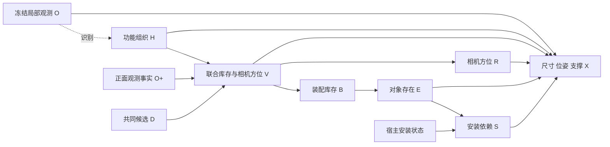

# v11：联合功能库存与全景空间组织

2026-10-27 实际结果已审计：Qwen 新增仅 `[1,1,2,2]`，出现单选/菜单首项/left 集中；API 因 HTTP 500 未完成。当前没有完整世界质量提升证据。请先读 [V11_RESULT_ROOT_CAUSE_REVIEW_20261027.md](V11_RESULT_ROOT_CAUSE_REVIEW_20261027.md)，先运行固定 D 的小规模机制对照，再决定是否改方法。下文“真实实验尚未运行”等为实现交付时的历史状态。

2026-10-26，Asia/Shanghai。不训练、不拟合场景数据集先验。已实现执行代码；真实 Qwen/API 实验由用户运行，本文件不宣称真实质量已经提升。

## 1. 回看旧版本后保留什么

真实 v9.1 `outputs/panorama_completion_20261026_181035_3984837`：端到端 Qwen 四次新增 [7,6,9,9]，后方累计 17/31；API [7,7,9,9]，后方 20/32。v10 则 Qwen [0,0,0,20]，后方 3/20；API [9,15,10,10]，后方 0/44。后方指原相机中心 Z<0，累计记录不是一个世界的数量。

旧版值得保留的是：**相机方位是采样场景方案的一部分，几何不能为了靠近可见家具把 rear 改成侧方。** 不恢复每种用途/模式只能选一个装配的限制，也不把较大的后方计数当作真实答案。

v10 的真实问题见 [V10_WORLD_QUALITY_REVIEW_20261026.md](V10_WORLD_QUALITY_REVIEW_20261026.md) 与[全部旧结果对比](../research/audits/v10_world_review_20261026/actual_002/index.html)：

- 只有一个明确 rear 装配；7 个 unspecified 装配的方位交给数值近邻搜索。
- 媒体装配的一些“沙发对面”描述伴随 larger camera Z 关系，排除了后方。
- Qwen RGB 条件选择空集集中，而同域 tag-only 更丰富。这是机制输入需要检验的证据，不是“删掉 RGB 必然更好”的证明。
- 宿主身份误绑定、接触擦边、尺寸与功能距离问题同时存在。

**本版只复用旧观测，不导入旧候选、概率或成功布局。** 后方支持来自新条件机制的真实采样，不把旧物体旋转到背后冒充新推断。

## 2. 本次实际改动

### 2.1 联合采样库存与相机方位

v10 先决定候选装配存在，再复制其声明的 R；没有方位时搜索侧边/后方。v11 将一个装配的状态改成：

\[
V_i\in\{\mathrm{none}\}\cup\mathcal R_i.
\]

对方位未知、无固定观测宿主的独立装配，允许 left/right/rear；明确声明的方位仍保留。提案可用 `region_options` 表达更窄的不确定域。已有相机深度顺序通过必要的中心 LP 排除矛盾方向；这个测试不证明完整框或物理可行。

附着固定观测宿主的装配，不能随着候选整体搬走：未声明方向时保留 anchored/unspecified 的接触搜索，由固定宿主限制位置。**这不等于给独立家具继续使用 unspecified。** 如果候选显式声明了方位，仍需满足它。

冻结模型每次直接输出一个完整向量，例如：

```json
{"assemblies":[{"id":"a0","region":"rear"},{"id":"a3","region":"left"}]}
```

缺席单位表示 none。所有单位共同决定，不把每个方位独立抽样。只有数值平滑尾项采用显式的单位独立基分布。前述 a0/a3 仅说明语法，不指定必选对象或后方数量。

同一单位改变方位时，共用原始物体实例、类别、宿主和存在节点；不会把左侧书柜与后方书柜算成两个不同拥有物体。同用途多个装配仍可共存。

left/right/rear 沿用当前受保护几何的方向域定义，不是严格互斥、等面积的角扇区：侧方域也可能覆盖部分负 Z。概率表的 rear 是“声明 rear 方案”的事件；实际后方内容在可视化里另外按最终中心 Z<0 统计，二者不能直接互换。

### 2.2 保留正面观测，增加规范 seed 的 RGB 对照

主库存机制读取固定的正面观测物体事实、H 与共同 D；RGB 继续用于提案、用途识别和数值布局。其研究假设是：减少把“未被拍到”当成“不存在”的影响，同时让图像通过上游影响候选与用途。

增加 `rgb_inventory`：相同 H/D/文字/预算，在联合选择阶段另附 RGB。两组本地请求使用**同一个规范 draw seed**，修复 v10 的阶段名造成 seed 不同的问题。API 不传 seed，不能声称服务端严格同噪声。该对照检验主路径的证据表示是否合适，不能按物体数量单独判胜。

目前正面事实包是核对后的对象 ID/名称；没有声称它已完整编码所有墙面、材质或空间线索。这仍是本版的表达局限。

### 2.3 修复两个已确认的正确性问题

- **固定宿主名称绑定：** 对 `obs_*` 的承载依赖需提供 `observed_host_name`，与冻结描述严格一致。相框不能被称为边桌。错误依赖组件整体拒绝，独立候选可保留；最终世界不删物体、不静默换宿主。这修复身份冲突，但不证明同名宿主真的有可用表面。
- **支撑代理：** 对 `rigid_box` 的 top/seat/shelf 依赖，数值求解要求孩子框中心投影在宿主框投影内；避免原来仅极小擦边重叠通过。假设为均质刚性框、单一水平支撑，不是已测重心/网格稳定性。不要求孩子整个框投影全部包含。显式 `contact_only` 用于质量/支撑模型未知的柔性等情况，保留其物理未验证状态。

新对象主状态同时导出数值阶段已经提出的 `orientation_yaw_camera_deg` 和 `intrinsic_size_m`。朝向为相机 Y 轴旋转假设，物体规范正面方向仍未验证；观测对象保持原样。

near 仍无全类别统一距离阈值；数值解保留距离和功能诊断。没有修复原始观测家具底面不共面，也不把它归因于新库存机制。全套几何检查仍是有限框模型。

## 3. 实际实现的模型

- O：固定局部 RGB、相机和预测 G_obs；O+ 为正面物体事实。
- H：不确定的功能组织标签；不含住户历史，也不声称正在发生相应活动。本版没有把未实现的丰富 H* 长文本当成新变量。
- V=(V_1,…,V_M)：联合的可选装配及相机方位向量。
- B_i=1[V_i≠none]：装配库存；R_i 从 V_i 确定。
- E_o=B_unit(o)：物体拥有/存在。
- S_o=E_o∧S_host(o)：声明的安装依赖。无新宿主或宿主为固定观测时，该宿主依赖基值为 1；不是实际物理稳定性。
- X：在 O、H、V、E/S 条件下提出并求解的尺寸、位姿与接触。



\[
q(H\mid O,D)\,p(V=B,R\mid H,O^+,D)
\prod_o\mathbf1[E_o=B_{unit(o)}]\,
\mathbf1[S_o=E_o\land S_{host(o)}].
\]

X 使用隐式冻结模型与几何求解，没有可计算的归一化 RGB 世界后验。上图为条件生成/推断结构；O 的条件箭头不表示照片物理制造物体。没有识别真实世界因果结构的主张。

实现中 J 是稀疏混合表示；`M_unit_*` 保存 V_i，`A_unit_*` 是确定性 B_i，`R_unit_*` 是确定性方位。J 不是新的物理原因。不要把安装 S 与物理验证混为一谈。

### 概率真的进入采样

记 n_hv 为条件机制固定预算有效选择次数、m_v 为参考机制次数。使用与上一版相同的 alpha=eta=1：

\[
\pi_0(v)=\frac{m_v+\eta\nu_0(v)}{K_0+\eta},\qquad
\widehat p(v\mid h,O^+,D)=\frac{n_{hv}+\alpha\pi_0(v)}{K_h+\alpha}.
\]

基分布为：

\[
\nu_0(v)=\prod_i\mu_i(v_i),\quad
\mu_i(none)=\tfrac12,\quad
\mu_i(r)=\frac{1}{2|\mathcal R_i|}.
\]

这里保留原先无信息库存基分布。**增加方向备选不会把单位存在先验从 1/2 偷偷变成 3/4。** 它不是房间占用目标，也不是数据拟合概率。

对象与声明 rear 等方案事件的概率由上述联合分布精确求和，进入逆 CDF 采样。例如：

\[
P(E_o=1)=\sum_hq(h)\sum_v\widehat p(v\mid h)\mathbf1[v_{unit(o)}\ne none].
\]

H 对库存与方位的影响在 `functional_probability_interventions.json` 中给出实际数值；如果机制本来平坦，报告零效应，不手填增益。空集、重复和数值失败全保留，不重抽到非空，不通过删物体制造成功。

## 4. 文献借鉴与适用边界

- [Human-centric Indoor Scene Synthesis Using Stochastic Grammar](https://arxiv.org/html/1808.08473)：借鉴功能组、承载关系、上下文组织与联合场景采样。它的概率来自学习，本项目不复制其学习参数、物体密度或活动路径模型。
- [Holistic 3D Scene Parsing and Reconstruction](https://siyuanhuang.com/holistic_parsing/main.html)：借鉴功能、几何、物理联合表达及结果检验。本项目没有实现其深度/法线/分割渲染似然或 MCMC 逆推断。
- [SD-SCM](https://aclanthology.org/2025.emnlp-main.107/)：借鉴指定结构、冻结 LM 机制与显式采样/干预；不据此宣称因果图已经识别或真实概率已校准。

本版的依据是本项目的退化证据及上述结构启发；不是增加故事文字、强制每个角度有物体或把旧成功世界挪到后方。

## 5. Qwen/API 对比配置

五分支×两后端，各采样四次，默认共 40 次布局：

| 分支 | 比较内容 |
|---|---|
| end_to_end | 同 D，各自估计正面事实/H 条件的联合 V，再布局 |
| layout_control | 合并原始次数后平滑一次；两路库存、相机方位与结构噪声完全相同，仅布局后端不同 |
| function_free | 切断库存/空间 H 边，保留完整联合 V 边缘分布；检验 H 关联和干预响应，不期待平均数量变化 |
| direct_inventory | 同一 D/O+ 联合 V 输出，不提供 H；几何保留匹配的 H 上下文 |
| rgb_inventory | 主机制相同文字菜单，选择时加入 RGB；本地规范 draw seed 配对 |

两后端使用相同图像字节、G_obs、相机、域、提示模板、温度 0.4/top_p 0.9/top_k 50 的请求设置和校验政策。API 为硅基流动 `deepseek-ai/DeepSeek-V4.1-Flash`，地址 `https://api.siliconflow.cn/v1`，密钥只从 `SILICONFLOW_API_KEY` 读取。服务端 seed 和内部解码不能与本地严格等同。

直接路径与功能路径的初始联合选择调用数均为 K×|H|，单次上限 1536；参考/识别/提案为共同成本，RGB 为额外诊断成本。实际修复次数、有效票数与 token 使用量另行记录。预算匹配不证明因果质量收益。

## 6. 执行代码与指令

核心：`world_pipeline/completion/assembly_holistic.py`；调度：`assembly_holistic_experiment.py`；几何：`assembly_holistic_geometry.py`；可视化：`assembly_holistic_visual.py`。原 v9/v10 行为默认不启用新支撑假设。

先运行 CPU 检查：

```bash
cd /data-nfs/gpu1-2/u13529658780/DIT360
bash qwen_edit_pano/scripts/holistic_completion.sh test
```

真实运行由用户执行，沿用已经设置的 `SILICONFLOW_API_KEY`：

```bash
cd /data-nfs/gpu1-2/u13529658780/DIT360
CAUPANO_WORLDS=4 CAUPANO_MECHANISM_DRAWS=4 \
CAUPANO_CONCENTRATION=1 CAUPANO_REFERENCE_CONCENTRATION=1 \
CAUPANO_BASELINE_ROOT=qwen_edit_pano/outputs/panorama_completion_20261026_181035_3984837 \
bash qwen_edit_pano/scripts/holistic_completion.sh compare GPU3 \
  qwen_edit_pano/outputs/assembly_set_completion_20261026_195138_370210/end_to_end 3407
```

输出为新建的 `outputs/holistic_completion_时间_PID/`，入口 `index.html` 自动包含旧版后方结果、全部端到端/同库存布局/RGB 对照样本的同坐标 XZ、可旋转 3D、ERP 方向图，以及五分支概率/支撑清单。类别表外仍使用紫色或红色保留；没有生成 RGB ERP。

只检查真实输入和配置、不调用模型：

```bash
cd /data-nfs/gpu1-2/u13529658780/DIT360
bash qwen_edit_pano/scripts/holistic_completion.sh prepare GPU3 \
  qwen_edit_pano/outputs/assembly_set_completion_20261026_195138_370210/end_to_end 3407
```

需要同时比较 v9.1 和 v10 时，运行结束后把 ROOT 替换为新目录；这是纯 CPU 可视化，不再调用模型。`--out` 使用未存在的目录：

```bash
/data-nfs/gpu1-2/u13529658780/.conda/envs/qwen3vl/bin/python \
  -m qwen_edit_pano.world_pipeline.completion.assembly_holistic_visual \
  --root ROOT \
  --baseline-root qwen_edit_pano/outputs/panorama_completion_20261026_181035_3984837 \
  --baseline-root qwen_edit_pano/outputs/assembly_set_completion_20261026_195138_370210 \
  --out ROOT/visual_all_versions_001
```

## 7. 验收标准

本版需要实测：后方候选是否进入合理的联合概率、采样后是否完整保留；Qwen 空集集中是否改善；身份/支撑问题是否减少；内容与功能是否合理；两后端在同库存下的尺寸和空间能力有何差异。不能只按后方数或总数判胜。

单张图不能唯一确定隐藏世界；本版仍是有限 LM 候选域、未校准机制和框几何代理。没有完整墙体、通行模拟、网格稳定性或真实隐藏 GT 的验证。详细 CPU 验证结果见 [release_validation.json](../research/audits/holistic_v11_20261026/release_001/release_validation.json)，其中合成 fixture 仅证明代码执行合同，不是新真实生成效果。

已完成 **214/214 项 CPU 回归**（原 204 项加新 10 项）、真实输入 prepare-only（92 项代码哈希匹配）、五分支两后端合成执行及可视化链路检查。原 v9.1/v10 共 4,280 份来源 JSON 未变，38 处合成可视化本地链接有效。

另外对原 v10 两个样本作固定库存/尺寸的几何重放：API world_01 的 9 个对象通过新支撑代理；Qwen world_04 的 20 个对象在新约束下没有得到通过的数值解，完整 20 个候选全部保留为诊断。这不是新语义生成效果，也不证明所有更优数值解均不存在；它说明旧“擦边即可通过”不能作为合理世界的认证。新运行若被阻断，应查看完整候选与失败原因，不能把少导出误读为生成阶段删物体。
