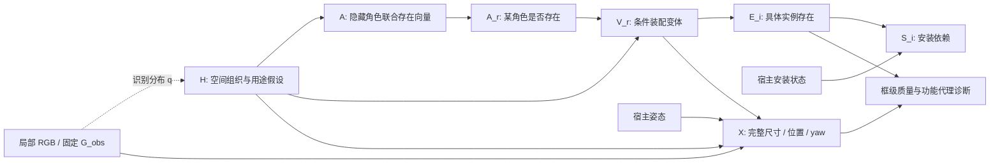

# v6：局部观测条件下的联合功能区域存在模型

2026-10-25。针对真实实验 `outputs/modular_completion_20261025_162311_4103717` 的根因改进；不是凭生成数量判断效果。

**已实现可运行代码、同配置本地/API 对照、概率干预与类别表着色。尚未运行真实 v6 GPU/API 实验，不能提前声称质量或因果增益提高。**

## 1. 为什么需要这次修改

已有证据见 [v5 实证审计](MODULAR_V5_RESULT_REVIEW_20261025.md)：

- 原始装配选择中，本地 64 次只有 1 次 none，API 64 次没有 none；API 四个角色的激活率不随 H 改变。
- reading/social/storage/work 往往一起进入世界，新增库存靠近组合上限。办公装配单独固定含 8 条记录。
- v5 将 none 与 J−1 套具体装配一起平滑：零 none 选择时，P(none)=1/[5J]。存在概率被替代项数量影响。
- 去掉平滑后的期望新增反而上升，说明问题也在机制生成偏向，不能只修改 α 或增加采样次数。
- 本地 7/12 次数值失败主要留下 null，保存输出由 EOS 结束；提高 token 上限没有根因依据。
- 提案深度词表前后冲突，部分成功提案计数误报。导出成功和求解收敛也不保证零碰撞。

因此本轮修改存在/替代项的分解、角色联合机制和接口验证；不添加最低物体数，不根据这张图调一个“看起来合适”的数量上限，不虚构住户历史，也不从未知房间范围编造容量约束。

## 2. 相关工作：实际借鉴与适用边界

以下为重新查阅的原论文、作者项目和官方代码。不是完整复现这些方法。

| 工作 | 可借鉴的具体机制 | 对本项目的边界 |
|---|---|---|
| [Human-Centric Indoor Scene Synthesis Using Stochastic Grammar](https://arxiv.org/html/1808.08473) / [作者代码](https://github.com/SiyuanQi-zz/human-centric-scene-synthesis) | S-AOG 将结构语法与终端 MRF 上下文相结合；功能分组、支撑关系和组间相容性应共同考虑 | 有向语法层级不等于已识别因果图；原方法学习分支、尺寸和 affordance 分布，不能将手写标签当成同等证据 |
| [Holistic 3D Scene Parsing and Reconstruction from a Single RGB Image](https://siyuanhuang.com/files/eccv2018parsing.pdf) / [官方 inference.py](https://github.com/thusiyuan/holistic_scene_parsing/blob/master/inference.py) | 功能层、几何层与物理约束联合；analysis-by-synthesis 使用深度、法向、分割投影比较 | 主要重建图像所约束的结构；图外物体无像素证据。当前工程没有实现其渲染似然，不能宣称拥有相同的 MAP 推断 |
| [SD-SCM: Language Models as Causal Effect Generators](https://aclanthology.org/2025.emnlp-main.107/) / [官方 sdscm.py](https://github.com/lbynum/sequence-driven-scms/blob/main/sdscm.py) | 声明 DAG，机制只读取父变量；干预替换机制，保持其余噪声用于模型内对照 | [原文限制](https://arxiv.org/html/2411.08019)明确指出非平凡关系及措辞稳定性不自动保证；本工程使用有效生成频率，未照搬 token 评分，也未证明现实因果 |
| [FactoredScenes: From Programs to Poses](https://arxiv.org/html/2510.10292v1) | 场景程序与姿态预测分解，程序库从样例学习 | 支持保留“结构选择→条件几何”，同时提示：只靠 LLM 临时提案不等于学得可靠程序库。原文主要研究无条件场景生成 |
| [MiDiffusion](https://arxiv.org/html/2405.21066) / [官方实现说明](https://github.com/MIT-SPARK/MiDiffusion) | 混合离散类别与连续几何；已有物体通过 corruption/masking 固定 | 官方 completion 使用平面图及已有物体；当前单图没有可靠完整平面图，不能把未知区域当成已知 floor mask |
| [Diorama](https://3dlg-hcvc.github.io/diorama/) | 单图开放词汇感知、场景图、支撑平面与语义布局优化 | 更接近从图像重建场景；支持模块化和显式关系，但不直接解决隐藏库存概率或其因果识别 |
| [PhyScene](https://physcene.github.io/) | 将碰撞、房间约束、可达性分开检查与引导 | AABB 零重叠不等于可达性、操作性或稳定性通过。本版本只完成框级检查，不能冒充物理仿真 |
| [Function2Scene](https://arxiv.org/html/2605.30819) | 功能需求转成可测量约束，工具检查与修复 | 人物和活动来自明确设计任务；不能反向套用为从一张图片可靠推断住户身份或生活经历 |
| [SceneSmith](https://proceedings.mlr.press/v306/pfaff26a.html) | 分层生成同时检验物理与交互属性 | 文本驱动仿真环境的对象密度目标不等于本任务的隐藏真值数量；不能照搬“物体更多”作为补全质量指标 |

独立判断：这些工作支持功能组织和物理结构建模，却不共同构成“从单图已识别真实场景形成因果机制”的证明。本项目应准确称为**带显式假设机制的条件场景 SCM**，通过跨场景校准与干预实验检验其研究价值。

## 3. 模型变量和结构

固定上下文 O：局部 RGB、原 G_obs、相机参数；固定域 D：提案形成的有限对象/装配域、观测身份和类别表。

- H：潜在空间组织/用途方案。仅传递规范功能标签与固定定义；不含对象清单、图像描述、具体人物历史或实际正在发生的活动。
- A：额外隐藏功能装配的**联合二元向量**。A_r=1 表示另外存在一组该角色的隐藏装配，而不是判断照片中是否支持此活动。比如已见沙发不要求再生成一组沙发，也不证明隐藏社交物品不存在。
- V_r：A_r=1 时的具体装配变体。每个变体含声明共存的家具和物品；A_r=0 时是 none。
- E_i：某个具体假设实例是否存在；观测实例不参加该采样。
- S_i：声明宿主依赖是否满足，不是稳定支撑/挂墙认证。
- X：完整尺寸、yaw、相机位置等数值世界状态；从 O、H、被选变体和宿主姿态条件生成与求解。
- Q：由 E、X 计算的碰撞、支撑、近邻距离等质量诊断。实际功能可用性属于下游检验，不能既当成已知上游原因又由生成结果循环证明。



图中 O→q(H) 表示推断过程，不应写成现实世界中的“图片造成房间用途”。D 是全程固定的条件，图中省略。结构方程只定义候选域内的模型，不声称识别了原始场景形成 DAG。

程序实际使用 `H`、`A`、`A_reading` 等二值节点、`M_reading` 等变体节点（M 是 V 的代码名）、`E_*` 和 `S_*`；真实父变量写入 `mechanism_graph.json`，每世界姿态方程写入 `pose_model.json`。

## 4. 概率机制为什么会真实改变生成

在固定 O、D 下：

\[
q(h\mid O,D)\,p_\theta(a\mid h,D)
\prod_r p_\phi(v_r\mid h,a_r,D)
\prod_i\mathbf1\{e_i=f_i(v)\}\,
\mathbf1\{s_i=e_i\land s_{host(i)}\}.
\]

没有宿主的根节点 S_i=E_i。候选变体中的实例是明确不同的假设身份；没有证据把它们当成同一个隐藏物体进行合并。组内所有对象共存仍是当前语法假设；较小库存需由不同变体表示，不能事后任意删物体。

识别 q(H) 读取同一观测板。联合激活机制只读取 H 与固定观测身份/角色域，不读取变体数量、变体清单、照片、识别投票或既往回答。变体机制只读取 H、该角色已激活、固定域内变体及固定观测身份。两后端每个阶段使用相同提示和预算。

对 R 个角色，A 的域是全部 2^R 个二元向量，含全零和全一。每个 H 有 K 次联合生成，保留有效/无效次数，用总浓度 α=1 的均匀 Dirichlet 预测：

\[
\widehat p(a\mid h)=\frac{n_{h,a}+\alpha/2^R}{K_h^{valid}+\alpha}.
\]

先验每角色存在概率为 1/2，不随这个角色有几套具体变体而变化。若 K=4 次都选择该角色存在，其 absence 概率为 α/[2(K+α)]=0.1；不再是依赖候选数 J 的 1/(5J)。这是公开的平滑假设，不是从真实数据学出的 50% 存在率。

V 的选择在非空变体域单独平滑。一个含办公标签的 H 也不强制办公区存在；不含办公标签亦不强制不存在。通过匹配 H 的加/去单个标签对照检查实际影响。

实例概率为：

\[
P(E_i=1)=\sum_hq(h\mid O,D)\,P(A_r=1\mid h,D)\,P(V_r=v(i)\mid h,A_r=1,D).
\]

这条数值直接进入逆 CDF 采样并写入每个新增对象的 `generative_presence_probability`。完整类别存在概率与期望类别数量分别计算；例如同一装配含两本书时，“有书的概率”不等于“书的期望数量”。数量分布通过条件卷积与联合激活求和精确计算。

**重要限制：若实际 LM 仍然对所有 H 选择所有角色，图不会自动产生有意义的 H 效应。代码会报告零/弱效应，不增加手写惩罚来伪造提升。联合激活允许相关性，并不保证 LM 学会合理空间容量。**

## 5. 干预和消融的解释

1. `do(H=h)`：逐 H 精确类别/实例/数量概率，以及同外生噪声下库存的变化；只证明假设模型内部效应。
2. `do(A_r=0)`：切断该角色的实现途径，保留其他角色与其噪声；该角色的具体实例不会生成。
3. `do(E_host=0)`：移除宿主的存在不会抹掉已拥有的子物体；子物体保留但安装状态无效。这与“该角色从未激活”是不同问题。
4. 几何宿主位移：见每世界 `pose_interventions.json`；是已有局部方程的敏感性，不冒充重新推断或渲染后的反事实。

v6 的 `function_free` 切边使用识别分布加权，不再用均匀 H 平均：

\[
p_m(A)=\sum_hq(h)p(A\mid h),\qquad
p_m(V_r=v\mid A_r=1)=
\frac{\sum_h q(h)P(A_r=1\mid h)p(v\mid h,A_r=1)}{\sum_h q(h)P(A_r=1\mid h)}.
\]

此对照实际移除 H→A 和 H→V 边，保留联合激活分布及每个装配/实例边缘概率；改变 H 对组合的组织作用。它不是要求两边物体数量必须不同的实验。H 仍参与几何条件生成，因此这是**库存机制 H 边消融**，不是宣称移除了所有功能影响。

## 6. 同时修复的工程根因

- 全部提案、原始允许词表与修复错误只暴露 `farther_than`（较大原相机 Z）和 `nearer_than`（较小 Z）。旧内部几何词只在已验证的编译边界转换；不猜测新回答中的模糊深度关系。
- 提案后续失败时，summary 仍记录已保存的有效程序和实例数量，保留 failed/partial_success。
- 布局模板删除无关 attachment 数值字段；所有必填 null、缺失尺寸/range/yaw/offset 一起报告给一次修复，不能拿默认 3 米、零 yaw 等充当模型预测。
- 库存生成后不重采直到非空；不删碰撞对象。全局框求解保持观测和尺寸，仍有非许可碰撞、原视锥违反或明确顺序违反时，完整库存留在 `G_full_candidates.json` 并可视化；不导出完成 `G_full.json`。
- 增加声明 near 的中心距离与 AABB 表面间隔诊断。不对所有功能关系套一个任意距离阈值，也不将未测墙面判定为已知错误。
- 观测对象逐字段不变，新增完整 AABB 必须在原视锥外；坐标仍为 x 向右、y 图像向上、z 向前，米与完整尺寸。

严格 AABB 门槛具有保守性：桌腿之间的空隙等真实几何不能由外包框表示，框重叠可能是网格级误报。因此这里叫“框级契约未通过”，不直接宣称真实物体发生物理穿透；仍保留完整诊断候选供审核。

## 7. 数据集类别与颜色

使用现有 `data/gt_world_supplement_v1/vocabulary.json`，是官方 MP 映射绑定的**37 类对象词表**；不能误称完整 40 类，也不能换用 NYU40。官方 TSV SHA 为 `2425968dff3307478803bc0387ae39c4e7e57a46f02fd2f848340f1d2fc45d38`。

保留两个字段体系：原始细粒度 `raw_category` 与当前状态实际 `category_id` 对应的 `dataset_category_label`。不为表外名称创建 embedding ID，不将不认识的名字强行改成 misc。比如 armchair 原始名称不在 37 类表内，但可映射为 chair；book 可能只能投影为 objects，这不证明完成了细粒度类别验证。

| 颜色 | 含义 |
|---|---|
| 蓝 | 固定观测 |
| 橙 | 原始类别名经格式规范化后就在类别表内，且状态实际类别受支持 |
| 紫 | 原始类别名不在类别表，但状态有受支持的数据集映射 |
| 红 | 当前状态类别未解析/不在对象词表，物体仍完整保留 |

`taxonomy_review` 同时保存原始 membership、实际输出类别、名词独立解析结果、两者是否有冲突、粗类别标记与文件哈希。交互 3D、同步旋转、XZ 图、ERP、表格使用相同配色。已有 v5 结果可以在新目录只重绘颜色，原始 G_full 不修改。

## 8. 运行方式

GPU/API 正式实验由用户运行；API 固定硅基流动 `deepseek-ai/DeepSeek-V4.1-Flash`，base 固定 `https://api.siliconflow.cn/v1`。继续使用终端已经配置的 `SILICONFLOW_API_KEY`；变量不存在时脚本提前退出。无需把 Key 提供给聊天。

先检查代码：

```bash
cd /data-nfs/gpu1-2/u13529658780/DIT360
bash qwen_edit_pano/scripts/activation_completion.sh test
```

正式运行（GPU3 换为可用节点；只复用旧观测，所有提案、概率机制、数值布局重新生成）：

```bash
export CAUPANO_WORLDS=4
export CAUPANO_MECHANISM_DRAWS=4
export CAUPANO_BASELINE_ROOT=qwen_edit_pano/outputs/modular_completion_20261025_162311_4103717
bash qwen_edit_pano/scripts/activation_completion.sh compare GPU3 \
  qwen_edit_pano/outputs/modular_completion_20261025_162311_4103717/end_to_end 3407
```

输出 `outputs/activation_completion_<时间>_<PID>/index.html` 自动链接可视化。六个分支为：

- `end_to_end/{qwen,api}`：共同观测/共同候选域，各自估计识别与机制、各自生成几何。这里包含 API 候选供本地使用，不能称本地独立自主完整能力。
- `layout_control/{qwen,api}`：合并两后端原始有效次数、只平滑一次，使用完全相同的库存与随机噪声，比较布局能力；样本 SHA 必须一致。
- `function_free/{qwen,api}`：同后端、同候选，使用上述保边缘库存 H 边消融，不额外请求机制。

`CAUPANO_BASELINE_ROOT` 使报告同时加入真实旧 v5 端到端输出；这是版本整体对比，不能单独归因于某一条因果边。两后端使用相同公开采样参数、图像板、逐阶段提示、K 和修复政策；API 内部视觉编码与 seed 无法证明完全相同。

联合 A 每个 H 只需 K 个请求，不需要请求全部 2^R 个模式；但匹配 H 域扩大后，机制总调用数会上升。准备和提案之后生成 `call_budget.json`，列出初始调用和含一次修复的上限。默认 K=4 是诊断预算，不能证明细小概率差异稳定；不能靠提高 K 纠正系统性全激活偏向。

也可单独重建对比页，自动选新画廊目录：

```bash
CUDA_VISIBLE_DEVICES= OMP_NUM_THREADS=1 OPENBLAS_NUM_THREADS=1 MKL_NUM_THREADS=1 \
MPLCONFIGDIR=/tmp/caupano_review_mpl \
/data-nfs/gpu1-2/u13529658780/.conda/envs/qwen3vl/bin/python \
  -m qwen_edit_pano.world_pipeline.completion.assembly_activation_visual \
  --root qwen_edit_pano/outputs/activation_completion_实际目录 \
  --baseline-root qwen_edit_pano/outputs/modular_completion_20261025_162311_4103717
```

## 9. 如何判断本轮有没有真实进展

先看接口有效率与所有失败分母，再看结构生成分布及匹配 H 的数值效应，最后看框布局/类别与人工语义检查。导出数下降也可能来自严格碰撞门槛，不能直接等同模型变差；实际拟合库存和失败候选均保留。

更关键的后续研究必须是跨场景学习/校准：

1. 按物理场景划分 train/validation/test，避免同一房间相邻视图泄漏。
2. 仅训练阶段利用全景/3D 真值构造局部可见 O 与图外库存目标，标注或学习额外功能组；不能仅凭 H 标签缺失制造 absence 真值。
3. 拟合联合激活与变体机制，包含真实空区域和多功能共存的负/正例；在验证集选择平滑/校准参数。
4. 测试时只输入局部 RGB，评估类别存在 Brier/NLL、概率校准、隐藏类别召回、尺寸位置误差与结构关系。有限 D 的候选覆盖率必须单独报告，避免把域外真值当作正确不存在。
5. 重复机制估计、匹配 H 干预与移除宿主对照，区分模型内敏感性和跨场景补全收益。单张图四个样本不足以支持真实因果正确性。

完整房间范围 L 的分布、可达性/支撑面恢复、学习到的类条件尺寸分布、实际渲染证据循环，均需要额外数据与验证；本次不伪装为已实现。当前可执行闭环是“有定义的概率机制→真实库存→条件几何→严格框约束→类别与功能代理诊断”，仍输出合理世界假设，不保证恢复唯一真实隐藏世界。

## 10. 代码与本次验证产物

- `world_pipeline/completion/assembly_activation.py`：结构机制、精确边缘概率、实际采样与干预。
- `assembly_activation_experiment.py`：共同域、匹配 H、两后端机制与池化。
- `assembly_activation_geometry.py`：完整数值错误反馈、全局框约束与 near 距离诊断。
- `assembly_taxonomy.py`：固定数据集类别审核与颜色。
- `assembly_activation_visual.py`：真实结果、旧版本、库存 H 边消融与同步视图。
- `scripts/activation_completion.sh`：执行入口。

验证入口：工作区 `research/audits/joint_activation_v6_20261025/index.html`。真实 v5 类别重绘与 v6 合成 fixture 分开标记；CPU fixture 不能证明真实 v6 生成效果。真实 GPU/API 结果以用户运行新输出为准。

交付检查：146 项 CPU 回归通过，其中新增 13 项覆盖联合存在概率、实际采样干预、保边缘切边、接口反馈、类别颜色、六分支流程和 shell 依赖失败。真实输入已完成 CPU 预检查；没有加载真实模型、提交 GPU 或调用付费 API。
