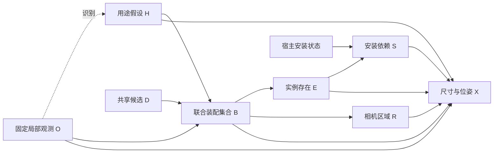

# 从局部观测补全合理世界：v9.1 实证与联合装配集合模型

后续实际结果已于 2026-10-26 复核：v10 后方退化、Qwen 库存空集集中，并发现支撑和功能几何问题，**没有证据支持已改善完整世界质量**。请先读 [V10_WORLD_QUALITY_REVIEW_20261026.md](V10_WORLD_QUALITY_REVIEW_20261026.md) 及其实际可视化。下文“未执行真实 v10”等为实现交付当时的历史状态。

2026-10-26。无训练、无新 GPU/API 调用。结论：需要改进，但不是再调数量或增加功能门槛。本轮移除两个有实证问题的建模限制：**每种功能/模式只能选一个装配**，以及**粗粒度 H 是选择阶段图像信息的唯一通路**。保留家具与生活物品共同装配、固定观测、安装依赖及全景方位保护。

## 1. 最新真实结果

来源：`outputs/panorama_completion_20261026_181035_3984837`，修复版 v9.1，seed=3407、worlds=4、K=4。RGB/G_obs 与早期 v5–v9 相同。

| 路径 | Qwen 四次新增 | API 四次新增 | Qwen 期望新增 | API 期望新增 |
|---|---|---|---:|---:|
| v9.1 功能机制 | 7,6,9,9 | 7,7,9,9 | 8.0052 | 8.5716 |
| v9.1 同域直接库存 | 18,9,18,15 | 16,9,14,12 | 15.4300 | 12.8500 |
| v9 功能机制 | 9,9,9,9 | 9,9,9,12 | 9.0500 | 10.0569 |
| v8 功能机制 | 13,9,15,13 | 12,16,16,12 | 12.7079 | 13.8261 |
| v5 功能装配 | 24,23,23,14 | 23,23,23,22 | 20.0200 | 21.0500 |

v9.1 全部 32 次布局均导出，没有通过删物体维持成功。直接路径已有更多对象并通过同样的数值检查，因此当前少物体不是碰撞/视锥求解器在删库存。

期望值是几何前的有限域库存分布，不等于语义正确性；v5 Qwen 当时仅 1/4 布局成功，不能把大库存全部当成有效世界。v9.1 后方中心记录为 Qwen/API 17/20（累计 31/32 条新增记录），方位保护仍起作用，不能因内容少就整体退回早期空间机制。

真实可视化：[v5 至 v9.1 内容与同坐标布局对比](../research/audits/assembly_set_v10_20261026/actual_v91_001/index.html)。包括全部计划样本清单、失败、3D/XZ/ERP、同步旋转和概率。只读审计冻结了 12,690 份来源 JSON。

## 2. 根因：接口修复后暴露了模型层面的压缩

### 2.1 候选内容没有恢复

v9.1 本地已从 0 个恢复到 4 个完整提案，但 API 仅接受 2 个。共同域仍为 26 条候选实例、19 种规范化原始名词；装配数量从 8 增为 11，每个装配平均内容更少。首轮原始候选均未碰到 24 对象容量上限，因此提高上限不是本例的根因修复。

独立合理组件也被整份候选拒绝连带丢失：

- 一个 reading 组件把毯子挂到无法承载完整视野外物体的可见沙发座面，连带丢弃了另一个自包含的边桌/杂志篮组件。
- 一个 entry 组件同时声明 rear 和 farther_than 正 Z 沙发，连带丢弃了独立的桌椅/电脑组件。
- 另一个 entry 深度冲突又使茶几、边桌/书、书柜/花瓶等独立组件整份落选。

最终库存不能临时删坏物体来变成“成功世界”；但提案阶段本来可以先构造独立装配的候选库。必须区分**候选组件是否合法**和**完整世界是否成立**。

### 2.2 “同功能=互斥变体”不成立

`reading__observed_extension` 中 a6 是右侧近沙发的边桌/台灯/书，a9 是左侧远沙发的边桌/书/杯。两者锚点与方位不同，模型却只能二选一。旧模型对它们同时存在赋严格零概率，这不是观测给出的物理不兼容结论。

茶几 a3 被放进 `social__new_group`，与额外沙发/脚凳/落地灯 a0 竞争。该渠道又被解释为“额外独立社交装配”。于是茶几存在率仅约 0.0068/0.0092，而同域直接路径对应约 0.23/0.61。茶几服务现有座位，并不需要再证明存在另一片社交区域。

v5 值得借鉴的是可共存的功能装配和共同生成的生活物品；不是其约 0.95 的角色存在率或“每个角色都激活”。

### 2.3 H 并未被证明是充分的观测摘要

旧存在/变体机制主要读取 H 标签与 D，图像只在提案、识别、几何阶段进入。它实际上要求粗粒度 H 与有限 D 足以代替剩余图像线索。单图用途通常多义，这个信息瓶颈没有理论或实证保证。

直接路径更多不是正确性的证明，但结合严格零支持的互斥结构、极低茶几概率及独立组件连带损失，足以支持有针对性的改模，而不是继续只修 schema 或调高 alpha。

## 3. 重新核验的论文和官方实现

| 工作 | 核验内容 | 本项目借鉴与边界 |
|---|---|---|
| [Human-centric Indoor Scene Synthesis Using Stochastic Grammar / S-AOG](https://arxiv.org/html/1808.08473) | And/Or/Set 层级；家具、承载物、功能组与上下文关系；数据学习后采样 | 同功能不应自动成为 Or 互斥；功能/支撑结构帮助组织全库存。其参数来自数据学习，不能照搬成免训练数量先验 |
| [Holistic 3D Scene Parsing and Reconstruction](https://siyuanhuang.com/holistic_parsing/main.html) | 功能、几何、物理与观测差异共同推断；analysis-by-synthesis，比较深度/法线/分割 | 保留观测证据，不把用途标签当成充分统计量。本项目没有实现它的渲染似然，不宣称复现其逆推断 |
| [FactoredScenes](https://arxiv.org/abs/2510.10292) | 学习场景程序库，LLM 生成程序，再做程序条件位姿预测 | 组合结构与数值布局分开是合理抽象；本项目只借鉴表达，不训练或拟合其库/位姿网络 |
| [HSM](https://3dlg-hcvc.github.io/hsm/) / [官方实现](https://github.com/3dlg-hcvc/hsm) | 跨尺度支持层级和局部 scene motifs；支持区域组织大型家具与小物品 | 普通生活物品应属于可组合装配。本项目不复制其占用阈值、采样轮数或物体数量作为补全目标 |
| [SceneSmith](https://scenesmith.github.io/) / [官方实现](https://github.com/nepfaff/scenesmith) | 实现分建筑、家具、壁挂、顶挂、小物体五阶段；阶段状态持久化；物理模拟 | 小物品与支撑质量需单独关注，不能只算大家具。它是文本到场景，本任务没有完整文字设计简报或已知房间边界；不照搬密度目标或多代理系统 |
| [ATISS 官方实现](https://github.com/nv-tlabs/ATISS) | 集合条件下的场景生成与部分场景补全；脚本保留初始与补全状态 | 集合式条件补全是重要对照，不需要先把普通物体解释成“额外活动区”。这是训练方法，不是直接替换本项目的免训练机制 |
| [SD-SCM](https://aclanthology.org/2025.emnlp-main.107/) | 用户指定结构、LM 指定随机机制，按图进行采样与干预 | 功能先验必须改变实际联合概率；它不保证本项目的图已被识别或概率已校准 |

这些工作的共同启发是合适的结构抽象与联合一致性，不是“论文物体很多，所以也把我们的数量调到一样”。没有复现这些工作的训练或效果。

## 4. 联合功能装配集合 SCM

固定 O 为局部图像、G_obs 和相机，D 为两后端共享的候选装配库。每个候选是完整、依赖闭合的单位，可以是一个小物体、带物品的家具，或多件相关家具。

- H：不确定的用途/功能组织，不含住户生活史。
- B=(B_1,…,B_M)：一次联合选择的装配存在向量。所有子集都可表达，包括空集；同用途多个单位可以共存。
- E_i：实例是否属于已选装配。
- S_i：声明的宿主安装依赖是否满足，不是物理稳定性证明。
- R：装配声明的相机区域；没有给出时为 unspecified。明确区域继续约束几何。
- X：完整尺寸和位姿，由冻结模型提出后执行同样的几何求解。



O 是条件生成过程的固定上下文；这些箭头不声称图片在现实中物理地制造家具。

\[
q(H\mid O,D)\,p(B\mid H,O,D)
\prod_i\mathbf1[E_i=B_{u(i)}]\,
\mathbf1[S_i=E_i\land S_{host(i)}]\,
\mathbf1[R=f_R(B,D)].
\]

没有宿主或宿主为固定观测时，相应依赖基值为 1。当前几何是隐式条件生成与求解，不存在可计算的归一化 RGB 世界后验。

功能条件机制仍实际估计概率。若 n_{h,b} 为固定预算中选择集合 b 的有效次数，m_b 为 D-only 参考次数，M 为去重候选数：

\[
\pi_0(b)=\frac{m_b+\eta/2^M}{K_0+\eta},\qquad
\widehat p(b\mid h,O,D)=\frac{n_{h,b}+\alpha\pi_0(b)}{K_h+\alpha}.
\]

仍用 alpha=eta=1，不为增加物体而调参。稀疏混合表示避免枚举 2^M；J 是数值表示，不是新物理原因。代码中的 M_unit 是 B 的确定性选择别名，不再进行第二次功能存在筛选。对象概率为：

\[
P(E_i=1\mid O,D)=\sum_h q(h\mid O,D)\sum_b\widehat p(b\mid h,O,D)\mathbf1[b_{u(i)}=1].
\]

这些数值进入真实逆 CDF 采样。没有最少物体数、每类别配额或后方比例，空样本、重复样本、失败全部保留。候选库有限且由 LM 提出；概率未校准，候选密度/重复描述仍是需要检查的局限。

## 5. 移除哪些限制，保留哪些约束

移除：function/mode 的一选一槽位；普通对象必须证明“额外活动区”存在；延伸必须提供额外服务边才合法；独立候选因别的组件错误整份落选；必须填写模式和方位等冗余字段。

保留：观测不可修改；准确的对象身份和宿主；声明关系不能自相矛盾；完整新增框位于原视锥外；明确相机区域不能被 near 优化改掉；尺寸、接触与残留碰撞等相同数值契约。最新全部布局已通过，这些约束没有造成这次的物体数量下降，不能为了变多就删除。

提案按显式支撑、空间关系与功能连接建立依赖组件。坏组件整体拒绝，其他独立组件可以留作候选；同区域的合法跨组宿主依赖可以合并成一个完整单位。没有从坏组件内部捡物体，也没有从最终采样世界删物体。跨不同明确区域的依赖组件仍需给出一个能表达整组的区域方案或 unspecified，不能偷偷覆盖原声明。

对原 v9.1 回复的确定性重放得到 19 个去重候选单位、45 条实例记录、28 种原始名词，原域为 11/26/19；其中找回了办公、茶几、书柜等独立组件。[重放记录](../research/audits/assembly_set_v10_20261026/actual_v91_001/candidate_replay_v10.json)。这只证明候选支持恢复，**没有使用旧 CPT 给新域赋概率，也不是新生成效果**。

## 6. 验证设计和对比公平性

五分支×Qwen/API，各采样四次，默认 40 次布局尝试：

| 分支 | 目的 |
|---|---|
| end_to_end | 同一 D，各自估计 O,H 条件联合装配选择与数值布局 |
| layout_control | 合并原始次数后只平滑一次，两路库存/噪声完全相同，比较布局 |
| tag_only | 只移除联合选择时的 RGB，保留相同文字 D、识别 q(H) 与几何；检查图像信息瓶颈 |
| direct_inventory | 同一集合格式与 D，直接 O,D→B，不提供 H |
| function_free | 移除库存 H 边；本模型保留完整的无条件联合 B 分布，只检验 H 关联/干预响应，不期待平均数量变化 |

Qwen/API 使用同一图像字节、观测、相机、域、提示模板、stage seed 政策、温度 0.4/top_p 0.9/top_k 50、校验与一次修复上限。API 固定硅基流动 `deepseek-ai/DeepSeek-V4.1-Flash`；API seed 和服务端内部解码无法与本地严格等同。

每 H 的功能联合选择计划 K=4 次；直接路径为 K×H数次，单次输出上限同为 512，匹配联合选择阶段的初始调用预算。提案、识别与参考为共同上游；tag_only 属于额外诊断成本。实际修复、有效次数、token 和服务端差异分别记录，预算匹配不等于已经证明因果收益。

判断改善时同时看候选支持、真实概率变化、物体遗漏/无据增加、同义重复、功能与支撑、方向与数值失败。不能用物体数单独决定方法胜负。数据划分/多场景验证仍有必要，但不要求用户训练网络或拟合训练集先验。

## 7. 代码与执行

核心：`world_pipeline/completion/assembly_set.py`；调度：`assembly_set_experiment.py`；可视化：`assembly_set_visual.py`。复用已验证的概率计算和 v9 方位保护几何。

```bash
cd /data-nfs/gpu1-2/u13529658780/DIT360
bash qwen_edit_pano/scripts/assembly_set_completion.sh test
```

真实运行由用户执行，沿用 `SILICONFLOW_API_KEY`，不需要向聊天提供密钥：

```bash
cd /data-nfs/gpu1-2/u13529658780/DIT360
CAUPANO_WORLDS=4 CAUPANO_MECHANISM_DRAWS=4 \
CAUPANO_CONCENTRATION=1 CAUPANO_REFERENCE_CONCENTRATION=1 \
CAUPANO_BASELINE_ROOT=qwen_edit_pano/outputs/panorama_completion_20261026_181035_3984837 \
bash qwen_edit_pano/scripts/assembly_set_completion.sh compare GPU3 \
  qwen_edit_pano/outputs/panorama_completion_20261026_181035_3984837/end_to_end 3407
```

入口 `outputs/assembly_set_completion_时间_PID/index.html`，含旧结果对比、五分支、类别表外颜色、物体清单、方向及 RGB 消融。每次新目录；只复用观测，不复用旧候选概率表。仍然生成世界状态框，不是 RGB ERP。

仅准备检查、不调用模型/API：

```bash
cd /data-nfs/gpu1-2/u13529658780/DIT360
bash qwen_edit_pano/scripts/assembly_set_completion.sh prepare GPU3 \
  qwen_edit_pano/outputs/panorama_completion_20261026_181035_3984837/end_to_end 3407
```

真实 v10 GPU/API 尚未执行。CPU fixture、原回复重放和测试不替代生成质量验证。

本轮最终验证：**204/204 项 CPU 回归通过**，新增 13 项覆盖同用途共存、依赖组件校验/合并、真实概率响应、图像输入对照、完整库存和十条分支。真实输入 prepare-only 在 `outputs/assembly_set_preflight_20261026_002` 通过，87 项代码哈希匹配；来源 12,690 份 JSON 保持不变；实际对比页 18 个 HTML、54 处本地链接有效。[完整验证记录](../research/audits/assembly_set_v10_20261026/actual_v91_001/implementation_validation.json)。
