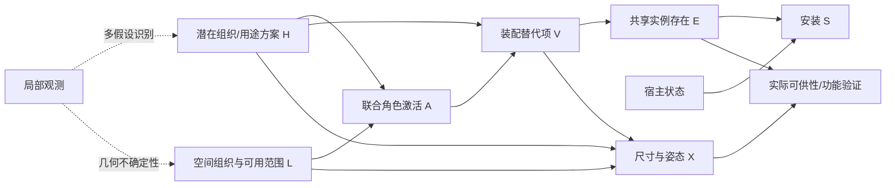

# v5 实际结果深度复核：是否还需要优化

2026-10-25。分析对象：`outputs/modular_completion_20261025_162311_4103717`。API 配置为硅基流动 `deepseek-ai/DeepSeek-V4.1-Flash`。

**结论：需要有针对性的优化。当前优先级是装配存在机制、全局组合一致性和本地数值输出接口。v5 已有可执行的结构机制，但本次结果尚未证明因果推理提高了场景补全质量。**

本次交付为实际结果审计、精确概率分析、可视化和优化方案；生成器保持现有 v5 实现，没有把下文建议当成已验证的 v6。

审计入口：工作区 `research/audits/modular_v5_result_review_20261025/report_final/index.html`。其中 `audit.json` 保存全部统计、精确联合分布比较与原始来源，`source_sha256.json` 保存来源哈希。分析没有调用模型/API/GPU，原实验文件未修改。

## 1. 这轮结果的真实状态

| 分支 | 结构采样的新增记录数 | 导出数值世界 | 期望新增记录数 |
|---|---|---:|---:|
| end_to_end / qwen | 24、23、23、14 | 1/4 | 20.020 |
| end_to_end / api | 23、23、23、22 | 4/4 | 21.050 |
| layout_control / qwen | 23、23、23、22 | 2/4 | 21.519 |
| layout_control / api | 23、23、23、22 | 4/4 | 21.519 |
| function_free / qwen | 16、24、23、22 | 2/4 | 21.100 |
| function_free / api | 24、24、23、21 | 4/4 | 21.050 |

“结构采样新增数”是进入布局的库存，不代表已经完成的合理世界。计数单位是对象记录；例如“一堆书”可能只是一条记录，不能直接与逐本标注的真值数量等价比较。

本地共 5/12 次数值导出，API 为 12/12。这里不是 12 个相互独立的场景测试：本地 12 次初始布局请求只有 9 个不同的“提示+种子”组合，有重复的确定性调用。固定库存这一组最适合比较后端：两份结构样本哈希相同，本地导出 2/4，API 导出 4/4。

本地导出的 5 个世界中，有 4 个仍含非许可 AABB 重叠，单世界剩余 1～4 对；API 导出的世界均为零重叠。所有导出世界仍标为 `layout_needs_review`，存在未核验安装。零重叠、导出成功、`world_state_ready` 的数值候选含义，都不能代替完整语义与物理验证。

## 2. v5 确实保住了哪些进展

- H 的实际传输值现在是纯功能标签与固定定义，未继续把整段照片描述当成 H。
- 对象存在、声明安装和数值布局分开；失败库存没有被删掉或重采直到成功。
- 本地/API 共用观测和候选域；固定库存比较仍成立。
- 机制表确实影响采样；消融后的 M 节点实际移除了 H 父边。
- 可视化和原始数据足以识别空世界、格式失败、碰撞与未核验安装之间的差别。

因此不需要推倒所有工程基础。此前 133 项 CPU 测试验证的是这些实现契约；它们不构成真实场景质量或因果增益的证明。

## 3. 主要问题一：从“经常选空”走到了“几乎每个角色都选存在”

当前候选域有 reading、social、storage、work 四个角色。原始选择为：

| 后端 | 有效装配选择 | none 次数 | 四个角色同时存在的模型内概率 |
|---|---:|---:|---:|
| Qwen | 64 | 1 | 64.91% |
| API | 64 | 0 | 80.03% |

这解释了物体数增加的来源：大多数世界同时拼入阅读、社交、储物和完整办公装配。不能把“从零变为二十多件”直接解释成更完整或更聪明。

装配的最大记录数分别是 6、7、3、8，合计 24。常见组合自然得到 22～24 条记录。这里没有最低 24 件的配额；但组合结构和高激活率让分布集中在上限附近。

### 3.1 当前 H 很少控制功能区域是否存在

实际边缘激活概率：

| 角色 | Qwen | API |
|---|---:|---:|
| reading | 97.5% | 97.5% |
| social | 95.0% | 95.0% |
| storage | 96.0% | 96.0% |
| work | 73.0% | 90.0% |

API 对四个角色的激活概率均不随 H 改变，模型内 I(H;是否激活) 都为零（浮点误差视为零）。Qwen 的前三个角色也一样，只有 work 激活率随 H 有少量变化。

所有允许的 H 都未包含 work 标签；API 对 work 的 16 次选择却全部选中唯一办公装配，编译后各 H 下均为 90%。不能据 H 没写 work 就强行设工作区概率为零，但当前 H 域没有“有/无工作用途”的匹配对照，也无法用该功能差异解释这条高概率。

办公装配固定有 8 条对象记录。其本身贡献约 7.2 条 API 期望新增，已占期望总量约三分之一。这是明确的结构性偏向，尚无隐藏真值或数据校准支持。

### 3.2 平滑还引入了“候选数越多，none 先验越小”的效应

对 K=4、总浓度 α=1、J 个候选，若没有一次选 none：

\[
\widehat p(\mathrm{none})=\frac1{5J}.
\]

reading 有 8 个状态，得到 2.5%；social 4 个状态，得到 5%；storage 5 个状态，得到 4%；work 2 个状态，得到 10%。因此“是否有此区域”的概率还受替代方案数量影响，语义上并不理想。

但拥挤也不能全部归咎于平滑。把平滑去掉，仅用已有原始选择频率，期望新增反而为 Qwen **21.3375**、API **22.625**。根本问题包含生成通道对非空装配的持续偏好，而不只是 α 的取值。

继续增加 K 会让零 none 选择对应的 none 概率更小。更多调用可以降低随机误差，无法自行纠正这种系统性偏向。

## 4. 主要问题二：功能影响需要分成“激活”和“替代项”，消融也需区分含义

API 的功能版与 function_free：

- 期望新增均为 21.05；完整数量分布一致到浮点精度。
- 四角色激活模式分布也一致。
- 具体装配联合分布仍有 **TV≈0.107965** 的差异。
- 个别精确类别的存在概率最大相差 **8.18 个百分点**。

所以“数量没变”不等于 H 完全没有作用。这里的作用主要是选择哪一种阅读/储物/社交装配，没有控制这些功能区域是否出现。对任务目标而言，后一层仍然缺失或很弱。

TV 指两个概率分布差值绝对值之和的一半。本次联合分布在 320 个装配组合上精确求和，H 已边缘化；不是用四张结果估出来的近似。

### 4.1 现有 uniform-profile 消融测到了什么

现有切边用所有 H 行的均匀平均：

\[
p_u(M_r)=\frac1{|H|}\sum_h p(M_r\mid h).
\]

这是一种定义清楚的参考机制。但实际识别 q(H) 不是均匀分布，因此它同时改变 H 与装配的联系，以及各装配的边缘概率。不能把所有结果差异都解释为“因果联系被删除的收益”。

本轮补算了保留边缘分布的离线对照：

\[
p_m(M_r)=\sum_hq(h\mid O,D)p(M_r\mid h,D).
\]

该对照移除 H 父边，同时保持每个装配及实例的单变量存在概率不变，主要检查共同 H 所产生的组合相关性。它不是新世界生成或新机制估计。

| 比较装配联合分布 | Qwen TV | API TV |
|---|---:|---:|
| 功能版 vs 现有均匀 H 切边 | 0.203510 | 0.107965 |
| 功能版 vs 保边缘切边 | 0.021925 | 0.030422 |

这表明现有消融差异相当一部分来自替代项边缘权重变化。两类对照都可保留，但研究含义要分别陈述。保边缘切边后，H 与装配的对应关系仍被破坏；上表衡量的是边缘化 H 后的库存联合分布，不是说 H–库存联合关系只改变了 2%～3%。

每行只有 4 次生成，最大 TV=0.4 也可能只是两次选择的差别。在可交换分类抽样的近似下，8 组 pooled-null 置换参考的最小值约为 0.132；提示和选项顺序并不完全可交换，因此这些值只作小样本噪声诊断，不作真实因果显著性检验，更不能据此证明“没有因果作用”。

## 5. 主要问题三：本地失败含接口原因，不能全部归因于模型能力

### 5.1 提案提示的深度关系约束相冲突

旧提示/底层错误信息仍列出 `in_front_of, behind` 为允许类型，新追加要求又拒绝它们并要求 `farther_than/nearer_than`。本地最后一次修复继续用了 behind，整阶段标为 failed。

这确实是现有接口设计中的冲突，应该优先修正。应发布唯一的、坐标含义一致的关系 schema，并让原提示、验证错误和修复提示使用同一套词表；不能只是继续在旧提示后追加一段约束，也不能无记录地猜测模糊关系的含义。

同时，`proposals/qwen/summary.json` 的 programs=0 不是完整事实。原始 `programs.json` 已保存 **3 个有效候选、11 条实例记录**，共享域实际使用了它们。当前 summary 在异常后没有更新部分成功计数，需要修复报告逻辑。

### 5.2 本地数值输出留下大量 null

本地 12 次布局中有 7 次失败；修复回复通常只补了尺寸，range、yaw 或 offset 仍有 null。最后看到的 `range_m must be finite positive` 只是验证器停下来的第一项，并不是唯一缺失项。

保存的本地生成均以 EOS 结束，生成长度约 1067～1994 token，输出上限为 8192。证据不支持“提高 max_tokens 就能修好”。

建议先合并报告所有必填值错误，让一次修复得到完整的缺失清单；减少编译器本来就能推导的无用输出字段；再比较一次输出整个世界与按装配输出数值的成功率。拆分时两路必须保持相同总预算和修复政策，最终仍统一进行全局碰撞与视野外检查。

不能把缺失数值直接填成 3 米、零 yaw 或零 offset，再把它们当作模型预测。当前 API 在相同库存上的输出和消碰撞更稳，但这只支持本次结构化数值生成能力较强，尚不证明隐藏库存更正确。

## 6. 主要问题四：共用候选域改变了能力对照的解释

实际共享库有 15 个非空装配：3 个源于本地，12 个源于 API。本地来源只覆盖 reading；其他角色均由 API 提供。

按实例期望数量计算：

- 本地完整条件生成：0.275 条来自本地候选，19.745 条来自 API 候选，API 来源占 **98.63%**。
- API 完整条件生成：0.275 条来自本地候选，20.775 条来自 API 候选，API 来源占 **98.69%**。

共享 D 对比较选择机制和布局很有价值，也说明本地能使用 API 提出的装配。但不能把这些结果当作“本地独立提出并生成完整世界”的证据。下一步应并列报告独立提案能力与同域机制/布局能力，避免混在一个端到端指标里。

## 7. 空间一致性还存在实质问题

API 的零碰撞值得保留，但对固定观测的 near 关系，中心距离可达约 5.36 m，AABB 表面间隙可达约 **4.55 m**。这与“靠近观测落地灯的阅读椅”之类描述有明显张力。

当前 near 没有定义硬阈值，不能擅自宣告所有大于某个米数的 near 都失败；但代码也没有实质验证这些功能邻近关系，不能把它们视为已经满足。应学习与类别、物体尺度、交互方式相关的接近/可达约束，并分别报告。

还有目标冲突：某些候选把新茶几描述为“在可见沙发与相机之间”，而任务要求完整新框在原视野外。几何器将其移到侧后方可以满足视野外检查，却可能破坏原候选的活动结构。生成前需要检查候选关系是否有机会与冻结观测和视野外条件共同满足。

未知墙面、房间边界、真实座面与架内层板仍未恢复。继续向无界相机空间塞入装配并通过零碰撞检查，不足以支持“合理完整室内世界”的结论。

## 8. 因果变量的语义需要再收紧

目前 H 自称 `Functional affordances`，但“可供性”和“形成场景的组织原因”需要区分：对象与布局通常决定实际可以做什么；潜在的组织/用途方案可以作为选择对象的上游生成变量。两者混用会让箭头的物理含义含糊。

当前分解可以是合法的条件生成模型；若要研究场景形成机制，应将 H 操作性定义为**潜在组织/用途方案假设**，将从对象、几何计算的实际可供性作为下游验证结果。H 保持多假设与不确定性，仍不推断住户职业、具体生活史或实际正在进行的活动。给标签改名本身不能解决问题，还要改变可检验的存在机制和评价方式。

[SD-SCM 的局限讨论](https://arxiv.org/html/2411.08019#S7)明确指出：预训练 LM 并不保证产生有意义、非平凡的变量关系，机制对措辞也敏感。这与本次 H 对角色激活作用很弱的现象直接相关。[因果表征学习综述](https://arxiv.org/abs/2102.11107)也强调高层因果变量本身是需要研究的问题；[无监督解耦研究](https://proceedings.mlr.press/v97/locatello19a.html)提醒应公开归纳偏置和监督来源，不能把标签化表示本身当成已识别的因果因素。

## 9. 推荐的优化顺序与下一版模型方向

### 第一阶段：修接口与评价，保留当前机制作为基线

统一关系 schema；正确记录部分成功；聚合所有缺失数值；分别评价独立提案和共享域能力；保留所有失败作为分母。增加本轮的存在概率、候选来源、类别变化和保边缘消融诊断。

这一步直接针对已确认的错误，收益可在小规模对照上验证，无须先增加新的潜变量。

### 第二阶段：明确区分“角色是否出现”和“出现时是哪一套装配”

推荐分解：

\[
A_r\sim p(A_r\mid H,L),\qquad
V_r\sim p(V_r\mid A_r=1,H,L,D).
\]

A_r 是存在/激活，V_r 是替代项，L 是不确定的空间组织/可用范围；不是住户生活历史。二元存在先验不再随 V_r 的候选数变化。实际存在概率需要在多场景数据上估计或校准，包括合理的缺席样本；不能把当前全部非空的投票换个公式就称为学会了存在推断。

H 不应只改变桌椅款式。应设计有/无某一用途的匹配 profile 干预，冻结其他变量与候选，直接核对 A_r 和类别存在概率是否按预期变化。当前 H 域里没有 work profile，不能拿它证明“工作用途影响办公区”。

### 第三阶段：联合激活和空间组织，避免独立拼接

角色存在宜用联合 p(A_1,…,A_R|H,L)，或者具有明确父变量的序列机制，而不是默认每个角色都独立存在。保留组内宿主闭包与可选生活物品，同时处理跨角色共用实例；只有明确同一身份的实例才能共享，不能按同类别盲目去重。

建议研究图（**尚未实现和验证**）：



空间未知要表达为 L 的分布，不能从单图捏造确定的房间边界。实际可供性是验证结果，不用它硬性要求每个用途都有额外家具；完整生活世界还允许普通物品和未充分支持的活动。

[S-AOG](https://arxiv.org/html/1808.08473)不只有树状分解，还包含跨对象 MRF 上下文约束和数据学习；v5 只实现了部分结构启发。[HSG](https://siyuanhuang.com/files/eccv2018parsing.pdf)强调功能、几何和物理的联合约束，[FactoredScenes](https://arxiv.org/html/2510.10292v1)实际学习程序及姿态分布。这些工作支持补齐联合机制与数据学习，不能用更多手工标签替代。

### 第四阶段：在多个场景上验证研究主张

按完整场景划分训练/验证/测试，再从完整数据构造局部观测；GT 只用于相应训练或离线评估，不进入测试场景生成。明确同一房间/全景空间的补全范围、视野外定义与对象粒度。

并列报告候选域覆盖、存在概率校准、数量分布、功能关系、空间可行性、多样性及失败率。单一隐藏真值不是所有合理替代世界的唯一标准，但没有任何分布或功能验证，也不能只凭可视化宣布因果改进。

现有 uniform-profile 切边继续作为先验敏感性参考；新增保边缘切边评价组合关联；有条件时加入明确场景程序的合成干预数据，区分模型内一致性与真实因果识别。

## 10. 当前最值得做什么

保留“纯 H、装配依赖、存在/安装分离、共同观测、固定库存对照”的工程基础。优先修复接口，再验证存在机制。当前证据不支持仅增加物体、增加 K、加长解释、扩大因果图或单纯切换 API 就能解决核心研究问题。

重新运行本次独立审计无需 Key、GPU 或模型：

```bash
cd /data-nfs/gpu1-2/u13529658780/DIT360
CUDA_VISIBLE_DEVICES= OMP_NUM_THREADS=1 OPENBLAS_NUM_THREADS=1 \
  MPLCONFIGDIR=/tmp/caupano_review_mpl \
  /data-nfs/gpu1-2/u13529658780/.conda/envs/qwen3vl/bin/python \
  research/audits/modular_v5_result_review_20261025/analyze.py \
  --root qwen_edit_pano/outputs/modular_completion_20261025_162311_4103717 \
  --out research/audits/modular_v5_result_review_20261025/新的审计目录
```

结果保存了精确概率一致性检查、两种消融、候选来源贡献、缺失数值、碰撞/邻近诊断及所有来源哈希。这里无需重新付费生成，就足以确定下一步优化的优先级。
