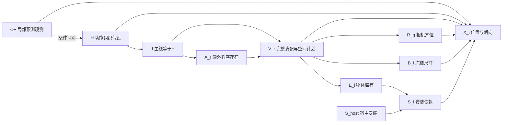

# 多输入测试、可视化与组会汇报

2026-10-27。当前 v13＋距离局部恢复已经可以作为**粗略全景世界状态候选生成的工作基线**。它能实际生成周围物体及数值状态，但跨输入可靠性、语义合理性和因果模块收益仍需分别验证。本次保留因果机制、提示语义、平滑和数值编译器，新增按图独立提案的测试入口及可视化；没有训练/微调。

**后续五图及实际错误修复以 [FIVE_SCENE_IO_FIX_20261027.md](FIVE_SCENE_IO_FIX_20261027.md) 为准。** 默认已扩展为5张图，推荐 `repair-generate GPU3 OLD_SUITE_ROOT` 复用原三份成功状态、修复观察/数值接口并新增卧室和厨房。下文三图、72世界及旧prepare目录为先前实现阶段记录；`generate` 始终是每图每后端一个世界。

## 已经能打开的材料

- [已有真实结果的新可视化、实验表与组会材料](outputs/organized_presentation_20261027_002/index.html)
- [组会幻灯片：方向键翻页，浏览器打印可导出 PDF](outputs/organized_presentation_20261027_002/group_meeting.html)
- [组会讲稿及实际实验表](outputs/organized_presentation_20261027_002/group_meeting.md)
- [因果模型图 PNG](outputs/organized_presentation_20261027_002/model_structure.png) / [SVG](outputs/organized_presentation_20261027_002/model_structure.svg)
- [新三张输入的准备页面](../research/audits/multiscene_v13_20261027/prepared_002/presentation_001/index.html)：仅输入预览，尚未进行真实模型生成。

新三张图的生成仍由用户执行；不能把准备页面或 CPU fixture 当成新的跨图实验结果。已有结果重绘不改变原 G_full、类别 ID、概率或尺寸。

## 运行三组新测试

**实际任务推荐单输出模式**：一张局部观测，每个后端只执行主线并生成一个完整世界，保留全部可视化。

```bash
cd /data-nfs/gpu1-2/u13529658780/DIT360
unset CAUPANO_PROGRAM_CATALOG
bash qwen_edit_pano/scripts/organized_multiscene.sh generate GPU3
```

仍对比 Qwen/API，因此默认三张输入共六份完整状态，每个后端各三份。内部提案和概率估计可以有多次调用，但最终世界数为每图每后端一份。此模式跳过两个对照分支及其池化步骤；因果机制和几何方法不变。只准备此模式可用 `prepare-single GPU3`。

下文 `run` 的“三分支×四候选”是**研究评估模式**：用于消融对照和随机稳定性检查，不是实际生成一个世界的必要流程。三个分支是三种实验设置，四个候选是同图四个独立完整世界，不是四部分拼接。

默认使用项目现有 `data/observer3d_indoor_val3_inputs.jsonl`，只读取其局部 RGB、ID、相机 HFOV 和输入哈希。已直接检查图像，三个输入不同于开发图：

| 输入 | 从局部 RGB 可见的内容 |
| --- | --- |
| 8194nk5LbLH_c9e8dc09263e4d0da77d16de0ecddd39 | 公共休息区：座椅、电视、壁炉等 |
| X7HyMhZNoso_2bb4931911e4412cb51f6437a82c5b6c | 另一处客厅：沙发、茶几和通道 |
| x8F5xyUWy9e_3a127fd2c5f34d978cba253145dae7d6 | 卫生间：洗手台、镜子、浴缸局部 |

上述描述是图像预览说明，不作为额外人工场景标签输入机制。候选生成不读取完整 GT 世界或真实 ERP。类别表元数据仍用于映射和可视化。

先确保环境变量 `SILICONFLOW_API_KEY` 已设置。本次两后端都要在新图上生成，**需要 Key**；此前距离恢复不需要 Key，是因为那一批 API 没有失败项。

```bash
cd /data-nfs/gpu1-2/u13529658780/DIT360
unset CAUPANO_PROGRAM_CATALOG

bash qwen_edit_pano/scripts/organized_multiscene.sh run GPU3
```

替换 GPU3 为可用节点。若尚未设置 Key，可在自己的终端先执行以下代码，不回显 Key：

```bash
read -rsp 'SiliconFlow API Key: ' SILICONFLOW_API_KEY
export SILICONFLOW_API_KEY
```

脚本创建 `outputs/organized_multiscene_时间_PID/`，完成后打印该目录的 `index.html`。默认每张图、每个后端、每个分支生成 4 个世界；三图×两后端×三分支×四候选，共 **72 个计划世界**，包括主线 24 个。失败、空集、重复都保留，不重抽到满意为止。

两后端固定为 Qwen3-VL-8B-Instruct 和硅基流动 `deepseek-ai/DeepSeek-V4.1-Flash`（`https://api.siliconflow.cn/v1`）。共享 Qwen 2D＋官方 WildDet3D 的预测观测，以比较补全机制及布局，不把观察器差异混进本轮比较。

每张图的执行过程：

1. 重新预测局部可见实例与三维框，得到 O+。
2. 两后端为该图重新提出完整功能程序，共同形成该图独立的候选域 D；不复用开发图的 15 个程序/70 条实例。
3. 安装 v13 的功能组织 H，按原四编码平衡接口重新估计 H/A/V 条件概率。
4. 运行 end_to_end、layout_control、function_free，使用原尺寸冻结、联合放置和局部缺距恢复。
5. 生成逐候选指标、图像、HTML 三维视图、CSV、讲稿及幻灯片。

省略的只有两个历史诊断：新图没有旧 v12 世界可做 geometry_control；也不重做“旧 H＋新接口”的历史 probe。这不改变主生成机制。

调用预算随该图实际提案得到的角色数 R 变化，H 为 1＋R 个软组织假设；默认每个后端的主机制初始请求数为 `4 × [1 + 2 × (1+R) × R]`。R=4 时为 164 次，另有该图提案和几何请求。精确预算在各图 `completion/call_budget.json`，没有隐藏的无限重试。

### 准备、继续与单独出图

只准备，不调用模型/API：

```bash
bash qwen_edit_pano/scripts/organized_multiscene.sh prepare GPU3
```

继续已初始化的测试目录：

```bash
bash qwen_edit_pano/scripts/organized_multiscene.sh resume GPU3 \
  qwen_edit_pano/outputs/这里替换为实际测试目录
```

`resume` 复用已完成阶段并执行未尝试阶段；已经记录的失败阶段不会自动追加随机请求。发生真实错误先看 `phase_records/` 和日志，不通过反复 resume 挑选更好的样本。代码变更后也不能继续伪装成同一次固定配置实验，应另开目录。

单独生成报告，不调用模型：

```bash
bash qwen_edit_pano/scripts/organized_multiscene.sh report \
  qwen_edit_pano/outputs/这里替换为实际测试目录
```

默认详细可视化主线全部候选，其余分支仍完整统计并保存状态。要给所有分支都生成新格式详细图：

```bash
CUDA_VISIBLE_DEVICES= /data-nfs/gpu1-2/u13529658780/.conda/envs/qwen3vl/bin/python \
  -m qwen_edit_pano.world_pipeline.completion.assembly_multiscene \
  report --root qwen_edit_pano/outputs/这里替换为实际测试目录 --all-branches
```

新报告自动使用新编号目录，避免覆盖。自选图像可通过 `CAUPANO_TEST_INPUTS` 指定同结构 JSONL，必要字段为 `id`、`local_rgb`、`hfov_degrees`，建议提供 `local_sha256`。输入 ID 必须唯一，只含字母数字、下划线和短横线。

## 可视化内容与含义

每个世界的详细页面同时提供：

| 文件 | 内容 |
| --- | --- |
| local_rgb.png | 原局部 RGB |
| layout_xz.png | 完整状态 XZ 平面图；没有伪造墙体边界 |
| local_projection.png | 实际三维框投影回原相机图像；后方物体不应出现在这里 |
| direction_projections.png | 前、右、后、左、上、下六方向的状态透视投影 |
| scene_3d.png | 可直接放进 PPT 的三维框图片 |
| scene_3d.html | 离线可旋转、缩放的三维图，支持标签开关 |
| erp_input_projection.png | 原局部 RGB 按相机射线投到 1600×800 ERP；未知区域灰色 |
| erp_state_map.png | 完整物体框的 2:1 ERP 方位投影 |
| erp_overlay.png | 局部 RGB 的 ERP 投影叠加周围完整状态框 |
| overview.png | 原图、平面、透视投影、三维及 ERP 的汇总大图 |
| labels.json | 编号、原 ID、类别、原始名、描述和颜色的对应表 |

颜色只保留：**观测蓝；可映射新增橙；未映射新增红**。原始名不在表内但能映射的对象也为橙色，不再额外使用紫色。这个规则依据实际保存的映射，不为漂亮出图擅自增加类别或修改 ID。

同一世界的各图使用相同编号，例如 `O01 sofa`、`N03 chair`。O 是观测，N 是新增；跨不同世界相同 N 编号不保证是同一对象，原始 ID 可在标签表核对。

对于旧结果中保存的粗类，如 sofa 被原观察器标为 furniture，图上写 `O01 sofa [furniture]`：保留可读原描述，同时公开原存储粗类别，不悄悄把类别 ID 改成 sofa。新观察器在新图上仍按原可见实例合同重新预测。

ERP 的灰色区域没有生成隐藏 RGB，叠加的是完整世界状态。当前项目阶段尚未连接 Adapter 生成真实感 RGB 全景；组会应将“状态补全”与“全景图像生成”分别说明。

## 组会可以这样解释当前模型

建议标题：**局部观测下，基于显式功能机制的免训练全景世界状态补全**。

> 我们从单张局部图像提出多个合理隐藏世界，而不是恢复唯一真值。首先固定可见物体观测，再推断不确定的功能组织假设。功能组织通过显式条件概率影响额外隐藏装配是否存在、选择哪套完整装配及空间计划。装配共同产生家具和普通用品，安装依赖与物体库存分离。随后冻结尺寸，联合生成位置和朝向，并进行框级数值编译与检查。

变量及结构：



固定上下文 D 限定可选完整程序；O+、D 也是各条件概率机制的上下文，图中省略重复箭头。O+→H 的虚线是推断计算，不代表照片物理上造成房间用途。

- H 是功能组织的软侧重，开发图为混合/阅读/社交/储物/办公五种；新图由实际候选角色构成，不强塞办公用品。
- A 是额外隐藏完整程序的库存存在，不是活动是否可能、也不是必须填补某种需求。
- V 的成员共同产生 E，所以桌椅、收纳和普通用品能够一起进入世界；数量来自所选程序，而非额外数量目标。
- S 近似 `E_i AND S_host`。移除宿主可以使安装依赖失败，但不因此抹除仍拥有的子物体。当前这种干预是语义机制内诊断，未重新求解反事实几何。
- 各角色在给定 H 后条件独立，是假设；完整程序内部的对象联合选择。有限 D 限制了能补什么。
- 尺寸 B 与连续位置 X 来自冻结大模型推断及数值编译，目前没有完整 RGB 似然或校准的全世界后验。

离散机制：

\[
q(H\mid O^+,D)\prod_r p(A_r\mid H,O^+,D)\,p(V_r,R_r\mid A_r,H,O^+,D).
\]

存在率的实际估计为

\[
\pi_r(h)=\frac{n_{r,h,1}+\alpha/2}{K_{r,h}^{valid}+\alpha},\quad\alpha=1.
\]

这些 CPT 进入逆 CDF 抽样，作用于真实物体库存。程序变体和空间计划也有显式数值分布。没有网络训练或微调；有限概率表在推断时通过条件选择估计，尚未校准。

例如已有真实 API 结果中：办公 H 下办公程序存在率 0.9，社交 H 下为 0.5，混合 H 下为 0.7。它说明 H 在模型内真实影响生成概率，不只是解释文字；**不证明现实因果效应已经识别**。

## 已有真实实验结果

以下来自开发图的实际恢复运行，新增数量不含 10 件固定观测；后方按原相机 Z<0 计算，均为四候选累计。

| 分支 | 后端 | 四候选新增 | 导出 | 后方/新增累计 |
| --- | --- | --- | --- | --- |
| end_to_end | Qwen | 21、7、9、23 | 4/4 | 29/60 |
| end_to_end | API | 21、8、7、21 | 4/4 | 7/57 |
| layout_control | Qwen | 21、14、11、23 | 4/4 | 25/69 |
| layout_control | API | 21、14、11、23 | 4/4 | 31/69 |
| function_free | Qwen | 21、8、7、23 | 4/4 | 29/59 |
| function_free | API | 21、8、7、22 | 4/4 | 14/58 |
| geometry_control（旧库存） | Qwen | 21、24、19、24 | 4/4 | 44/88 |
| geometry_control（旧库存） | API | 21、24、19、24 | 4/4 | 41/88 |

全部 32 个已导出世界通过当前视锥、声明方位、顺序和残留非豁免 AABB 碰撞检查；保留观测。距离接口修复用六次 Qwen 请求找回六个原计划世界，26 个原成功状态逐字节相同，概率/库存/尺寸不变。

对照的解释必须准确：

- layout_control：两后端共享池化概率表及离散库存/空间计划，比较尺寸与布局输出，不能把后方记录差异直接解释成因果推断能力差异。
- function_free：J 独立于识别的 H，但仍按同一个 q(H) 抽取，保持无条件离散联合分布。几何仍接收 H。平均数量相近是设计允许的，不能据此判定因果有用或无用；需要检验条件语义与空间质量。
- geometry_control：精确重放旧 v12 库存与方位、重新估计几何；是工程几何诊断，不是新图的新因果推断。本次三图新测试没有这个分支。

目前可汇报“模型可执行、完整候选能落地、功能假设真实调节概率、后方有支持、接口错误已定位修复”。不能汇报已经证明“因果方法显著优于非因果基线”“已达到语义正确率”“已完成跨图验证”。

具体未解决问题包括：边桌服务目标与 rear 空间计划不相容、Qwen 打开电脑的深度疑点、固有轴/正面约定、观察器粗类别、未恢复真实房间边界和墙面。它们见 [实际恢复验收](V13_RANGE_RECOVERY_RESULT_REVIEW_20261027.md)，不通过新数量约束绕过。

## 验证和代码位置

主要新代码：

- `world_pipeline/completion/assembly_multiscene.py`：多输入阶段管理、按图新域、原 v13 主机制估计。
- `world_pipeline/completion/assembly_presentation_visual.py`：三色/编号类别标注、平面、六方向、三维和 ERP。
- `world_pipeline/completion/assembly_multiscene_report.py`：真实结果统计、CSV、图集、讲稿和幻灯片。
- `scripts/organized_multiscene.sh`：GPU/API 执行与继续入口。

测试：

```bash
bash qwen_edit_pano/scripts/organized_multiscene.sh test
```

49 项集成 CPU 回归已通过；随后对标签显示的局部改进，15 项最新多图/可视化 CPU 回归通过。包括与原 v13 主机制表和 CPT 等价、两后端提示与局部种子配置匹配、池化原始计数一次平滑、保边缘 H-cut、前后相机投影、近裁剪、ERP 射线与精确 2:1 比例、状态不变、阶段继续不重复请求、待运行不伪报结果。WildDet 环境的入口导入也已检查。

记录在 `../research/audits/multiscene_v13_20261027/release_001/` 和 `release_002/`。生成原始模型及官方几何求解器未修改；本轮没有进行真实新图 GPU/API 推断。
