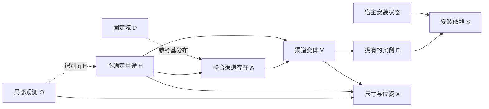

# v8：免训练的功能条件机制、参考收缩和直接库存对照

后续更新：真实 v8 已运行并出现明确的局部聚集偏差。最新实际审计与 v9 功能—空间实现见 [PANORAMIC_SPATIAL_MODEL_V9_20261026.md](PANORAMIC_SPATIAL_MODEL_V9_20261026.md)。下文“v8 尚未真实运行”为当时状态，保留为实现历史。

2026-10-26。已实现，用户自行执行真实 GPU/API 推断。本轮只做 CPU 验证，没有训练、模型权重更新或付费 API 调用。

核心因果假设沿用 v7；这次修改有实际概率效果，重点修正均匀平滑、候选丢失及布局接口问题，并补足直接预测对照。**不以物体更多、更少或解释更长定义改进。真实 v8 质量尚待运行验证。**

## 1. 修改的依据和边界

真实 v7 `outputs/realization_completion_20261025_224043_2053447` 中，部分渠道没有条件激活票，仍由均匀平滑得到 0.1 的存在率；固定回复后，改变平滑强度就会明显改变库存预测。单个渠道 4 次有效回复不足以把零票解释为真实不存在。

另一个已确认问题是：多个备选方案共用一次全回复校验，一个不合法方案会导致合法同伴方案被整份拒绝。第三个问题是数值模型反复填入 `region=front`，与要求视野外的接口冲突。

本版分别处理这三件事，不重新引入住户生活历史、未知但确定的房间面积或对象数量配额。

## 2. 当前功能 SCM 的结构

O 为局部图像和固定预测 G_obs，D 为该图像的有限提案域，H 为用途/组织假设。渠道 s=(功能, observed_extension/new_group)，两种实现可同时存在。



O→q(H) 是推断方向，不是图像造成房间用途；D 及参考分布是条件模型的固定定义，不是新增生活史或物理原因。代码中的 J 是联合分布的计算表示。near/左右/远近仍是空间约束，不自动成为因果边。

库存分解：

\[
q(H\mid O,D)\,\tilde p(A\mid H,D)
\prod_s p(V_s\mid H,A_s,D)
\prod_i\mathbf1[E_i=f_i(V)]\,
\prod_i\mathbf1[S_i=E_i\land S_{host(i)}].
\]

根实例无宿主时 S_i=E_i。移除宿主保留已拥有的子物体，只使安装依赖失效。用途不是必须出现某物体的硬需求；单图不推断具体住户生活史。

一个渠道仍最多选一个非空变体，变体内部实例共同出现；条件于 H 的变体独立仍是建模假设，本轮没有无证据地添加部件节点。X 是冻结模型提出数值属性后的约束求解结果，没有定义完整的归一化 RGB 似然。这里是有限域条件生成模型，不是已识别的真实世界形成 SCM。

## 3. 概率真正怎样改变

先做一组 **D-only 参考采样**：它看到共同的观测物体清单、渠道含义与可能名词，不接收图像、特定 H、识别票数或后续答案。记渠道数 m，参考有效次数 K0，某联合激活掩码 a 的次数 n0(a)：

\[
q_0(a\mid D)=\frac{n_0(a)+\eta\,2^{-m}}{K_0+\eta}.
\]

每个 H 下再独立进行条件采样，得到次数 n_h(a)、有效次数 K_h。实际采样使用：

\[
\boxed{\tilde p(a\mid h,D)=\frac{n_h(a)+\alpha q_0(a\mid D)}{K_h+\alpha}.}
\]

默认 K0=K_h=4，alpha=eta=1。原 v7 对每个零条件票渠道提供 0.1 的边缘存在率；本版若该渠道在条件采样和参考采样中均为零票，其边缘率为 0.02。若参考采样支持它，概率可以高于该值，甚至高于旧值。**不是统一降概率，也不把零票置零。**

参考基分布是推断阶段冻结模型回复的估计，不是新图像证据，也不保证比均匀先验更接近真实分布。因此保存同 D、同 q(H)、同条件原始票数和同 V 的 `uniform_reference_ablation.json`，只替换激活基分布以核对数值变化；它是概率对照，不是完成的场景质量实验。

实际对象存在率仍通过上述机制与 V 的条件概率边缘化计算，并进入逆 CDF 的 SCM 采样，随后才预测几何。报告区分条件票、参考票和均匀尾部的贡献。图像识别 q(H) 与多变体 V 仍采用原来的有限类别估计；单一合法变体的概率 1 表示域内没有其他选项，不代表模型实测确定性。

条件概率区间使用固定 q0 后的 Beta 边缘：Beta(n_on+alpha*pi0, K_h-n_on+alpha*(1-pi0))。这是假设有效 LM 回复 IID 时的机制估计不确定性，未包含参考估计、候选缺失、提示词偏差或 q(H) 不确定性，更不是实际物体存在概率的已校准区间。没有根据隐藏真值调参或训练概率表。

## 4. 四种实验与直接对照

每种都运行本地 Qwen 和硅基流动 `deepseek-ai/DeepSeek-V4.1-Flash`，请求解码配置、观测、候选域和几何求解器在两后端间匹配。API 地址为 `https://api.siliconflow.cn/v1`，key 从 `SILICONFLOW_API_KEY` 读取。

| 分支 | 用途 |
|---|---|
| end_to_end | 各后端的参考收缩功能机制 + 各自数值属性预测 |
| layout_control | 汇合两路原始票数后只平滑一次；两后端使用完全相同库存、随机数和机制 |
| function_free | 保留联合 A 和每个模块/实例边缘概率的 H 边消融，H 仍用于几何上下文 |
| direct_inventory | 图像 O,D 直接联合选择中性编号槽位的具体变体，不接收 H/识别/参考答案 |

直接对照与功能模型拥有相同有限库存支持。令 v 为每个槽位的具体变体或 none，A(v) 为其存在向量，正变体数为 L_s，其平滑库存基分布为：

\[
b(v\mid D)=q_0(A(v)\mid D)\prod_{s:v_s\ne none}L_s^{-1},
\quad p_d(v\mid O,D)=\frac{n_d(v)+\alpha b(v\mid D)}{K_d+\alpha}.
\]

这里保留直接选择的**联合**库存频率，没有把直接回复拆成独立物体概率。H 不进入直接库存机制，模型内 do(H) 不改变其库存概率。为隔离库存阶段，两条路径的布局仍保留相同 q(H) 作条件上下文，故这是直接库存对照，不是整个流程完全删除 H。

直接 K_d 默认也是 4。**功能推断与直接预测的总调用预算不相等**：功能路径估计多个 H/渠道，直接回复较长，token 上限也不同（直接 1024，类别机制 256）。报告 `call_budget.json`、原始请求计划、实际 API 次数/usage，不能把这个对照直接当成预算匹配的最终因果收益证明。

## 5. 提案与几何接口

- 每条提案回复仍限定 1..2 个完整 alternative。逐个按原 v7 严格约束检查，保留全部合法完整方案，不从非法方案捡单个物体或编造锚点关系。
- 第一份含合法方案的回复即接受，不为补齐被拒方案额外请求；若整份没有合法方案，保留原来至多一次 schema 修复预算。所有拒绝原因写入 `proposals/*/alternative_validation.json`，失败查询继续固定后续计划，不重试到非空。
- D 每次重新构建并绑定哈希，新 D 必须重新估计全部机制。旧输出只复用局部图和预测 G_obs，不复用旧概率表或旧布局。
- 数值模板删除 `region` 和 `azimuth_deg`。完整隐藏方向域由程序、固定锚点和关系决定；回复若显式填入 front/region，明确拒绝，绝不静默改成 rear。
- 保留 v7 的支撑树、硬方向关系、完整 AABB 视野外、残留碰撞门槛与 near 表面距离优化。搜索有预算，失败不证明该物体不存在。无真实墙面恢复或网格稳定性认证。
- 空库存、重复库存、布局失败及诊断候选全部保留。原始物体名不被硬改成词表内假类：蓝=观测，橙=原名在表，紫=表外可映射，红=未解决，全部显示。

## 6. 执行代码

主模型：`world_pipeline/completion/assembly_mechanism.py`；调度：`assembly_mechanism_experiment.py`；几何：`assembly_mechanism_geometry.py`；可视化：`assembly_mechanism_visual.py`。shell 入口为 `scripts/mechanism_completion.sh`。

先运行新版本 CPU 测试，不使用 API key：

```bash
cd /data-nfs/gpu1-2/u13529658780/DIT360
bash qwen_edit_pano/scripts/mechanism_completion.sh test
```

真实生成：保留已经设置的 `SILICONFLOW_API_KEY`。若尚未设置，可在终端隐藏输入，不写入代码或文档：

```bash
read -rsp 'SiliconFlow API Key: ' SILICONFLOW_API_KEY
export SILICONFLOW_API_KEY
```

随后执行；默认每分支/后端 4 个世界、每个机制条件 4 次初始采样，共 32 次布局尝试。这个命令会调用 GPU 和付费 API，不执行训练。

```bash
cd /data-nfs/gpu1-2/u13529658780/DIT360
CAUPANO_WORLDS=4 CAUPANO_MECHANISM_DRAWS=4 \
CAUPANO_BASELINE_ROOT=qwen_edit_pano/outputs/realization_completion_20261025_224043_2053447 \
bash qwen_edit_pano/scripts/mechanism_completion.sh compare GPU3 \
  qwen_edit_pano/outputs/realization_completion_20261025_224043_2053447/end_to_end 3407
```

自动创建新目录 `outputs/mechanism_completion_时间_PID/`。旧 v7 与新 v8 候选域不同，旧结果用于视觉参考；同域的数值基分布对照保存在新目录中。两种模型仍使用共同提案域，不能把本地结果当成完全自主生成候选的能力证明。

可选仅准备（检查本机环境并复制冻结观测，不调用 GPU/API、不生成新世界）：

```bash
cd /data-nfs/gpu1-2/u13529658780/DIT360
bash qwen_edit_pano/scripts/mechanism_completion.sh prepare GPU3 \
  qwen_edit_pano/outputs/realization_completion_20261025_224043_2053447/end_to_end 3407
```

`prepare` 和 `compare` 均创建新目录；不是在原目录续跑。真实运行中某阶段失败会留下原始回复、错误和已有结果，调度仍尝试剩余可执行分支并生成报告，返回非零状态。不要因为退出非零就删除整个实验；先查看 `phase_errors/` 和各分支 `summary.json`。不自动重发网络失败的付费请求。

输出总入口是新目录 `index.html`：有同坐标范围的交互 3D/XZ/ERP 方向图、同步旋转、类别着色、精确数量分布、概率来源分解、均匀基分布数值对照、H 干预和直接库存对照。ERP 图仍是状态方向图，不是 RGB 全景。

## 7. 验证及文献范围

全套 **174 项 CPU 回归通过**，其中新版本 16 项：完整库存有限域分布逐项核对、蒙特卡洛与精确概率比较、归一化、参考收缩 0.02 例子、无效回复、原子备选保留、混合前汇合原始票数、条件变量隔离、真实 H 库存干预、宿主移除保留子物品、八分支导出/失败统计及类别可视化。

已用真实 v7 观测执行仅准备检查：`outputs/mechanism_preflight_20261026_002`；没有加载生成模型或调用 API。已对旧失败回复作纯校验重放，三个查询可接受合法方案，一个仍全部不合法并保留错误。旧 v7 的 1,959 个 JSON 哈希不变。

持久化 CPU fixture：`../research/audits/mechanism_v8_20261026/release_002/index.html`。八分支 16 次合成世界尝试、全部本地 HTML 共 441 个链接已核对。页面明确标注 SYNTHETIC，只验证执行契约，不能当作新模型实际生成效果。真实 v8 语义质量、概率可靠性和因果收益尚未验证。

方法表述参考 [SD-SCM](https://aclanthology.org/2025.emnlp-main.107/) 的用户结构/冻结模型机制分离，以及 [Language Model Cascades](https://arxiv.org/abs/2207.10342) 的推断阶段概率程序视角。这里的参考收缩是本项目针对已发现问题的显式设计，由数学和代码测试核对，不声称文献已证明其补全效果。S-AOG/FactoredScenes 只借鉴表示分解，不复现训练分布。
