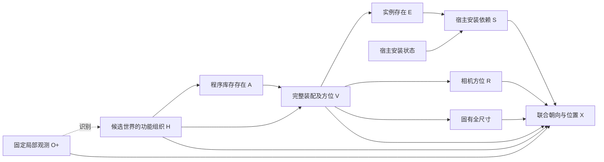

# v13：功能组织条件机制与完整装配联合放置

2026-10-27。本版不训练。真实 Qwen/API 由用户执行，CPU fixture 不作为真实效果。本次保留 v12 完整候选及 SCM 骨架，围绕已查明的存在机制饱和、尺寸与宿主坐标错误作受控改进。

## 1. 本次交付

- `world_pipeline/completion/assembly_organized.py`：功能组织 H、对称存在状态接口、实际概率采样及原库存重放。
- `assembly_organized_experiment.py`：同图候选冻结、两后端机制估计、旧 H 接口对照和四个世界分支。
- `assembly_organized_geometry.py`：尺寸先验估计、尺寸冻结后的朝向/相对位置联合估计、同宿主物品的 MILP 联合分离。
- `assembly_organized_visual.py`：真实样本、旧版、概率、后方、支撑和失败候选的自动对比。
- `assembly_organized_replay.py`：不调用模型、冻结旧尺寸的数值重放。
- 执行入口 `scripts/organized_completion.sh`。

当前版本是**固定同图 v12 丰富候选的机制与几何实验**。v12 的全部 15 个程序、70 条候选实例、43 个空间计划保留；不复用旧概率作为主线概率，也不挑选某个成功世界照搬。70 是互斥候选合计，不是每个世界的数量目标。主线不重新提出候选，不能将结果当作新的自主提案能力。

## 2. 因果生成结构

主线延续条件生成分解：

\[
q(H\mid O^+,D)\prod_r
p(A_r\mid H,O^+,D)\,
p(V_r\mid A_r,H,O^+,D).
\]

O+ 是固定的预测观测身份和三维框；D 是冻结的候选程序域。H 是候选世界的功能组织假设；A 是额外隐藏程序的库存存在；V 包含整套家具/生活物品及相机空间计划。V 展开实例存在 E 和方位 R，E 与宿主安装状态决定安装依赖 S，几何机制生成尺寸与位置。



图中的识别箭头不是照片导致场景形成。固定 O/D 条件未在简图中重复画出。有限离散 SCM 与连续几何机制分别记录；没有声称从单图识别真实因果结构或获得校准世界后验。给定 H 后各功能角色独立，是沿用并公开的近似；同一程序内的多件家具和所属物品共同展开。

### H：从可能用途细化为组织假设

本图包含混合/未强调某用途，以及 reading、social、storage、work 各自得到强调的五种假设。角色从 D 自动取得，不硬编码本图类别清单。强调一种用途不排斥其他用途，不要求新增独立活动区，不包含具体库存、数量或住户历史。所有 H 由同一固定观测进行不确定识别。

这是一组待检验的有限假设，不是这些活动已被图像证实。只有一套工作程序时，H 不能凭空创造工作变体；实际能改变的是程序存在、已有变体或方位的条件概率。

### A：对称世界状态选择

不再直接输出 `present:true/false`。同一角色的两个状态明确表示“这个世界拥有额外隐藏程序”与“这个世界没有额外隐藏程序”，两者都保留原观测和其他可选功能。交换别名绑定及呈现次序，每四次覆盖四种编码；保持对应 draw 在不同 H 和不同后端间的本地 seed/选项计划配对。

这只平衡表面编码，**不会平衡响应数量**。仍使用原来的存在平滑：

\[
\widehat p(A_r=1\mid h)=\frac{n_{h,r,1}+\alpha/2}{K_{valid}+\alpha},\quad\alpha=1.
\]

所有回答全为存在时仍得到原样的 .9，不手改 CPT 或制造 H 效应。编码平均后的 LM 响应频率未经世界真值校准，也不把编码变化当成独立的真实场景观察。

V 继续使用完整程序及空间计划的条件分类；先验先均分语义程序，再均分各自合法空间计划。增加方向选项不会提高存在先验。概率实际进入逆 CDF 抽样，逐对象存在率、类别概率、数量分布及 `do(H)` 都会导出。

### 依赖与未知

移除宿主使其孩子安装失效，保留孩子的拥有状态。没有把未知标签或未观测区域解释为不存在。程序、空样本、重复和失败都保留，不设最少数量、必须出现的类别或后方配额。

## 3. 几何优化

### 两阶段数值接口

第一阶段只估计每件具体物体的固有全尺寸，米制 `[width,height,depth]`，不输出位置。第二阶段冻结这些尺寸，再联合估计朝向、根家具位置及宿主上的物品位置。朝向在第二阶段共同估计，避免在不知道相互位置时就固定朝向。

根物体输出相机轴下的 `root_offset_m`；有宿主的物品输出 `host_offset_uv`，定义为：

\[
\Delta x=u\,w_{host}/2,\quad \Delta z=v\,d_{host}/2,\qquad
\mathbf x_i=\mathbf x_{host}+R_{host}\Delta\mathbf x_i.
\]

新宿主用其固有轴及第二阶段的朝向，固定观测宿主因未知朝向而用相机 AABB 轴。顶部高度由程序计算；层板、座面或悬挂继续要求明确参数。u/v 为零表示宿主中心，±1 表示相应边缘，不是绝对 XYZ。没有把表外或过悬物品删除，也没有新增统一的全框包含限制。

### 同宿主联合放置

原样保留所有尺寸、朝向和宿主，通过 `scipy.optimize.milp` 为同一宿主且垂直区间重叠的物品，联合选择相机 XZ 轴上的非重叠分离。目标是相对模型初始位置的最小 L1 移动；支撑中心界限沿用原来的有限框代理。每个宿主有固定 3 秒/10,000 节点预算，失败或超时无可行解会记录，不能解释为物品不存在。

之后沿用原有完整视锥、保护方位、顺序、支撑与全局碰撞检查。若预处理后的全局结果失败，可同时保留并比较原始偏移的数值候选；这是固定库存几何搜索，不重新抽库存、不估计新的后验。所有数值尝试及选择记录在 `numeric_review.json`。

此方法依然是 AABB 代理，不认证实际网格、重心、真实支撑面、人体可用性或通行。尺寸本身可能估错；程序不为了通过碰撞检查缩小尺寸。

## 4. 四个世界分支与接口诊断

| 分支 | 内容 | 解释范围 |
|---|---|---|
| `end_to_end` | 固定候选上，两后端分别估计新 H/A/V/R，再生成新尺寸与布局 | 固定观察器与候选后的新生成，不是重新运行原 RGB 全链路 |
| `layout_control` | 合并原始票数、仅平滑一次；两后端采用相同离散模型、噪声和语义世界 | 比较相同库存/方位下的几何能力；尺寸阶段输入相同，各自尺寸输出会使下一阶段输入不同 |
| `function_free` | 离散机制切断 H 的上下文耦合，保持无条件库存和方位边缘分布 | 评估条件响应；不期待平均物体数必然下降。几何仍保留 H，此项只消融离散程序路径 |
| `geometry_control` | 精确重放 v12 `layout_control` 的全部原语义世界、方位与地面先验，再生成新尺寸/布局 | 固定库存，单独看几何接口；不是冻结旧尺寸的实验 |

额外的 `interface_oldH` 在**旧 H、相同候选**下只重新估计对称存在接口，不产生额外几何。旧布尔接口的票和新接口的票都记录在 `mechanism_diagnostics.json`，便于区分 H 变化与存在接口变化。

默认每个分支四个世界，共 32 次世界尝试。源运行有多少计划世界就完整重放多少，不通过减少计划样本挑选成功案例。

## 5. Qwen/API 配对与调用预算

两路使用同一方法、候选、提示模板、结构噪声和生成配置。API 固定硅基流动 `deepseek-ai/DeepSeek-V4.1-Flash`，端点 `https://api.siliconflow.cn/v1`，读取 `SILICONFLOW_API_KEY`。默认机制和几何都是相同文字观测输入；设置 `CAUPANO_LAYOUT_RGB=1` 时只为两路位置阶段同时附带相同观测板。尺寸阶段仍使用同一文字对象输入。

本地 seed 对应配对，API 不发送未获支持的 seed；不能声称两种模型有相同的内部采样噪声。温度、top_p 等沿用已有 matched 配置，服务端内部实现差异继续保留说明。

本图默认 K=4 时每后端预算：

- 主机制 164 次：4 次 H 识别，5 H×4 角色×4 draw×存在/变体两类。
- 旧 H 存在接口诊断 64 次。
- 16 个非空世界最多 32 次初始几何请求；空世界不调用数值模型。
- 合计最多 **260 次初始请求/后端**；每次解析至多一次修复，传输错误不自动重试。

具体预算在 `call_budget.json`，不隐瞒额外诊断成本。有效请求保存提示/seed/原始回复 SHA 缓存；当前一键命令每次创建全新目录，旧数据不覆盖。不承诺完整运行可自动续跑，也不会静默重抽失败样本。

## 6. 执行指令

CPU 测试，不调用真实模型/API：

```bash
cd /data-nfs/gpu1-2/u13529658780/DIT360
bash qwen_edit_pano/scripts/organized_completion.sh test
```

实际补全与自动可视化，由用户执行：

```bash
cd /data-nfs/gpu1-2/u13529658780/DIT360
CAUPANO_MECHANISM_DRAWS=4 \
CAUPANO_CONCENTRATION=1 CAUPANO_REFERENCE_CONCENTRATION=1 \
bash qwen_edit_pano/scripts/organized_completion.sh compare GPU3 \
  qwen_edit_pano/outputs/compositional_completion_20261027_105105_496519 3407
```

第三个参数是 **v12 总运行目录**，不是 `end_to_end` 子目录。输出为全新的 `qwen_edit_pano/outputs/organized_completion_时间_PID/index.html`。入口打印完整路径和退出状态；即使部分分支失败仍尽量生成报告。

可视化包含旧 v12 端到端、旧相同库存布局对照、新端到端、新相同库存对照及原语义世界的新几何；同范围 XZ、可旋转三维和 ERP 方位图。失败候选明确保留，不混入成功统计。蓝观测、橙表内原名、紫表外已映射、红未映射；所有标签和物体保留。

只准备，不调用模型：

```bash
cd /data-nfs/gpu1-2/u13529658780/DIT360
bash qwen_edit_pano/scripts/organized_completion.sh prepare GPU3 \
  qwen_edit_pano/outputs/compositional_completion_20261027_105105_496519 3407
```

独立复核数值优化，连旧尺寸和朝向也固定，无需 Key/GPU：

```bash
cd /data-nfs/gpu1-2/u13529658780/DIT360
bash qwen_edit_pano/scripts/organized_completion.sh replay \
  qwen_edit_pano/outputs/compositional_completion_20261027_105105_496519
```

## 7. 当前已经验证与尚未验证的内容

对原 v12 的八个相同库存布局案例，完全冻结原库存、尺寸、朝向、宿主、观测及方位，仅进行联合放置重放：Qwen 原四次剩余碰撞 **4、8、1、4 → 0、0、0、0**，四次均通过当前框约束；API 四次仍通过。全部 1,606 份原运行 JSON 保持不变，无新模型调用。

[打开原尺寸实际重放](../research/audits/organized_v13_20261027/old_size_replay_001/index.html)。这不能证明原来的桌子高度或电脑尺寸变合理：旧尺寸正是刻意保留的。

两阶段接口、概率流、空/重复/失败保留、宿主坐标、H 干预、H-cut 和自动可视化通过 CPU fixture 检查；236 项完整 CPU 回归通过，并补充通过了一个 CLI 错误路径保护测试。最终真实输入 prepare-only 的 103 项代码哈希匹配。完整回归及集成记录在 [release_001](../research/audits/organized_v13_20261027/release_001/)。该目录区分集成时的代码与随后只涉及 CLI 旧目录保护的改动；最终验证以 `validation.json` 和日志为准。

新 H 和对称存在提示能否改善真实 LM 的概率区分，以及新尺寸估计是否可靠，仍须用户实际运行，不能用 fixture 的预设回答证明。后续优先检查 `mechanism_diagnostics.json`、各分支的 `functional_probability_interventions.json`、`dimension_stage.json` 和 `numeric_review.json`。

本版沿用 [S-AOG](https://arxiv.org/html/1808.08473) 的功能装配思想，参考 [SD-SCM](https://aclanthology.org/2025.emnlp-main.107.pdf) 对条件机制与干预的处理，几何联合分离使用 [SciPy MILP](https://docs.scipy.org/doc/scipy/reference/generated/scipy.optimize.milp.html)。没有复现论文训练结果，也没有声称语法或框优化识别了真实物理因果机制。
