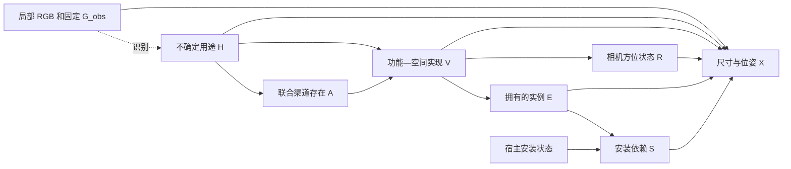

# v8 的局部聚集根因与 v9 功能—空间实现模型

2026-10-26。用户约束：不训练；根据局部观测生成合理的完整 360° 世界状态。本轮读取真实 v8 `outputs/mechanism_completion_20261026_120551_1879296`，不把成功导出或对象增加等同于任务完成。

后续真实 v9 已执行：后方记录明显增加，但候选与装配内容收缩。最新根因和 v9.1 有限接口修复见 [V9_CONTENT_REGRESSION_REVIEW_20261026.md](V9_CONTENT_REGRESSION_REVIEW_20261026.md)。保留本页模型结构；当前不增加新 DAG，不通过调高存在率恢复数量。

## 1. 用户指出的现象确实存在

下表为各版本端到端四次世界采样的累计新增对象记录，不是独立真实场景数。后半空间按中心 Z<0，中央后方按 |相机方位角|>135°。

| 版本 | 后端 | 新增记录 | 后半空间记录 | 中央后方记录 |
|---|---|---:|---:|---:|
| v7 | Qwen | 42 | 4 | 0 |
| v8 | Qwen | 50 | 1 | 0 |
| v7 | API | 44 | 6 | 3 |
| v8 | API | 56 | 6 | 1 |

v8 32/32 次布局尝试都导出了数值世界，但新增中心大量落在约 ±50°～70°，紧贴输入 ±45° 视野边缘。Qwen 的后半空间覆盖在本开发例中下降；API 后半空间记录总量没有增加，中央后方也更少。不同版本的 D 与库存不同，不能把表中差异归因于某一个改动，也不能据此判断全部语义质量都下降；但“局部补边不能替代全景世界补全”的问题明确存在。

实际角度图和只读数据：[真实 v8 方向审计](../research/audits/panorama_v9_20261026/actual_v8_001/index.html)，含实际 v7/v8 方位直方图、根对象统计、每个模块的相机后方必要可行性诊断。旧结果不修改。独立放置根对象方面，v8 Qwen 后方为 1/25，API 为 6/30；小物品的附属数量不能当作独立空间区域数。

## 2. 根因：空间实现没有成为受保护的生成状态

### 不是新功能组存在率整体太低

v8 Qwen 的期望新增为 12.7079，其中新组贡献 5.7979，约 45.6%；API 对应为 13.8261、7.336，约 53.1%。媒体组合的存在率分别为 0.60 和 0.86。即使选择了新组，很多仍被放在可见区域旁边。

### 主要新组的相机深度约束已排除后方

候选 a6 媒体组对媒体柜声明了 `farther_than obs_001`，其内部规范名称为 `in_front_of`，实际含义是更大的原相机 Z。观测近沙发 Z≈1.972 m。因此媒体柜不可能同时满足“相机后方 Z<0”。这不是把一个 offset 改成负值就能合法解决的问题。

对六个新组候选，放松尺寸、接触、碰撞和 Y，仅保留声明的 X/Z 顺序，检查全组中心处于后半空间：a5、a6、a10、a14 共四个不可行。可行只是没有发现该必要条件冲突，不是物理布局认证。

“在沙发后面”“远处墙面”“面对沙发”与“在相机后方”含义不同。现有函数正确执行了明确的相机 Z 关系，但提案中的功能意图不应被无依据地转换为相机深度关系。

### 功能服务与距离邻近混在一起

v7 延伸渠道要求绑定观测锚点，原接口只接受空间关系或安装。像“隐藏媒体设备服务可见沙发”这样的联系很容易被写成 near。near 目标随后优先拉近 AABB 表面间隔，最便宜的视锥外解往往就在左右边界。

### v8 删掉了数值 region，却没有保留语义方位

上一版删除数值回复的 region，解决了反复 `front` 的 schema 冲突；但方位语义仍只存在于不可执行的 placement 文本中，或丢给后处理几何搜索。候选模块的概率只选择了“什么”，没有可靠携带“属于哪个相机方位”。不确定域的初始方向和 near/位移目标还可能形成侧方偏好。

因此，本次不调高存在率、不设后方比例、不把旧对象旋转一圈，也不编造未知墙界。修改的是实际遗漏的 **功能—空间状态**。

## 3. v9 的模型与实际概率

H 仍是不含生活史的用途假设，A 是联合渠道存在，V 是具体功能—空间实现。每个 V 同时包含对象装配、声明的相机区域及功能连接。R 是 V 的显式相机区域状态，进入几何求解。



\[
q(H\mid O,D)\,p(A\mid H,D)\prod_s p(V_s\mid H,A_s,D)
\prod_s\mathbf1[R_s=f_R(V_s)]
\prod_i\mathbf1[E_i=f_i(V)]\mathbf1[S_i=E_i\land S_{host(i)}].
\]

上式是可枚举的离散库存与区域状态分布；固定观测宿主和无宿主情形的安装依赖基值取 1。几何是另一个隐式条件生成步骤：冻结语言模型提出尺寸/相对位姿，再由约束映射求解 `X = T_geom(数值提案; G_obs,H,V,E,S,R)`，失败保留为 blocked 状态。当前没有该数值提案的可计算归一化密度，不以几何残差冒充世界后验概率。图中的观测到 H 虚线表示识别方向，实线是本项目指定的条件生成依赖，不能混同物理因果识别。

V 的候选相机区域为 left/right/rear/unspecified。rear 表示完整框处于原相机后半空间，不是某家具后面；left/right 为侧方隐藏域，可以延伸到后半空间，并不是与 rear 互斥的物理角度分箱。unspecified 留给信息不足或跨方位装配，其数值搜索仍有限、有启发式，不宣称恢复了全局房间布局。

区域是候选世界假设，不是测量事实。每个渠道的后方实现概率直接由所选 V 的概率求和：

\[
P(A_s=1,R_s=rear)=\sum_hq(h)P(A_s=1\mid h)
\sum_{v:f_R(v)=rear}P(V_s=v\mid h,A_s=1).
\]

不是给 rear 人工分配一个固定概率。不同区域即使对象清单相同，也保留为不同空间实现；只有解释措辞变化不应复制同一个状态。对象数量不因区域出现而自动增加。

保留 v8 的冻结模型参考收缩概率，无训练、无标签拟合。区域支持以集合形式进入参考/激活机制；变体与直接预测菜单提供明确区域及服务连接，区域不是几何阶段补出来的解释。R 节点具有实际 CPT；同噪声 `do(R)` 可以保留库存而改变位姿约束。

H→V→R 仍是本项目假定的条件生成机制，不是从单图识别出的真实物理因果图。没有完整归一化 RGB 生成似然，也不假称已推断真实墙面、房间容量或全局户型。

## 4. 功能连接与几何分开

每个提案组增加以下字段：

```json
{
  "layout_region": "rear",
  "spatial_reason": "One possible camera-opposite counterpart of the visible arrangement",
  "functional_links": [
    {"source": "media_console", "target": "obs_000", "kind": "serves", "purpose": "Provides a media focal point for visible seating"}
  ]
}
```

`serves` 表示功能意图，不是 near、不证明朝向/可达性，也不是安装或新物理因果边。延伸组可以用这个连接合法绑定观测锚点，不必编造 near；真实空间顺序仍写在 relations，真实支撑仍写在 attachment。新对象之间的依赖必须在同一装配，不能跨组借用不存在的对象。

库存干预移除服务端对象时，已拥有的子物体仍保留，缺失端点的服务连接记录为 unresolved_functional_links，不保留成悬空的有效连接。

校验时用冻结观测和放松的中心级线性系统拒绝“rear 且比正 Z 观测更远”等自相矛盾的候选。这个必要检查不保证尺寸、接触或碰撞可行。整份备选为原子校验单位，不从非法候选捡对象；每阶段仍至多一次 schema 修复。

几何回复依然不填写 region。区别在于：**数值模型不决定 R，但生成模型已经采样了 R。** 明确区域传入支撑树求解，并作为约束，near 或较小位移不能把 rear 改成侧方。指定区域下若无可行解，保留库存与诊断，不移动观测、不改尺寸、不偷偷改 R 或丢对象，也不重采直到后方出现。

## 5. 如何验证，而不是追求均匀铺满

- 保留四分支×两后端：功能补全、共享库存布局对照、保边缘 H 消融、直接库存对照。两后端仍为本地 Qwen 和硅基流动 `deepseek-ai/DeepSeek-V4.1-Flash`。
- 新可视化记录物体中心角度、后半空间/中央后方记录、独立放置根对象，并与真实 v8 同坐标对比。杯子、书等附属物不会被误当成独立区域丰富度。
- 报告区域程序的存在概率、D 是否提出 rear 候选、每个世界的实际 R 和空间约束违规。没有 rear 候选记为支持缺失，不解释为真实后方为空。
- 图中没有记录的角度仍可能未知；不计算“每扇区至少 N 个”的目标，不让数量、均匀度或后方比例进入采样/求解评分。
- 继续检查语义、功能服务是否合理、过度重复和距离/朝向问题。后方物体更多不自动证明质量提升，side-domain 与 rear-domain 的程序概率也不是已校准的物理覆盖概率。
- 直接路径不接收 H，但仍保留相同 q(H) 作几何上下文；两条路径总调用预算不同。报告实际请求和预算，不把它当作已完成的预算匹配因果收益实验。

这些选择借鉴 [S-AOG](https://arxiv.org/html/1808.08473) 对功能组、支撑和组间关系的区分，[HSG](https://siyuanhuang.com/files/eccv2018parsing.pdf) 的结构/几何联合一致性，以及 [PanoDreamer](https://arxiv.org/html/2412.04827) 优先考虑全 360° 一致性的思想。没有复现这些工作的训练或 RGB 生成算法，也不把它们的效果归于本项目。

## 6. 执行代码

模型：`world_pipeline/completion/assembly_panorama.py`；调度：`assembly_panorama_experiment.py`；区域保护几何：`assembly_panorama_geometry.py`；方向可视化：`assembly_panorama_visual.py`。

先进行纯 CPU 测试：

```bash
cd /data-nfs/gpu1-2/u13529658780/DIT360
bash qwen_edit_pano/scripts/panorama_completion.sh test
```

真实生成沿用已设置的 `SILICONFLOW_API_KEY`，不训练、不复用旧 D/旧 CPT：

```bash
cd /data-nfs/gpu1-2/u13529658780/DIT360
CAUPANO_WORLDS=4 CAUPANO_MECHANISM_DRAWS=4 \
CAUPANO_BASELINE_ROOT=qwen_edit_pano/outputs/mechanism_completion_20261026_120551_1879296 \
bash qwen_edit_pano/scripts/panorama_completion.sh compare GPU3 \
  qwen_edit_pano/outputs/mechanism_completion_20261026_120551_1879296/end_to_end 3407
```

新目录：`outputs/panorama_completion_时间_PID/index.html`。仍是完整世界状态的框/XZ/ERP 方向图，不是 RGB 全景。默认 32 次布局尝试；概率机制 token 上限 512、直接库存 2048，容纳新增空间字段；两后端请求配置一致，预算在冻结 D 后写入 `call_budget.json`。

若仅检查环境与观测复制，不调用模型/API：

```bash
cd /data-nfs/gpu1-2/u13529658780/DIT360
bash qwen_edit_pano/scripts/panorama_completion.sh prepare GPU3 \
  qwen_edit_pano/outputs/mechanism_completion_20261026_120551_1879296/end_to_end 3407
```

每次创建新目录，旧结果保持不变。保留原始失败、阻断候选及 phase_errors，原始物体名称和表外颜色继续保留。本地和 API 仍使用共同提案域，不代表各自独立提案能力的完整评估。

本页首发时的 CPU 测试和合成 fixture 只验证逻辑与执行契约；不能把强制指定 rear 的合成测试当作真实模型已改善全景补全的证据。后续真实 v9 结果已在最新内容审计中复核，v9.1 接口修复后的真实生成仍未执行。

## 7. 首版实现验证与判读原则

- 全套 CPU 回归 **186/186 通过**；包括空间状态概率、同噪声干预、服务连接与 near 分离、完整 AABB 区域保护、空库存、表外类别、缺失上游依赖时的可视化。
- 真实观测的 prepare-only 检查在 `outputs/panorama_preflight_20261026_002`，83 项冻结代码哈希匹配；RGB、G_obs 与 v8 一致，无模型加载或 API 调用。
- 合成人工 fixture 完成八分支、16 次世界尝试；74 个 HTML 的 428 处本地链接有效。该 fixture 只验证实现，见[验证记录](../research/audits/panorama_v9_20261026/release_002/release_validation.json)与[完整测试日志](../research/audits/panorama_v9_20261026/release_002/full_regression_186.log)。
- 真实 v8 的 2,173 份 JSON 与审计前哈希一致，未重写旧结果。

以上是 v9 首发验证的冻结记录；当前 v9.1 为 191 项 CPU 回归通过，最新 prepare-only 与来源保存记录见内容退化审计，不使用首版代码哈希宣称当前实现未变。

下一轮先检查 D 的 `rear_program_proposed` 和 `spatial_support`，再看后方实现的真实概率、采样的 R，最后核对几何区域约束与实际角度。没有后方提案是候选支持问题；有提案但概率很低是条件机制问题；样本含 rear 却没有合法后方世界是几何或依赖问题。四次采样未出现后方也可能只是有限采样，须结合完整概率分布判断。新增后方数量只作描述，同时人工核对服务关系、场景用途、重复、支撑与距离。先运行这次有根因支持的修复，不预先叠加下一版机制。
