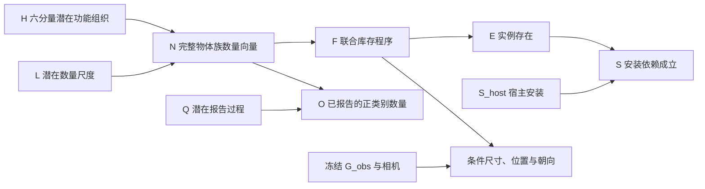

# 完整库存因果场景补全 v3：实现、依据与运行

日期：2026-10-25。本版已接入项目实际生成、概率采样、布局和可视化入口。它是针对当前项目条件的可执行研究模型，不是声称已识别真实房间成因或得到了最优的单图世界后验。

## 1. 修改依据：解决实际任务定义错误

任务是：局部 RGB 与冻结 G_obs → 与观测兼容的完整周围世界假设，预测隐藏实例类别、完整尺寸、中心与朝向，再导出 `G_full = G_obs ∪ ΔG`。单张图像无法确定唯一真实世界，因此应表达多个合理假设及不确定性。

上一版实际运行的两个目录均为空，六个实现的 `object_keys=[]`，导致所有样本必然零新增。原因不是布局删除对象，而是把“解释可见家具用途”当成了“完整库存生成”。将需求激活概率调大不能改变这个支持域。

本版保留 joint 中有用的联合库存与宿主依赖，替换“未满足需求 → 新物体”的门控。功能组织改变的是**完整库存组合的概率分布**。可见沙发已经支持会客，不意味着没有更多储物、生活物品或其他区域。

主要改动与根因对应：

| 根因 | 实现 |
|---|---|
| 只解释观测，候选域为空 | 完整周围库存提案；固定两类探索通道；可复用并重新校验旧 joint/baseline 原始提案 |
| 把功能充分性误当库存完整性 | 移除 R 需求不足门，使用完整物体族数量 N 与联合程序 F |
| 功能解释不影响实例 | 明确 CPT，精确计算程序/实例/数量概率，再按这些概率实际抽样 |
| 空解释重复，提高空状态权重 | 空提案归并为一个显式 null 库存；完全相同的结构提案去重 |
| 不同提案混淆了机制增益 | 三路严格使用同一目录、观测、参数和布局后端，仅改变数值采样机制 |
| 语言叙述过度推断生活史 | H 仅表示潜在功能组织；L 仅是数量尺度，不宣称知道住户经历或房间物理面积 |
| 运行成功被误当补全成功 | 全部提案为空时明确报告 `empty_candidate_domain_no_completion`，不加载后续依赖分支模型 |

## 2. 重新核验的文献及使用方式

| 原始工作 | 对本版的启发 | 适用边界 |
|---|---|---|
| [S-AOG / Human-Centric Indoor Scene Synthesis，CVPR 2018](https://arxiv.org/html/1808.08473) | 对象出现、数量变化、联合组合、尺寸和支撑关系需要生成分布 | 语法和 MRF 不是自动识别出的真实因果图；本版没有复现其训练或人体 MCMC |
| [HSG / Holistic 3D Scene Parsing，ECCV 2018](https://siyuanhuang.com/files/eccv2018parsing.pdf) | 功能与几何应连接到可检查的观测模型 | 其深度/法线/分割渲染似然尚未接入；本版只有粗粒度计数报告似然 |
| [ATISS，NeurIPS 2021](https://research.nvidia.com/labs/toronto-ai/ATISS/) | 完整物体集合生成，以部分对象为条件 | 是重要的强非因果基线；不能只和弱提示词比较就宣称因果贡献 |
| [MiDiffusion](https://arxiv.org/html/2405.21066) | 离散类别和连续布局联合建模，掩码保留已有对象 | 它通常具有 floor plan；当前单图没有可靠完整边界，本版没有加载它的模型权重 |
| [FactoredScenes，NeurIPS 2025](https://arxiv.org/html/2510.10292v1) | 生成程序与实例姿态分层，程序库约束联合场景结构 | 不能把临时语言提案说成已经学习的程序库 |
| [3D Scene Graph Prediction，IROS 2026](https://arxiv.org/html/2607.10879) | 从部分探索状态预测未探索区域，并联合预测对象属性 | 任务方向很接近，但输入不是本项目的一张局部 RGB，也不是因果发现证明 |
| [FuncRoom-Agent，2026 预印本](https://arxiv.org/html/2608.29519) | 结构、大家具、支撑物、嵌套小物的可执行依赖 | 其功能目标由输入给定；不能直接用其功能覆盖目标强行给已有房间填家具 |
| [FunFact，CVPR 2026](https://arxiv.org/html/2604.03696v1) | 联合推断功能关系与边缘概率 | 关系候选推断不能替代隐藏库存生成，其 RGB-D 条件也不同 |

本版的功能密度比参数化是本项目的明确建模选择，以上论文不构成该具体公式效果的证明。统计共现可以用于学习条件机制；问题在于能否区分共同用途、联合组合、安装依赖和观测过程，并用受控实验验证机制影响。

## 3. 与实际代码一致的模型结构



H 的六个分量是 social、reading、work、dining、storage、background，可以共存。它是生成模型中的功能组织，不是当前动作或某个居民的具体意图。

L 是参考数量尺度，默认 .6/1/1.8；它不是房间长宽，不创建虚构墙面。Q 是粗报告概率的潜变量，默认 .25/.55/.85，**不等于 FOV/360，也不是实际测量的可见性**。

N 使用十三个物体族计数：工作设备、照明、储物、床、媒体、书籍、餐具/托盘、织物、植物/装饰、座具、桌面家具、建筑构件、其他。观测与提案都用同一明确规则绑定，所有 ID、名称和绑定结果写入 `count_observations.json`。

每个 F 是完整联合增量，加上所有固定观测才构成完整库存。程序内的宿主、物品与空间关系一起选择，避免逐个独立抽物体破坏组合。N 的状态来自候选程序实际具有的完整数量向量；本版尚不支持超出提案域的无限新实例出生。

E_i 是“所选 F 是否包含实例 i”的确定性机制。S_i = E_i AND S_host。移除宿主使安装无效，不把其他已拥有的子物品自动从库存中删除。空间关系不是因为画成边就被当作真实因果关系。

## 4. 数量机制：为什么使用功能密度比

仅将少量候选完整数量代入独立数量 PMF 相乘，可能让稀疏候选成为高密度点。候选程序只是完整世界空间中少量代表，缺少对应提案质量，因此原始数量 PMF 不应冒充完整全局世界质量。本轮数值回放实际发现了这种空状态偏好，不能通过随意调大均值来修饰结果。如果已有充分数据学出的完整数量先验，可以直接使用；当前没有这种校准依据，所以不把手写绝对 PMF 当成可信场景分布。

本版明确采用**固定候选域中的参考数量分布，经功能机制调制**。它是一个归一化的有限生成模型，不宣称修正了未知的 VLM 提案密度。

物体族 k 的参考均值 a_k>0、功能影响 b_rk≥0、尺度 s_l>0：

\[
\mu_k(h,l)=s_l\left(a_k+\sum_r h_r b_{rk}\right).
\]

背景数量使用较宽的负二项分布，功能数量使用一个有限均值的 Poisson 分量：

\[
g_{0k}(n)=\mathrm{NB}(n;s_l a_k,r),\quad
\gamma_k(h)=\frac{\sum_r h_rb_{rk}}{a_k+\sum_r h_rb_{rk}},
\]

\[
g_{hk}(n)=(1-\gamma_k)g_{0k}(n)+\gamma_k\mathrm{Pois}(n;\mu_k(h,l)),\qquad
\rho(n;h,l)=\prod_k\frac{g_{hk}(n_k)}{g_{0k}(n_k)}.
\]

令 b_D(n) 为当前不同数量向量上的参考分布，默认等权：

\[
p(N=n\mid h,l,D)=
\frac{b_D(n)\rho(n;h,l)}{\sum_{n'\in\mathcal N_D}b_D(n')\rho(n';h,l)}.
\]

F 在具有所选 N 的唯一联合程序间等权。完全相同的结构提案先合并；不同程序但相同数量向量共享该数量状态的质量，避免通过多写几段类似提案增加总权重。

当功能负荷 b 全设为 0，ρ=1，参考库存支持仍存在。普通生活物品不需要被证明为当前某活动的必要设备，关闭功能不会把它们一概判作不必要。

这个混合形式还解决了另一个问题：同形状负二项分布只改变均值时，其对数密度比会成为数量的线性奖励。本版在每族的极大数量尾部，密度比回到 1−γ，而不是随数量无限增大；因此不会仅因复制更多同类物体持续获得更高功能分数。这是软概率性质，不是数量上下限。该性质及混合分布归一化已加入测试。

默认 a、b、r、H/L/Q 先验均是完整公开的参考参数，**没有从论文偷换成测量值，没有从语言模型索取自评概率，也没有完成真实校准**。所有数值保存于新实验配置和 `population_parameters.json`。它们可由第八节的审计数据拟合替换。

## 5. 从局部报告反演完整库存

每个候选中 N_k = 已观测族数量 o_k + 新提案数量。对已报告的正数量族，使用粗粒度 Binomial 报告核：

\[
\mathcal L(O^+\mid N,Q)=
\prod_{k:o_k>0}{N_k\choose o_k}q_Q^{o_k}(1-q_Q)^{N_k-o_k}.
\]

未报告族保持未知，不加入 o_k=0 的负证据项。本阶段冻结 G_obs，暂不估计检测假阳性。Q 的共用潜变量允许一定场景级覆盖变化，但不能替代逐物体的视野、遮挡与检测模型。

有限后验为：

\[
p(h,l,n,f,q\mid O^+,D)\propto
p(h)p(l)p(n\mid h,l,D)p(f\mid n,D)p(q)\mathcal L(O^+\mid n,q).
\]

精确枚举 H/L/N/Q，再求 F 和实例边缘概率。实际采样按这些概率选择联合库存，随后调用原参数化布局预测完整尺寸、位置和朝向；没有依据解释长度排序，也没有仅输出一段后验描述。

\[
p(E_i=1\mid O^+,D)=\sum_{f:i\in f}p(f\mid O^+,D).
\]

实例概率写入 `G_full.json` 的 `generative_presence_probability`，明确是**布局筛选前**的概率。零新增、重复和布局失败全部保留，不重抽直到凑够非空结果。

由于 D 可由同一图片辅助提出，且没有可计算的 VLM 提案密度，这不是对所有真实世界的无偏视觉后验。代码只对计数报告建一次似然，不再叠加 v2 的 noisy-OR 线索。连续几何目前是条件预测/约束求解，不是经过学习的联合图像后验。

## 6. 两种候选来源与三路对照

建议第一轮固定已有 joint 候选：重新读取其原始 Qwen 回复，用当前解析器重新验证身份、宿主、观测引用与接口；不复用旧概率和旧几何。这能将“概率机制变化”与“又一次语言模型提案变化”分开。

随后可运行全新提案：每个场景假设固定两次请求，一次关注周围组织，一次关注普通物品与次级区域，每次最多两个完整联合程序。保留空回复，禁止循环调用直到非空；额外保留一个唯一的 observed-only 状态。

三路均使用完全相同的候选程序、参数、RGB、G_obs、相机、请求样本数：

| 目录 | 概率机制 | 能说明什么 |
|---|---|---|
| `joint_reference` | 唯一联合程序均匀抽样 | 同域参考，不是原先整个 joint 流程的完全复现 |
| `population_posterior` | 功能数量机制 + 正计数报告后验 | 新模型的完整结构采样 |
| `population_no_function` | 将功能负荷设为 0，保留计数报告与参考库存 | 与上一行比较，隔离本模型内功能数量机制的影响 |

后验与 reference 的差异同时包含功能、数量分组和观测更新，不能全部称为因果效应。与 no_function 的对照更适合检验功能机制影响，但效果好坏仍需真实数据评测。比较页会校验三路程序、参数和观测一致。

## 7. 可以直接运行的命令

代码已放入工作树。先执行 CPU 测试：

```bash
cd /data-nfs/gpu1-2/u13529658780/DIT360
bash qwen_edit_pano/scripts/population_completion.sh test
```

**推荐先固定已有 joint 候选，验证新概率机制及实际三维结果。** GPU3 替换为你可用的节点：

```bash
CAUPANO_POPULATION_CANDIDATES=qwen_edit_pano/outputs/causal_completion_pilot_20261024_220629_380006_3407/joint \
CAUPANO_WORLDS=4 \
bash qwen_edit_pano/scripts/population_completion.sh compare \
  GPU3 \
  qwen_edit_pano/outputs/causal_completion_pilot_20261024_220629_380006_3407/joint \
  qwen 3407
```

这里使用本地 Qwen 重新预测所抽库存的布局，不需要 API Key。旧 joint 候选必须经过当前校验；其中物体并非真实库存标签，仍需审核。该来源目前有完成的 qwen 提案；选择 api/both 时须提供对应已完成的候选来源或使用全新提案模式。

全新提案模式，不设置候选缓存环境变量：

```bash
env -u CAUPANO_POPULATION_CANDIDATES CAUPANO_WORLDS=4 \
bash qwen_edit_pano/scripts/population_completion.sh compare \
  GPU3 \
  qwen_edit_pano/outputs/causal_completion_pilot_20261024_220629_380006_3407/joint \
  qwen 3407
```

两种模式均新建 `qwen_edit_pano/outputs/population_completion_时间_PID/`，不续写旧实验。`api`/`both` 才需要 `SILICONFLOW_API_KEY`。只有 posterior 分支提出/载入候选，另外两路复用该目录，并重新运行布局。

主要结果：

```text
population_posterior/qwen/completion/probability_audit.html
population_posterior/qwen/completion/probability_audit.json
population_posterior/qwen/completion/count_observations.json
population_posterior/qwen/completion/population_parameters.json
population_posterior/qwen/completion/causal_model.json
population_posterior/qwen/completion/structural_samples.json
population_posterior/qwen/completion/world_*/G_full.json
population_posterior/qwen/completion/candidate_source.json  # 使用缓存时
visual_compare_001/index.html
visual_compare_001/synchronized_3d.html
```

比较页展示三列实际对象、统一坐标的 AABB、物体列表、尺寸、位置与可同步旋转的三维视图。ERP 是世界状态方向图，没有生成 RGB 全景。脚本会输出实际路径；失败会显示失败原因，并跳过依赖未建立目录的 GPU 任务。

## 8. 数据拟合入口

新增 `assembly_population_fit.py`。输入为人工核验的独立完整场景 JSONL：`scene_id`、`split`、六个 `roles` 代理标注、十三族 `full_counts`，以及可选的已匹配真值实例 `views` 计数。

同一物理房间只能出现一次，不能把裁剪作为独立样本；验证集不参与参数拟合。角色标签是功能组织代理，不是观察到了真实居民意图。可选 view 的计数必须与完整库存匹配，不能将检测假阳性冒充真值实例。

拟合器估计 H 先验、非负族数量负荷与背景均值，固定总体尺度为 1，避免尺度与均值不可分辨。若有已核验 views，只估计粗计数覆盖模式，仍不称其为几何可见性。验证报告是给定角色代理的完整计数 NLL，不是隐藏库存概率已经校准的证明。

```bash
/data-nfs/gpu1-2/u13529658780/.conda/envs/qwen3vl/bin/python \
  -m qwen_edit_pano.world_pipeline.completion.assembly_population_fit \
  --annotations /你的路径/audited_complete_scene_counts.jsonl \
  --output qwen_edit_pano/outputs/population_fit_run001
```

将输出参数用于推断：设置 `CAUPANO_POPULATION_PARAMETERS=/输出路径/population_parameters.json`，然后运行第七节命令。参数被完整保存进新实验。当前没有拿未审核的 GT 清单自动训练，也没有执行真实训练；直接推断使用显式默认参数。

## 9. 验证与效果边界

完整 CPU 套件 **112 项通过**。新增 16 项覆盖：概率归一化、功能计数不会无限奖励重复物体、功能机制对真实采样概率的影响、缺失类别保持未知、显式空状态、精确结构去重、实际抽样频率、噪声重放、宿主与功能干预、训练/验证隔离、原始 joint 回复重校验、缓存入口实际执行新布局、三路同域导出与可视化、上游失败跳过后续 GPU，以及空域不再冒充成功补全。Shell 语法检查通过。

CPU 缓存重放使用旧 joint 的非空提案，验证新概率与采样链路，没有执行新的图片推断。该重放只能证明接线与模型内差异，不证明新增物体真实存在，也不证明布局更合理。本轮 GPU/API 实验由你执行。

空间层继续使用原支撑相对参数化与完整物体视锥外约束。AABB 接触和碰撞是代理，不等于真实表面、承重、人体可用性或物理稳定性。下一步应在新输出上检验这些问题，而不是因为框图看起来完整就宣称完成了物理推理。

该版本解决的是：从局部可见用途解释，转向可执行的完整库存分布与条件采样。后续真正的研究增益应通过独立完整房间、真实视野划分、强条件生成基线、程序库先验、几何观测似然和已知机制变化的受控数据来验证。
