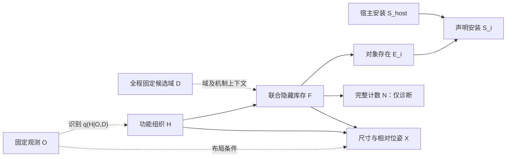

# 局部观测下的世界补全：v3 核对、SD-SCM 调研与 v4 执行方案

2026-10-25。以保存的配置、原始回复、状态文件和当前源码为依据；不把历史 AI 交接中的判断当作实验事实。

这次需要改的是**概率机制的来源与可检验性，以及本地/API 对照的实验控制**。继续增加“生活历史→需求→物体”的解释层，不能解决已查到的问题。v4 已实现为可执行的、具有明确适用范围的条件生成原型；尚无真实 v4 GPU/API 质量结果，不能宣称优于 v3。

## 1. 先核对用户刚运行的结果

核对目录：`outputs/population_completion_20261025_115554_2925396`。审计 JSON、图表、实际旧结果入口和 CPU 验证入口见工作区 `research/audits/sdscene_model_v4_20261025/index.html`。

| 实际分支 | 四次新增实例数 | 实际抽到的联合库存 |
|---|---|---|
| population_posterior | 4、4、4、9 | f3、f3、f3、f1 |
| joint_reference | 4、7、4、4 | f2、f0、f2、f3 |
| population_no_function | 0、4、9、7 | f_null、f2、f1、f0 |

因此，这一轮已经不是“一个物体都没有”。主分支前几次采到相同库存，造成视觉上重复。保留 IID 重复样本是正确的；删除重复世界会改变采样分布。四次样本不足以评价覆盖率或证明因果模块有效。

发现的具体问题：

1. **候选不是这次重新生成的。** 主分支从旧 `causal_completion_pilot_20261024_220629_380006_3407/joint` 重读候选，另外两路继续复用同一候选。这样可检查概率重加权，却不能评估当前模型提出新物体的能力。这一轮没有 API 补全结果。
2. **旧计数存在标签错误。** f3 的储物柜、书桌、办公椅类别均写成 `furniture`，台灯写成 `lighting`。旧程序只读 `category`，把四件新增物体都计成 `other`，直接影响基于类别计数的 v3 权重。现已修复为类别优先、具体名称/variant 回退，记录来源；`side_table` 和 TV stand 也修正了族映射。旧结果文件保持原样，不能把修正后的诊断计数当作旧模型实际使用的计数。
3. **存在候选内部的语义矛盾。** f2 的 `freestanding wooden bookcase` 却声明 `attachment.kind=wall`。这需要在候选生成时拒绝并反馈给模型，不应由布局器偷偷改成落地。
4. **数值布局的模板可能影响预测。** 旧模板预填 `range_m=3`、yaw=0、offset=[0,0,0]、surface_fraction=.5 等；保存的回复多次照用这些数值。v4 把数值模板改为 null，要求后端明确填写。这个修改减少提示中的数值锚定，不意味着三维预测已经准确。
5. **几何结果仍未完成物理验证。** 实际主分支四个世界均通过完整 AABB 视野外检查，最终非许可碰撞对为零，但均为 `layout_needs_review`。f3 的挂墙柜未核验；f1 的座面书/毯、挂钩和悬挂衣物等未核验。当前主分支没有水平接触失败，因此不应把旧版本“接触面积过小”的问题机械地套用为这次主因。未核验安装不等于已经证明错误；没有碰撞也不等于稳定或有真实安装面。

实看 `layout_xz.png` 和 ERP 方向图，f3 是侧方书桌/椅子/台灯加后方柜子；f1 是两侧的座椅与储物/悬挂组合。画面上的框密集、标签重叠不能直接推出三维碰撞，需要同时看数值报告。ERP 是方向投影图，不是生成的 RGB 全景。

## 2. 重新查阅论文及官方实现后，哪些可以借鉴

| 工作与一手来源 | 可借鉴的内容 | 对本项目的适用范围 |
|---|---|---|
| [Human-centric Indoor Scene Synthesis Using Stochastic Grammar](https://arxiv.org/abs/1808.08473)，[作者代码](https://github.com/SiyuanQi-zz/human-centric-scene-synthesis) | S-AOG 的功能层级、整体对象组合、人类交互约束；分布从室内场景数据学习 | 功能和交互应约束组合与布局。其 MRF 上下文关系不自动等于因果边；不能据此恢复住户生活史 |
| [Holistic 3D Scene Parsing and Reconstruction from a Single RGB Image](https://siyuanhuang.com/files/eccv2018parsing.pdf)，[作者实现](https://github.com/thusiyuan/holistic_scene_parsing) | 功能、几何、物理共同约束；渲染的深度/法线/分割与观测比较，进行 analysis-by-synthesis | 借鉴观测一致性和功能约束。它的单图重建不等于本项目的完整视野外库存推断，不能直接拿其渲染误差验证看不见的物体 |
| [SD-SCM：Language Models as Causal Effect Generators](https://aclanthology.org/2025.emnlp-main.107/)，[论文正文](https://arxiv.org/html/2411.08019)，[官方实现](https://github.com/lbynum/sequence-driven-scms) | 用户指定 DAG；父变量文本约束；有限域采样；干预替换机制 | 直接启发 v4 的机制接口与概率采样。论文使用指定结构生成数据，不能证明 LM 或单图识别了真实场景的因果结构 |
| [MiDiffusion](https://arxiv.org/html/2405.21066)，[作者代码](https://github.com/MIT-SPARK/MiDiffusion) | 离散类别与连续几何共同建模，固定已有对象的补全协议 | 借鉴冻结观测、联合预测类别/尺寸/位置。其 floor-plan 条件和训练数据与本项目不同；当前未知房间边界，不能直接沿用其越界指标 |
| [FactoredScenes](https://arxiv.org/html/2510.10292v1) | 功能结构程序与真实场景中的姿态变化分开学习 | 支持把库存程序和几何机制分开诊断。v4 尚未学习其程序库或姿态分布 |
| [FunFact](https://arxiv.org/html/2604.03696v1)，[项目页](https://funfact-scenegraph.github.io/) | 功能关系的不确定性、局部候选与整体一致性约束 | 借鉴概率化关系和约束传播。它主要从 RGB-D 建立功能场景图，不是单张局部 RGB 的隐藏物体生成器 |

具体实现核查：HSG 的 `inference.py` 接收深度、分割、法线估计，`mcmc.py` 用能量差与温度执行 Metropolis-Hastings 接受步骤。因此，“引入功能”不是只写出一段解释，而是让功能约束参与配置选择。MiDiffusion README 明确区分 synthesis、scene_completion、furniture_arrangement 等设置，提醒我们必须对齐输入条件才能比较。

SD-SCM 有两个最相关的设计：parent-only concatenation 与 domain-restricted sampling。本文借鉴这两点，但没有声称完整复现其 token 限域采样。还检查了[官方 `sdscm.py`](https://raw.githubusercontent.com/lbynum/sequence-driven-scms/main/sdscm.py)：本次读取的 main 中，`chunk_continuation` 使用候选输入后的最后位置 logits，再索引候选 token 后聚合。这不等同于对每个候选做正确移位的 teacher-forced 序列对数似然。因此未直接复用该打分函数；这项实现核查不否定论文关于指定结构和干预的理论定义。

对本地/API 公平比较而言，另一个实际问题是 API 通常不能提供任意完整候选的可比 token likelihood。不能一边给本地算真实概率、另一边让 API 自报“0.9 confidence”，再当作同一方法比较。

## 3. v4 的模型结构：区分识别与生成

不设置强语义的住户背景生活历史 C。单图只能支持对当前空间组织的有限推断，无法可靠确认住户职业、过去活动或物品购买史。

定义：

- O：固定的局部图像、相机、G_obs 与观测宿主信息。
- D：冻结的共享候选域，包括可能功能组合、完整隐藏库存、固定观测实例及附件规则。由本地/API 的新提案共同构建，不是全世界所有可能物体。
- H：潜在功能组织 profile，例如“社交+阅读”，允许多个功能共存；另有“具体用途未确定”状态。它不是当前人在做什么，也不是住户历史。
- F：联合隐藏库存程序，包含具体类别、variant、物体组、附件宿主和关系；有一个显式空库存状态。
- E_i：对象是否在库存中；S_i：声明的宿主依赖是否满足。S_i 不代表已通过真实物理验证。
- N：完整库存的族计数，只用于诊断，不再用手工计数权重影响采样。
- X：尺寸、相对位姿、区域方向等布局参数，经相同求解器编译为相机坐标的三维框。



这里虚线表示识别或固定条件，不是声称“图片导致了房间用途”。在每一个固定 O,D 的补全任务中，H 是已由识别分布初始化的 SCM 根节点；F 的唯一变化父节点是 H，D 作为全程固定上下文存在。

实际联合采样律为：

\[
\widehat Q_m(H,F\mid O,D)
=\widehat q_m(H\mid O,D)\widehat p_m(F\mid H,D).
\]

库存及声明安装是确定机制：

\[
E_i=\mathbf1[i\in F],\qquad
S_i=E_i\land S_{\mathrm{host}(i)},
\]

无宿主根节点按自身存在确定声明安装状态，观测宿主按固定可用状态处理。移除桌子只会让台灯的安装依赖不满足，不能自动把“仍拥有的台灯”从库存中消灭。正常生成中完整程序已验证宿主闭包。

几何是后端提案核 `X_LM ~ K_m(·|O,H,F,D)` 加公共确定求解器。当前没有拟合连续密度，不把数值布局审查当作 RGB 似然。失败世界保留原库存与失败记录，不重采直到成功，也不把成功子集悄悄归一化为原分布。

**这是“SD-SCM 启发的、机制约束的条件世界生成模型”。** 它具有可执行结构与模型内干预，但未识别真实世界的因果图，尚不能用它估计住户真实行为对物品拥有的因果效应。H→F 是研究假设；场景语法的层级关系、on/near 等空间关系，也不能全部直接叫因果边。

## 4. 概率如何真正控制隐藏物体生成

### 4.1 机制不是让模型填写自信分数

对固定 H 与 D，本地和 API 都重复进行相同预算的分类生成，只返回：

```json
{"choice":"f0"}
```

每行默认 K=3 次，分类有效性由外部公共验证器检查。`p(F|H,D)` 阶段只提供当前 H、每个完整世界共有的观测实例名称、固定库存选项；不附图、不传额外 G_obs 几何、不传之前投票，也不传提案来自哪个后端。候选顺序按共同的阶段种子置换，降低固定顺序偏差。识别 q(H|O,D) 阶段才看同一观测图板与观测上下文。

对 J 个状态，用总浓度 α=1 的对称 Dirichlet 平滑：

\[
\widehat p_j=\frac{n_j+\alpha/J}{K_{\rm valid}+\alpha}.
\]

这里 α 是公开的平滑选择，不是已学习的物理先验。保存原始选择次数、无效次数、每行概率和在多项式假设下的标准差。每个请求最多一次完整 JSON 修复；仍然无效的 draw 单列统计。一整行没有有效选择则阶段失败，不能回退到均匀概率并伪装成推断成功。

严格地说，这估计的是**指定提示、候选顺序协议、采样参数及修复流程下有效生成通道的频率**，不是 token 条件概率，也不是校准后的真实场景概率。不同顺序和服务端随机性使多项式标准差只是近似不确定性诊断。K=3 用来检查链路；正式判断机制差异需要更多 draw、重复运行和多场景验证。

### 4.2 先采 H，再按对应行采 F

编译后的有限 SCM 用独立的 Uniform[0,1) 噪声与逆 CDF 按拓扑顺序采样。对对象 i：

\[
P(E_i=1\mid O,D)=\sum_{h,f}\widehat q_m(h\mid O,D)
\widehat p_m(f\mid h,D)\mathbf1[i\in f].
\]

该值写入最终新增对象的 `generative_presence_probability`，实际 F 采样也使用相同表。不是生成解释后另外均匀抽世界。

替代程序中的对象 ID 不是同一个已确认的真实物体，因此实例概率必须按“此候选中的实例”解释。另保存按精确具体类别统计的 `category_presence` 与 `expected_category_counts`：类别至少出现一次的概率和类别期望数量分开计算，不能把实例概率之和误叫类别存在概率。仅统一大小写与下划线，不宣称自动解决椅子/扶手椅等所有同义类别。

每个补全目录提供：

- `probability_audit.html`：q(H|O,D)、每行 p(F|H,D)、最终 P(F)，可直接核对。
- `empirical_mechanisms.json`：实际生成计数、概率、无效率。
- `functional_probability_interventions.json`：逐 H 干预后的库存、实例与类别存在概率。
- `causal_model.json`、`mechanism_graph.json/svg`：真正使用的 CPT、全部节点与父变量。
- `structural_samples.json`：每个样本的 H/F、外生噪声和库存，不删除重复与空世界。
- `world_*/host_interventions.json`：宿主移除与固定噪声 H 干预；几何不会自动重解。

如果 p(F|h) 的各行相同，功能变量没有产生库存概率影响，程序会如实给出零差异。不能人为加大权重制造“因果有效”的图表。小 K 下的非零差异也可能是采样噪声，不能直接认定为稳定的因果效应。

### 4.3 为什么 v4 不继续叠加 v3 的计数权重

v3 的手工功能先验、计数分布及观测报告机制提供了明确数学分布，却没有在本任务上完成学习和校准；此次还暴露了具体类别计数错误。候选本身受图像影响，将额外的启发式权重直接称作真实 RGB 后验，需要额外证明，不能靠“因果图更复杂”成立。

v4 直接声明条件生成律 q(H|O,D)p(F|H,D)，不再加手工 NB/Poisson 密度比或第二个图像/计数似然。N 仅是 F 的确定诊断子节点。保留原 v3 源码与旧实验用于比较，这不意味着所有使用图像候选的贝叶斯方法都不成立。

## 5. 本地/API 相同配置如何落实

新入口 `scripts/sdscene_compare.sh` 必定包含 qwen 与 api 两路。两路均复用最新源实验的 **qwen G_obs**，即使源实验保存了不同的 API 观测，也不重新识别图像。图像、观测文件、相机、D、预算与编译器共同冻结。

| 项目 | 共同设置 |
|---|---|
| 图像 | 相同 RGB 图板，JPEG92、最长边 1536；记录发送前字节哈希 |
| 系统提示及解析 | 同一系统提示；文本生成后共用 JSON 解析与验证；相同一次修复预算 |
| 解码请求 | temperature=.4、top_p=.9、top_k=50；请求非 Thinking 模式 |
| 输出上限 | 提案/布局 8192，profile 选择/库存选择 256；各阶段两路相同 |
| 抽样 | 每个 H 相同 K；本地按阶段独立种子；API 不发送未获文档保证的 seed |
| 失败处理 | 保留原回复与错误；依赖缺失阻断后续 GPU 阶段；报告仍展示可用结果 |

本地/API 的 tokenizer、视觉编码、服务端实现和算力不同。同 token 上限不等于同计算预算，也不能保证服务端实现相同采样。API 是后端能力对照，不能将差异仅归因于参数量。

先各自生成新候选，再冻结共享并集 D。完全相同的结构程序只保留一次；各类空程序合成一个 f_null。合并后的选项用中性 f0/f1 编号，机制提示不展示 qwen/api 来源。候选提案来源保留在审计记录中。若两路固定预算提案全空，任务标记失败，不补造模板对象。

有两组实际世界对照：

1. **end_to_end**：同 D,O，本地和 API 分别使用自己的 q(H)、p(F|H) 和布局后端。检查识别/机制差异如何传到物体库存与布局。单独的提案统计仍显示各路能提出什么。
2. **layout_control**：把两路原始分类次数合并，只平滑一次，得到一个共享机制表。共同 seed 采出相同 H/F/E/S；对两份 `structural_samples.json` 做字节哈希断言。随后才交给不同布局后端。此组能更直接检查相同库存下的尺寸/位置能力。合并不是更正确的后验，也不是质量加权融合。

两组共用既有可视化实现，提供相同坐标轴的俯视图、ERP 方向图和可旋转三维框。`layout_control` 的结构样本不一致时报告会明确报错。

## 6. 直接执行

从工作区根目录运行。先检查：

```bash
cd /data-nfs/gpu1-2/u13529658780/DIT360
bash qwen_edit_pano/scripts/sdscene_compare.sh test
```

API 仍然需要 Key；前一轮只跑本地、复用旧候选时不需要 API Key。目前 Codex 进程里没有该环境变量，真实 API 推断未执行。请在你自己的终端设置，避免写入命令历史或聊天：

```bash
read -r -s -p 'SiliconFlow API Key: ' SILICONFLOW_API_KEY
echo
export SILICONFLOW_API_KEY
```

若终端已设置这个 Key 变量，直接复用。本实验按用户指定，API 固定使用硅基流动的 `deepseek-ai/DeepSeek-V4.1-Flash`，端点为 `https://api.siliconflow.cn/v1`，本地仍使用 Qwen3-VL-8B。`sdscene_compare.sh` 会显式传入 API 模型并设置硅基流动端点，避免之前遗留的 `SILICONFLOW_MODEL` 或端点环境变量使对照跑错模型。直接调用 Python CLI 时仍可用 `--api-model` 指定模型。

```bash
CAUPANO_WORLDS=4 CAUPANO_MECHANISM_DRAWS=3 \
bash qwen_edit_pano/scripts/sdscene_compare.sh compare GPU3 \
  qwen_edit_pano/outputs/population_completion_20261025_115554_2925396/population_posterior \
  3407
```

`GPU3` 替换为要用的计算节点。源路径必须是有 `experiment.json` 的那一层，不能直接给其父目录 `population_completion_...`。新脚本只复用该目录的图像和 qwen 观测，重新生成候选、分类机制和所有布局。

默认新建 `outputs/sdscene_compare_时间_PID`。不覆盖已有实验。CPU 阶段不占 GPU，本地提案/机制/布局分别通过 srun 提交，API 阶段在 CPU 进程调用网络。正常阶段的调用预算约为每后端 1+2×假设数 个提案请求、K×(1+功能 profile 数) 个分类请求、两组各至多 W 个布局请求；每次至多一次验证修复，不包含隐式无限重试。

这次 K=3 是联通/诊断配置。若整个流程通过且需要较稳定机制估计，可以在**新目录**用 `CAUPANO_MECHANISM_DRAWS=16` 重跑；当前允许 1..20。不要根据是否非空决定继续抽样，也不要在看完结果后只挑有利样本。

结果入口：

```text
新输出根目录/index.html
  ├─ visual_end_to_end_001/visual_compare_001/index.html
  ├─ visual_layout_control_001/visual_compare_001/index.html
  ├─ comparison.json
  ├─ mechanism_diagnostics.json
  ├─ proposals/{qwen,api}/summary.json
  ├─ shared/domain.json
  ├─ shared/mechanisms/{qwen,api,pooled}.json
  └─ {end_to_end,layout_control}/{qwen,api}/completion/
        ├─ probability_audit.html
        ├─ causal_model.json
        ├─ structural_samples.json
        └─ world_*/{G_full.json,numeric_review.json,world/index.html}
```

若中途报错，脚本仍尽量生成索引，查看 `phase_errors/`、各阶段 log、`proposals/*/summary.json` 和 `completion/summary.json`。失败记录不等于一个有效的空世界。不要手工新建假的 causal_model.json 来绕过错误。

只重建画廊不调用 GPU/API，且会保留旧画廊、新建编号目录：

```bash
CUDA_VISIBLE_DEVICES= \
/data-nfs/gpu1-2/u13529658780/.conda/envs/qwen3vl/bin/python \
  -m qwen_edit_pano.world_pipeline.completion.assembly_sdscene_experiment report \
  --root qwen_edit_pano/outputs/你的_sdscene_compare_目录
```

## 7. 本次代码与验证范围

实现：`assembly_sdscene.py`、`assembly_sdscene_experiment.py`、`assembly_sdscene_geometry.py`、`scripts/sdscene_compare.sh`；接入现有 `assembly_world.py`、`assembly_experiment.py` 和 `assembly_pilot_visual.py`。修复 `assembly_population.py` 的类别计数，但不改写用户旧结果。

初次完整 CPU 回归通过 122 项，其中新增 10 项检查共同观测、父变量限制、概率进入实际采样、类别存在概率与期望数量、噪声重放、宿主删除语义、域/相机哈希、两路完整导出、固定库存字节一致性、失败后跳过 GPU、无 Key 早停及可视化重建。后续按用户指定固定 DeepSeek/硅基流动配置，再次通过全部 10 项 v4 专项测试，其中脚本测试注入错误的旧模型/端点环境变量，确认实际 prepare 参数仍为指定 DeepSeek 模型和硅基流动端点。已有真实 API 客户端的假 HTTP 测试验证 payload，未使用真实 Key、未访问 API。

真实用户输入已通过 CPU 预检查并完成新实验的 prepare，未加载权重、未提交 GPU、未调用 API。审计中的 `cpu_fixture_final` 使用人工可控 fixture，**不是真实模型生成结果，也不能证明因果模型提高了补全质量**。

## 8. 下一步优化以新结果决定，避免继续堆变量

第一优先级是区分失败来源：

- 若提案为空、宽泛或互相矛盾，比较两路原始候选和修复率。这是候选支持或生成能力问题，后续概率机制无法凭空创造域外物体。
- 若候选合理但各 H 的 F 条件行几乎相同，先增加分类 draw 和重复运行，检查功能 profile 是否可区分；不能直接手工加大权重。公开零差异也有研究意义。
- 若固定库存后 API 布局显著好于本地，瓶颈更可能在数值/空间生成后端，继续加“生活历史”节点没有针对性。
- 若两路都出现相同的宿主/姿态错误，需要更强的可学习几何机制或表面表示；禁止把未知挂墙面默认为已恢复。

之后才值得实施训练与严格评估：按场景划分训练/验证/测试，从完整场景构造受控局部视图，严格区分视野内遮挡和真正视野外对象。学习功能组合→联合库存程序，再学习宿主相对的尺寸/姿态分布；借鉴 S-AOG/HSG 的可供性与虚拟人交互体积，但不把“可供某活动”解释成住户真的做过该活动。

有完整场景真值时，在候选域召回之外评价类别/数量分布、固定观测一致性、语义组合、可行空间、宿主接触、通行与重复杂物。单一隐藏真值不应成为所有合理替代世界的唯一标准；需要多样性与合理性并报。只有四张可视化、更多物体或更低碰撞率，都不足以证明因果增益。

未来的机制消融应固定 D、O、预算和几何后端，明确替换 H→F 的条件机制后再比较，不把不同候选域的效果混为因果模块收益。真实动作反事实还需要有效干预数据或额外识别假设；目前保存的是指定 SCM 内的组织敏感性与安装依赖诊断。
