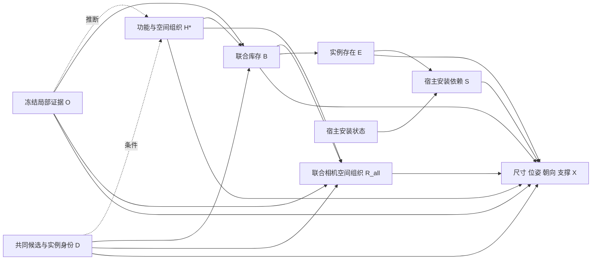

# v10 实际结果：后方退化与世界合理性复核

2026-10-26，Asia/Shanghai。复核用户已运行的 `outputs/assembly_set_completion_20261026_195138_370210`。本轮只增加 CPU 审计和说明，没有改生成图、概率、提示词或几何求解器，没有调用 GPU/API，也没有发布 v11。

**判断：后方生成不足属实；v10 尚未证明能产生合理的完整全景世界。** API 部分样本的尺寸和支撑优于 Qwen，但仍有宿主身份和功能布局问题。Qwen 的 20 物体样本不能作为“物体多所以更合理”的证据。

[全部实际可视化与逐项诊断](../research/audits/v10_world_review_20261026/actual_002/index.html)；[机器可读审计](../research/audits/v10_world_review_20261026/actual_002/audit.json)；[只读验证](../research/audits/v10_world_review_20261026/actual_002/validation.json)。包含 v9.1 与 v10 的全部端到端样本、v10 全部 RGB 消融样本，共 24 个世界的同范围 XZ/3D/ERP 状态图；没有挑最好样本。五分支全部 40 次布局另有逐对象记录，空世界保留。

## 1. 先看实际结果，区分采样与概率

| 版本/分支 | 后端 | 四次新增对象数 | 有限域 E[N] | 后方记录/全部新增记录 |
|---|---|---|---:|---:|
| v9.1 端到端 | Qwen | 7,6,9,9 | 8.0052 | 17/31 |
| v9.1 端到端 | API | 7,7,9,9 | 8.5716 | 20/32 |
| v10 端到端 | Qwen | 0,0,0,20 | 4.1160 | 3/20 |
| v10 端到端 | API | 9,15,10,10 | 10.0040 | 0/44 |
| v10 选择阶段不接 RGB | Qwen | 10,17,10,19 | 12.8120 | 6/56 |
| v10 选择阶段不接 RGB | API | 10,15,10,17 | 14.2840 | 3/52 |

“后方”指原相机坐标中心 Z<0；不是相对沙发的 behind。记录累计跨四个世界，不是一个房间的物体数。全部 40 次均导出，并不等于 40 个合理完整世界；其中包含空补全。

各版使用相同 RGB/G_obs，但 D 和模型回复不同，版本差异不能归因于单个改动。v9.1 后方较多也不是隐藏真实世界的证据。

## 2. 后方为何少：存在选择和空间组织是两个问题

### 2.1 API：后方方案本来就少，概率也低

本次真实 D 只有 11 个单位、21 条对象实例记录；不是上一轮旧回复重放得到的 19 单位/45 实例。不能把重放覆盖当成真实新提案质量。

相机方位分布为：7 个 unspecified、2 个 left、1 个 right、**仅 1 个 rear**。唯一后方 a8 是 console/vase/magazines 三件组，存在率 Qwen=0.156、API=0.148。

API 四个 IID 世界都没选中这个明确后方单位的概率为：

\[
(1-0.148)^4=0.5269366.
\]

这是“未选中 a8”的概率，不是完整几何模型的“后方完全为空”概率；unspecified 单位理论上也可以布置到后方。本次它们实际均落在前半空间。四次没有后方与已定义的低后方概率一致，增加采样次数本身不会纠正分布。

### 2.2 unspecified 并没有成为真正的全局空间随机机制

当前 R 是候选属性的确定性拷贝，不是独立估计的联合 `p(R_all | H,B,O)`。候选没有方位时，几何阶段进行有限的 left/right/rear 搜索，优先满足已有 near 等关系和少量位移代价。这不是根据整体房间组织推断后方内容。

这次还有两种具体限制：

- a4 媒体柜和书柜虽写了“opposite wall”，其类型化关系却分别要求 Z 大于正 Z 的 obs_000/obs_001。因此这两个对象不能放到相机后方。`farther_than` 是相机深度；“沙发对面”本身不能推出这个深度关系。
- a1/a2 的托盘和 a5 的物品固定依附正 Z 的观测宿主，不能把这些宿主移到后方。a7/a10 等又通过 near 关联前方可见家具，数值搜索通常选择侧边。

已有搜索日志也排除了“后方被渲染丢失”的解释：Qwen world_04 曾记录 a7 在 rear 的数值备选，前五项硬检查/接触/碰撞代价均为 0；最终侧方方案的 near 代价约 8.62，含该 rear 方案约 11.64，因此选侧方。这里只证明当前框约束允许该备选，不证明其物理或语义更好。本次明确 rear 的 a8 一旦被选中，三个完整框确实留在后方，没有被优化器搬回前方。

### 2.3 Qwen：原始 RGB 条件选择还出现空集集中

Qwen 最大权重的 H=h3（background/reading/social/storage，q=0.64）在四次条件选择中全部返回空集。整体模型 P(B=empty)=0.6880195，四次实际为 0,0,0,20。这里没有导出器删除对象。

相同 D/H/文字菜单的 tag_only，h3 四次均非空，整体 E[N]=12.812；RGB 条件版本为 4.116。一个需要验证的解释是：模型把“推测视野外世界”部分理解成“只选择能从图片证明存在的对象”。**这只是结合结果作出的推测，不是已确认的模型内部原因。** 原提示已经写了 lack of visibility is not absence，再延长解释未必有效。

本地 RGB/tag-only 请求使用不同阶段的哈希 seed，API 未传 seed，K=4；因此这个对照是相同域上的分布诊断，不是相同噪声的反事实实验。不能直接宣布去掉 RGB 就更合理。

额外核对了平滑贡献：Qwen E[N]=4.116 可拆为条件原始票数 1.216、D-only 参考原始票数 2.48、均匀尾项 0.42。原产物 `expected_hidden_from_reference=2.9` **已经包含** 0.42，不能重复相加。约 70.5% 的均值来自参考收缩，并非约 80.7%。但实际 20 物体样本的 J=`01111111111` 来自 h8 的真实条件票，不能说这个样本是平滑凭空生成。

## 3. 不只是后方：已有世界还有哪些问题

### 3.1 功能文字与对象身份未闭合

obs_009 的冻结身份和图像裁剪都明确是 picture frame。a5 却把 television remote 的宿主设为 obs_009，并在理由中称其为 side table。API world_02/03/04 和 Qwen world_04 实际包含这个错误。几何程序只看框，没有检查这个身份绑定与承载语义是否成立。

这不是“沙发通常与遥控器共现”就可以证明的功能关系；宿主必须是正确的实例和可用支撑面。

### 3.2 框接触通过不等于稳定放置

当前约束只要求孩子/宿主的 XZ 框投影存在正交面积，不要求稳定性。Qwen world_04 的全部 12 个 top/seat/shelf 子物体，框中心均落在宿主投影之外；投影交面积占孩子投影面积约为 1e-9 到 1e-4。电视仅约 0.002%。求解器以极小边缘重叠满足了接触条件。

在刚性均质物体、水平平面和单一支撑等假设下，这些位置明显不能支持稳定放置的解释。由于实际网格、质量分布、支撑面与重力未测量，不把投影比例包装成已验证的物理判据，也不建议对所有物品硬设“必须 100% 包含”。柔性织物、悬挂、真实底座等要分别处理。

API world_01 的四个承载物投影均完整落在宿主内，尺寸也更可信，说明两后端存在数值能力差异。但后续错误宿主仍能通过检查，不能因此给 API 整体物理认证。

### 3.3 功能关系没有落实为空间可用性

“落地灯旁的阅读边桌”实际中心距：API world_01 约 3.162 m，Qwen world_04 约 3.203 m；两者框表面间距均约 2.252 m。另一个“同阅读区”书柜与灯中心距约 3.464 m。

不为所有 near 手填统一距离阈值。但“给落地灯服务的邻接桌面”目前没有得到有效证明。候选把对象锚在画面中央的灯附近，同时新增框又必须完整视野外，最终被挤到侧边。这要求修正候选的功能实现方式；仅加强 near 会使矛盾更严重。

### 3.4 Qwen 的尺寸与相对坐标存在能力问题

world_04 的媒体柜固有尺寸为 [1,0.5,2] m，书柜为 [1,1,2] m，flat-screen television 为 [0.5,0.3,0.5] m，yaw=0。这些是 `intrinsic_size_m`，不是旋转导致的 AABB 交换。多个对象反复使用相同数值和看似绝对位置的相对 offset，也需要单独验证。

因此，修改因果图不能自动解决数值布局能力。先保持同库存、同语义约束，比较后端原始尺寸与最终布局，避免把问题全归于物体存在率。

### 3.5 重复身份和观测几何也有局限

- a1/a2 两个 white rectangular tray 都依附同一 ottoman，图中已经有 tray。它们可能是同一意图的不同描述；现有“用途不同”不足以证明两个新实例。两个书柜也需核对身份。同类但不同锚点的两个边桌则不能只按类别合并。
- 两张沙发和 ottoman 的预测底面相差约 0.336 m。当前 floor prior 的五个锚点（还包括灯和托盘）底面跨度约 0.741 m，重力和地面均未实测。新物体对齐的只是该先验。不能静默改 G_obs；应把上游误差与新生成误差分开报告。
- 主 `G_full.objects` 没有 yaw/orientation；数值提案和旁路文件有 yaw。当前主世界状态不能完整验证“电视朝向沙发”，观测沙发朝向本身也未知。仅有 AABB 不足以表达这类功能状态。
- 表外名词按既有规则着色并保留；本次 remote、console、mug 等仍有未映射项。它们不应在评价中被静默丢弃。

## 4. 文献核验后的取舍

| 一手来源 | 已核验的方法 | 对当前问题的具体启发与边界 |
|---|---|---|
| [Human-centric Indoor Scene Synthesis Using Stochastic Grammar](https://arxiv.org/html/1808.08473) | 场景语法、功能组、承载地址、人体可供性与活动路径；学习分布后 MCMC 采样 | 学的是可执行功能组织与关系，而不只是用途标签。本项目不训练，不能照搬其拟合概率或物体密度 |
| [Holistic 3D Scene Parsing and Reconstruction](https://siyuanhuang.com/holistic_parsing/main.html) | 功能、几何、物理联合表示，渲染深度/法线/分割与输入作 analysis-by-synthesis | 功能解释必须接受实际几何与观测验证。本项目尚无它的渲染似然，不把数值通过当成完整逆推断 |
| [PanoDreamer](https://arxiv.org/html/2412.04827) | 将单图到 360° 场景组织为全景和全景深度的整体优化 | 全局一致性应在整个空间上建立，局部家具旁延伸不等于全景推断。它不是因果场景语法，本轮未接入其生成网络 |
| [SD-SCM / Language Models as Causal Effect Generators](https://aclanthology.org/2025.emnlp-main.107/) | 用户给结构、LM 给随机机制，并按结构作采样、干预、反事实 | 需要检查机制实际造成的概率与几何变化；它不保证我们手写的图已被识别为真实物理因果图 |

这些工作支持“功能组织、几何实现、观测检验要联合考虑”，不支持“给每个方位设最低数量”或“解释写得更长就有因果推理”。

## 5. 建议的优化结构：先定义可执行的功能—空间机制

保留依赖闭合装配、同功能多组可共存、固定观测与完整库存。下一版若实施，应优先替换当前粗 H 和确定性 R 的接口，而不是再加一套背景历史/容量/数量门控。

- H*：不确定的功能与空间组织假设，例如现有座位服务于交谈，或另有观看方向；功能组与原相机的关系明确为假设。不是住户生活史，也不是已经量出的墙/房间边界。
- B：联合装配库存，实例身份、承载对象和功能角色明确；同类可多件，共指假设不得被误当成多个独立物体。
- R_all：**完整布局中联合采样的相机方位/相对组织**，不再以 unspecified 交给侧方逃逸搜索决定。它与其他组协同，但不要求每个角度有物体。
- E/S：库存存在与声明的安装依赖，继续与物理可用性分开。
- X：尺寸、位姿、朝向和支撑实现；功能作用必须由可核对的布局条件支持。
- O：冻结观测。生成世界经相机/可见性形成观测；推断时只将有证据的存在、可见空域和关系用作证据。视野外没被拍到，本身不给缺失物体负证据。

建议条件推断的分解为：

\[
q(H^*\mid O,D)\;p(B\mid H^*,O,D)\;
p(R_{all}\mid B,H^*,O,D)\;
\prod_i\mathbf1[E_i=B_{u(i)}]\,
\mathbf1[S_i=E_i\land S_{host(i)}]\;
p(X\mid B,E,S,R_{all},H^*,O,D).
\]



这是**建议的条件生成/推断结构，尚未实现或证明更好**。图中 O 的条件箭头不表示照片在物理上制造物体。世界形成方向仍应区分功能组织→库存/装配→布局→相机观测；这里没有从单图识别真实因果效应。

实现时功能组织必须改变实际 B/R/X 的联合概率或可执行约束。只新增 H* 的长文本字段、仍令 R=f(candidate)，无法解决本次根因。对 RGB 的处理也不能简单删除：需要保持正面图像证据，同时避免把不可观测当作不存在。当前框模型不足以定义完整 RGB 似然，不能宣称直接得到了可计算的真实世界后验。

## 6. 执行次序与验收：先验证两个根因，再动整条流程

1. **固定本次 D，做库存选择阶段的受控实验。** 原 RGB、只传经核对的正面观测事实、不传 RGB 的菜单诊断，保持 H/D/提示任务/预算一致；本地复用同一组规范化 draw seed，不再让 stage 名改变 seed。API 记录不支持同噪声的限制。看空集率、重复身份、功能遗漏与无据增加，不按数量选胜者。不重新生成提案、观测或几何来混淆差异。
2. **只修空间机制。** 固定 D、库存、尺寸与已有类型化关系，先在未声明方位且几何允许的组件上比较当前 unspecified 搜索和联合功能空间 R；a4 的既定正 Z 顺序仍保留，不能为了后方效果删掉。新提案接口另行分清“沙发对面/服务于座位”与 larger camera Z，独立评价这项关系生成修正，不篡改旧结果。允许合理的稀疏后方、通道或相机邻近墙面的假设，但不能凭空把所有空方向解释为墙。比较概率支持、功能实现、方向与失败，而不最大化后方计数。
3. **使宿主和功能实现可检验。** 在提案绑定阶段发现 frame/table 身份冲突，保留诊断并要求明确修正，不在最终世界里静默换宿主。对声明稳定承载的刚性对象使用适用的支撑面/重心代理；柔性和未知情况明确标记。保留观测和完整采样世界；不可行样本如实计为失败，不通过删物体制造成功。
4. **补齐状态与评价。** 导出已有提案的姿态及其不确定性，分开数值尺寸能力、观测地面误差、支撑、功能、身份与 360° 全局组织。至少在几张不同局部视角上核对，避免只适配这一张图。这不涉及训练。

当前最值得做的是前两项受控验证，并先落实明确的宿主/支撑缺陷。暂不继续提高平滑强度、增加最小物体数、强制后方比例，或直接重跑五分支整个实验。单图不能唯一确定隐藏世界；但“未知”必须由多种合理完整假设表达，不能仅由大量 unspecified 和可见锚点旁的框拼接来代替。

## 7. 已完成的审计代码与复现

新增脚本：[review_world.py](../research/audits/v10_world_review_20261026/review_world.py)。它只读取已有结果，计算分布、方位、宿主投影接触、距离、尺寸与身份清单，生成 24 世界对比。`--out` 必须为新目录，防止覆盖。

```bash
cd /data-nfs/gpu1-2/u13529658780/DIT360
CUDA_VISIBLE_DEVICES= OMP_NUM_THREADS=1 OPENBLAS_NUM_THREADS=1 MKL_NUM_THREADS=1 \
MPLCONFIGDIR=/tmp/caupano_review_mpl \
/data-nfs/gpu1-2/u13529658780/.conda/envs/qwen3vl/bin/python \
  research/audits/v10_world_review_20261026/review_world.py \
  --root qwen_edit_pano/outputs/assembly_set_completion_20261026_195138_370210 \
  --previous-root qwen_edit_pano/outputs/panorama_completion_20261026_181035_3984837 \
  --out research/audits/v10_world_review_20261026/my_review_001
```

本轮已实际运行审计。冻结的 4,280 份来源 JSON 保持不变，24 个世界的图已导出，75 处本地 HTML 链接核对通过。未训练、未调用新模型、未把建议结构冒充已实施的改善。
