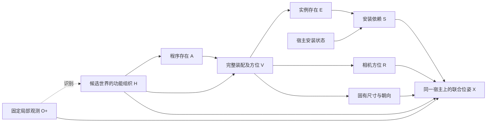

# v12 后续优化：基于真实根因的无训练路线

2026-10-27。本文是联网核验与研究设计，不是已发布的新生成版本。本轮未修改生成源码，未调用 Qwen/API，未训练。

## 1. 当前能确认的改善

本次实际运行 `compositional_completion_20261027_105105_496519` 使用同图 v5 的固定丰富语义候选，重新估计概率和生成几何；没有重新提出候选。

- 端到端 Qwen 新增 `[21,8,9,23]`，API `[21,8,7,24]`，两路各 4/4 导出。相较 v11 的 Qwen `[1,1,2,2]`，完整装配内容恢复。
- Qwen 新增记录中后半空间为 30/61，中央后方 11 条；v8 对应为 1/50、0 条。后方恢复不只是附属物品计数增加：新增放置根中后方为 13/26。
- API 后半空间 11/60，中央后方 0 条，仍有侧方集中；但相同库存布局对照可以生成中央后方，所以不能概括为 API 无法布局后方。

这些是本图结果的描述性改善，不是跨场景显著性结论、隐藏真值恢复率或因果收益证明。[实际结果报告](V12_ACTUAL_RESULT_REVIEW_20261027.md)与[完整原始审计](../research/audits/v12_result_review_20261027/actual_001/audit.json)支持以下根因分析。

## 2. 原论文及官方实现核验

下表区分“论文已经做到的内容”与“建议借鉴的部分”。借鉴不代表无需训练即可复现原论文。

| 工作与一手来源 | 核验的方法 | 对本项目的具体价值及边界 |
|---|---|---|
| [Human-Centric Indoor Scene Synthesis Using Stochastic Grammar / S-AOG](https://arxiv.org/html/1808.08473) | And/Or/Set 场景语法，功能分组、宿主地址关系、人类可供性和空间势函数；从 SUNCG 学习分布后采样 | 支持保留完整装配；功能关系应表达共同使用与支撑，减少无意义全连接约束。借鉴结构，不复制其学习参数；MRF/语法关系不能直接当作已识别的因果边。 |
| [Holistic 3D Scene Parsing and Reconstruction from a Single RGB Image / HSG](https://siyuanhuang.com/holistic_parsing/main.html) | 联合功能、几何与物理；通过渲染后的深度、法线、分割与输入差异进行逆向优化 | 生成状态应有观测一致性与功能一致性检查。当前只有框和冻结 G_obs，不能冒充已经有完整渲染似然或物理重建。 |
| [FactoredScenes](https://arxiv.org/html/2510.10292v1) | 学习程序库；LLM 生成布局程序；程序条件的分层朝向模型依赖训练数据 | 支持“可复用程序→几何实现”分解及宿主/从属对象联动。无训练方案借鉴接口和程序结构，不直接接入其训练路线，也不把稳定同图目录说成通用程序库。 |
| [SD-SCM: Language Models as Causal Effect Generators](https://aclanthology.org/2025.emnlp-main.107.pdf) | 用户指定 DAG，LM 定义条件机制，生成观测、干预及反事实样本 | 直接支持冻结条件机制并测量 do(H)。论文局限部分同时指出：非平凡变量关系并不自动成立，变量措辞会影响结果。不能仅凭画图宣布真实因果推理已有效。 |
| [Large Language Models Are Not Robust Multiple Choice Selectors / PriDe](https://proceedings.iclr.cc/paper_files/paper/2024/hash/54dd9e0cff6d9214e20d97eb2a3bae49-Abstract-Conference.html) | 检查选项 ID/位置偏置，通过排列估计及去偏处理缓解 | 借鉴语义不变、标签与顺序变化的配对诊断。随机中性别名不能保证无偏；当前只有选择样本，不能假设已取得 PriDe 所需的概率信息或声称复现其方法。 |
| [Can LLMs Express Their Uncertainty?](https://arxiv.org/abs/2306.13063) | 对黑盒模型的置信度提示、重复采样与聚合做实证比较；多种方法仍有过度自信和困难任务失效 | 重复投票或口述一个概率都不自动得到校准世界概率。先验证接口稳定性，保留机制估计的不确定性。 |
| [Holodeck](https://yueyang.ai/holodeck/) | LLM 产生语义/空间关系，布局优化器实现约束，配合可检索三维资产 | 借鉴语义规划与数值求解分工。它面向文本描述生成环境，不提供本任务的局部图像隐藏世界后验；不能直接复制未经观测的房间边界。 |
| [LayoutGPT](https://proceedings.neurips.cc/paper_files/paper/2023/hash/3a7f9e485845dac27423375c934cb4db-Abstract-Conference.html) | 结构化布局表示及上下文示例增强 LLM 视觉规划 | 可以用独立、通用的米制/宿主坐标示例降低数值接口错误，不提供本图隐藏答案，不改变库存或引入数量目标。 |
| [ReSpace](https://respace.mnbucher.com/) | JSON 结构化场景状态、自回归添加/编辑；对象添加依赖专门训练的空间模型；体素几何评价 | 借鉴紧凑状态接口与逐步落实布局。不能假设普通 Qwen 仅换 JSON 就有其空间能力，也不把原系统作为本轮无训练实现。 |
| [SceneSmith](https://scenesmith.github.io/) | 分层构建建筑、家具、壁挂、顶挂和小物品，结合资产及物理属性处理 | 借鉴不同尺度、不同宿主的分阶段落实和检查；保留普通生活物品。其文本数量要求、资产生成和仿真系统不等于本任务的局部观测推断，不复制对象数目标。 |
| [SceneEval 与官方实现](https://github.com/3dlg-hcvc/SceneEval) | 分开评估数量、属性、关系与支撑、碰撞、可达性等；部分指标需要 VLM 和三维资产 | 借鉴多维评价，避免以数量或导出率判胜。没有实际房间边界/网格时，不虚构通行、越界或物理分数。 |
| [FloorplanQA](https://arxiv.org/abs/2507.07644) | 用结构化布局单独测试距离、可见性、路径和物体放置；发现 LLM 空间一致性问题 | 支持将数值能力与上游功能程序选择分开测试，正对应本次同库存 Qwen 0/4、API 4/4 的差异。 |
| [ATISS](https://arxiv.org/abs/2110.03675)、[MiDiffusion](https://arxiv.org/abs/2405.21066) | 前者为部分对象集合条件化的训练模型；后者为离散/连续扩散并通过 masking 支持补全 | 可了解强非因果条件补全。MiDiffusion 的“不用任务专用训练”不等于模型本身不用训练；两者也通常有地板/房间条件。当前不把它们当作直接可替换的无训练因果方法。 |

上述原始论文没有证明“功能语法=真实因果发现”。对本项目最相关的共同点是：明确的可组合内容表示、条件机制的实际行为、分层几何实现与可核对的评价。

## 3. 根因排序：哪些是证据，哪些还是假设

### 3.1 存在率没有利用 H，是确定事实；其原因仍需区分

128 次程序存在判断全 true，所有角色/所有 H 的平滑存在率均 0.9。全真不自动证明额外物品不合理，但它不能支持“由 H 区分了存在概率”。扩大 K 会更确定地逼近同一退化响应，无法自动修复含义或接口。

可能原因包括：

1. H 的语义不足以区分库存。当前代码明确把 H 写成 possible affordances，并排除 actual activity、ownership 等含义。这能防止过度推断生活史，但也使不同 H 可能只是对同一个世界的不同非穷尽描述，而不是有效的生成条件。
2. 存在提示强调“可能存在”“不必严格需要”“缺标签不表示没有”。这些提醒本身有道理，组合起来可能让模型回答“这种场景可以有”，而非从一个世界假设的存在/不存在分布中抽样。此项是待验证的提示解释，不能仅凭全真确定。
3. 布尔/标签偏置，或模型本身对这组目录确有很高存在倾向。需要内容不变的编码对照区分，不能为了出现 false 而改提示。

### 3.2 几何接口确有错误；不需要增加物体不存在的门槛

同库存、同空间计划、同文字输入下 Qwen 0/4、API 4/4；失败有同宿主物品重叠和家具重叠。成功世界还存在 0.4m 高写字桌、电脑过薄等尺度问题。这是下游数值机制的独立问题，不能通过取消整个功能程序来掩盖。

### 3.3 部分功能关系没有落到几何状态中

声称“沙发旁”的边桌实际相隔数米，说明笼统 near 和完整功能说明之间有语义丢失。不能把所有关系统一成一个小距离：电视到沙发与杯子到桌面的合理关系不同。也不能只凭落地灯相隔数米就断言照明不可能，因为真实照明和可供性尚未建模。

### 3.4 API 后方不足尚不支持新增配额

冻结模型给出的“一个世界包含明确 rear 计划”概率为 0.4285317。实际四个 API 端到端样本均未选择 rear；按当前 IID 生成模型，这个事件的概率为：

\[
(1-0.4285317)^4=0.1066519.
\]

约 10.7%，不是足以证明后方机制失效的低概率事件。这是模型内的概率计算，不是对模型正确性检验。明确 rear 与实际中心 Z<0、中央后方是不同统计口径。先核对完整方位概率支持与实际方位保持，不因四个样本中央后方为零就强制补物。

## 4. 优化对象：保留骨架，细化机制

建议延续以下分解，不急于新增因果节点：

\[
q(H\mid O^+,D),\quad
A_r=f_r(H,O^+,D,U_r),\quad
V_r=g_r(A_r,H,O^+,D,U'_r).
\]

V 包含完整功能程序和相机空间计划；再展开实例存在 E、宿主安装依赖 S，生成固有尺寸与实际位姿。

这是下一步研究设计的示意图，不表示本轮源码已经分拆了尺寸节点。O→q(H) 是识别方向，不能解释为照片导致场景形成。D/O 的固定条件在式中写明，简图没有画出所有条件输入。跨角色给定 H 后独立的假设仍须公开。

### 优先级一：H 要表达可比较的功能组织假设

在不推断住户历史的前提下，尝试将 H 从“阅读/社交可能发生”细化为“这个候选世界主要按休闲阅读组织”或“兼有较强工作用途的功能组织”等结构化假设，并保留未确定值。它们仍是推断假设，不能写成图像已经证实的事实。

H 不应直接包含“有一张桌子”等待预测库存，也不应成为“没有 work 标签就禁止书桌”的硬门槛。不同功能可以共存。对确有区分度的假设，考察相应程序概率是否稳定变化；如果观测不支持区分，允许效果为零。

测量：类别存在概率、类别数量分布、条件装配分布、方向概率及它们的条件差异，而非解释文字长度或总数变化。原目录中的单一工作变体本来就没有内容替代项，不能要求 H 在该槽位创造不存在的变体。

### 优先级二：分清“合理可能”与“世界中的实际存在”

先做编码和语义诊断：在相同 O/D/H 下，对称展示“有额外隐藏程序”与“没有额外隐藏程序”的世界状态，使用等价标签交换与顺序交换。否定选项只是否定额外隐藏程序，不能误写成连可见宿主或场景中所有相关物品也不存在。

保持负向状态的语义明确、两侧描述长度可比，避免正侧长列一套诱人的装配、负侧只写一个 none。中性别名和随机次序仍需检验，不能被当作去偏保证。

重复票是冻结 LM 条件机制的估计，口述概率也只是另一种未经校准的估计。不能把未知编码成不存在，不能规定真/假各半，也不能手改 CPT 以制造 H 效应。若仍饱和，先检验 H 定义和功能程序粒度，不能不断增加调用次数期待自然解决。

### 优先级三：同一宿主的物品应联合落实

保留完整库存，将尺寸、宿主局部坐标和联合放置分开检查。对于宿主朝向已假设的新增物体，继续使用明确的局部变换：

\[
\mathbf{x}_i=\mathbf{x}_{host}+R_{host}\,\Delta\mathbf{x}_i.
\]

顶面/层板高度由声明的表面参数与宿主尺寸计算。现有代码已有局部坐标，优化重点在于模型是否正确输出，以及联合求解是否能处理同宿主的多个孩子，而不是仅新增一条说明。

可使用独立通用的米制示例、宿主局部坐标示例和紧凑状态包；一次协调桌上的电脑、台灯、笔记本，避免逐件各自选择桌面中心。尺寸确定后，不让求解器为了消除碰撞任意缩小物体。所有旧尺寸及失败保留以便比较。

支撑、容纳、叠放要区分。若语义确为书放进篮子，应明确 containment；不能事后把所有冲突都解释为合法套叠。完整框包含和物理稳定性也不是等价关系，避免为全部物体新增统一的过严支撑门槛。

### 优先级四：从功能关系落实到可检查的空间条件

借鉴 S-AOG/HSG，优先检查和任务有关的有限关系，例如“椅子可在桌前使用”“边桌为哪张沙发服务”“书由哪层书架承载”。按具体语义定义距离、朝向和可用表面的诊断；需要明确假设的部分先作为软评价，不把全部关系连成约束网。

保持相机方位是所选世界计划的一部分，near 优化不能把后方计划悄悄吸到镜头旁。另一方面，不能为满足某条不可兼容的 near 描述而改变固定观测、强制后方数量或删除新物体。若候选关系本身冲突，应报告候选语义不兼容。

### 优先级五：验证新提案是否保留程序内容

先固定当前 D 完成上述机制对照，再独立测试重新提案模式。新增候选需保留完整普通生活物品、宿主关系和跨区域功能组；也允许没有额外程序，不设丰富度下限。

将同图旧目录视为受控实验工具，不能在新图继续使用。后续跨图可以复用抽象程序接口与通用语义模板，必须重新绑定该图的观测身份、概率、尺寸与位置。

## 5. 最小验证顺序与通过标准

| 阶段 | 固定内容 | 只改变什么 | 主要判断 |
|---|---|---|---|
| A1 存在接口 | 当前 O/D/H、温度、完整候选、种子策略 | 对称状态描述及语义不变的标签/顺序 | 内容对应的概率是否对表面编码稳定；全真是否继续存在。不要以出现 false 为通过标准。 |
| A2 功能条件 | A1 的接口与 D，固定 O | 有区分度的 H 组织假设；再做含义不变的改写对照 | 条件影响是否超过编码/措辞扰动，影响是否针对相关功能，而非让所有类别一起增加。允许无信息情形为零。 |
| B 数值落实 | 本次 layout_control 的四个完整语义世界及空间计划 | 尺寸与同宿主联合坐标接口 | 改进碰撞、尺度和功能距离，同时逐项验证实例全集、宿主及 G_obs 不变；4 个原失败不得从分母消失。 |
| C 实际补全 | 已验证的接口与预算 | 在若干不同局部输入上重新提案和推断 | 内容、关系、方位和失败率能否同时改善；区分同图目录实验与自主提案结果。 |

A1/A2 先选择阅读、工作等少量有诊断价值的角色，预先固定调用预算，复用已有原始回复；此时无需重新生成所有几何。图像、候选和输入表达在 Qwen/API 间匹配，API 无 seed 的局限照实记录。每项变化单独执行，失败和无效回复保留。

因果价值还需要一个公平对照：相同 O/D、相同完整程序接口和可比较预算，但直接估计 `p(A,V|O,D)` 的无 H 方法。不能只拿旧版退化成单选的全局列表作对照，也不能把按设计保边缘分布的 H-cut 期待成“必然数量变差”的基线。

评价建议同时报告：

- 观察状态不变与所有计划样本的成功/失败，包含空集及重复。
- 角色、类别、宿主和多件同类实例的内容，数量作为描述量。
- 尺度、同宿主物品冲突、声明功能关系与最终坐标之间的一致性。
- 新增根与附属物品分别统计的方位分布；中央后方、后半空间与明确 rear 计划分开。
- do(H) 条件响应、语义不变改写响应和菜单排列响应；真实因果结构仍未被识别。

若有独立隐藏标注，限定在评测使用，不能把它作为输入或调参答案；没有隐藏真值时，评估兼容性和合理性，不能宣称恢复了唯一真实全景。SceneEval 的评价思路可借鉴，但当前缺少实测房间边界及真实网格，不虚构对应数值。

## 6. 当前明确不优先的工作

当前没有证据支持新增住户生活史、硬性功能需求、房间容量、后方配额或物体总数目标；没有理由让世界更容易布局而主动减少库存。也不优先迁移整套训练式场景生成器、展开多代理系统、引入完整 CAD/物理仿真或启动 RGB 全景渲染项目。

本阶段成功标准是：保留 v12 已恢复的完整内容，使功能条件机制更有解释力、数值实现更可靠，并清楚报告仍然不确定的部分。优化幅度由局部对照证据决定。
