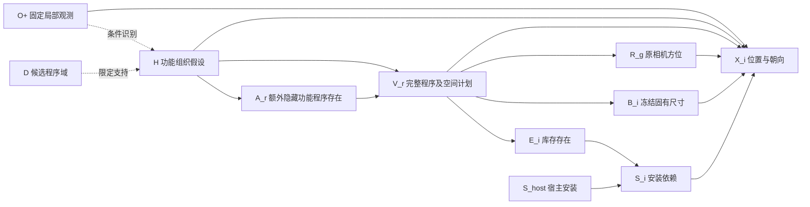

# v13 缺失距离恢复与当前因果模型

2026-10-27。本次只修复已定位的数值回复接口，不更换因果模型、不训练、不重新采样库存或重估概率。

## 已确认的原因

实际原始运行：`outputs/organized_completion_20261027_152654_1370933`。

四分支共计划 32 个世界，26 个已导出，六个 Qwen 案例失败：

| 分支 | 失败世界 | 原计划新增数量 | 缺失组距离数量 |
| --- | --- | --- | --- |
| end_to_end | 02、04 | 7、23 | 2、4 |
| layout_control | 01、04 | 21、23 | 3、4 |
| function_free | 02、04 | 8、23 | 2、4 |

逐一校验**初次** `calls/layout_NN_placement.json`：19 个 `range_m` 缺失，其他必需的朝向、宿主相对偏移等字段有效。通用重试要求整份重写 JSON，随后回复退化为空模板，才出现最后日志中的大量 yaw 缺失。没有证据将这六次失败归因为库存存在概率太低或联合布局求解失败。

本次回归直接使用这六份实际初始回复，不使用已经丢失有效字段的 `_repair.json`。

## 修复的范围

1. 今后两阶段布局中，若只有距离缺失，保留初次有效回复，另发一个紧凑请求，只输出指定组的 `{id,range_m}`。
2. 校验准确的 ID 集合、唯一性和有限正数；拒绝 null、布尔值、漏项、重复项和额外字段。不填默认距离。
3. 深复制初次回复，只写入缺失距离；重新严格解析整份布局。有效距离、所有物体 ID、尺寸、yaw、相对偏移、宿主和已选方位保持原值。
4. 使用原 v13 联合宿主放置与全局数值编译器。编译器原有的合法数值调整仍会发生，冻结的是初始有效位置回复和语义合同，不声称最终绝对坐标完全不动。
5. 原六个失败案例用独立恢复入口：复制整个原运行到新目录，成功的 26 个状态逐字节复用；原概率表、语义世界、冻结尺寸、失败回复和错误记录均保存。
6. 完成恢复的案例才能从新目录当前 summary 的失败列表移除。原 summary 在 `range_repair/original_summaries/`；每个案例保留 `original_failure`。无效补丁或数值未通过，仍明确标为失败/诊断候选，不删物体、不重复抽到成功。

数值通过仍不能认证具体服务关系、照明或资产正面。API world_04 的边桌服务目标与位置不一致、Qwen 个别打开电脑的深度疑点，继续保留复核；本次不按最近邻自动改服务目标，也不悄悄改尺寸。已有原因和距离下界见 [实际结果复核](V13_WORLD_STATE_ACCEPTANCE_20261027.md)。

## 执行

在项目根目录执行：

```bash
cd /data-nfs/gpu1-2/u13529658780/DIT360
bash qwen_edit_pano/scripts/organized_range_repair.sh repair GPU3 \
  qwen_edit_pano/outputs/organized_completion_20261027_152654_1370933
```

替换 `GPU3` 为可用节点即可。脚本创建独立的 `outputs/organized_range_repair_时间_PID/`，末尾打印其 `index.html`。原输出目录不能作为执行目标，也不允许覆盖既有恢复目录。

本批是 **Qwen 六个初始距离请求**，每个至多一次格式纠正，合计最多 12 次；API 待恢复数为零，直接复用已有结果，**这条命令不需要 API Key**。这不是重新做两后端配对能力实验。以后只有检测到 API 待恢复案例才会初始化 API，仍使用冻结配置中的硅基流动 `deepseek-ai/DeepSeek-V4.1-Flash` 及 `SILICONFLOW_API_KEY`。

两后端生成的当前方法、字段校验和编译器相同；概率表、语义样本或尺寸可能因模型输出而不同。两者不能因“代码相同”就称为数值输入完全相同。原 `layout_control` 是共享概率与离散库存的对照；本次恢复不是重做该对照。

可选，只准备并检查待修列表，不启动模型：

```bash
bash qwen_edit_pano/scripts/organized_range_repair.sh prepare GPU3 \
  qwen_edit_pano/outputs/organized_completion_20261027_152654_1370933
```

若选择 prepare，后续使用打印的 `NEW_ROOT`：

```bash
PY=/data-nfs/gpu1-2/u13529658780/.conda/envs/qwen3vl/bin/python
NEW_ROOT=qwen_edit_pano/outputs/这里替换为prepare输出的目录
srun -p debug --nodelist=GPU3 --nodes=1 --ntasks=1 --gres=gpu:1 \
  --cpus-per-task=4 --mem=48G --qos=normal --time=02:00:00 \
  "$PY" -u -m qwen_edit_pano.world_pipeline.completion.assembly_organized_repair \
  run --root "$NEW_ROOT" --backend qwen
CUDA_VISIBLE_DEVICES= "$PY" -m qwen_edit_pano.world_pipeline.completion.assembly_organized_repair \
  report --root "$NEW_ROOT"
```

默认一条 `repair` 命令会先准备、运行，再生成报告，即使某案例失败也尝试生成报告。后端失败时脚本非零退出，不能据此认为全部案例均失败；查看新目录报告和 `range_repair/qwen.json`。每个后端只允许一批固定预算尝试，不能反复追加请求挑选成功结果。

## 可视化和核对

新目录 `index.html` 链接恢复前后的四分支对比：统一坐标范围的 XZ 俯视图、可旋转三维框、ERP 方位图、每世界数量、后方分布及失败状态。原名在数据集表内为橙色，表外但可映射为紫色，未映射为红色，观测为蓝色；表外对象仍保留。这里是物体世界状态可视化，不是生成 RGB 全景。

主要记录：

- `range_repair_manifest.json`：六个案例、19 个字段、原 JSON 和受保护副本的哈希、原成功状态复用数、固定请求预算。
- `range_repair/qwen.json`：逐案例的实际恢复结果和原始错误；不以错误日志消失代替成功判定。
- `*/qwen/completion/world_NN/range_repair_calls/`：本次距离原始请求及回复。
- `*/qwen/completion/world_NN/range_patch.json`：补丁与合并后回复。
- `*/qwen/completion/world_NN/numeric_review.json`、`G_full.json`：通过当前数值检查的结果；未通过时仅保留诊断候选。

先看六个缺失距离是否已补齐并导出、26 个原成功状态是否保持，再看新增世界是否有明显尺寸或关系问题。主线 Qwen 原计划仍为 `[21,7,9,23]`，不会因为此次恢复而变成更多物体。恢复找回的是原来不可见的整份世界，不是提高库存概率。

## 当前模型：完整功能程序的条件结构生成模型

核心仍为 v13，具体代码在 `world_pipeline/completion/assembly_organized.py` 和 `assembly_compositional.py`，数值恢复在 `assembly_organized_geometry.py`。它是免训练、由冻结大模型提供经验条件选择概率的**假设性因果生成模型**，还没有证明识别了现实中真实的因果机制，也没有校准真实隐藏物体概率。

### 输入与候选支持

局部图像先经已有观察器得到固定的预测观测 `O+`：可见物体、类别、预测三维框和相机。未报告某物体不等于证明它不存在。

当前对比冻结了此前同图的候选域 `D`：15 个完整功能程序、70 条规范候选实例和 43 个相机空间计划。70 是整个备选目录的记录数，不是要求单次生成 70 件，也不是现实中 70 件都应存在。v13 本批没有重新提案，不能据此声称已验证对新图的自主候选发现。

### 变量与箭头



图中把固定的 `O+,D` 对各条件机制的输入省略为上下文。虚线 `O+→H` 是推断计算，不是说照片在物理上造成房间用途。当前没有完整的“世界渲染成观测”的似然模型。

- **H：功能组织假设。** 本图为混合、阅读侧重、社交侧重、储物侧重、办公侧重五种。侧重不是排他用途，不推断住户历史、身份或实际活动；办公侧重仍可以有阅读和储物。
- **A_r：某角色是否还有额外隐藏完整程序。** 不是活动能否发生、物体是否可能存在，也不是要求新增一个独立房间或区域。四个角色在给定 H 后条件独立，这是建模假设。
- **V_r：若存在，选择哪一套完整装配及相机计划。** 例如工作桌、椅、收纳、电脑和普通桌面物品一起进入库存；一个程序可包含多个同功能组。本批每个角色至多选一个完整程序，程序内部允许多个实例。
- **E_i：具体对象的库存存在。** 由所选程序成员决定；几何失败不会反过来把它记为不存在。
- **S_i：声明的安装依赖是否满足。** 对被支撑对象近似为 `E_i AND S_host`。移除桌子可让电脑的安装依赖失效，但不因此推断电脑从库存消失。这不是网格级稳定性证明。
- **R_g、B_i、X_i：方位、固有尺寸、位置与朝向。** V 中的方位实际进入编译；先估尺寸并冻结，再用观测、完整库存、关系和方位估计联合位置/朝向。既有 MILP 与全局框约束处理数值放置，不删除库存来换通过。

离散部分实际分解为：

\[
q(H\mid O^+,D)\prod_r
p(A_r\mid H,O^+,D)\,
p(V_r,R_r\mid A_r,H,O^+,D).
\]

`E,S` 随后由确定性结构方程产生。连续几何阶段是条件大模型输出加确定性数值编译，目前不能写成一个已经校准、可计算完整 RGB 后验的模型。

### 因果假设如何实际影响概率

每个 H/角色的多次条件选择进入计数，使用固定对称 Beta 平滑估计存在率：

\[
\pi_r(h)=\frac{n_{r,h,1}+\alpha/2}{K_{r,h}^{valid}+\alpha},\qquad \alpha=1.
\]

程序/空间选项使用条件频数与预先固定的参考平滑，再以逆 CDF 和保存的外生随机数真实抽样。不是拿“可能有办公需求”这句话直接当成概率1，也不强迫各行产生差异。存在率的基准不随备选项数量增加而增大。

例如本批 API 的办公角色：`H=work` 得到 4 次存在，平滑后 **0.9**；`H=social` 为 2 次存在/2 次不存在，平滑后 **0.5**。因此在模型内更换 H 会改变完整办公程序进入隐藏库存的概率。它会改变实际抽样，不只改变解释文字。每行只有四次选择，0.9/0.5 是这个未校准模型内的预测，不是现实频率或已证明的真实因果效应。

已有 `functional_probability_interventions.json` 保存逐 H 的条件概率。`function_free` 使用计算耦合变量 J 的断边对照：主线 J=H；断边时 J 独立从同一个 q(H) 抽取。这保持无条件的完整库存/空间离散联合分布，同时取消识别 H 对库存的调节；几何仍保留 H 上下文。不能拿两分支平均数量接近来断言因果模块有效或无效。

### 当前应固定什么、以后再判断什么

先固定 H→A→V→E/S/R 的骨架与完整装配粒度，完成本次接口恢复。没有必要为解决 `range_m:null` 改 DAG、提高数量或增加后方配额。360° 意味着周围方位都有可生成的支持，不要求每个角度都放家具。

恢复后再核对具体服务目标绑定、尺寸与形态；它们是不同层次的问题。随后在多个不同局部输入上检查完整性、相容性、功能关系、空间合理性及多候选变化，再决定是否需要修改 H 语义或条件独立假设。单图的一批世界尚不足以证明结构因果方法优于强非因果补全。

## CPU 验证

```bash
bash qwen_edit_pano/scripts/organized_range_repair.sh test
```

覆盖实际六份初始回复的重放、19 个字段的局部修复、完整回复不额外请求、非法/其他字段缺失拒绝、零 API 待修不初始化、原成功状态与概率/库存/尺寸哈希不变、固定失败预算、原目录写保护、四分支报告和导出失败处理。

完整 **249 项 CPU 回归全部通过**，记录在 `../research/audits/organized_range_repair_20261027/release_001/validation.json`；原运行 2,735 份 JSON 未变，105 项代码哈希一致。实际输入只准备检查在 `prepared_001/prepare_only_validation.json`：Qwen 六例/API 零例、19 个距离、26 份成功状态复用；前后四分支共 52 份状态展示和 159 个本地链接检查通过，所有受保护副本保持不变。此页面还没有新的真实距离恢复结果。

CPU 测试中的距离是人工 fixture，仅验证接口及编译流程；没有使用真实模型/API生成新距离。真实恢复质量需要执行上方命令后再分析。
