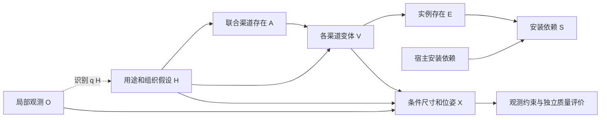

# v7 真实结果复核与下一步决策

用户后续明确 **不进行训练，继续优化因果推理模型**。当前约束及免训练概率诊断以 [NO_TRAINING_CAUSAL_DIRECTION_20261026.md](NO_TRAINING_CAUSAL_DIRECTION_20261026.md) 为准。下文关于训练集学习装配库/先验的建议退出当前计划；已有 v7 实证结论与冻结记录保留。

2026-10-26。结论：**暂时固定 v7 的核心建模方法，进入跨场景验证；现在没有证据支持继续升级因果图。冻结的是研究候选方法，不是宣布方法正确或实验结束。** 推荐先把明确的提案解析缺陷作为 v7.1 接口修复，验证后统一跑跨场景实验；不要与新的因果结构同时更改。本轮完成诊断与冻结，未实施该生成接口修复。

真实来源：`outputs/realization_completion_20261025_224043_2053447`。本轮没有运行新的 GPU/API 推断，也没有修改任何生成代码、概率表、旧结果或候选域。CPU 审计与可视化：`../research/audits/v7_freeze_review_20261026/result_002/index.html`；可重复审计程序：`../research/audits/v7_freeze_review_20261026/audit_v7.py`。

## 1. 实际结果支持什么

局部图、固定观测、解码请求、候选域均已配对；API 确认为硅基流动 `deepseek-ai/DeepSeek-V4.1-Flash`。同一开发图反复用于修改方法，不能作为独立测试集。

| 分支 | 结构采样新增记录 | 数值世界导出 | E[N] | 激活平滑分量对 E[N] 的贡献 |
|---|---|---:|---:|---:|
| 端到端 / Qwen | 11、7、12、12 | 4/4 | 14.0180 | 24.90% |
| 端到端 / API | 10、11、12、11 | 4/4 | 12.6804 | 27.85% |
| 固定库存 / Qwen | 10、11、12、14 | 2/4 | 12.9222 | 15.14% |
| 固定库存 / API | 10、11、12、14 | 4/4 | 12.9222 | 15.14% |
| 保边缘 H 消融 / Qwen | 11、11、14、12 | 4/4 | 14.0180 | 24.90% |
| 保边缘 H 消融 / API | 11、12、11、11 | 4/4 | 12.6804 | 27.85% |

计数单位是程序对象记录，一叠书也可能只有一条。总计 24 次布局尝试、22 个数值导出，不是 24 个独立场景。

重新检查全部 22 个导出：观测对象内容不变、采样库存完整保留、新框均未与原视锥相交、明确顺序无违规、非许可 AABB 残留重叠为零。只有 2 个通过全部现有 layout proxy，其余 20 个仍有未验证的 shelf 等安装状态。这些框级检查不证明实际可达、面向正确、房间边界正确、物体尺寸真实或真实物理稳定。

固定库存对照的两个失败均发生在本地回复：`a8_g2.region = front`，修复回复仍如此。该组含落地茶几及其物品，不是某个固定观测宿主上可忽略的字段。不能把 front 静默改为 rear 或放宽视锥约束。它首先是布局回复与任务接口的冲突，需要单独统计；不能算为模型选择了空库存。

## 2. 最关键的研究发现：有数值作用，还没有质量增益证据

当前有 9 个实现渠道、12 个非空候选模块、44 条候选实例记录。其中 7/9 个渠道只有一种非空变体。H 在这些渠道中只能改变存在率，不能改变渠道内部物品组成。

在识别支持的 H 上，本地 entry/new、social/new、storage/new 的原始激活票全部为零；API 的 reading/new、social/new、work/new 也全部为零。它们在当前预测分布中的 0.1 存在率来自：

\[
\tilde p(A\mid h)=\frac{K}{K+\alpha}\hat p(A\mid h)
+\frac{\alpha}{K+\alpha}\prod_s\operatorname{Bern}(A_s;1/2),
\qquad K=4,\ \alpha=1.
\]

因此零票渠道仍有 `0.2 × 0.5 = 0.1` 的边缘存在率。平滑可以表达未见事件的不确定性，不能把它说成图像提供了该物体存在的证据；其贡献也不是应当删除的“错误物体比例”。本轮只量化，没有调整 alpha 或补数量下限。

对 H 的模型内替换确实会改变库存：例如 `do(H=h7)` 与 `do(H=h8)` 的 E[N]，Qwen 为 12.41→14.41，API 为 11.77→13.35。这说明结构方程具有数值敏感性，不证明识别出的用途正确，更不是真实房间因果效应。

进一步精确枚举当前有限域的 **1,536 种完整模块库存状态**，比较端到端与保边缘 H 消融：

| 后端 | 实例边缘概率最大差 | 数量分布总变差 TV | 完整库存联合分布 TV |
|---|---:|---:|---:|
| Qwen | 2.22e-16 | 5.66e-17 | 1.14e-16 |
| API | 2.22e-16 | 0.03499 | 0.07123 |

该消融本来就保持每个模块/实例的边缘概率，也保持联合 A 分布；它主要测试 H 与条件变体之间的组织关联，不能用单物体边缘概率或平均数量证明 H 的收益。当前本地完整库存分布也几乎完全相同，说明这个开发例对该消融没有库存层面的区分力。相同随机数下样本不同不等于分布不同，可能只是逆 CDF 耦合不同。H 在消融中仍进入布局，几何效果也必须分开解释。

API 库存 TV=0.07123 表示分布发生变化，不表示变化更好。当前没有隐藏真值或独立盲评支持“因果模型提高补全质量”的结论。

## 3. 已定位问题应该怎样处理

**提案接口会丢掉有效同伴方案。** 对四个最终失败的提案回复逐个备选方案复核，8 个备选中有 3 个单独通过现有严格校验：Qwen 一个 3 记录的新背景组；API 一个 7 记录的阅读延伸+新储物组合、一个 6 记录的阅读延伸。旧流程因同一回复中的另一个方案违规而整份拒绝。这是候选域覆盖损失，不能归因于 H→A 的因果图。

如果后续修复，单位应为完整 alternative：保留通过严格校验的完整方案，逐项记录拒绝原因；不能从不合法方案中捡单个对象拼成新方案，不能伪造缺失锚点或关系。初始/修复轮次的合并、去重和调用预算政策必须预先固定，并对两路一致。该修复会改变候选域 D，必须重新提案及估计新域上的机制，不能向旧 D 追加方案后沿用旧表。本轮未实施或追补，以保持本次证据可比较。

**部分 near 仍然远，不能一律怪优化器。** 本地端到端 world_01 的 a6 边桌距观测落地灯表面约 2.631 m。固定当前尺寸、Y 与观测锚点，只保留当前实现的 left/right/rear 视野外约束，放松其他碰撞/支撑/组关系，单对象最小间隔仍约 1.882 m。另一个指向沙发的 near 实际间隔 2.247 m，单对象放松下界约 0.152 m。两项同时优化还受其他关系影响，不能分别达到各自最优值。

这说明观测锚点位置、完整框必须在视野外、以及“服务已有物体”的提案之间可能存在张力。下界只针对现有三个几何方向域，不是所有物理布置的不可行性证明。接下来要独立评价“这个隐藏延伸是否可用”，不能任意设统一 near 阈值、移动固定观测、把家具放进输入画面、或增加故事变量来掩盖冲突。

**数据集映射会掩盖语义差异。** 本次 22 个导出的 249 条新增对象出现记录中，121 条为受支持的具体映射，73 条只能落到 objects 等粗兜底，55 条未解决。不是 249 个不同物体或独立样本。继续保留原名和颜色：蓝=观测，橙=原名在表，紫=表外且映射受支持，红=未解决。评价时分别报告细名与粗类覆盖；把杯子/书都落入 objects 后的分数不能充当具体类别推断能力。

## 4. 本轮重新核对的文献及实际启发

| 论文/官方入口 | 与本项目有关的结论 | 下一步借鉴及适用边界 |
|---|---|---|
| [Human-centric Indoor Scene Synthesis Using Stochastic Grammar](https://arxiv.org/html/1808.08473)；[官方代码](https://github.com/SiyuanQi/human-centric-scene-synthesis) | 从场景数据学习语法与 affordance 分布，区分组关系和支撑，并评价功能性/自然性 | 保留功能组与依赖表示，补独立功能评估；语法/MRF 不是已识别的因果 DAG，不推断住户历史 |
| [Holistic 3D Scene Parsing and Reconstruction from a Single RGB Image](https://siyuanhuang.com/files/eccv2018parsing.pdf)；[官方实现](https://github.com/thusiyuan/holistic_scene_parsing) | 用深度、法向、分割的 analysis-by-synthesis 联合检验结构与几何 | 将证据一致性与生成先验分开；当前并未复现这些图像似然，视野外也无直接像素观测 |
| [SD-SCM / Language Models as Causal Effect Generators](https://aclanthology.org/2025.emnlp-main.107/)；[作者实现](https://github.com/lbynum/sequence-driven-scms/blob/main/sdscm.py)；[限制段](https://arxiv.org/html/2411.08019) | 用户给结构、LM 给机制，允许模型内干预；非平凡依赖与变量措辞稳定性需要检查 | 保持可执行数值机制，优先检查多场景增益与措辞/机制种子的稳定性，不能以画出 DAG 代替验证 |
| [MiDiffusion](https://arxiv.org/html/2405.21066)；[官方代码](https://github.com/MIT-SPARK/MiDiffusion) | 对已知物体部分约束进行场景补全，联合建模类别与连续属性 | 借鉴严格保留已观测和离散/连续分开评价；它有平面图和训练数据，不能直接当作本项目同条件结果 |
| [Seen2Scene](https://arxiv.org/html/2603.28548) | 在真实不完整扫描中显式掩盖未知区域，保留观测并生成未知结构 | 数据缺失区域不能当物体不存在；其 TSDF/部分扫描输入比单 RGB 强，不能直接复制精度数字 |
| [SceneEval](https://arxiv.org/html/2503.14756)；[官方实现](https://github.com/3dlg-hcvc/SceneEval) | 将计数/属性/关系与碰撞、支撑、可通行、可接近性分开评价 | 优先补独立的关系/功能评价。核对了 README：部分指标依赖 VLM 和 3D 资产，不是直接对本项目 AABB JSON 运行全部官方指标 |
| [SceneCritic](https://arxiv.org/html/2604.13035)（2026 预印本） | 说明 VLM 视角/提示词不稳定，使用数据导出的尺寸、支撑、共现及朝向关系评价布局 | 几何程序检查+独立盲评互补；其共现图是关联先验，不应拿来定义“因果成功”，也不能由生成器自评替代外部证据 |
| [Linear-LLM-SCM](https://arxiv.org/html/2602.10282)（2026 预印本） | 在给定 DAG 的连续线性机制任务中，量化参数可能不稳并受结构扰动影响 | 提醒先评估机制可靠性；领域与变量均不同，不直接推断本项目哪个后端更强 |
| [Strictly Proper Scoring Rules, Prediction, and Estimation](https://sites.stat.washington.edu/people/raftery/Research/PDF/Gneiting2007jasa.pdf) | 用适当评分规则评价概率预测，而非只比较最终抽样命中率 | 类别存在用 Brier/log loss、数量分布用离散 CRPS；这些评价预测分布质量，校准还需可靠性图及足够独立样本 |

核对的工作没有支持“再加潜变量就一定更好”。本轮的判断是这些方法与当前实证共同指向机制学习/验证、观测约束和多维评价；不是某篇论文直接证明 v7 最优。

## 5. 暂时固定的模型结构与准确表述

令 O 为局部 RGB 和预测的固定 G_obs；D 为该图通过固定提案程序获得的有限候选域；H 为不确定用途/组织假设。渠道 s=(功能，实现类型)，类型为 `observed_extension` 或 `new_group`，可同时存在。



\[
q(H\mid O,D)\,p(A\mid H,D)
\prod_s p(V_s\mid H,A_s,D)
\prod_i \mathbf1[E_i=f_i(V)]\,
\prod_i \mathbf1[S_i=E_i\land S_{host(i)}].
\]

无宿主根对象取 S_i=E_i；这里 S 只表示声明的安装依赖满足，不是物理验证。尺寸和位姿通过 `(O,H,V)` 条件模型及约束求解生成；没有完整、归一化且校准的图像后验或 X 的密度模型，不能把上述库存分解写成已完成的全图像生成似然。实现里的 J 是联合激活混合分布的计算表示，不是房间的物理原因。条件于 H 的不同渠道变体独立、每渠道最多一种非空候选、变体内实例共同出现，都是当前假设。

`O→q(H)` 是推断方向，不是“图像导致房间用途”的物理因果边。应称 **受假设因果结构约束、具有可执行机制的条件场景补全模型**；尚不能称从单图识别出了真实场景形成因果图。空间 near/左右/远近边也是关系约束，不自动成为因果边。

这套方法能够作为一个固定研究候选进入实验，尚无证据称其是最终最优模型。住户生活历史 C 不重新加入；不增数量配额，不因样本为空或重复而重采。

## 6. 接下来按什么顺序做

1. **先冻结证据和研究问题。** `result_002/freeze_manifest.json` 绑定当前 323 个 Python/shell 生成代码文件、此开发例域与机制表。新图像要生成自己的 D，冻结的是产生 D 的规则、预算、提示和验证方法，不是所有房间共用当前客厅的 12 套候选。把现在这张图标记为开发例。
2. **单独修复提案接口并核对 front 冲突，再作六视图跨类型诊断。** 维持因果结构和数值参数，给接口修复单独版本与回归。本轮没有生成接口修改。已有 `data/box_world_val6_v1/inputs.jsonl`：卧室、客厅、厨房、浴室、桑拿/长凳、稀疏走廊，来自 4 个建筑。它们此前已用于项目开发，不是新独立测试集；6 个视图也不保证是 6 个独立房间。建议每视图保留 8 个 IID 世界、K 仍为 4、alpha=1、seed=3407、同一固定预测 G_obs 给两路。8 是诊断预算，不是统计功效保证。先找跨类型失效模式，所有解析/布局/数值失败都计入。
3. **将对照问题拆开。** 现有固定库存对照只隔离布局后端；现有保边缘 H 消融检查组织关联。还需要另一个明确对照：同 O、同 D、同预算和布局求解器，直接由 O 预测库存而不经过 H；若比较无条件/共现模型，其参数只能从训练集获得。不能用均匀乱采样作唯一“非因果”基线，也不能把不同 D 的旧 baseline/joint 与当前输出直接当严格因果消融。这个新增直接库存对照目前尚未实现，不要误称现有 compare 命令已经包含它。
4. **用独立证据评价合理性。** 程序检查观测保留、视锥、碰撞、支撑代理、依赖、类表状态；独立人工盲评锚点用途合理性、重复家具是否必要、朝向、使用通道与整体空间组织，允许“无法判断”。只把生成器自己声明的 near 全部满足，仍可能是自洽而错误。记录完整失败率、已导出质量、语义/布局多样性和成本，不能只展示最好一张。
5. **概率校准与观测契约对齐后再做统计实验。** 当前 `gt_world_supplement_v1` 元数据实际为 train=1,301/16 建筑、val=182/4 建筑；官方全量身份清单有 val=925/11 建筑，不代表全部图像/GT 已完成质量核验。先核对训练使用历史和房间身份；按建筑/房间隔离训练、校准、评估，不能把同房间不同视角混入。最初可取 20 个经核对的不同房间作诊断，再按建筑数量/区间宽度扩展；20 不是足够发表显著性结论的保证。
6. **有 GT 时评价分布，无 GT 时评价合理性。** 隐藏类别存在 Brier/log loss、数量 CRPS，并分别报告候选覆盖上限；D 未涵盖的类别不能从分母删除。GT 的“隐藏”必须与当前“完整 AABB 在输入视锥外”的契约一致，扫描未知/类别漏标不能当负例。表外名投影到粗类时计算“至少一个该粗类存在”的联合事件，不能把多个别名概率简单相加。可用已有完整全景作独立参考，但不能作为输入。单个真实隐藏世界是条件分布中的一次实现，不是唯一合理解；同时评价合理多样性和独立盲评。
7. **最后决定修什么。** 跨场景若主要失败在候选覆盖，先修提案；覆盖足够但概率系统偏差，先用训练/校准数据学习机制；概率合理但布局错误，修尺寸/朝向/支撑与几何；只有反复出现当前变量无法表达的跨渠道依赖/多个同类功能区等模式，再以预设对照研究因果图扩展。将这些与接口 v7.1 分开版本。RGB 全景接入是后续集成，当前框图不能冒充 RGB 补全效果。

平滑敏感性应先在冻结票数上离线比较 alpha（例如 0.25/1/4，仅作敏感性，不按隐藏测试集挑参）；要检验 LM 机制稳定性，另做固定 D、相同 K 的独立机制种子/措辞重复。对同一 K=4 表抽 1,000 个世界只减少数值采样误差，不会增加机制估计的独立证据。

## 7. 立即可用的执行方式

本轮审计已经执行，不需要 API key，也不用再次生成。查看 `../research/audits/v7_freeze_review_20261026/result_002/index.html`，包含全部 22 个原布局入口和同步对比链接。原同步对比为 `outputs/realization_completion_20261025_224043_2053447/visual_v7_001/index.html`。

重做只读审计（输出路径必须是新目录）：

```bash
cd /data-nfs/gpu1-2/u13529658780/DIT360
CUDA_VISIBLE_DEVICES= OMP_NUM_THREADS=1 OPENBLAS_NUM_THREADS=1 MKL_NUM_THREADS=1 \
  /data-nfs/gpu1-2/u13529658780/.conda/envs/qwen3vl/bin/python \
  research/audits/v7_freeze_review_20261026/audit_v7.py \
  --source qwen_edit_pano/outputs/realization_completion_20261025_224043_2053447 \
  --out research/audits/v7_freeze_review_20261026/result_003
```

下面提供原始冻结 v7 在六视图第一张上的可重复诊断命令，供保留接口修复前基线使用；推荐的统一跨场景实验应在接口修复、回归和新冻结后执行。下面调用原有代码，会运行 GPU 观测、GPU 补全和付费 API。API key 仍通过终端环境变量 `SILICONFLOW_API_KEY` 传入。不要将 key 写进文件。该命令只包含现有三种分支，不含第 6 节提出但尚未实现的直接库存基线。

```bash
cd /data-nfs/gpu1-2/u13529658780/DIT360
export CAUPANO_QWEN_PYTHON=/data-nfs/gpu1-2/u13529658780/.conda/envs/qwen3vl/bin/python
export SILICONFLOW_API_BASE=https://api.siliconflow.cn/v1
export SILICONFLOW_MODEL=deepseek-ai/DeepSeek-V4.1-Flash
export OMP_NUM_THREADS=1 OPENBLAS_NUM_THREADS=1 MKL_NUM_THREADS=1
export MPLCONFIGDIR=/tmp/caupano_review_mpl
export HF_HUB_OFFLINE=1 TRANSFORMERS_OFFLINE=1 SAM3_COMPILE=0
pilot_id=zsNo4HB9uLZ_ed8645386a0a4de2bfc486e0a1d02468
pilot_source=qwen_edit_pano/outputs/v7_observation_${pilot_id}_$(date +%Y%m%d_%H%M%S)_$$
CUDA_VISIBLE_DEVICES= "$CAUPANO_QWEN_PYTHON" \
  -m qwen_edit_pano.world_pipeline.completion.assembly_experiment init \
  --root "$pilot_source" \
  --image "qwen_edit_pano/data/box_world_val6_v1/$pilot_id/local.png" \
  --hfov 90 --completion-model realization --seed 3407 --worlds 8
srun -p debug --nodelist=GPU3 --nodes=1 --ntasks=1 --gres=gpu:1 \
  --cpus-per-task=4 --mem=48G --qos=normal --time=02:00:00 \
  "$CAUPANO_QWEN_PYTHON" -m qwen_edit_pano.world_pipeline.completion.assembly_experiment \
  observer2d --root "$pilot_source" --backend qwen
srun -p debug --nodelist=GPU3 --nodes=1 --ntasks=1 --gres=gpu:1 \
  --cpus-per-task=4 --mem=48G --qos=normal --time=02:00:00 \
  "$CAUPANO_QWEN_PYTHON" -m qwen_edit_pano.world_pipeline.completion.assembly_experiment \
  observer3d --root "$pilot_source" --backend qwen
CAUPANO_WORLDS=8 CAUPANO_MECHANISM_DRAWS=4 \
  bash qwen_edit_pano/scripts/realization_completion.sh compare GPU3 "$pilot_source" 3407
```

按顺序执行并检查每步退出状态，观测失败时不执行下一步。其他视图用 `inputs.jsonl` 中已有 ID 替换 `pilot_id`，每例使用新目录；禁止把 display_label/GT 标签加入模型提示。若先选择修复提案接口，则应先完成 v7.1 的回归和新冻结，再统一跑六视图，不能混合两个接口版本的结果。

CPU 审计核验：重新计算概率与归一化、完整枚举库存分布、逐项重验失败提案、22 个世界的库存/观测/视锥/顺序/重叠检查、1,959 个原 JSON 哈希和 323 个生成代码哈希保持不变。新增诊断工具没有调用 provider，也没有重新运行付费请求。旧图仅作为客厅开发记录继续保留。
