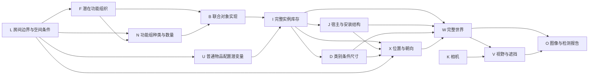

# 零新增结果审计与因果场景补全模型重设计

日期：2026-10-25。分析对象：`outputs/functional_completion_20261025_092354_2337884`，以及上一轮相同局部观测的 baseline/joint 实验。结论依据实际文件和原始论文，不把之前 AI 文档当作正确性证明。

## 1. 本次零新增的直接原因已经确定

| 方法 | 候选实例目录大小 | 实际结构样本新增数 | 布局请求数，含修复 |
|---|---:|---|---:|
| 旧 baseline | 8 | 2、6 | 2 |
| 旧 joint | 24 | 7、4、4 | 5 |
| 新 functional posterior | 0 | 0、0、0、0、0、0 | 0 |
| 新 functional prior | 0 | 0、0、0、0、0、0 | 0 |

两个新分支复用相同目录。目录不是经过后验筛掉之后变空，而是在语言模型提案阶段就为空：

- 两个场景假设 z0、z1，共六个需求。
- 六个需求各只有一种实现，六个实现的 `object_keys` 全为空。
- `component_registry={}`。
- 所有新增数组为空，所以没有执行任何布局请求，也不存在布局后端把新物体删除的情况。

因此，在**当前被截断的候选域 D 内**，有：

\[
p_D(N_{hidden}=0\mid O)=1.
\]

这是目录构造导致的确定结果。改变随机种子、增加抽样次数、提高需求激活率，都无法从空集合抽出新实例。它也不意味着真实世界没有镜头外物体。

实际概率表显示，功能推断确实更新了数值：

| 功能组织分量 | 先验 | 后验 |
|---|---:|---:|
| social | 0.4000 | 0.6864 |
| reading | 0.3000 | 0.6692 |
| work | 0.2500 | 0.4144 |
| background | 0.5000 | 0.8688 |

但先验和后验的 `object_presence` 都为 `{}`，隐藏实例期望都是 0。work/dining 甚至没有对应需求路径。**功能状态变化，不等于隐藏世界变化。**这次结果不能支持“因果推断改善了补全”的结论。

实际审计、文件哈希与交互式计数示例见工作区 `research/audits/zero_hidden_support_20261025/index.html`。原实验输出未修改。

## 2. 上一版设计具体错在什么地方

### 2.1 把“解释观测”替代成了“推断完整世界”

旧需求模板大体在回答：这些已看到的家具能满足哪些需求？新结果中，会客由沙发解释、照明由落地灯解释、储物由托盘解释、背景由中性配色解释。语言模型完成了一个容易的局部解释任务，却没有构建周围世界。

程序中的数学接线是通的，但采样空间没有隐藏实例。上一版我重点验证了精确后验、共享实例和实际采样频率，没有将“候选支持域退化”纳入实际任务验收，这是方案设计缺口。

### 2.2 功能充分性不能推出库存完整性

\[
\text{已有沙发和灯足以支持阅读}
\not\Rightarrow
\text{隐藏书籍、储物、其他区域的概率为零}.
\]

现实场景包含同一用途的多个区域、备用物品、收藏、装饰、暂存和与主要活动无关的东西。不能让“尚未满足的功能需求”成为新增物体唯一来源。

### 2.3 没有完整库存与数量分布

当前只有有限目录中的 E 开关，缺少“完整世界里有多少个功能组、多少件对象，以及观测了其中多少”的机制。每个需求最多三个策略，不会自己产生新的实例槽位；所有策略只引用观测时，E 完全没有状态可切换。

### 2.4 观测模型没有约束完整世界

现有 O 是经关键词压缩后的正线索；其观测过程没有从每个完整物体的类别、几何和实际相机计算可见性。它能更新粗功能状态，却不能辨别“全世界只有这些东西”和“还有很多物体没有进入视野”。

### 2.5 提示与字段没有形成可执行的功能模型

本次两个 `functions` 字段都复制了模板词 `coexisting activities`。有些文字还提到 side table，但目录没有对应实例。这不是发现了某个隐藏桌子，而是文字解释与结构化实体脱节；不能从文字中直接补造实体。

### 2.6 人工 CPT 不等于已学出的场景机制

0.12/0.78、固定覆盖率和 noisy-OR 强度仍是手设参数。它们定义了可执行的假设模型，没有证明该模型符合真实场景分布。若未来目录非空，激活门、策略门与分支混合还可能使单个实例概率较低；应分别检查并学习参数。分支混合本身是合理的不确定性表达，不能为了增加数量随意删掉。

### 2.7 程序成功状态掩盖了任务退化

`worlds_exported_needs_review` 只能证明 `G_obs ∪ 空增量` 合法导出，不能证明补全成功。应另外报告 `candidate_support`、`observed_only`、`P(Nhidden=0)` 和“因果物体效果是否可检验”。但也不能把所有零新增样本一律判错：在有充分支持的完整模型中，零隐藏确实可能是合理事件。

## 3. 重新核验相关工作

以下是方法借鉴，不是声称已经复现其效果。数值性能不能从论文直接移植到本项目。

| 工作及原始来源 | 与本次问题相关的机制 | 对本项目的具体启发与限制 |
|---|---|---|
| [Example-based Synthesis of 3D Object Arrangements，TOG 2012](https://graphics.stanford.edu/~mdfisher/sceneSynthesis.html) | 数据学习的 Bayesian network 与 Gaussian mixture 场景模型 | 需要可生成库存的统计先验，不能仅对当前检测物体写解释；Bayesian network 本身不证明因果方向 |
| [Activity-centric Scene Synthesis，TOG 2015](https://graphics.stanford.edu/~mdfisher/actSynth.html) | 从不完整扫描识别可支持的活动，结合场景数据库与粗几何生成多种功能相似布置 | 功能推断后必须连接可生成的对象布置模型；它主要追求功能相似，不是恢复唯一真实库存 |
| [Human-Centric Indoor Scene Synthesis Using Stochastic Grammar，CVPR 2018](https://arxiv.org/html/1808.08473) | And/Or/Set、对象出现与尺寸分布、地址支撑、可供性势，直接抽结构再调整布局 | 最值得补回的是对象出现/组合数量的生成先验；我们之前只保留“需求解释”没有复现完整语法先验 |
| [Holistic 3D Scene Parsing and Reconstruction，ECCV 2018](https://siyuanhuang.com/files/eccv2018parsing.pdf) | 功能与几何联合推断；深度、法线、分割的 analysis-by-synthesis 观测项 | 需要世界→观测的可检查路径；其隐含人体不是实际住户或生活史，重建结果也不验证任意视野外内容 |
| [ATISS，NeurIPS 2021](https://research.nvidia.com/labs/toronto-ai/ATISS/) | 学习完整无序对象集合的条件生成，可执行 room completion | 可见对象是完整场景生成的条件，不是已列举出的所有候选；应作为强非因果基线 |
| [DiffuScene](https://tangjiapeng.github.io/projects/DiffuScene/) / [InstructScene，ICLR 2024](https://chenguolin.github.io/projects/InstructScene/) | 完整对象集或语义图先验，与布局生成相连，支持部分场景补全 | 新实例槽位来自学出的生成模型；不是靠要求“至少几个物体”补数量 |
| [MiDiffusion](https://arxiv.org/html/2405.21066) | 离散类别、连续几何联合扩散，使用 corruption/masking 固定部分对象 | 适合已观测对象不变的补全基线；当前多依赖 floor plan，单图还需处理边界不确定性 |
| [FactoredScenes，NeurIPS 2025](https://arxiv.org/html/2510.10292v1) | 学出的程序库提供结构模式，程序与生活场景姿态变化分离 | 先建立可复用组合先验，再生成具体实例；[作者代码](https://github.com/joyhsu0504/factored_scenes)已核验，但本轮没有安装或运行 |
| [3D Scene Graph Prediction，IROS 2026](https://arxiv.org/html/2607.10879) | 从部分探索的环境预测未探索部分：房间层预测类别/边界/通达，对象层预测类别/位置/尺寸/朝向 | 比纯房间设计更接近你的“局部→完整世界”；仍不是单图因果发现，输入条件与本项目不同 |
| [FuncRoom-Agent，2026-09 修订预印本](https://arxiv.org/html/2608.29519) | 递归 DSL 按房间、活动区、大家具、支撑物、嵌套小物构建，使用执行反馈与训练 | 借鉴层级扩展和物理依赖次序；其功能目标是输入给定，不能照搬为本项目“从局部推断真实已有用途”，也不能拿功能覆盖奖励强制填家具 |
| [FunFact，CVPR 2026](https://arxiv.org/html/2604.03696v1) | 把已提出的功能关系作为随机变量，联合推断边缘概率 | 可借鉴关系不确定性；没有候选边/物体时，关系推断也不能凭空扩展支持域 |
| [Probabilistic Scene Graphs，2026-09 预印本](https://arxiv.org/abs/2609.23144) | 对离散结构与连续几何共同维护不确定性 | 借鉴世界信念表示；该工作主要是建图，不应当作已解决隐藏世界生成的证据 |

另核验了 [Perception Beyond the Visible，2026-10](https://arxiv.org/abs/2610.18670)：它明确是研究陈述，适合作背景，不是可直接复现的完整生成方法。

这些工作共同支持的是：**先有完整场景分布，再用观测和功能约束对它进行条件化。**这不是“为了因果而放弃所有共现统计”。共现可以用于学习条件机制；关键在于显式区分共同用途、功能组合、安装依赖与观测过程，并用干预/机制变化验证，而不是把每条相关性都画成物体间因果箭头。

## 4. 建议采用的下一版模型

建议重设计“完整库存与观测推断”这一层。保留当前冻结观测、实例 ID、支撑引用、数值采样、日志和可视化；不用为了更换理论推翻所有工程。



这是下一版研究结构，**不表示当前代码已经实现整个图**。

- **F** 是潜在功能组织的生成假设，不是当前活动或居民职业。单张图像不能可靠识别具体生活史；不再增加这种叙述变量。
- **N** 对完整世界中的功能组和实例数量建模，允许同一功能有多个区域，也允许数量为 0。其范围、分布和终止概率需要数据学习。
- **B** 从联合组合中生成桌—椅—灯、柜—储物等结构，再采样具体类别、实例与宿主。共享物体保留同一 ID，避免为每个功能复制一次。
- **U** 只表示普通生活物品配置的随机性/负荷，不是“用户收藏史”。它也必须有可学习分布，不能成为没有约束的杂物生成口袋。
- **J、D、X** 联合考虑宿主承载、尺寸、可达性与自由空间。人体可供性可以是辅助因子/变量，不代表图中真的有人。
- **V、O** 明确区分物体存在、进入视野、被遮挡和被检测。当前“完全位于原始视锥外”的导出约束继续保留；视野内被遮挡物体属于以后另一个目标范围。

功能邻近、人体可达性、碰撞和渲染残差可以作为概率因子；不应仅因为画成连线就称为因果关系。方向与外生噪声耦合应明确假设，并接受模拟/干预数据检验。

一个对应的生成分解可以写为：

\[
p(L,F,N,B,U,I,J,D,X,V,O\mid K)
=p(L)p(F\mid L)p(N\mid F,L)p(B\mid N,F,L)p(U\mid L)
 p(I\mid B,U)p(J,D,X\mid I,B,L)
 p(V\mid I,J,D,X,L,K)p(O\mid I,J,D,X,L,V,K).
\]

这里的联合几何条件分布可以再细分为宿主优先的拓扑序；物理与可供性因子的归一化需要处理。不要把未经归一化的布局数量直接当成场景概率，避免无意识偏向简单/少物体世界。

推断目标是：

\[
p(W_{hidden},L,F,N,B,U\mid O,K),
\]

而不是“从 O 推断几个需求，再只补充这些需求缺少的设备”。在当前对照阶段，G_obs 继续冻结；加入观测几何不确定性时另开实验，不悄悄移动已观测对象。

## 5. 数量与可见性：缺失机制的最小数学原型

先用简化例说明为什么功能已满足也可以存在其他物体。令完整数量 N 有先验 π，已观测数量 n，且每个实例以概率 q 独立被报告，暂不考虑假阳性：

\[
p(N=n+h\mid n,q)\propto
\pi_{n+h}{n+h\choose n}q^n(1-q)^h.
\]

当 n=1、q=0.3、π(N=0,1,2,3)=(0.25,0.45,0.25,0.05) 时：

\[
p(N_{hidden}>0\mid n=1)\approx0.4848.
\]

这是手写数学示例，不是照片推断，也不是建议该房间有多少件某类家具。它只表明：**已观测一个能够满足功能的实例，不会从概率上排除其他隐藏实例。**

`assembly_support_audit.hidden_count_posterior` 已实现上述有限域精确计算，并测试归一化、完整检出和零检出边界。真实场景不能直接把 FOV 比例当 q：物体位置、遮挡与成组布置会造成相关可见性，需要用几何或多视野数据估计。没有被观测的类别不能自动填一个可靠负样本。

## 6. 候选域也必须改，不能只增加数量节点

即使 N 允许新增，类别/程序支持域为空仍无法生成。建议执行以下固定预算流程：

1. 先保留局部观测解释，单独提出周围可能的功能区、独立储物与普通物品组合，给每条提案记录来源和不确定性。
2. 从完整场景/学出的程序库检索多个可兼容组合，与 VLM 提案合并；处理共享身份、观测重复与宿主闭包。不能只把旧输出当真值或硬塞固定家具名单。
3. 保留“没有这一组合”的空状态；候选生成未覆盖某类型时，记作未知/支持不足，而不是将现实中该类型的概率设为零。
4. 采用预先固定的扩展预算，记录全部提案。不要反复采样直到非空再丢弃空提案，这会产生选择偏差。
5. 在同一候选域上比较：无功能先验、功能先验、学习的数量先验、数量+可见性模型。候选召回与后验质量单独评价。

VLM 没有可计算提案密度时，不能声称把候选重加权后得到了对所有真实世界的无偏后验。候选未知质量、截断和提案敏感性应单独报告。要获得更严格的采样解释，需要可评估的程序/场景先验及合法的条件推断。

## 7. 执行顺序与验收

先做一次固定 G_obs、固定调用预算的四路候选对照：旧 joint、当前 functional、重构后的完整世界提案、程序库/数据先验提案。统计候选类别、实例数量、非空实现、宿主闭包和空支持率，人工审核候选召回与不合理重复。这个实验解决“提案是否能表达隐藏世界”，还不能证明因果增益。

然后在统一候选域上做因果/概率对照：

- 原始场景先验与功能条件先验；
- 有/无数量先验；
- 有/无可见性模型；
- 同一目录下关闭指定功能生成机制，检查相关对象概率是否变化、无关对象是否基本保持；
- 借助已知机制的模拟场景，改变功能组织/宿主/空间容量，验证预测变化和模型内干预。

评价应同时包括候选召回、数量与类别分布、P(零隐藏)、库存 NLL/Brier、可用支撑、空间可行性、多样性和全部布局失败率。新物体数量不是单独的优化目标；旧 joint 有新物体也不能证明其尺寸、壁挂与支撑是正确的。

数据方面，已有清单中的裁剪不是独立完整房间。之前核验的 supplement 是 1483 条记录、20 个 scene_id；`ready_for_training=false` 表示尚未批准训练，不自动证明所有标注错误。训练前应审核完整性、房间范围、实例重复与类目映射，并按物理场景划分训练/验证；功能标签是代理标注，不是观测到了居民意图。

## 8. 本轮新增代码与执行方式

新增代码用于**只读诊断与缺失机制原型验证**；没有把未经学习的计数参数接进正式生成器，也没有宣称已经完成上面的整体重设计。无需 API Key，无需 GPU，不改原实验。

打开：工作区 `research/audits/zero_hidden_support_20261025/index.html`。它包含四路实际数据、原始文件哈希、功能概率变化，以及可以调整检出概率的计数示例。

重新生成审计时使用新的输出目录：

```bash
cd /data-nfs/gpu1-2/u13529658780/DIT360
CUDA_VISIBLE_DEVICES= /data-nfs/gpu1-2/u13529658780/.conda/envs/qwen3vl/bin/python \
  -m qwen_edit_pano.world_pipeline.completion.assembly_support_audit \
  --roots \
    qwen_edit_pano/outputs/causal_completion_pilot_20261024_220629_380006_3407/baseline \
    qwen_edit_pano/outputs/causal_completion_pilot_20261024_220629_380006_3407/joint \
    qwen_edit_pano/outputs/functional_completion_20261025_092354_2337884/posterior \
    qwen_edit_pano/outputs/functional_completion_20261025_092354_2337884/prior \
  --output research/audits/zero_hidden_support_review002
```

本轮新增四项 CPU 验证通过：实际零支持域复现、完整模型的精确空库存概率、部分观测计数后验、检出边界条件。没有重新执行 GPU/API 场景生成，没有改动旧世界或调整参数来制造非空结果。

当前旧生成脚本尚不能解决候选域退化；原命令原样重跑不能被当作方法改进实验。下一步的核心实现应是**具有数量与组合先验的完整库存生成，经过可见性产生局部观测，再对这个过程反演**。
