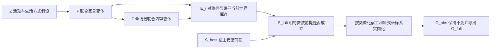

# CauPano：库存与安装分离的条件场景模型

本文记录上一轮拆分式库存模型。当前联合隐藏世界增量实现与执行指令见 [WORLD_COMPLETION_CURRENT.md](WORLD_COMPLETION_CURRENT.md)；库存/安装的变量含义保留。

日期：2026-10-24。当前协议 `conditional_inventory_installation_scm_v2`，接口 `joint_contents_single_attachment_v3`。沿用 `scripts/assembly_compare.sh` 一个入口，默认执行本版本。旧结果不覆盖，旧协议仅用于查看报告和复制已有观测。

## 实际日志与根因

检查了两次最新实验，而不是只读终端最后一行：

| 原目录尾部 | 观测设计 | API 新增对象 | Qwen |
|---|---|---|---|
| `20261024_164350_3285761` | 独立前端观测 | 11 / 14 / 16 | `contents_f2` 失败 |
| `20261024_165643_3369725` | 固定同一份观测 | 15 / 10 / 11 | `contents_f2` 失败 |

API 已成功导出数值候选，但不是已验证的合理世界；两组均有 `layout_needs_review`。不能将“未报异常”视为语义、安装和因果质量已通过。

1. Qwen 在同一对象上给出 `attachment={kind:hang,host:floor_lamp_001}`，又在关系列表写 `on floor_lamp_001`。旧程序把自然语言 `on` 限定为水平承托，形成两个来源对同一个安装变量的重复定义。原回答和纠错回答相同；不能不断加重试来解决这个表示冲突。
2. 旧程序把整个内容变体中的任何失败传播为整份模型失败，已生成的其他内容机制因此也不能进入抽样。本版消除重复的安装字段，而不是忽略坏对象、截掉变体或偷偷改变参考采样分布。仍有真正未知 ID/循环依赖时，保留原回答并报告错误。
3. Qwen 清单中还有灯罩等部件、地板上的书本/笔记本等弱语义假设。接口通过不代表这些假设就合理。新清单明确区分可独立存在的物体与父物体变体/部件；没有程序黑名单或按词删除对象。
4. API 的支撑失败有坐标接口证据：媒体柜内禀尺寸 `[1.6,.55,.45]`、yaw=-90°，完整相机 AABB 因此 X 仅 .45m；柜面物品 X 偏移却可达 .55/.70m。原程序将它们无条件当相机轴偏移。现在每个偏移必须明确声明 `camera` 或 `host_local`，宿主偏移按宿主 yaw 转换；观察宿主没有已知 yaw，必须使用 camera。
5. API 许多互穿发生在同一语义组。旧求解器只允许整组平移，同组柜子与边桌即使重叠也不能改变相对位置。这是求解自由度问题，无须靠增加活动标签节点解决。

## 文献核验与借鉴边界

- [SD-SCM 论文](https://aclanthology.org/2025.emnlp-main.107/)与[官方实现 sdscm.py](https://github.com/lbynum/sequence-driven-scms/blob/main/sdscm.py)：可指定结构、按父变量构造机制、在外部执行采样/机制替换。官方实现计算候选续写的 token log-prob 再采样。本项目仍采用 LM 提议的有限规则与明确的均匀参考采样，不冒充原论文的条件概率估计；没有据此获得视觉后验。论文也明确讨论了冻结 LM 能力和措辞敏感性。
- [DoWhy 官方说明](https://www.pywhy.org/dowhy/main/user_guide/gcm_based_inference/introduction.html)：SCM 需要每个节点的父变量与生成机制。这里只把有明确变量含义和方程的边纳入结构模型，空间 `near/left_of` 等仍是布局关系。
- [S-AOG 论文](https://yzhu.io/publication/scenesynthesis2018cvpr/paper.pdf)：家具、受支撑物体、地址引用和属性有不同角色。借鉴其表示，允许程序根据宿主引用派生所属组，消除“模型另填组 ID，却与宿主组冲突”的多余决策。原工作学习概率与 MRF，本项目没有复现这些训练。
- [Holodeck 论文](https://openaccess.thecvf.com/content/CVPR2024/papers/Yang_Holodeck_Language_Guided_Generation_of_3D_Embodied_AI_Environments_CVPR_2024_paper.pdf)及[小物体官方代码](https://github.com/allenai/Holodeck/blob/main/ai2holodeck/generation/small_objects.py)：对象选择、具体 receptacle、局部摆放分工。借鉴宿主条件化，不复制其房间设计目标、固定数量阈值、Unity 依赖或失败后删物体的流程。
- [LayoutVLM](https://openaccess.thecvf.com/content/CVPR2025/html/Sun_LayoutVLM_Differentiable_Optimization_of_3D_Layout_via_Vision-Language_Models_CVPR_2025_paper.html)：数值姿态与语义关系共同参与布局优化。这里借鉴这项分工，用已有 SciPy 优化器修正接触和相交；没有下载/训练其模型，几何优化也不改名为因果识别。
- [CausalStruct](https://arxiv.org/html/2509.15249v1)：依赖次序与布局调整可以参考。其对象属性、物理关系、3DGS/SDS 任务与本项目不同，不能把几何损失降低当作已识别真实因果效应。

结论是需要修改有歧义的变量和过强的条件独立假设，而不是为了“更因果”继续堆节点。单图不能证明唯一真实因果图；当前方案仍是供检验的假设生成模型。

## 可执行模型及含义

固定输入 `B=(RGB,G_obs,K)`。RGB/G_obs 约束候选机制的提议；这属于近似逆向推断。不是声称图像在真实世界中造成家具存在。



```text
Z   = inverse_CDF(reference_Z, U_Z)
F   = inverse_CDF(reference_F_given_Z, U_F)
T_F = off if F inactive; otherwise inverse_CDF(reference_joint_contents_given_F, U_T)
E_i = selected_by(F,T_F)
S_i = E_i AND (host_is_fixed_observation OR S_host)
      # 无宿主的根对象为 S_i=E_i，仍不代表物理安装已验证。
```

**相比 v1 的结构改动：**

1. `T_g` 各组内容独立选择改成 `T_F` 全场景联合内容选择。上下文允许多个共存活动；不再要求模型为每个组填内容，也不把“附近恰有一盏灯”变成在地上硬填书/杯子的理由。最多两个完整内容变体，每个可为空，保留有限计算容量，没有数量下限。
2. 独立的库存变量 E 和安装前提 S。v1 的 P 同时承担存在/安装，宿主关闭就会让物品消失。v2 下 `do(E_table=0)` 只移除该桌；台灯仍在库存中，但其安装 S 失效。没有未经模型明确提出就将灯搬到地板，也不导出虚构位置。这个操作是模型内的库存干预，不模拟重力或时间过程。
3. 类型化 `attachment.kind/host` 是唯一安装来源。主体内容接口根本不要求第二份关系列表。模型额外写的 `on` 只有在源对象已明确绑定同一个宿主时才作为重复描述登记；`on` 不自动解释成 top，`on_top_of` 仍须确实是 top；未知/不同宿主仍拒绝。原词与绑定动作保存，物理安装不因此获得认证。
4. 宿主引用决定受支撑物品的组，模型不再另行决定一个可能冲突的组。物体可引用当前家具变体中的任意明确宿主；编译器拓扑排序并派生所属组。根物品可选已有组或独立的 g_free。

这些机制真正参与采样、实例激活与安装状态计算，不只是画图或在提示词里写“因果推理”。`causal_model.json` 保存实际 DAG/CPT/机制域；`host_interventions.json` 保存固定外生噪声下的模型内干预；不调用 LM 来伪装干预结果。

**概率边界：** reference 当前仍是均匀探索策略，不是 LM token 概率、照片似然或已校准的房间后验。候选域本身依赖冻结模型的知识与措辞。没有做因果结构发现，也没有验证因果收益。当前的坐标阶段是给定选中库存的条件姿态提议与确定性几何编译，还没有实现任意干预下完整的坐标反事实机制。

## 几何编译

新增对象仍输出相机坐标 `x右/y图像上/z前`、米制三维中心和完整 AABB。原观测不调整。

- 每条 `offset_m` 都有显式 `offset_frame`。`host_local` 用宿主自身轴，按宿主 absolute yaw 旋转；观察宿主只有 AABB，使用 camera。子物体自己的 yaw 不用于旋转相对宿主的偏移。
- 优化变量改为支撑树各对象的局部 XZ 位移；宿主位移传给所有后代，同组不同家具不再刚性焊死。原始相对位置与声明的空间关系是软目标。
- `top/seat/shelf` 保留宿主高度机制，约束水平 AABB 投影有正接触；允许悬挑，不强制物品完全装进父 AABB，不声称稳定性或形状级碰撞已验证。其他安装类型保留不确定性。
- 在相同离开输入视锥的半空间中求解，原观测没有位移变量。不新增人为房间边界、类别黑名单或数量配额。不可行时保留清单和诊断，不删物体冒充完成。

CPU 诊断对六个原 API 候选重放：在“预测宿主上的原偏移按 host_local 解释”这一**显式诊断假设**下，AABB 交叠总数从 19 对降到 0，接触失败从 7 项降到 0。原模型的偏移意图并不已知，因此这不是正式质量对比，也不是新 API/Qwen 生成结果。数据见 `research/audits/inventory_installation_2026-10-24/geometry_replay.json`。真实重跑必须输出明确的 frame 再评估。

## 执行与可视化对比

以下复用最新两次实验的两端 2D/WildDet3D 观测，新目录中重新生成 API 与 Qwen 的全部语义机制和布局。同一组内共用当前模板、机制结构、几何执行器与公开解码配置；实例化候选内容分别生成。原模型/API 名称、输入、种子与观测设计保留。

```bash
cd /data-nfs/gpu1-2/u13529658780/DIT360
bash qwen_edit_pano/scripts/assembly_compare.sh test

if [[ -z "${SILICONFLOW_API_KEY:-}" ]]; then
  read -rsp 'SiliconFlow API Key: ' SILICONFLOW_API_KEY
fi
export SILICONFLOW_API_KEY

bash qwen_edit_pano/scripts/assembly_compare.sh retry2 GPU3 \
  /data-nfs/gpu1-2/u13529658780/DIT360/qwen_edit_pano/outputs/assembly_rgb_compare_20261024_164350_3285761 \
  /data-nfs/gpu1-2/u13529658780/DIT360/qwen_edit_pano/outputs/assembly_rgb_compare_20261024_165643_3369725
```

GPU3 换成可用节点。API Key 不写入代码。保留同一模型、温度 .4、top_p .9、top_k 50、max_tokens 8192、无重复惩罚；Qwen 初始本地种子 3407，接口纠错 3408。API 不保证相同种子和内部解码。

若要从 RGB 重新执行两端的 2D 和 WildDet3D：

```bash
bash qwen_edit_pano/scripts/assembly_compare.sh run2 GPU3
```

生成的 `two_experiments.html` 直接嵌入两端所有成功候选的离线 3D 框、XZ 俯视布局和 2:1 状态方向图；参数记录折叠。具体 G_full、支撑/安装和数值诊断可点击查看。失败分支明确显示失败阶段，不拿纯文字提议代替放置结果。2:1 方向图不是生成的 RGB ERP，全流程仍未接 Adapter。

运行成功后优先判断完整库存是否与观测相容、是否有部件重复计数或机械添物、宿主是否合理、远侧/背后布局是否合理、原观测是否保持。模型内干预执行成功和物体数增加均不能单独证明因果收益；下一步收益实验应固定前端、模型和布局后端，只消融语义/依赖机制，并用多个验证样本与盲评比较。
